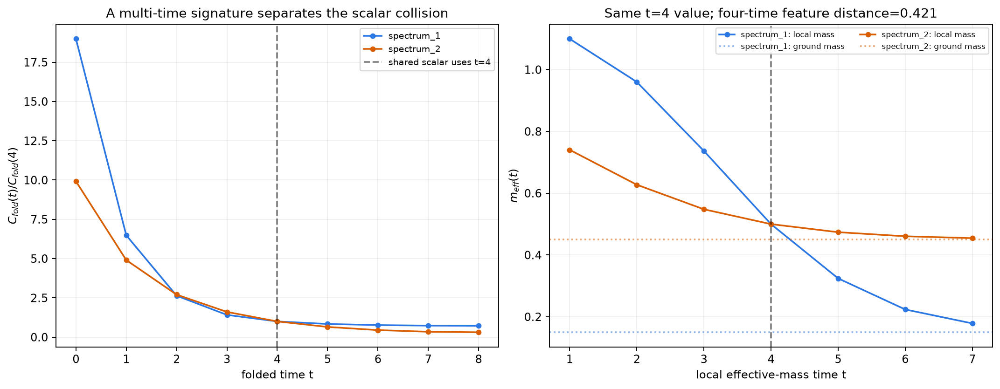

# Pion anchor map: multi-time feature separation of the exact collision pair

**Classification:** exact, noiseless, two-state periodic PP examples only. The production scalar returns the same `m_eff(4)=0.50` for both spectra; no anchor/reference data, sealed split, GPU or QUDA were accessed. `physical_score=null`.

## Candidate feature and result

Use the predeclared shape vector `x=(C_fold(2),C_fold(3),C_fold(5),C_fold(6))/C_fold(4)`. For the two exact counterexamples in the companion non-identifiability report, the vectors are:

- ground mass `0.15`: `[2.637299 1.416397 0.838855 0.766758]`
- ground mass `0.45`: `[2.705231 1.605447 0.649805 0.448293]`
- exact L2 separation `0.421325`, L-infinity separation `0.318465`; the scalar difference remains `7.8e-16`.



For these two known spectra only, retaining the neighboring time points distinguishes a pair that the single t=4 scalar collapses. If both observed feature vectors had a deterministic L2 error at most `epsilon` and `2 epsilon` were below the exact separation, their error balls could not overlap; this report supplies no such data error bound.

## Data flow and limits

```text
reuse the two exact scalar-collision spectra -> fold T=16 PP correlators -> normalize C(t) by C(4) at t={2,3,5,6} -> compare four-dimensional signatures -> distinguish this pair only -> keep physical anchor gate abstained
```

This does not establish global identifiability for arbitrary positive spectra, identify an unknown number of states, prove per-configuration positivity, or bound the map-to-joint-PP/A4P target bias. A richer feature vector needs a frozen estimator, failure/support rules, noise and chain-dependence calibration, omitted-state validation and an explicit bridge to `m*` before it can replace the scalar anchor.

The exact model inputs, feature rows, protocol, source snapshots and hashes are included here. Reproduce from the repository root with:

```bash
python -m tasks.pion_projection.anchor_scalar_multitime_diagnostic \
  --output tasks/pion_projection/anchor_scalar_multitime_replay_v1
```
