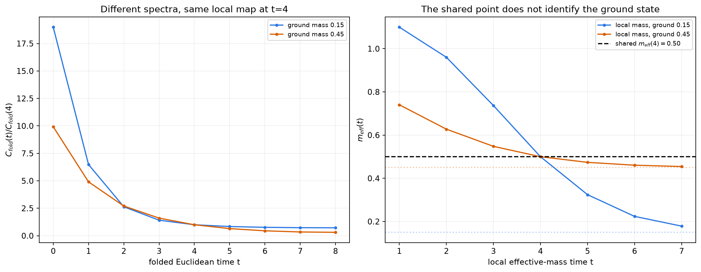

# Pion anchor scalar map: exact identifiability counterexample

**Classification:** exact noiseless synthetic two-state counterexample. No Pion configuration, anchor/reference bytes, sealed split, GPU or QUDA were accessed. `physical_score=null`.

## Construction

The proposed reader maps one state to `M=m_eff(4)=acosh((C_fold(3)+C_fold(5))/(2 C_fold(4)))`. For the positive periodic two-state spectrum `C(t)=A0 K(m0,t)+A1 K(m1,t)`, `K(m,t)=exp(-mt)+exp(-m(16-t))`, the identity `K(m,3)+K(m,5)=2 cosh(m) K(m,4)` gives:

```text
cosh(M) = (1-w4) cosh(m0) + w4 cosh(m1)
w4 = A1 K(m1,4) / (A0 K(m0,4) + A1 K(m1,4))
```

Solving this equation lets distinct ground masses produce the same map value with positive finite overlaps.

| spectrum | ground mass m0 | excited mass m1 | A1/A0 | returned m_eff(4) | |m_eff(4)-m0|/R |
| --- | ---: | ---: | ---: | ---: | ---: |
| spectrum_1 | 0.15 | 1.20 | 14.780684 | 0.500000000000 | 0.120690 |
| spectrum_2 | 0.45 | 1.20 | 0.744802 | 0.500000000000 | 0.017241 |



The two valid reader inputs have the same map value `0.5`, while their ground masses differ by `0.300`. Any deterministic correction that sees only that scalar must return the same value for both; by the triangle inequality its worst-case absolute error is at least half the separation, `0.150`. The selected bound requires `C <= 0.029` (`C/R <= 0.010`, `R=2.9`), so that guarantee is impossible over this two-state class without additional restrictions or observables. This remains true even though both map values and both ground masses lie inside `[0.1,3.0]` and both spectra are noiseless, positive, and exactly periodic.

This is a deliberately favorable submodel in which the target joint-fit mass is exactly the PP ground-state mass `m0`; it does not prove that the actual anchor ensemble contains either spectrum. It proves that the current map formula plus support check alone cannot establish `C/R<=0.01`. An independently supported restriction on the excitation gap/overlap, or a richer per-state observable tied to the frozen joint PP/A4P target, is required. Noise, model mismatch, chain dependence and finite-sample invalid-state rates can only require further validation; they cannot repair this noiseless non-identifiability by themselves.

## Data flow and decision

```text
choose two ground masses in support -> solve positive overlap so both map to M=0.50 -> verify with the production scalar-reader formula -> apply triangle-inequality minimax lower bound -> reject a universal C/R<=0.01 claim from this scalar alone -> keep anchor gate ABSTAIN
```

Analytic example denominator: `2/2/0/0`; production anchor input denominator: `0/0/0/0`; reference gate: `1/0/0/1`. The next step is an independent review of this no-go argument and a decision whether to replace the scalar map with a multi-time/per-channel estimator or require an externally justified spectral/overlap restriction. Do not infer a physical bias, open sealed data, or promote the gate.

The protocol, example CSV, source snapshots, source hashes, and artifact hashes are included in this folder.
