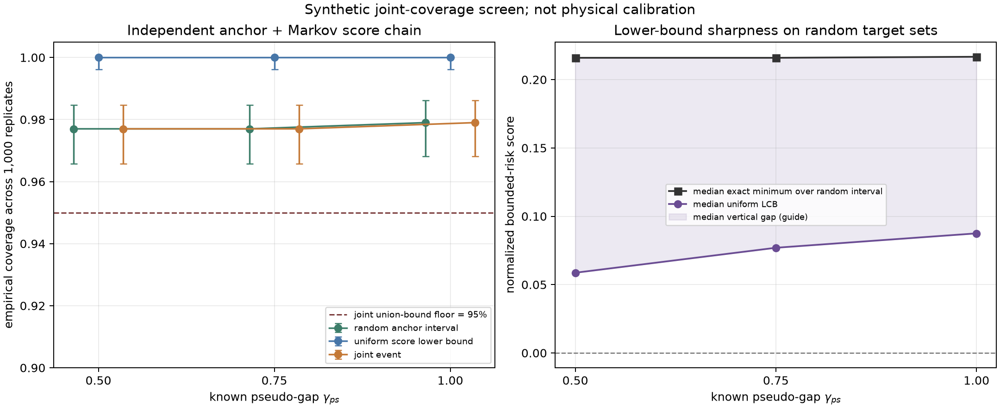

# Pion independent-anchor joint coverage screen

**Status:** `SYNTHETIC_JOINT_COVERAGE_SCREEN_NOT_PHYSICAL_CALIBRATION`; `physical_score=null`; no lattice, E-reference, gauge, GPU/QUDA, or sealed input was read.

## Frozen protocol

Each replicate has two separate random streams. The anchor stream draws 256 IID Bernoulli observations with exact target mass `p=0.4`, then forms a two-sided exact Clopper-Pearson interval at `alpha_anchor=0.025`. The score stream draws 16,384 states from an independent, exactly stationary two-state reversible chain. The chain uses `lambda=sqrt(1-gamma_ps)`, `P01=(1-lambda)*0.4`, and `P10=(1-lambda)*0.6`; its normal pseudo-gap is the selected `gamma_ps` in `{0.5, 0.75, 1}`.

The reference prediction is the chain state and the candidate is `0.5`, with prediction domain `[0,1]`, `R=1`, and target mesh step `0.1`. The exact stationary risk curve is `E[s(m)]=(1-2p)m-1/4+p = 0.2m+0.15`, so its minimum on each random interval is computed exactly from the interval endpoints. The production exact-grid builder and support-gap Eq. (3.26) radius are used for the uniform lower bound. The joint event requires both that the random anchor interval contains `p` and that the score LCB is no greater than the exact minimum over that interval.

The preallocated failure probabilities are `alpha_anchor=0.025` and `alpha_score=0.025`. Conditional on any realized anchor interval, the independent score-chain guarantee applies simultaneously over its grid; a union bound therefore gives a planned joint lower coverage of 0.95 under the protocol assumptions.

## Results

| gamma_ps | anchor coverage | score-uniform coverage | joint coverage | joint Wilson 95% interval | median interval width | median LCB | median exact minimum | median slack | positive LCB |
|---:|---:|---:|---:|---:|---:|---:|---:|---:|---:|
| 0.50 | 0.977 | 1.000 | 0.977 | [0.966, 0.985] | 0.140 | 0.059 | 0.216 | 0.158 | 1.000 |
| 0.75 | 0.977 | 1.000 | 0.977 | [0.966, 0.985] | 0.140 | 0.077 | 0.216 | 0.139 | 1.000 |
| 1.00 | 0.979 | 1.000 | 0.979 | [0.968, 0.986] | 0.140 | 0.087 | 0.217 | 0.129 | 1.000 |



## Text diagnostic and interpretation

```text
independent anchor Bernoulli sample (256) -> exact random target interval (alpha_anchor=.025)
                                                                  |
separate exact-stationary Markov chain (N=16,384) -> production exact grid + support-gap LCB
                                                                  |
                      anchor contains p AND uniform LCB <= exact interval minimum
                                                                  |
                   count anchor / score / joint events; Wilson MC intervals + sharpness
```

The figure's left panel shows the three event rates against the planned 95% joint lower bound. The right panel compares the median uniform LCB with the median exact interval minimum and shows the median slack. The screen uses 1,000 independent PRNG replicates per gap, so its Wilson intervals describe Monte Carlo uncertainty; they do not replace the analytic 95% union-bound guarantee. If a small MC interval endpoint falls below 0.95, that is a finite simulation fluctuation, not by itself a contradiction of the theorem.

## Denominators and reproducibility

Planned and valid denominators: 3000 anchor/score replicate pairs; 768,000 anchor observations; and 49,152,000 score-chain states. Failed or abstained units: 0. Raw synthetic Bernoulli arrays and full chain trajectories are preserved bit-packed in `synthetic_inputs.npz`; `replicate_results.csv` has one row per planned replicate and records both seed streams, interval endpoints, state counts, coverage events, and LCB slack. `protocol.json` records source snapshot hashes and runtime versions.

These results test only a known two-state reversible model with exact `p`, exact pseudo-gap, exact stationary starts, and an anchor sample that is IID by construction. They do not validate HMC independence, production `gamma_ps`/TV receipts, target mass/source correspondence, score-anchor common bias, anchor-to-E bridge, prediction support, physical units, or an E-reference gate. The anchor interval is not an estimate of any physical mass. Pion remains `NOT_READY/UNCERTIFIED`, `physical_score=null`, and sealed inputs closed.

To reproduce from the repository root: `python -m tasks.pion_projection.bounded_block_risk_independent_anchor_coverage_screen`. The report builder fails if the output folder already exists, preserving prior evidence.
