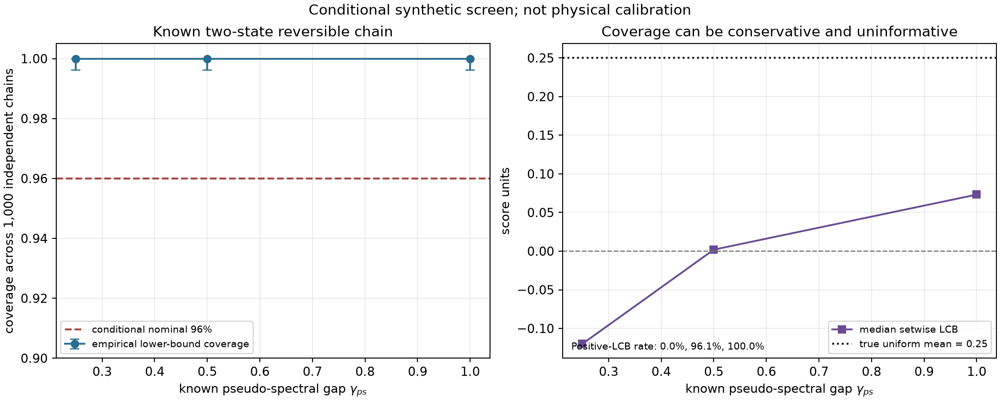

# Pion setwise Markov lower-bound coverage screen

**Status:** `CONDITIONAL_SYNTHETIC_MARKOV_COVERAGE_SCREEN_NOT_CALIBRATION`. `physical_score=null`; no lattice, anchor, E-reference, gauge, or sealed input was read.

## Frozen construction

A two-state reversible chain uses transition matrix `[[1-gamma/2,gamma/2],[gamma/2,1-gamma/2]]`, stationary law `(1/2,1/2)`, exact stationary starts, and pseudo-spectral gap `gamma`. Each independent replicate contains 4,096 planned states. The reference prediction is the current state (0 or 1), the candidate prediction is 0.5, `R=1`, and the fixed common target interval is `[0.45,0.55]`.

For either stationary state, the normalized risk difference has expectation exactly `0.25` for every target `m` in the interval. The screen calls the production helper's exact-rational grid builder, counts every generated grid point in the simultaneous family, applies the support-gap Eq. (3.26) radius, and subtracts its upward-rounded `h/R` Lipschitz cover penalty. It counts a replicate as covered only when the uniform LCB does not exceed the exact value `0.25`.

## Results

| gamma_ps | chains | empirical coverage | Wilson 95% interval | median uniform LCB | positive-LCB rate |
|---:|---:|---:|---:|---:|---:|
| 0.25 | 1000 | 1.000 | [0.996, 1.000] | -0.120 | 0.000 |
| 0.50 | 1000 | 1.000 | [0.996, 1.000] | 0.002 | 0.961 |
| 1.00 | 1000 | 1.000 | [0.996, 1.000] | 0.073 | 1.000 |

## Interpretation and limits

The left panel checks conditional lower-bound coverage under a known, reversible two-state chain with correctly supplied gap. The right panel shows informativeness: high coverage alone is insufficient if the LCB remains below zero. This checks only one exact finite-state family and the implemented grid/cover arithmetic; it does not validate an HMC trajectory's gap, initial TV, block schedule, target-set coverage, anchor-to-E bridge, or real score support. `alpha_anchor=0.01` is reserved but no random anchor set is used in this fixed-interval check.

Data flow: `frozen two-state transition -> independent exact-stationary chains -> statewise bounded scores on the production helper's full target grid -> support-gap Markov radius with the exact grid family -> h/R cover penalty -> coverage/LCB ledger and figure`. No failed draws occurred; all planned states and replicates remain in the denominator.

This does not close Pion's target mass/source correspondence, common-bias bound, production dependence receipts, independent review, or TaskSpec/evaluator integration. Keep `NOT_READY/UNCERTIFIED`, `physical_score=null`, and sealed inputs closed.

Artifact digests are recorded in `artifact_hashes.json`; `protocol.json` freezes seeds and assumptions.
