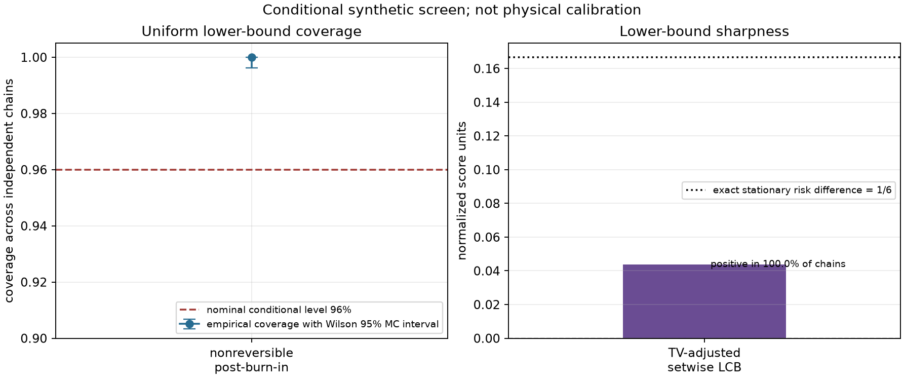

# Nonreversible post-burn-in Pion setwise Markov coverage screen

**Status:** `CONDITIONAL_SYNTHETIC_MARKOV_COVERAGE_SCREEN_NOT_CALIBRATION`; `physical_score=null`. No lattice, anchor, E-reference, gauge, or sealed input was read.

## Frozen construction

The three-state directed cycle has transition matrix `[[1/2,1/2,0],[0,1/2,1/2],[1/2,0,1/2]]`. It is doubly stochastic but nonreversible. Its nontrivial eigenvalues have magnitude `1/2`; normality gives `gamma_ps=max_k(1-(1/2)^(2k))/k=3/4`. Chains start at state 0, discard eight transitions, then score 16,384 planned states. The exact post-burn-in total-variation distance from uniform is `1/384`; the helper receives the next representable float above it.

The reference prediction by state is `(0, 0.5, 1)` and the candidate is `0.5`. On every target `m` in `[0.45,0.55]`, stationary risk difference is exactly `1/6`: the state-0 and state-2 scores sum to `1/2`, and state 1 contributes zero. The report uses the production exact grid, simultaneous support-gap radius, initial-TV alpha cost, `2*TV` mean shift, and `h/R` Lipschitz cover penalty.

## Results

| pseudo-gap | burn-in | exact initial TV | chains | empirical coverage | Wilson 95% MC interval | median LCB | positive-LCB rate |
|---:|---:|---:|---:|---:|---:|---:|---:|
| 0.75 | 8 | 1/384 | 1000 | 1.000 | [0.996, 1.000] | 0.044 | 1.000 |

## Interpretation and limits

This adds a nonreversible transition operator and a known nonstationary starting law to the earlier reversible stationary screen. Coverage counts the event that the helper's interval-uniform LCB is no greater than the exact stationary mean. The Wilson interval measures Monte Carlo uncertainty across the 1,000 independently seeded chains; it is not the helper's conditional confidence interval.

The screen does not validate a production trajectory's pseudo-gap, its TV receipt, target-set coverage, anchor-to-E bridge, score support, block schedule, or unit. The anchor alpha is reserved but no random anchor event is present. No production conclusions follow; retain `NOT_READY/UNCERTIFIED`, `physical_score=null`, and sealed inputs closed.

Data flow: `fixed state 0 -> 8 directed-cycle transitions -> exact TV=1/384 -> 16,384 scored states -> exact setwise grid -> simultaneous gap bound with TV-adjusted alpha and mean shift -> interval cover penalty -> coverage/LCB figure`. All 1,000 chains and all planned score states remain in the denominator.

Artifact digests are recorded in `artifact_hashes.json`; `protocol.json` freezes the generator, exact gap/TV derivation, and seed.
