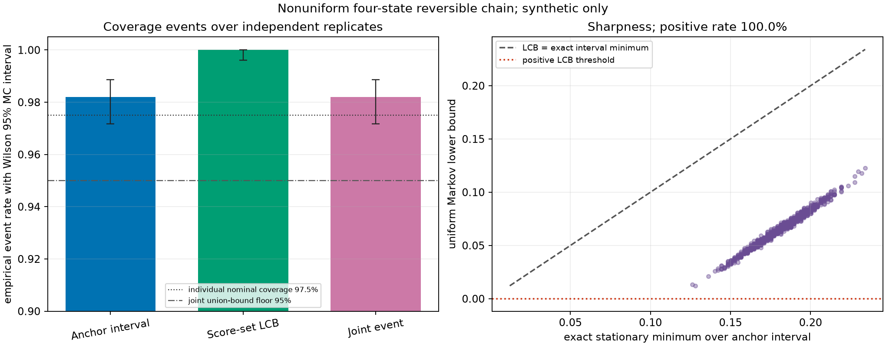

# Pion bounded risk: nonuniform four-state Markov coverage screen

**Classification:** synthetic dependence diagnostic; not a physical calibration or an HMC receipt.

Reproduce from the repository root with `python tasks/pion_projection/bounded_block_risk_nonuniform_multistate_coverage_screen.py --output <new-empty-directory>`. The default output is the versioned report folder; existing output is never overwritten.

The score stream uses a four-state reversible refresh chain with stationary law `[0.05, 0.15, 0.3, 0.5]` and transition `P=0.7 I + 0.3 1 pi`. Its numerically checked eigenvalues are `[0.7, 0.7, 0.7000000000000003, 0.9999999999999999]`, consistent with the exact spectrum `1,0.7,0.7,0.7`; hence the exact normal-kernel pseudo-gap is `1-0.7^2=0.51`. Every chain starts at state 0, burns 24 transitions, and then contributes 16,384 scored states. The exact post-burn-in TV distance is `3640043396230761873619/20000000000000000000000000`; the reader receives its upward-rounded float bound `0.00018200217`.

An independent anchor stream draws 256 Bernoulli observations at target `p=0.4` and forms a two-sided exact Clopper-Pearson interval with `alpha_anchor=0.025`. A separate score chain maps its four states to reference predictions `[0.0, 0.25, 0.75, 1.0]` and compares them with candidate prediction `0.5` over that random target interval. The score interval is uniformized with the production exact target grid, support-gap Markov bound, TV-adjusted alpha, `2*TV` mean-shift penalty and Lipschitz mesh cover cost. The expected stationary score is affine in the target, so its exact minimum over each sampled interval is evaluated at the appropriate endpoint.

The run planned 1,000 independent anchor/score pairs, 256,000 anchor observations, 16,384,000 scored Markov states and 24,000 burn-in transitions. Failures/abstentions are `0/0` by construction. The 8-replicate vectorized implementation check matches the production helper within `5.55e-17` (tolerance `2e-14`).

| Event | Successes / planned | Rate | Wilson 95% Monte Carlo interval |
| --- | ---: | ---: | ---: |
| Anchor interval covers p | 982/1000 | 0.9820 | [0.9717, 0.9886] |
| Score LCB covers interval minimum | 1000/1000 | 1.0000 | [0.9962, 1.0000] |
| Joint event | 982/1000 | 0.9820 | [0.9717, 0.9886] |

Median target interval width is `0.1402`; median exact interval minimum is `0.1813`; median uniform LCB is `0.0657`; positive-LCB rate is `100.0%`. Coverage counts describe this finite simulation and its exact toy DGP, not physical coverage.

The key new dependency feature is a nonuniform stationary law with state-dependent scores and a nonstationary fixed start. The chain is nevertheless analytically tractable: refresh-or-stay gives a known reversible kernel, exact spectrum and exact TV after burn-in. The 95% joint lower guarantee follows from the declared independent anchor event plus the score-chain family bound; receipt hashes are identifiers for synthetic fixtures only.

Data flow: `independent Bernoulli anchors -> exact random interval` plus `state-0 initialization -> 24 refresh transitions -> four-state Markov score chain -> all-state score map -> production helper-equivalent simultaneous uniform LCB -> anchor / score / joint coverage and sharpness figure`.

This closes one additional software/method stress category only. It does not validate HMC independence, gap, TV or burn-in; does not establish anchor-to-E common-bias coverage; and does not provide production map/support, reference, review or authorization receipts. No production or sealed input, GPU or QUDA was accessed. Pion remains `NOT_READY/UNCERTIFIED`, `physical_score=null`, sealed inputs closed.
