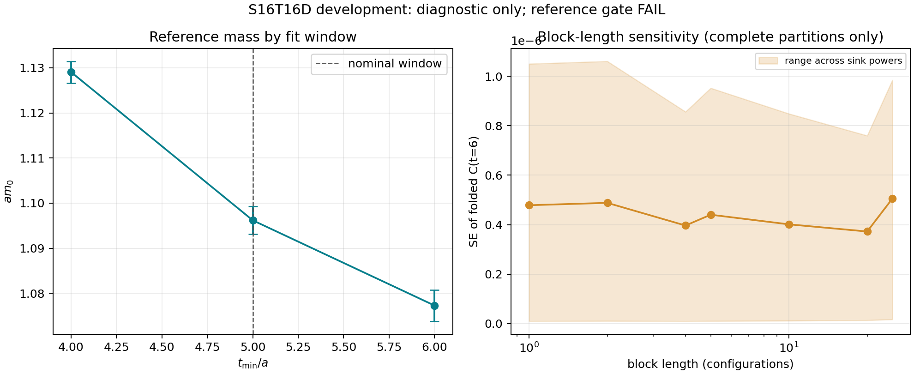

# Pion S16T16D development analysis amendment

Status: **diagnostic only; reference gate failed**.

The 100-config development measurement was preserved unchanged. The frozen analysis stopped because its block-length sensitivity loop required length 3, which cannot partition 100 rows into complete equal-size blocks. This amendment records that limitation and uses only complete partitions at lengths 1, 2, 4, 5, 10, 20, and 25. No row was dropped.

## Reference gate

- Nominal fit: mass `1.0961829`, bootstrap SE `0.00305`, approximate fit p-value `1.081e-15`.
- Maximum reflection-odd z: `1.024` (limit `4.0`).
- Failure reasons: Nominal correlated reference fit fails the approximate goodness-of-fit gate, Reference window [4, 5, 6, 7, 8] shifts by 20.41 paired standard errors, Reference window [6, 7, 8] shifts by 15.78 paired standard errors.
- The figure shows fitted mass and bootstrap uncertainty across reference windows, plus the C(t=6) standard-error sensitivity. These are diagnostics from this chain, not an independent anchor or a physical score.

## Measurement integrity

- Configurations: `100`; measurement generation: `ab8a41d27e0488ca3646ac83475e680f677b17a913d05913f7731ec87a4448ce`.
- See `analysis_provenance.json` for input, source, and output hashes.
- The E-chain anchor and D validation/shared holdout were not opened by this amendment.

## Exploratory two-state model check

The primary single-cosh result remains `FAIL`; no anchor, validation, or shared holdout was opened. A post-failure two-state fit on the same D IDs 0–99 raises approximate fit p-values to 0.90–0.997 and reduces the ground-state window shifts to 0.86σ and 1.92σ. However, in the `[6,7,8]` window the excited-state bootstrap hits its upper mass bound and the fit condition number is about `3e5`. This is consistent with excited-state curvature but does not identify the second state robustly. See the separate [two-state diagnostic](two_state_diagnostic.md), [plot](two_state_diagnostic.png), and [provenance hashes](two_state_diagnostic_provenance.json). These are exploratory diagnostics and do not amend the frozen gate.

## Exploratory effective-mass scan

The folded-cosh effective mass was calculated for all seven sink powers using the same 100 D-development configurations, 20 complete length-5 blocks and 1000 paired bootstrap draws. The curves decrease strongly from `t=3` to `t=7`; at `t=7`, the bootstrap medians range from `1.034` to `1.093` across sink powers, compared with the failed common single-state fit `1.09618 ± 0.00305` (bootstrap SE). This visible time and channel dependence is consistent with unresolved spectral curvature, but these are correlated channels and time points from the same sample, not independent plateau confirmation. See the [full scan](effective_mass_diagnostic.md), [channel-by-channel figure](effective_mass_diagnostic.png), and [late-time interval figure](effective_mass_late_time.png). The result is exploratory and does not reopen the anchor or score gate.
