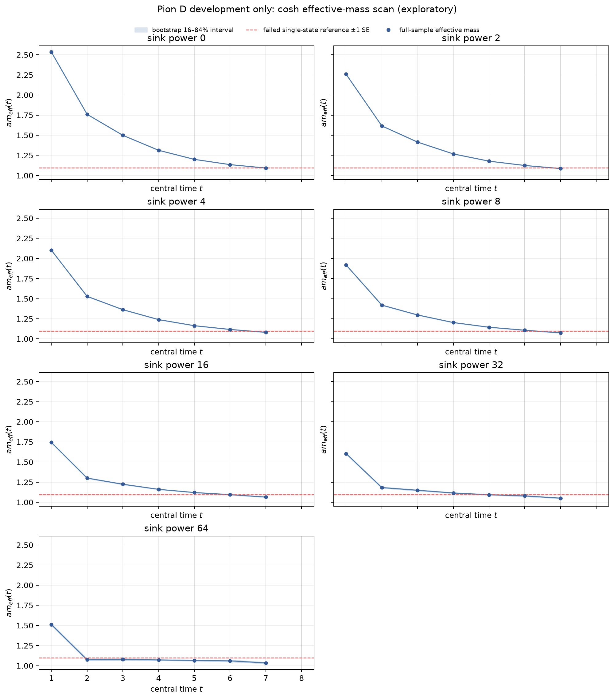
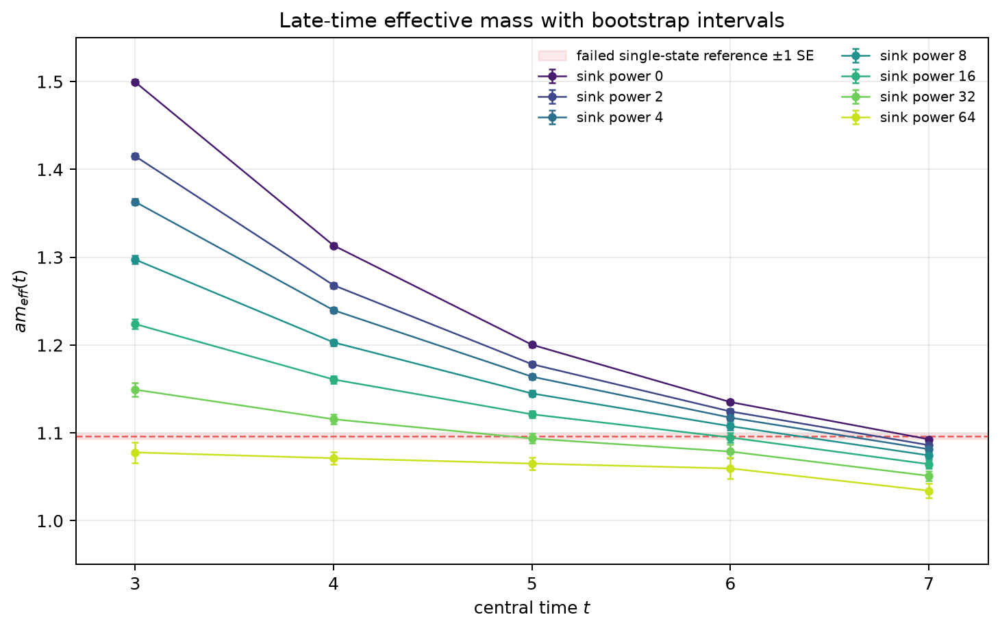

# Pion effective-mass scan on D development

**Status: exploratory diagnostic only; the frozen single-state reference gate remains failed.**

- Data: 100 configurations (IDs 0–99), 20 complete blocks of length 5, 1000 paired bootstrap draws.
- Channels: sink powers 0, 2, 4, 8, 16, 32, 64; plotted points use all D-development configurations, with the 16–84% bootstrap band from the same complete block resamples.
- Invalid effective-mass bootstrap channel/time cells: 0; invalid draws are retained in the JSON counts rather than clipped into a mass estimate.
- The red band/line marks the failed single-state reference, $am=1.09618\pm0.00305$, fitted on window [5, 6, 7, 8].

The estimator uses the folded periodic-cosh identity $m_{eff}(t)=\operatorname{arccosh}[(C(t-1)+C(t+1))/(2C(t))]$. Time points and channels are correlated; the plot is a spectral-shape diagnostic, not an independent plateau test. It cannot replace the frozen reference gate or authorize E, validation, or shared-holdout access.

Hashes and per-channel/time values are in `effective_mass_diagnostic.json` (measurement `8a78947c8b4d1bec3b672ed57cd1406ed0bcccf6ec874747ece4d64078da7fe3`, source `03947100a7debae800b4edd42482ac4c831be227dab10e6b4ce93c4d0cad0210`).
