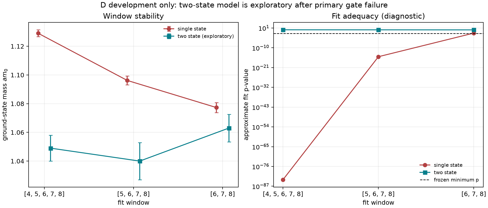

# Two-state reference diagnostic on D development

**Status: exploratory only; the frozen single-state reference gate remains failed.**

The two-state ansatz was fitted to the same 100 D-development configurations (20 configuration blocks) and the same three frozen time windows. Bootstrap indices were reused across windows to show paired shifts. No E anchor, D validation, gap, or shared holdout data were opened.

| Window | Two-state $am_0$ ± SE | $am_1$ ± SE | Approx. p | Paired shift | Condition | Bound reached? | Valid bootstrap |
|---|---:|---:|---:|---:|---:|:---:|---:|
| [4, 5, 6, 7, 8] | 1.049 ± 0.00894 | 1.712 ± 0.064 | 0.997 | 0.858σ | 7.39e+03 | no | 1000/1000 |
| [5, 6, 7, 8] | 1.04 ± 0.0129 | 1.596 ± 0.12 | 0.955 | reference | 1.46e+04 | no | 1000/1000 |
| [6, 7, 8] | 1.063 ± 0.00964 | 1.844 ± 0.279 | 0.902 | 1.92σ | 2.99e+05 | yes | 1000/1000 |

## Interpretation boundary

- A two-state fit can explain curvature caused by excited-state contamination, but improved in-sample fit is not proof that the second state is physically identified.
- The `[6,7,8]` fit reaches the excited-state upper mass bound in its bootstrap and has condition number about $3\times10^5$; this is a direct identifiability warning, despite the good in-sample p-value.
- Read the amplitude signs and condition numbers in `two_state_diagnostic.json`; unconstrained amplitudes and short windows can produce unstable decompositions.
- Even if this screen meets the numerical thresholds, it does not amend the frozen primary protocol, validate the independent E chain, or permit a physical score.
- The next legitimate confirmation requires a separate frozen protocol/model hash and independent-chain check before opening E. Do not tune model or thresholds after E is measured.
