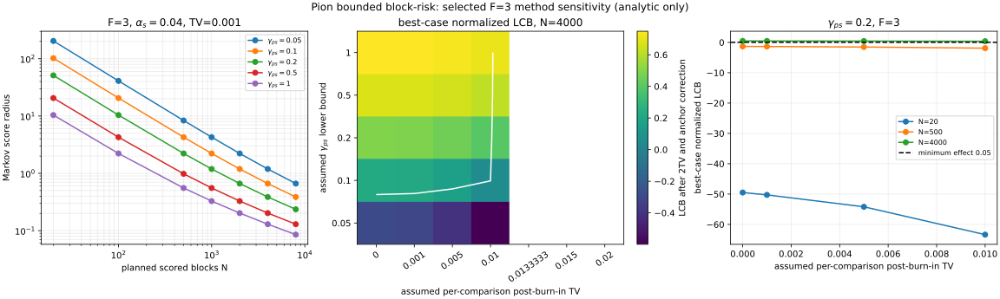
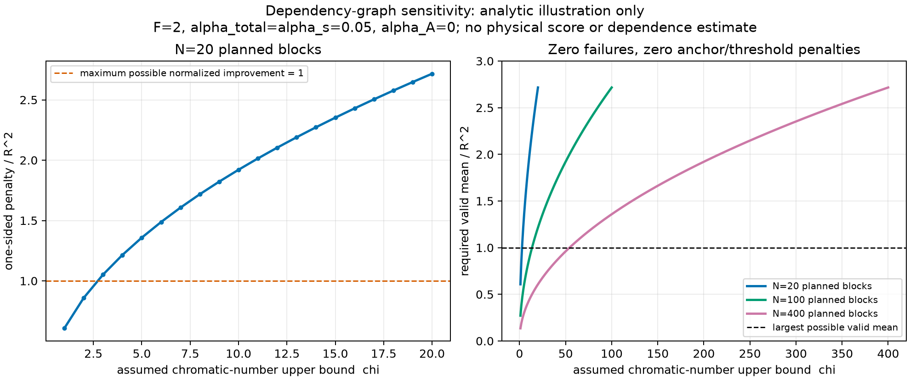
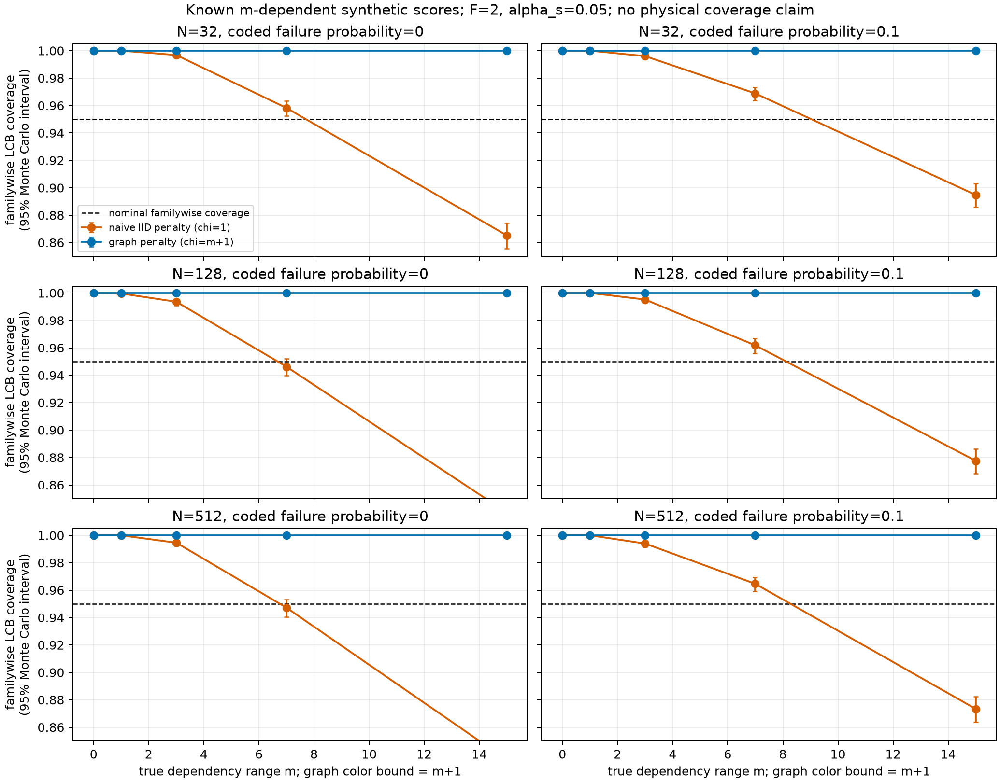
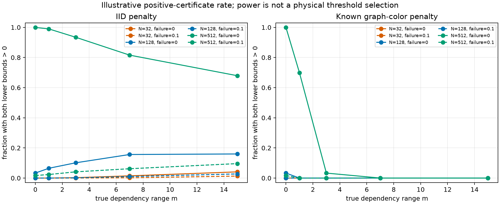
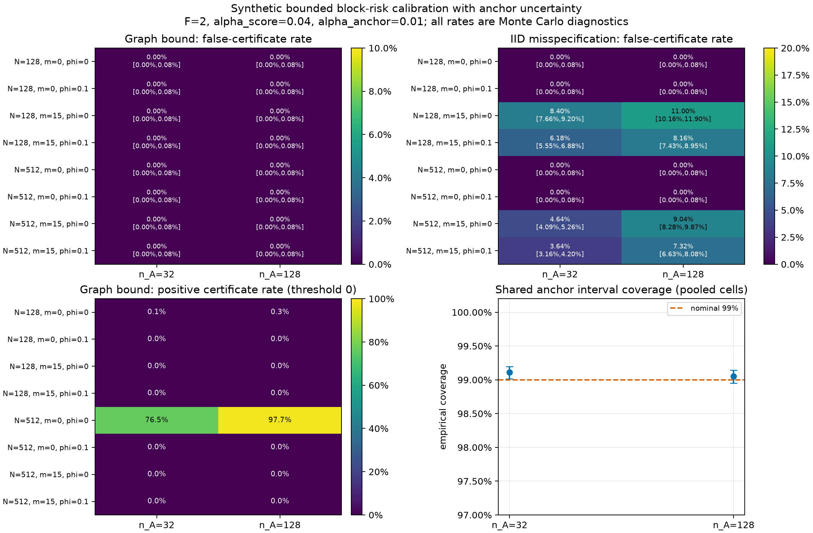
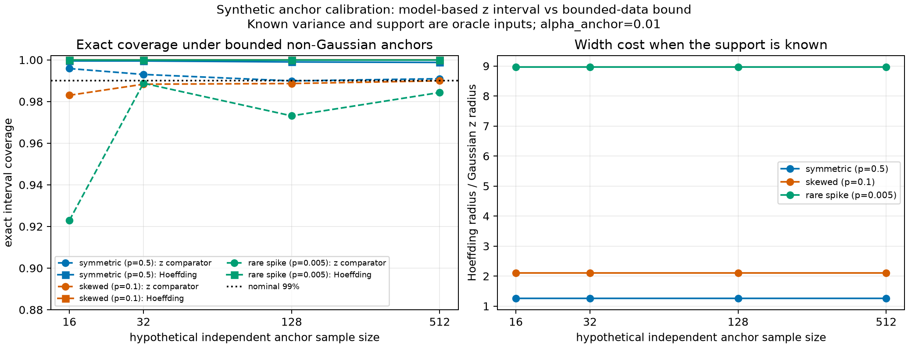
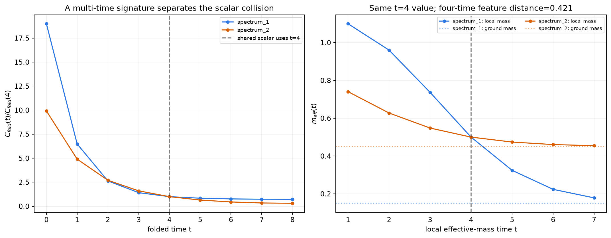
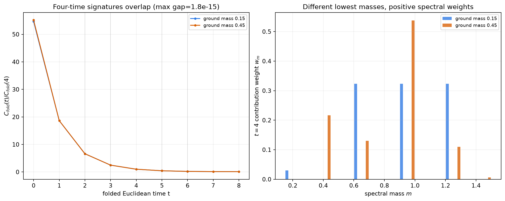

# Pion projection: bounded block-risk calibration handoff

### 当前控制状态（2026-11-28）

`F=3`、bounded block-risk、score/anchor 错误预算和 Markov 覆盖路线已有明确方案及图文敏感度诊断；研究默认值已自选为 `a_t m_pi`、`R=2.9`、clip `[-1,1]`、`delta_star=0.4205`、效应门 `0.05`、score-chain `gamma_ps>=0.20`/burn-in `8`/`N=4000`/TV `<=0.001`、**anchor-chain Markov Bernstein `n_A=4000`、`gamma_A>=0.20`、burn-in `8`、TV `<=0.001`、`alpha_A=0.01`**，以及拟议 `C/R<=0.01`。选择 Markov anchor 为主路，是因为本任务的 HMC 配置不应在没有来源证明时假定为 IID；`n_A=1000` bounded-IID Hoeffding 只保留为确有 1000 个 IID stationary units 收据时的备选。候选 anchor scalar map `m_eff(4)` 有 snapshot CPU reader，但尚未独立审阅。2026-11-28 的精确无噪声反例证明：仅靠该标量和 `[0.1,3.0]` support，连正两态周期 PP 子模型都无法普遍保证 `C/R<=0.01`；在当前无 gap/overlap 限制的类上 minimax `C/R>=0.051724`。一个特定四时间向量虽能分开原反例对，但新的正多态构造又让不同 ground mass 的两组正谱在四时间特征上相撞，故“增加几个时间点”本身也不能认证全局可识别性。需另有可信的态数/gap/overlap 限制及确定性 target bridge，或直接提供可审计的 common-bias 界。通用 `core/evidence.py` schema v2 与 Pion task adapter 仍只核验 source bytes/元数据一致性，完整 statistical stage 最多到 `draft`，不认证 digest authority、reviewer 身份、统计独立性或物理有效性，也不计算物理 score。真实 score/anchor 链的 `gamma_ps`/TV、E-reference、可接受 map/common-bias `C` 收据仍缺。Pion 仍为 `NOT_READY/UNCERTIFIED`、`physical_score=null`；按用户要求，E/gap/validation/shared holdout/confirmation 保持封存，不启动 GPU/QUDA。

### 2026-11-26 自选 anchor 覆盖主路：Markov-aware，不假定 IID

我将 anchor coverage 主路定为固定有界标量的 Markov pseudo-gap Bernstein：`n_A=4000` 链状态、`gamma_ps>=0.20`、8 个状态 burn-in 后 `TV<=0.001`、共享 `alpha_A=0.01`、support `[0.1,3.0]`、拟议 `C<=0.029`（即 `C/R<=0.01`）。TV 从 anchor alpha 中扣除，所以 stationary Bernstein 项使用 `alpha_A-TV=0.009`；单一 anchor 区间在三个 score comparisons 间共享，family size 为 1。对应现有 helper 的规划算术为随机半径 `0.585915 a_t m_pi`、总误差 `B=0.614915 a_t m_pi`、score 修正 `2B/R=0.424079`。连同 score-chain 最坏计划半径约 `0.386316` 和 score-chain `2TV=0.002` 扣减，在 score 均值取理论最大值 1 的理想上限下 LCB 约 `0.1876`，高于预设 `0.05`；这仅说明设计在最乐观算术下非空，不表示 coverage、效果或 anchor map 已成立。

这项选择明确排除“把 HMC 配置数量、间隔、ESS 或 bootstrap 次数直接当 IID 样本数”。IID Hoeffding `n_A=1000` 保留为次选，只有真实来源能证明每个单位相互独立、来自目标平稳分布，且同样的 scalar-map/support/common-bias bridge 通过审阅时才可启用。**当前 anchor evaluator 仍必须弃权**：先前全局 ensemble PP/A4P 拟合的质量是非线性整体统计量，不是每个 gauge configuration 自然产生的标量。除非给出一个预先固定、取值确实在 `[0.1,3.0]` 的状态映射，并独立证明其 stationary mean 与目标 `m*` 相差不超过 `C=0.029`，否则不得调用 Markov anchor 界或计算物理 score。统计/数学收据与新数据授权分别是不同门。既有 `F3_markov_sensitivity_v1` 生成于 IID anchor 是主路的旧合同版本；其中的 Hoeffding anchor 扣减和最佳情形 LCB `0.488744` 不代表当前 Markov-anchor 方案，保留为历史敏感度，不重写历史产物。

文字数据流：`独立 E-chain 状态 -> 固定标量映射及支持证明 -> anchor-chain 条件/gamma/TV receipt -> scalar-mean 到 global-fit m* 的 C bridge -> 与 score-chain 独立性 -> 计算 B 和 2B/R -> 全部门通过才进入 bounded LCB；任何 map/support/C/gap 缺失即 ABSTAIN`。本轮只改方法默认值与审计文字，没有新数据读取、coverage 模拟或物理测量；真实 anchor denominator 仍 `0/0/0/0`。

### 2026-11-25 接续复核：anchor-fit 区间桥仍不能安全实现

本轮复核向量 anchor handoff 后，没有读取 D/E、gap、validation 或 shared-holdout 输入。现有 `bounded_block_risk_anchor_vector.py` 只生成固定有界 feature 均值盒；其 diagnostic 把 `target_fit_interval` 与 common-bias `C` 留为 null。可复用的 two-state runner 目前只存在于 D-development archive 的 source snapshot，而任务主路径的 `statistics.py` 是单态拟合；不能把 archive runner 或当前 D-development 协方差自动视作已冻结的 E-anchor estimator。

要实现 sound branch-and-bound，至少还缺：每个 PP/A4P per-state feature 的**事前有限支持证明**、冻结的 feature→channel/time 映射、固定且可验证正定的协方差/regularization 及其误差处理、紧致的 mass/state-order 参数域、双态/三态与窗口 gate 的区间定义，以及从 `m*` 区间到 common-bias `C` 的独立论证。Wilson-like propagator/correlator 不能仅因格点有限或观测样本有限就视作有界；从已见 D 样本取 min/max 也不构成目标分布支持界。缺这些输入时，写 B&B 数值或 fixture 不会闭合物理 estimand，反而可能把假定误报为证书，所以本轮不新增伪通用 solver。

**支持界需要什么（解析判据，非测量）：**若某个固定 anchor feature 可写成 `f_j(U)=Re〈η_j,D_W(U)^{-1}ξ〉`，则有 `|f_j(U)|≤||η_j||·||ξ||/σ_min(D_W(U))`；若是 propagator 双线性 contraction `f_j(U)=Re[(D_W^{-1}ξ)†Γ_j(D_W^{-1}ξ)]`，则 `|f_j(U)|≤||Γ_j||·||ξ||²/σ_min(D_W(U))²`。所以一个足够条件是对合同允许的**整个 gauge-support** 证明统一的 `σ_min(D_W(U))≥δ>0`，再把 source/operator norm 和所有归一化分母的正下界一并纳入；也可直接给每个 feature 的更紧确定性包络。有限矩阵维数与 compact link 域本身不保证 `δ>0`：如果允许域闭包内可逼近奇异矩阵，逆算子就无统一上界。这里不声称本项目 `κ=0.14` 算符必有奇异配置，只指出当前没有此 uniform-gap theorem/receipt；观测样本的经验极值不能代替它。对协方差估计与拟合器，还需另证全盒内 eigenvalue floor、目标函数连续/紧致、全局 minimizer 集合与所有 gate 的区间稳定性，算法设置的 `1e-10` floor 不能自动界定 anchor sampling error。

具体流程仍为：`算符/源范数 + 全支持 σ_min 下界或直接 feature 包络 + 归一化分母下界 -> 每个 feature 的事前有限区间 -> 同时 anchor mean box -> 对冻结协方差/双态 PP+A4P 目标做全局区间传播 -> 所有 admissible minimizer 的 m* hull -> 独立 C bridge`。任一环没有来源或区间 solver 不能闭合，就在该环 `ABSTAIN`。这条推导是对“为何不能安全补一个 B&B solver”的可审查文字诊断，没有给项目数据添加数值。

文字流程：`独立 anchor feature 支持与 estimator/covariance receipt -> 同时 feature box -> 冻结 PP/A4P fit 的全局 minimizer enclosure -> m* hull -> 独立 common-bias C bridge -> review/授权 -> 才能进入确认；任何盒未闭合即 ABSTAIN`。本项实现/应用分母为 `0/0/0/0`（没有合格输入计划）；物理 score 仍为 null，TODO 保留。当前 CPU 侧没有能在不造假假设、不重跑已完成 synthetic 网格条件下关闭此证书缺口的合法动作。

### 2026-11-25 CPU 边界与 Markov 定理引用复核

对照 [Paulin corrected arXiv v5](https://arxiv.org/html/1212.2015v5) 逐条核验了项目使用的界：固定 score 的 block-chain Bernstein 路线标作 Theorem 3.11 / Eq. (3.25)，预声明时变 `f_i(X_i)` 路线标作 Eq. (3.26)，初始律的 TV 扰动标作 Proposition 3.15 / Eq. (3.29)。当前对应 helper / diagnostic 将这三种用法分开，且不声称估计 gap、TV 或 anchor bias；没有发现需要改写的定理编号或把 bootstrap/trajectory spacing 当 gap receipt 的说法。

本轮仅在 CPU 上重跑四组 Markov/anchor-vector 聚焦用例：**57 passed**。这是代码路径回归，不是 coverage calibration 或物理测量。anchor-fit B&B 仍缺事前 feature support、冻结的 E-anchor covariance/fit map 和独立 common-bias `C` bridge；Markov 认证仍缺 score-specific block-chain `gamma_ps` / TV receipts。没有再生成 synthetic 网格，也没有访问封存 split。因此当前合法工作边界仍是：补入可审阅的独立 receipts 后继续全盒拟合/认证；在此之前不增加伪通用 solver，维持 `NOT_READY/UNCERTIFIED` 和 `physical_score=null`。

本次后续复核补入上段的统一 resolvent 支持判据后，重新执行当前 checkout 的完整 Pion 测试文件集 `tests/test_pion*.py`：**180 passed**。这是 helper/schema 回归，不是 Markov 覆盖率、feature 有界性或 anchor-fit 证书；代码与物理状态未因此升级。

## 2026-11-25 我自行选定的 bounded block-risk 输入

用户已要求我自行给出方法输入。以下是可以直接作为下一版方案默认值的选择，**不是测量结果、收据或外部授权**。本节覆盖前文“等待用户选择 target、R、clipping、delta_star”的候选问题；经验量和状态仍按下文的封存/未认证规则处理。

| 输入 | 我选定的值 | 性质与理由 |
|---|---|---|
| 目标 | `m* = a_t m_{pi,0}`，S16T16 quenched Wilson ensemble、`kappa=0.14`、零动量、最低质量 valence isovector pseudoscalar 能级 | 目标定义取自 [Pion task specification](../../doc/pion_projection.md)；数值必须由独立 anchor 得到，不能从当前失败的单-cosh pilot 填入 |
| anchor/reference | 独立 E-chain 上的 candidate-blind 联合谱拟合：PP 的 `n=0,8,16` 三通道加局域 A4P；共享两态能量、各通道独立振幅，拟合 `t=3..8`，比较 `t_min=2,3,4` 及二态/三态模型；PP 偶折、A4P 奇折 | 这是新的参考协议选择；它不复用候选调参结果。协方差仍用冻结的 25% diagonal shrinkage 与 `1e-10` 特征值地板。通过门：`m0` 相对误差≤5%、拟合 `p>=0.01`、模型/窗口质量位移≤2.5 paired SE、PP/A4P 相容且无边界命中；任何一项失败即 reference unresolved |
| 预测域与归一化 | 两个预测质量都必须落在 `(0.1,3.0)` `a_t m_pi` 内；`R=2.9 a_t m_pi` | 取自当前固定拟合搜索域，只是保证 `|y_candidate-y_reference|<=R` 的合同域，不是物理质量先验 |
| score | `Z_i=clip(D_i/R^2,-1,1)`，其中 `D_i=(A-y_ref)^2-(A-y_candidate)^2`；失败 block 记 `-1`，全失败 comparison abstain | 预先固定 bounded estimand；不再对分数作随 block 变化的重标度 |
| 最小效应 | `delta_star=0.05 R^2=0.4205 (a_t m_pi)^2`；要求 familywise LCB `>0.05` | 把最大归一化损失差的 5% 选作最低有意义改善门槛；这是工程/研究判据，不是由旧 pilot 推出的物理常数 |
| 比较族与显著性 | `F=3`：候选对 local identity、tuned `H^32`、frozen signed-SLSQP；`alpha_total=0.05`, `alpha_score=0.04`, `alpha_anchor=0.01` | 三个比较均固定在 development 选择完成之后的 confirmation family 中；必须在报告里保留每个 comparison 的 planned denominator |
| score 依赖 | 主路选 fixed-score non-reversible block-Markov pseudo-gap Bernstein；block 是连续 5 个配置，固定同一个 score map。设计门槛：`N=4000` 个 scored blocks、`gamma_ps_lower>=0.20`、burn-in 8 blocks 后 `delta_TV<=0.001` | `F*delta=0.003<alpha_score`；按现有实现与剩余 `alpha=0.037` 计算，浓缩半径约 `0.3863`。这说明该证明路线很保守，旧 D receipt 的 20 个 length-5 blocks 远不足以给出非平凡 LCB。数值是下一版设计要求，不是现有 chain 的估计 |
| anchor 覆盖 | 主路：Markov pseudo-gap Bernstein，`n_A=4000`、`gamma_A>=0.20`、burn-in 8 后 `TV_A<=0.001`、`alpha_A=0.01`、support `[0.1,3.0]`；IID Hoeffding `n_A=1000` 仅作经收据证明的备选 | 共享 anchor family=1，stationary alpha=`0.009`；规划随机半径 `0.585915`、加拟议 `C=0.029` 后 `B=0.614915 a_t m_pi`，因此 `2B/R=0.424079`。全部依赖独立 anchor-chain gap/TV、固定有界 scalar map、目标偏差 C 和 score/anchor 条件独立收据；这些收据当前都缺，不能调用该界 |

既有 `F=2` 依赖/coverage 模拟是历史敏感度诊断；本次已按选定的 `F=3` 比较族完成纯公式敏感度图、CSV 和流程说明，见 [`F3_markov_sensitivity_v1/README.md`](F3_markov_sensitivity_v1/README.md)。图示网格含245个公式情景，其中140个可计算、105个因 alpha/LCB 条件弃权、0个数值失败；物理测量分母仍为0/0/0/0。规划点 `N=4000, gamma_ps=0.20, TV=0.001` 在假设 score mean 达到理论最大1时给出半径0.386316、最佳可能归一化 LCB 0.488744；这些只是条件算术，不是测量或覆盖证据。不要重跑 F=3 网格，也不要把 `F=2` 覆盖率移植到 `F=3` 合同。



**目前不能由我填造的证据：**实际 `m*` 数值、score 与 anchor Markov chains 各自的 `gamma_ps` 下界、各自 burn-in/TV 收据、anchor scalar map/support/C 证明、两链条件独立 receipt 和 E-chain correlator receipt。旧的 D0–99 receipt 只对应 20 个长度 5 的候选块，既不证明 score-chain 独立性也不支持上述覆盖。现有 S16T16 reference gate 已失败；所以这些设计数值不能把状态升级为 `READY`，合同的物理数据收据保持缺失，`physical_score=null`，sealed E/gap/validation/holdout 继续关闭。

文字流程：`独立 candidate-blind E 谱拟合 -> 通过 reference/model gate -> 单一 bounded score map 与三比较族 -> 证明 score-block Markov gamma/TV -> 证明独立 anchor-chain scalar map/support/gamma/TV/C -> 对完整 N=4000 计划块计算 LCB -> LCB>0.05 且所有门通过才可申请新 confirmation；否则 ABSTAIN`。

**交接规则：**本文件下方较早的“等待用户选择 target/R/clipping/delta_star”均为历史记录，现由本节默认值覆盖；machine-readable contract 与公式诊断均已完成。后续不再重复相同合同/模拟工作，只补独立 E-chain reference、score-specific `gamma_ps`/TV 收据、anchor scalar-map/support/C bridge、anchor-chain `gamma_ps`/TV 和独立审阅/授权。bounded-IID Hoeffding 的1000个单位仅当真实 IID stationary units 有 receipt 时作为备选；同一 HMC 链的配置数、间距、ESS 或 bootstrap 次数均不能满足该假设。当前 Markov route 也不能在 scalar map 缺失时直接套用。无这些证据时保持 `NOT_READY/UNCERTIFIED`、`physical_score=null`；不要读封存 split 或把 synthetic fixture 升格为实测证据。

## 决策状态

- 用户接受 **bounded block-risk** 作为一个独立 estimand；它不等价于原 ensemble-risk，也尚未给出物理分数认证。
- 继续保持 `NOT_READY/UNCERTIFIED`、`physical_score=null` 和封存数据状态。不访问 E anchor、gap、validation、shared holdout；不启动 GPU/QUDA。
- 此文件给下一位 agent 的开工顺序。每项新诊断都要同时保留 planned/valid/failed/abstained 分母，并附图或可复查的文字流程图。

## 已完成且可复核的工作

1. [依赖图敏感度报告](../../results/pion_projection/bounded_score_dependence_sensitivity_20261123_v1/README.md) 给出有条件的图染色 Hoeffding 界、推导、输入假设和示意图。新版本 [bounded block-risk 校准报告](../../results/pion_projection/bounded_block_risk_calibration_20261123_v2/README.md) 补上总错误预算校验、anchor Lipschitz 条件、失败 block 的固定分母定义与替代稳健统计量的边界。
2. [独立 block/anchor receipt 审计](../../results/pion_projection/independent_block_anchor_receipt_audit_20261122/README.md) 核对了已有开发 receipts：100 个 D 配置可按 length-5 规则划成 20 个候选块；独立块数仍是 `NOT_ESTABLISHED`。trajectory 间距 5 和 block bootstrap 都不构成独立性证明。E anchor 只有计划，没有 correlator receipt，因此没有可用 anchor 值或 common-bias 界。
3. [`dependency_graph_bound.py`](dependency_graph_bound.py) 是纯解析 CPU 工具；[对应测试](../../tests/test_pion_dependency_graph_bound.py) 覆盖浓缩项、anchor/score alpha 总预算、失败编码和阈值反解。它不读取物理输入。
4. [`bounded_block_risk_score.py`](bounded_block_risk_score.py) 将每个计划 block 的配对平方误差差和显式成功掩码映射为 bounded score，失败 block 固定记为 `-1`，并按全部 planned block 计算条件 LCB；它不连物理 evaluator，始终返回 `physical_score=null`。测试见 [`test_pion_bounded_block_risk_score.py`](../../tests/test_pion_bounded_block_risk_score.py)。
5. [合成校准压力网格](../../results/pion_projection/bounded_block_risk_stress_20261123_v2/README.md) 横扫 `N, chi, alpha_s, alpha_A, B/R, failure_fraction, delta_star/R^2` 的 1,728 个情景，并输出分母表、失败/依赖/anchor 热图和 alpha 分配图。严格边界 `m_required >= 1` 被标成 `ABSTAIN`，没有裁剪成可行；这里的 “valid scenario” 仅指数学上可达，不是观测有效或物理认证。
6. [框架扩展点地图](../../doc/framework_extensibility.md) 总结 LatticeArena 可复用的 task/operator、measurement capability、search、score、state、ledger、artifact 接口及目前缺少的跨 task 集成层。
7. [bounded block-risk v1 合同草案](bounded_block_risk_contract_v1.md) 将 estimand、clipping/failure 变换、条件浓缩式、anchor Lipschitz 修正和缺失输入整理为独立版本化 handoff。当前 [`bounded_block_risk_contract_v1.json`](bounded_block_risk_contract_v1.json) 的 `selected_protocol` 已写入 2026-11-25 选定的方法默认值；实际 `m*`、依赖、anchor、common-bias 与 reference receipts 仍为 `null`。检查器只可给出 `CONTRACT_COMPLETE_REQUIRES_HUMAN_REVIEW`，不会认证物理分数。
8. [v1/v2 Markov pseudo-gap reports](../../results/pion_projection/bounded_block_risk_markov_gap_20261124_v1/README.md) are retained as historical artifacts; their displayed Bernstein constants match the corrected statement, but their original theorem citation was stale. The [v3 report](../../results/pion_projection/bounded_block_risk_markov_gap_20261124_v3/README.md) cites Paulin arXiv v5 Theorem 3.11 / Eq. (3.25), flags the author's correction to an incomplete earlier proof, and implements the Proposition 3.15 / Eq. (3.29) initial-law TV correction. It adds a 12-cell burn-in/TV what-if table and three fixed helper fixtures. That v3 implementation supported one fixed score function across blocks; the optional time-varying Eq. (3.26) route is now separately implemented and documented below. No report estimates the actual block-chain gap, post-burn-in TV, coverage, or physical score.
9. [合同结构检查器与报告](../../results/pion_projection/bounded_block_risk_contract_diagnostic_20261124_v6/README.md) 为当前 `DRAFT_NOT_READY` 评分草案提供 machine-readable JSON 与 fail-closed inspector。它检查图染色 Hoeffding 或固定-score Markov pseudo-gap 路线、stationary 起点或带 receipt 的 post-burn-in TV、`F*delta < alpha_score`、anchor 覆盖方法、总误差界 `B` 与共偏差子界 `C<=B`、`B >= random_coverage_radius + C`、`R` 与预测差界及独立 reference gate。合成的 Markov stationary/TV 形状只返回 `CONTRACT_COMPLETE_REQUIRES_HUMAN_REVIEW`；收据内容仍须人工审核。测试见 [`test_pion_bounded_block_risk_contract.py`](../../tests/test_pion_bounded_block_risk_contract.py)。



图中 `N=20`、`F=2`、`alpha_total=alpha_s=0.05`、`alpha_A=0`、无 anchor 偏差/阈值/失败只是乐观 what-if。色数界 `chi=1,2,3` 对应惩罚约 `0.607, 0.859, 1.052`；后者已超过 `[-1,1]` score 能达到的最大均值。该图没有估计实际 `chi` 或效果。

新增压力图将每个输入组合作为一个 planned synthetic scenario；1,728 个情景中 1,132 个数学上有可达均值、596 个因 `m_required >= 1` 应 `ABSTAIN`。场景加权的假设 block 汇总是 planned/valid/failed/abstained = `299520/269568/29952/0`；这些是假设分母，不是新的测量样本，也不代表独立块。测试覆盖严格等于 1 的边界与全 planned blocks 失败时的 abstention。

### 已知有限依赖图下的 Monte Carlo 覆盖诊断（合成，见 v2）

[Conditional coverage report](../../results/pion_projection/bounded_block_risk_coverage_mc_20261123_v2/README.md) 补上解析可行性网格没有回答的方法学问题：若依赖图已知，graph-color LCB 在有限样本下的覆盖/保守性，与错误使用 IID 惩罚相比如何。30 个 cell 横扫 `N={32,128,512}`、真实依赖范围 `m={0,1,3,7,15}`、失败率 `{0,0.1}`；每格 5,000 次 MC，`F=2`、`alpha_s=0.05`。有效 score 是 `0.2 + 0.8 tanh` 的对称滑窗噪声；`m+1` 个同余类使用互不重叠的高斯创新，故本合成过程的依赖图与色数界 `chi=m+1` 已知。paired failure mask 在两个 score family 间共享，失败 block 保留在 planned `N` 并编码为 `-1`。



正确 `chi=m+1` 的 graph-color LCB 在全部 30 个 cell 的实测 familywise coverage 均为 `1.0`（每格 5,000 次；最小 MC 95% Wilson 下界约 `0.9992`）。故意错误地用 `chi=1` 时，最差 cell `N=512,m=15,phi=0` 的 coverage 为 `0.8362`，MC 95% 区间约 `[0.8257,0.8462]`。这验证的是**已知合成 m-dependence**下公式的条件行为，绝不证明项目真实 `chi`。



graph-color LCB 在高 `m` 下虽保持覆盖，正下界通过率也可能降至 0（例如该模拟中 `m=15`），说明有限样本有效性与有用检出率是两项不同性质。MC denominator 分层保存：30/30 simulation cell 有效、150,000/150,000 replicate 完成；paired planned block events `33,600,000` 中 `1,679,993` 个假设失败并编码为最差分数，未删除。所有 replicate 下界/覆盖指示、种子规则、源快照和 SHA-256 都在报告目录。

此实验不含 anchor error（`alpha_A=0`）、不估计效应分布、没有物理阈值，并且用可证明的创新构造直接给定依赖图；真实流程仍须先证明 score-specific 图或带常数的 mixing bound。`IID`/`graph-color` 模拟差异不能用来替代那项证明，也不能把剪裁后 estimand 换回 ensemble-risk。

### 有限样本共同覆盖：依赖分数 + 独立 anchor（合成，见 v1）

[联合校准报告](../../results/pion_projection/bounded_block_risk_anchor_coverage_mc_20261123_v1/README.md) 补上上一版 `alpha_A=0` 的方法学缺口。16 个 cell 横扫 `N={128,512}`、已知依赖范围 `m={0,15}`、假设失败率 `{0,0.1}`、独立 anchor 样本数 `n_A={32,128}`；每 cell 5,000 个 replicate，共 80,000。`F=2` 的 score 误差预算为 `alpha_s=0.04`，anchor 双侧精确正态区间预算为 `alpha_A=0.01`，总计 `alpha_total=0.05`。score 生成器用已知 `m` 的滑窗高斯创新，anchor 误差与 score 独立；anchor 的 `sigma=0.05` 已知。这些都是明确的合成假设，不是从项目数据估得的参数。



在该生成器下，正确 `chi=m+1` 的 graph-color 规则 16/16 cell 均观测到零 false certificate；每格 5,000 次对应的最大 Monte Carlo 95% Wilson 上界为 `0.000768`。故意用 IID `chi=1` 时，最大误认证率为 `11.0%`（`N=128,m=15,phi=0,n_A=128`）；anchor 区间实测覆盖率跨 cell 为 `98.92%–99.22%`，标称 99%。图左下的正证书率展示效用损失：`N=512,m=0,phi=0,n_A=128` 为 `97.74%`，而 `m=15` 时为 0。零观测误认证只是有限次模拟结果，不是实际数据覆盖证明；正证书阈值 0 也只是演示值。

每 cell 保存分层分母：MC replicate、paired block event、family-block score、anchor estimate 和 anchor observation 的 planned/valid/failed/abstained 数。假设失败 block 留在计划分母并记 `-1`；all-failed replicate abstain。源码、随机种子、replicate 级结果、图、协议和哈希随报告保存。此诊断只验证**已知依赖图、独立且已知方差正态 anchor**下的联合校准路径；不估计真实 `chi`、anchor 覆盖、共同偏差、目标质量/物理效应，也不满足 reference gate。任务仍为 `NOT_READY/UNCERTIFIED`，`physical_score=null`，封存数据未访问。

### Anchor 分布稳健性：正态 z 区间 vs 有界样本 Hoeffding 区间（精确合成枚举）

[精确 coverage 报告](../../results/pion_projection/bounded_block_risk_anchor_robustness_exact_20261123_v1/README.md)补查前一项的正态模型假设。对三个均值为 0、方差同为 `sigma^2=0.05^2` 的二点分布（稀有上侧事件概率 `p={0.5,0.1,0.005}`）及 `n_A={16,32,128,512}`，枚举每格 `n_A+1` 个二项计数状态及其精确概率，不使用 Monte Carlo，也不读取 anchor/物理数据。



比较的正态 z 半径 `B_z=z_(1-alpha_A/2)*sigma/sqrt(n_A)` 使用生成器的 oracle 方差，但其 99% coverage 解释要求正态母体；有界独立样本 Hoeffding 半径为 `B_H=(U-L)*sqrt(log(2/alpha_A)/(2*n_A))`。稀有事件 case `p=0.005,n_A=16` 的 exact z coverage 只有 `92.2931%`，而 Hoeffding exact coverage 为 `99.9999999999%`；12 格内 Hoeffding 的最小 exact coverage 为 `99.8767%`，最大宽度代价 `B_H/B_z=8.959`。这说明可用分布无关界换覆盖保证，但 `2B/R` 可能变得很宽；它不证明项目 anchor 的支持范围或 iid 条件。

分母报告明确区分 2,064 个假设 anchor observations 与 2,076 个 exact count states；均为精确枚举的合成规划数量，不是物理样本或 MC replicates。Hoeffding 路径只有在 anchor observations 的独立性和事前已知有限支持均可证明时可用；支持未知、anchor 有系统偏差或配置间相关时，这个界不能认证。当前仍缺 E-anchor receipt、共同偏差界及其与 score 样本的独立性证据。正态和 Hoeffding 两条路都不能替代 reference gate；状态继续为 `NOT_READY/UNCERTIFIED`，`physical_score=null`。

### Planned-block 评分函数合同测试（CPU；未接入 evaluator）

`conditional_block_risk_lcb` 的数据流是：`D_i(A)=(A-y_ref)^2-(A-y_candidate)^2` → 对有效 block 计算 `clip(D_i/R^2,-1,1)` → 失败 block 记 `-1` → 以完整 planned `N` 计算均值与 graph-color LCB。四块测试例的原始差为 `[8,-8,2,NaN]`、`R=2`、掩码为 `[valid,valid,valid,failed]`，因此 bounded scores 为 `[1,-1,0.5,-1]`；block 分母 planned/valid/failed/abstained=`4/3/1/0`，单个比较结果的分母=`1/1/0/0`。全失败时 block 分母=`2/0/2/0`，单个比较结果分母=`1/0/0/1`，状态为 `ABSTAIN_NO_VALID_BLOCKS` 且不输出 LCB。这样区分了 block failure 与 panel-level abstention。

函数只实现合同算术；`chi`、anchor 覆盖和 `|y_candidate-y_reference|<=R` 都是调用方必须提供的条件，代码不会验证它们。函数对所有调用固定返回 `physical_score=null`；这项测试不访问任何 correlator/ensemble，也不证明依赖结构、anchor 或物理 reference。

### 颜色类 empirical-Bernstein 备选界（合成条件诊断，新增）

为判断 Hoeffding 是否能在低方差时减少保守性，增加了 [`bounded_block_risk_empirical_bernstein.py`](bounded_block_risk_empirical_bernstein.py) 和 [30-cell 对照报告](../../results/pion_projection/bounded_block_risk_empirical_bernstein_20261123_v4/README.md)。对事前固定的 dependency-graph coloring，在每个颜色类内应用 Maurer–Pontil Theorem 11 的有界独立样本 empirical-Bernstein 界，再以 `n_c/N` 加权；候选族与 `chi` 个颜色类用 `alpha_s/(F*chi)` 做 Bonferroni。颜色类只有一个 block 时退回 Hoeffding。原论文定理允许独立但不同分布的变量；仍要求类内联合独立，方差自适应不能推断或修复错误依赖图。

沿用已知 `m`-dependent 合成生成器，30 格、每格 5,000 个 paired replicate，graph-color Hoeffding 与 empirical-Bernstein 实测 familywise coverage 都是 `1.0`；每格 Wilson Monte Carlo 95% 下界最小 `0.9992`。功效并未普遍改善：`N=512, phi=0, m=0` 的正 LCB 率仅由 `0.9996` 到 `1.0000`；`m=1` 则由 `0.6994` 降为 `0.3550`；`m>=3` 两者接近零，EB 不优。颜色数增大后类样本缩小，EB 的加性项主导。全网格 replicate planned/valid/failed/abstained=`150000/150000/0/0`；失败 block 留在计划分母并记 `-1`。

因此目前保留 graph-color Hoeffding 作为主校准路线，只把 empirical-Bernstein 留作有已证明着色且颜色类足够大时的敏感度选项。该结果不证明真实图、anchor 覆盖、支持范围、common-bias 或物理目标；没有图色数来源时两者都必须 abstain。函数测试见 [`test_pion_bounded_block_risk_empirical_bernstein.py`](../../tests/test_pion_bounded_block_risk_empirical_bernstein.py)；图、分母、源码快照和 hash 在报告目录。

### Markov block-chain pseudo-spectral-gap 备选界（解析敏感度，新增）

[v3 敏感度报告](../../results/pion_projection/bounded_block_risk_markov_gap_20261124_v3/README.md)依据 Paulin 的 corrected arXiv v5 Theorem 3.11 / Eq. (3.25) 实现 non-reversible Markov-chain Bernstein 路径。把一个预先固定、非重叠的 score block 作为 block-chain 状态；依 Assumption 3.1，该齐次链需为 `phi`-irreducible、aperiodic、state space 为 Polish 且有唯一 stationary law，定理主体针对 stationary chain。对 `Z_i in [-1,1]` 可取 `C=2`、`V_f<=1`。令 `L=log(2F/alpha_s)`，用 worst-case `V_f=1` 解定理指数，得到

```text
epsilon_ps = [20*C*L + sqrt((20*C*L)^2 + 32*gamma_ps*L*(N + 1/gamma_ps)*V_f)] / (2*gamma_ps*N)
```

再以 `LCB = zbar - epsilon_ps - 2B/R` 接入现有 squared-error anchor correction；`alpha_s/alpha_A` 和原物理 reference gate 仍独立保留。这里必须用 block chain 自身的、可审阅的 `gamma_ps` 正下界；采样间隔、block bootstrap 或 empirical ESS 都不能替代。初始分布非 stationary 时还须单独加入 burn-in/初始律修正。全失败的 panel 继续按当前 helper 规则 abstain。

图比较 `N={20,50,100,200,500}` 与假设 `gamma_ps={0.005,...,1}`，固定 illustrative `F=2, alpha_s=0.05`，并以 `chi={1,2,4}` graph-color Hoeffding 惩罚作不同假设下的背景。scenario 分母 planned/valid/failed/abstained=`40/2/0/38`；valid 仅指在假设全部成立且所有样本分数取最大值 1 时，零阈值 LCB 才数学上可达。physical block-score 分母 `0/0/0/0`，没有测量。`N=20,gamma_ps=1` 的最优乐观半径仍为 `8.969`；`N=500,gamma_ps=1` 为 `0.493`。这是定理与 worst-case range term 的保守度，不是项目 mixing rate 或功效估计。

**来源支持的内容：**Paulin 当前 arXiv v5 的 Assumption 3.1 列出齐次、`phi`-irreducible、aperiodic、Polish state space 和唯一 stationary law；Theorem 3.11 / Eq. (3.25) 对 stationary chain 的同一固定 `f` 给出 pseudo-gap Bernstein 界，Proposition 3.15 / Eq. (3.29) 给出初始 law TV 扰动。作者说明此前版本（包括发表版）的一般状态 Bernstein 证明论证不完整，v5 作了修正。原文也给出时间变化的 `f_i` 路线 Eq. (3.26)，包含 `V_sum` 与 `M/k_ps`。固定函数与变时函数现由两个分开的 helper/合同分支实现；新的变时分支要求完整 score schedule、最小 maximizer `k_ps`、正的逐余数类方差和上界、anchor-score shift 界及对应 receipts，仍不替用户验证 receipts。见[原文](https://arxiv.org/html/1212.2015v5)。

**初始分布修正：**设 burn-in 后第一个 scored state 的 law `q_t` 满足 receipt 所支持的 `d_TV(q_t,pi)<=delta`。Prop. 3.15 Eq. (3.29) 使每个比较的事件概率额外至多 `delta`；`F` 个比较占用 `F*delta`，要求 `F*delta<alpha_s`，剩余 stationary score alpha 为 `alpha_s-F*delta`。score 在 `[-1,1]` 时，helper 对 operational finite-plan mean 再保守扣除 `2delta`。v6 contract inspector 已要求 stationary 模式的 `burn_in_blocks=0, delta=0` 或 post-burn-in TV、receipt 与 alpha 条件；它不验证 receipt 真伪。项目仍无 burn-in/TV receipt，不能用任意示意值替代。

## 可审阅的 estimand 与校准合同草案

令 `D_i(A)` 为预先限定的配对平方误差差，并定义 `Z_i=clip(D_i(A)/R^2,-1,1)`。bounded block-risk 是有限计划的 `theta_N=(1/N) sum_i E[Z_i | protocol, anchor]`；若有平稳性可简化为共同期望，但有界浓缩推导本身不要求同分布。它只针对这个 block 级 estimand，不替代 ensemble-risk 或物理真值。剪裁界限和剪裁前后的解释必须在看确认数据前冻结，因为 clipping 会改变 estimand。

若 planned block 数为 `N`，候选确认族为 `F`，score dependency graph 的一个可证明色数上界为 `chi`，且每个颜色类内部的 block score 在给定共享 anchor/protocol 后联合独立，则单侧惩罚为

```text
epsilon = sqrt(2 * chi * log(F / alpha_s) / N)
```

失败 block 不删除：记 planned 样本失败比例为 `phi_hat`，有效块观测均值为 `zbar_valid`，并把每个失败编码成最差改善 `-1`，则 `zbar=(1-phi_hat)*zbar_valid-phi_hat`。浓缩项仍使用全部 planned `N`，图也必须包含失败状态。若这类失败编码不符合科学问题，应改成单独、事前定义的 failure-augmented estimand，而不能只分析成功样本。

对平方误差差 `D(A)=(A-y_ref)^2-(A-y_candidate)^2`，有精确恒等式

```text
D(A)-D(m*) = 2 (A-m*) (y_candidate-y_ref)
```

所以 `|A-m*|<=B` 只能推出 `2B/R` 归一化偏差项，前提是预测差事前满足 `|y_candidate-y_ref|<=R`，且实际评分只有该平方误差差项。若加入拟合不确定性、方差惩罚或其他非线性组件，需逐项推导 Lipschitz 上界；不允许自动沿用 `2B/R`。

总不覆盖率须预先拆成 score 误差 `alpha_s` 与 anchor 覆盖误差 `alpha_A`，校准 API 要求显式传入全部 alpha 且检查 `alpha_s + alpha_A <= alpha_total`，避免把图示默认值误当物理设定。相应 lower bound 和规划边界为

```text
LCB/R^2 = zbar - epsilon - 2B/R
zbar_valid > (delta_star/R^2 + epsilon + 2B/R + phi_hat) / (1-phi_hat)
```

报告中的 `alpha_total=0.05, alpha_A=0` 仅是依赖图敏感度图的乐观演示，不是用户冻结的校准值。`N/chi` 只是代数记号，不是估计的 ESS。

块有界可阻止极端观测支配 Hoeffding 项，但剪裁不制造独立性。Paired block bootstrap、HAC/ESS、median-of-means 可作为敏感度检查；如果依赖结构/混合率未获证明，它们不能单独认证有限样本覆盖。trajectory 间距、RHS 数和 bootstrap 重抽样都不能当作独立 block 数。

## 当前下一位 agent 开工顺序（2026-11-25；只剩证据与授权门）

1. **reference：**自选的 candidate-blind 联合谱方案已进合同；旧 single-cosh `FAIL` 仍有效。只有独立 E-chain receipt 和数据授权到位后才运行新 reference；交付拟合残差/窗口与态数稳定性图、PP/A4P 一致性、边界命中表、planned/valid/failed/abstained 分母及独立审阅。任一 reference gate 失败就保持 unresolved。
2. **score dependence：**如未来获准，固定同一 score map、每 block 连续5个配置，按 `N=4000`、`gamma_ps>=0.20`、8-block burn-in 后 TV `<=0.001` 的预注册要求提交 score-specific 证明和 receipt。D0–99 的20个候选 length-5 blocks、trajectory spacing 和 bootstrap 不能代替这些证据。
3. **anchor：**合同主路选择 `n_A=4000`、`gamma_A>=0.20`、burn-in 8、post-burn-in `TV_A<=0.001`、support `[0.1,3.0]`、`alpha_A=0.01`、`C/R<=0.01`。先验证固定 scalar map、支持界、scalar target correspondence 和独立 C bridge；未闭合即不调用覆盖界。1000-unit IID Hoeffding 仅在真实 IID stationary units 有收据且同一 map/C 条件成立时作备选。不得用 ESS、trajectory spacing 或 bootstrap 代入 IID/gap 证明。
4. **独立审阅与确认：**只有 reference、dependence、anchor、source identity 与 common-bias receipts 全部齐全并获未封存数据/资源 owner 授权后，才运行 F=3 confirmation。任何缺项均 `ABSTAIN/NOT_READY`；不得读取 sealed split、启动 GPU/QUDA 或产生 `physical_score`。
5. **诊断交付：**每项都附图或可复查文字数据流，列清 planned/valid/failed/abstained、原因、剪裁前后 score、各误差扣减、`LCB` 和输入 hashes。现有 F=3 公式图与 CSV 已完成，不再重跑同一网格。

## 历史开工清单（已由 2026-11-25 自选输入更新替代）

1. **版本化评分合同及结构检查器已整理**：人类可读草案见 [`bounded_block_risk_contract_v1.md`](bounded_block_risk_contract_v1.md)，当前 null JSON 为 [`bounded_block_risk_contract_v1.json`](bounded_block_risk_contract_v1.json)，检查器见 [`bounded_block_risk_contract.py`](bounded_block_risk_contract.py)。下一步仍需研究者冻结 `m*` 单位/范围、`R`、剪裁函数、失败编码、目标 `delta_star`、`F` 和总 alpha 分配；现阶段不从 toy 或开发误差反推物理阈值。
2. **合成规划/覆盖诊断已完成：**1,728 点解析可行性网格、30-cell 已知 `m`-dependence MC、16-cell 共同 score+anchor MC、12-cell exact anchor-distribution 枚举，以及 30-cell color-class empirical-Bernstein vs graph-Hoeffding MC 均有图/表、明确分母和可复现输入。它们只检验已知合成图、正态或有界 iid anchor 条件下的公式/效用；不估计真实覆盖、支持或依赖。经验方差界没有显示对高色数网格的普遍功效改进，故不替代 Hoeffding 基线。
3. **两条 Markov 路线均有独立代码，但项目依赖证据仍未完成：**固定 `f` 用 Eq. (3.25)；预先冻结的时变 `f_i` 用 Eq. (3.26)，并保留 `M/k_ps` 原项。两路均需核验未封存 receipt 是否支持 block-chain 条件、`gamma_ps` lower bound、stationarity 或 post-burn-in TV 修正、以及 anchor 条件/联合界。时变路线另需 `k_ps` 最小 maximizer 证明、每个 residue class 的严格正方差和上界、schedule/variance/anchor-shift receipts。不要读取封存 E/gap/validation/holdout，也不得用 trajectory spacing、bootstrap 或 ESS 替代这些证据。没有 review 通过的 graph `chi` 或 Markov gap/initial-law 证据时保持 `ABSTAIN/NOT_READY`。
4. anchor 路径需要独立、匹配的 E correlator receipt，以及总误差界 `B` 的来源、显式 common-bias 子界 `C<=B`、两者的合并规则和与 score 样本的条件独立说明。v1 保守结构要求 `B >= random_coverage_radius + C`：正态区间需支持正态/已知方差；Hoeffding 需事前证明有限支持和 iid anchor 单位。两者都要给 coverage receipt，并报告 `2B/R` 的效用代价。多个待覆盖 anchor 时事前分配 `alpha_A`；同一个共享 anchor 供候选族复用不因 `F` 自动重复分配。现有 `n_A/sigma/alpha_A` 仅为合成设计值；尚无此证据时不要读取封存 E/gap/validation/holdout。
5. 通过独立审阅并获数据授权后，才进行确认测量；冻结候选族后报告全量 paired block 原始 score、planned/valid/failed/abstained、剪裁前后诊断、图色数来源、alpha 分配和 `LCB`。即使统计门通过，也必须单独通过原先失败的 reference/model-identification gate 才能产生物理分数。

停止规则：没有可审阅的 dependence bound、anchor bias 覆盖界或通过的物理 reference 时，输出 `ABSTAIN/NOT_READY` 并保持 `physical_score=null`；不以更窄的 bootstrap 区间代替缺失假设。

## 2026-11-24 本轮复核记录

- 对 Pion 依赖图、bounded block-risk、anchor 稳健性与经验 Bernstein 的 7 个 CPU 测试模块重跑：**54 passed**。这是公式/实现与合成诊断的验证，不是物理校准或 coverage 证明。
- 当前 PR #5 中，7 份已跟踪报告 manifest 的 **60 个**文件哈希全部匹配；三份 task TODO 中的 26 个本地 Markdown 引用均解析到已跟踪文件；三份 TODO 的 21 个 GitHub commit URLs 已通过 GitHub Git-tree API 核对，所有目标存在；7 个 README 文件的 /tree/ 链接已更正为 /blob/。
- 未读取封存 E/gap/validation/holdout，也未做 GPU/QUDA 测量；NOT_READY/UNCERTIFIED 与 physical_score=null 保持不变。
- 下一步仍需研究者提供 score-specific dependence receipt（或 block-chain gamma_ps 下界）、独立 anchor/common-bias 覆盖依据及物理 reference；没有这些证据时，后续 agent 应停止在 ABSTAIN/NOT_READY，不要重跑相同合成网格来替代缺失输入。

## 2026-11-24 跨任务复核同步

- companion PR #6 新增 Optimize degree-4 Chebyshev 系数在连续区间 `[-1,1]` 上的正性诊断，含报告图、区间最小值表、协议、分母和哈希；结果仅针对三个 synthetic fit，不能作为任意配置或物理算符的 PSD 证明。
- PR #6 源码/测试提交 `f25acababd490729328af1189a5934f56bde7f89` 上，9 个 Optimize/Wilson 专项 CPU 测试模块共 **65 passed**；后续报告提交为 `337bc99b87952c4c866c6f55ea000427c00273b5`。这不是完整仓库测试，也未运行 GPU/QUDA。
- 在后续 v5 inspector 与 Markov LCB follow-up 之前，复核 PR #5 的 Pion 报告为 7 个 tracked manifest / 60 个 payload 文件，PR #6 的 Optimize/Wilson 合计 10 个 manifest / 70 个 payload 文件，所有 SHA-256 匹配；三份 TODO 中 26 个相对链接均解析，28 个 GitHub commit/tree 链接均解析，带文件路径的目标均存在。
- Pion 的 bounded block-risk 合同及其 `NOT_READY/UNCERTIFIED`、`physical_score=null` 状态没有变化；仍需 score-specific dependence receipt（或 block-chain `gamma_ps` 下界）、独立 anchor/common-bias 覆盖证据和物理 reference。未读取 sealed 输入。

## 2026-11-24 Pion contract inspector follow-up

- 增加 machine-readable null contract 和纯结构检查器；`graph_color_hoeffding` 与 `markov_pseudo_gap_bernstein` 两个条件路线都能进入结构完整分支，但输出仅为 `CONTRACT_COMPLETE_REQUIRES_HUMAN_REVIEW`，始终 `certified=false`、`physical_score=null`、`data_access=none`。
- 检查器要求 anchor 的 total error bound `B`、common-bias 子界 `C<=B`、合并规则及各自 receipt；并按 normal/Hoeffding 路线检查已知 sigma/分布假设或有限支持/iid 单位字段。v5 进一步计算相应随机覆盖半径，并要求 `B >= random_coverage_radius + C`。当前合同所有物理与证据输入仍为 null。
- 合成报告为 6 个合同形状检查，planned/valid/failed/abstained=`6/2/4/0`；valid 只表示字段形状完整。v5 inspector 13 项测试通过；合计 8 个 Pion bounded-risk/dependence 专项模块 **67 passed**。
- 当前未访问 E/gap/validation/holdout、未运行 GPU/QUDA。真实 dependence receipt、anchor 覆盖/共偏差证据、`m*`/`R`/阈值与独立 reference 仍是外部输入；本诊断不关闭 Pion 物理门。
- 截至 v5 contract diagnostic 的当时复核，9 份 tracked Pion report manifest / 74 个 payload 文件通过 SHA-256；三份 TODO 的 34 个相对链接均解析到 tracked 文件，28 个 GitHub commit/tree 链接跨 7 个 commit tree 均有目标。该项保留为历史快照；当前报告/链接数量见下方 Markov LCB follow-up。

## 2026-11-24 Markov LCB software integration follow-up

- 将 `conditional_block_risk_markov_lcb` 接入 corrected Theorem 3.11；完整 planned block 数进入 Bernstein 半径与均值；有效 block 先按 `R^2` 缩放并裁剪至 `[-1,1]`，失败 block 记为 `-1`；all-failed panel abstain。helper 明确 anchor 条件假设，并实现 burn-in 后 initial-law TV 的 `F*delta` 概率预算和 `2*delta` finite-plan mean shift；始终 `certified=false`、`data_access=none`、`physical_score=null`。
- 新增 [v3 文字/图报告](../../results/pion_projection/bounded_block_risk_markov_gap_20261124_v3/README.md)：校正 theorem version/citation，保留旧报告及其历史 source snapshots，新增 12-cell TV 敏感度图/表、protocol、源码快照、哈希和三种 helper fixtures。synthetic comparison 分母=`3/2/0/1`，block-slot 分母=`10/6/4/0`；这些是固定输入算术，不检验理论覆盖率，也不提供项目 gap、TV 或 anchor 证据。
- [`test_pion_bounded_block_risk_markov_score.py`](../../tests/test_pion_bounded_block_risk_markov_score.py) 有 18 项测试，覆盖 corrected radius、TV 概率预算及均值修正、失败编码、全失败 abstention、anchor/fixed-score 条件说明和不合法输入。
- 实际 `gamma_ps` lower-bound receipt、score-specific Markov/stationarity 条件、anchor 覆盖/共偏差、用户冻结阈值和独立物理 reference 仍缺；不访问 sealed 数据、不运行 GPU/QUDA，状态不变。
- 本轮 Pion 相关 CPU suite 与报告/链接复核结果更新见下方最新记录；当前 Markov v3、contract v6 和测试文件需一起纳入 PR #5。

## 2026-11-24 Markov theorem-contract closure

- 按 arXiv v5 原文补齐合同边界：Markov route 必须声明固定 score function；要求 stationary initial law（zero burn-in/zero TV）或带 receipt 的 post-burn-in TV bound，并对 `F*delta < alpha_score` fail closed。测试 fixture 覆盖缺 receipt、alpha 被 TV 用尽、时变 score function 三类失败。
- contract v6 文本诊断共 10 个结构 fixture：planned/valid/failed/abstained=`10/3/7/0`；stationary 与 post-burn-in TV synthetic shape 均标为须人工审阅，物理输入仍 null。此处为历史快照；下方 v7/varying-score 更新已补 Eq. (3.26) 路线。
- Markov LCB 测试新增 theorem exponent 独立代数核对及 malformed-input fail-closed 检查；生成的两张敏感度图只使用固定分析网格。最终复核：9 个 Pion bounded-risk/dependence CPU test modules 为 **93 passed**；12 份已跟踪 Pion report manifest 覆盖 99 个 payload 文件，SHA-256 全匹配；三份 task TODO 的 43 个相对 Markdown 链接均指向 tracked 文件；`git diff --check` 通过。旧的 28 个 GitHub commit/tree 链接未在本轮更改，仍沿用前一轮已通过 Git-tree API 的检查结果。

## 2026-11-24 Eq. (3.26) time-varying score route

- 原文依据是 [Paulin corrected arXiv v5, Theorem 3.11 / Eq. (3.26), Remark 3.12](https://arxiv.org/html/1212.2015v5)。固定-score 的 Eq. (3.25) helper 保持不变；新增 [`bounded_block_risk_markov_varying.py`](bounded_block_risk_markov_varying.py) 计算变时 `f_i(X_i)` 的 Bernstein 置信半径及条件 LCB。此路线估计 `theta_N=N^-1 sum_i E_pi[f_i(X_i)]`；若 `f_i` 改变了原先的目标/归一化，可能是不同 estimand，必须先由研究者冻结并审阅目标等价性。
- 变时路线使用每个 `k_ps` residue class 的正方差和上界 `V'_r>=V_r`，`V'_sum=ΣV'_r`，`M'=(Σ√V'_r)/min√V'_r`，并在指数中保留 `M'/k_ps`。原文明确称是否能把 `M/k_ps` 替换为 1 尚不确定；实现不作该替换。`k_ps>N`、缺少任何 residue class、零/非有限方差上界、缺 schedule/gap/variance/k_ps/TV/anchor-shift receipt，或 `F*delta>=alpha_score` 都 fail closed。
- [`bounded_block_risk_contract.py`](bounded_block_risk_contract.py) 的 Markov 合同现在区分 fixed-score 与 time-varying score route；变时合同额外需要完整 score schedule receipt、最小 pseudo-gap maximizer `k_ps` 及 receipt、每个 residue class 的严格正方差和上界及 receipt、以及以 normalized score units 表示且至少覆盖现有 paired-loss `2B/R` 的 anchor shift bound 与 receipt。synthetic complete 仍只到 `CONTRACT_COMPLETE_REQUIRES_HUMAN_REVIEW`，并要求人工确认 schedule 是否保留目标 estimand。
- [Eq. (3.26) 图/文字报告](../../results/pion_projection/bounded_block_risk_markov_varying_20261124_v1/README.md) 包含 72 个公式敏感度格、`N={20,100,500}`、`k_ps={1,2,4,8}`、三个假设 pseudo-gap 下界、balanced/imbalanced 方差上界图、TV-alpha 表、部分失败/全失败 fixtures 与 SHA-256。情景分母 planned/valid/failed/abstained=`72/5/0/67`；`valid` 只表示若均值达到最大 1 则有可能超过零阈值。helper fixture 的 block-slot 分母 `20/18/2/0`；全失败比较保留 `4/0/4/0` 并 abstain。没有做 coverage Monte Carlo，因为真实 gap、`k_ps`、方差和 anchor receipts 缺失。
- 更新后的 [contract v7 结构诊断](../../results/pion_projection/bounded_block_risk_contract_diagnostic_20261124_v7/README.md) 有 14 个 synthetic contract fixtures，分母 `14/4/10/0`；新的 Eq. (3.26) 完整形状仍要求人工审阅，缺 schedule receipt、零 class variance 或 anchor shift 低于 `2B/R` 会被拒绝。两份报告均含文本流程图；变时敏感度另有图。物理状态、reference gate、sealed data 与 `physical_score=null` 均未变。
- 本轮 Pion 三个 Markov/contract test modules **62 passed**；完整 `test_pion_bounded_block_risk_*.py` + `test_pion_dependency_graph_bound.py` 专项 suite **116 passed**。合并本次两份新报告后，PR #5 共 14 个 tracked report manifests / 116 个 payload files，PR #6 共 10/70；全部 SHA-256 匹配。三份 TODO 的 47 个相对 Markdown 链接均存在；`git diff --check` 与提交前复核完成。
- **下一步给其他 agent：**不要再实现 Eq. (3.26) 或重跑相同的 72-cell 网格。只在研究者提供并 review 真实 `gamma_ps`/`k_ps`、逐类方差上界、`f_i` schedule、初始 law/TV 和 anchor-score shift receipts 后，比较 Eq. (3.25)/(3.26) 的可用性与功效；同时继续等目标 `m*`/单位/`R`/`delta_star`、独立 anchor/common-bias 证据和 reference gate。缺任一项时保持 `ABSTAIN/NOT_READY`，不得从模拟补值。


## 2026-11-24 Astra 输入审阅：候选端点与授权边界

GPT-6.2-Astra 子代理完成的是只读协议审阅，随后已关闭。它没有数据所有者或集群授权能力；本记录继续服从用户此前的决定：保持 NOT_READY/UNCERTIFIED、physical_score=null，封存 split 不读。

**候选端点（历史草案，不能直接冻结）：**在本机历史审阅分支 codex/continue-research-todos-20261123 的提交 f9603b4 中，protocol_fresh_20261120.json（SHA-256 1568592a9263bc3bbedd2d9c50ad740e307aa02175736f4deb795defccefa5e7）记载拟合域 mass_bounds=[0.1,3.0]、block_length=5、anchor IDs=[0,59]；配套 M2 草案（SHA-256 338e01ce31c22e4d51f89ce1eef60ca16649919e40ee7157d18b541cba2d97d1）将 m0 用格点单位报告。该文件不在 PR #5 当前树中，协议的 target/reference 字段仍为空，所以它只支持“可以把格点单位的 m0 作为待确认候选”；若将 m0 记作 a_t E0，是对时间格距单位的记号映射解释。它不证明端点是 pion 基态质量，也不证明这个区间是物理先验。若用户确认两支模型的预测都必须留在 [0.1,3.0]，当前评分合同里的预测差上界可取 R_pred=3.0−0.1=2.9；这只界定两支预测的最大差，不界定真值 m*、anchor common bias 或独立性，也不能替代用户对 clipping/estimand 的批准。

当前 PR #5 的 receipt 审计仍只支持 100 个 D development 配置可切成 20 个 length-5 候选块；独立块数 NOT_ESTABLISHED。E[0,59] 只是历史计划，没有 correlator/anchor receipt。trajectory spacing 和 block bootstrap 均不能补成独立性证据。

**下一位 agent 的具体工作：**先把上面内容作为待答决策卡，而不是修改 null contract。请研究者确认或改写：(1) endpoint 是否为格点单位 a_t E0，还是另一个 observable；(2) 是否接受 [0.1,3.0] 的预测域和由此得出的 R_pred=2.9；(3) 目标 m*、score clipping 与 delta_star；(4) 提供未封存 D receipt 可支持的 score-specific dependency graph/color bound，或 block-chain gamma_ps、stationarity/post-burn-in TV 和时变 score schedule 收据；(5) 独立匹配 anchor receipt、覆盖方式及 common-bias C 的上界。收到这些后先更新 machine-readable contract 和诊断；不访问封存 E/gap/validation/shared holdout。任一关键收据缺失仍 ABSTAIN。

文字数据流：D correlator 与 block IDs → 冻结预测域/score → 证明 dependency 或 Markov 条件 → 独立 anchor 与 C 界 → 全 planned denominator 的 paired block-risk LCB → reference gate；任一缺口即 ABSTAIN。此轮没有新测量，新增诊断分母 planned/valid/failed/abstained=0/0/0/0。

## 2026-11-24 shared abstention-state follow-up

PR #6 [`710eeb2`](https://github.com/Greyyy-HJC/LatticeArena/commit/710eeb27b5d94de37a646ee52ec743be18894786) extends generic `RunState` with a terminal `abstained` status and a required human-readable reason. A run may move from `not_run` or `draft` to abstained; it cannot silently move from abstained to draft/validated, and `score_or_null()` remains null. This change is on the separate PR #6 branch: the current PR #5 `core/state.py` has not yet incorporated it, and the task-specific Pion evaluator/contract inspector is not connected to `RunState`. Pion's existing `ABSTAIN/NOT_READY` outputs and sealed-data boundary remain unchanged. After the PRs are integrated, a future adapter may record a task-specific no-certificate reason, but it must not mark any stage validated or change the user's `NOT_READY/UNCERTIFIED` and `physical_score=null` decision. The repository-wide `python3 -m pytest -q` run passed **134 tests** on PR #6 head [`710eeb2`](https://github.com/Greyyy-HJC/LatticeArena/commit/710eeb27b5d94de37a646ee52ec743be18894786); this is CPU/software validation, not GPU/MPI physics validation.

文字流程：`missing dependence/anchor/reference evidence -> abstained(reason) terminal -> physical_score=null`; only a new run after reviewed receipts can begin a fresh validation path. This is a status-model extension, not evidence that the Pion dependence or anchor requirements are met.

## 2026-11-24 shared TaskSpec split preflight

PR #6 head [`3b9c772`](https://github.com/Greyyy-HJC/LatticeArena/commit/3b9c77201be97d300dfce98b0c3e0d67dc57146f) strengthens `core.specs.task_spec`: split values must be inclusive integer `[start,end]` ranges, start must not exceed end, names must be nonempty strings, and declared ranges must not overlap. Pion's current development/gap/validation ranges pass this structural preflight. The full repository test suite passed **134 tests** on that head.

文字数据流：`protocol 的 split endpoints -> TaskSpec 检查格式/闭区间/不重叠 -> downstream data loader 再核对实际 IDs 与 protocol hash`。前半段只能排除合同中写明的区间重叠；它不核验文件内容、receipt、独立性、anchor 覆盖或 reference，因此 Pion 的 `NOT_READY/UNCERTIFIED`、`physical_score=null` 与 sealed-data gate 保持不变。

## 2026-11-24 shared ScenarioSpec/RunReceipt handoff

PR #6 head [`f209015`](https://github.com/Greyyy-HJC/LatticeArena/commit/f209015337b08f26e34b733771d56142a5288806) 新增 [`core/receipts.py`](https://github.com/Greyyy-HJC/LatticeArena/blob/f209015337b08f26e34b733771d56142a5288806/core/receipts.py)：`ScenarioSpec` 记录情景单位、假设、seed 与来源哈希；`RunReceipt` 记录按阶段拆分的 planned/valid/failed/abstained/not_run、失败/弃权/未运行原因、报告 payload 哈希和文字数据流。PR #5 纳入相同 API/测试后，Pion 的 [v8 bounded-risk contract report](../../results/pion_projection/bounded_block_risk_contract_diagnostic_20261124_v8/README.md) 成为合同检查消费者：14 个 fixture 为 `14/4/10/0/0`，10 个 blocker 均有原因，receipt 绑定 8 个 payload、外层 manifest 覆盖 9 项且哈希匹配。

另将已保存的 [known-graph coverage MC v2](../../results/pion_projection/bounded_block_risk_coverage_mc_20261123_v2/README.md) 只读包裹为 [shared-receipt overlay v1](../../results/pion_projection/bounded_block_risk_coverage_receipt_20261124_v1/README.md)：没有重跑 150,000 个 replicate；分别保留 scenario cells `30/30/0/0`、replicates `150000/150000/0/0`、paired block events `33600000/31920007/1679993/0` 和 family scores `67200000/63840014/3359986/0`（均按 planned/valid/failed/abstained）。后两种 failed 是预设的 synthetic Bernoulli 失败编码，不是测量失败；reason totals 与失败计数精确相等。receipt 覆盖 18 个 payload，外层 manifest 覆盖 19 项；原 v2 的 10 项 manifest 和报告副本也逐项核验。定向 contract+receipt tests 为 **35 passed**，coverage overlay 的 no-rerun/hash test 为 **1 passed**；当前 PR #5 全仓 suite 为 **164 passed**。

上述两个 saved-report receipt overlay 已在后续完成，见下节；不要重复构建 overlay 或重跑 Monte Carlo/公式网格。

## 2026-11-24 saved score/anchor 与 Eq. (3.26) receipt overlays

- [`joint score/anchor coverage receipt v1`](../../results/pion_projection/bounded_block_risk_anchor_coverage_receipt_20261124_v1/README.md) 只读验证并复制已保存的 80,000-replicate synthetic report，原图和源报告 manifest 保留；未重跑模拟。receipt 将 16 cells、80 cell-by-unit rows 展开为 replicate `80000/80000/0/0`、paired block event `25600000/24321134/1278866/0`、family block score `51200000/48642268/2557732/0`、anchor estimate `80000/80000/0/0`、anchor observation `6400000/6400000/0/0`。后两种 score failure 是假设 Bernoulli 编码，不是测量失败。receipt 绑定 21 个 payload，外层 manifest 覆盖 22 项，源 manifest 11 个 payload 均核验；图显示 synthetic known-graph 的 false-certificate rate 与 IID misspecification 对照，以及假设 known-sigma anchor coverage，不能支持项目 anchor 独立性、common-bias 或真实依赖图。
- [`Eq. (3.26) time-varying Markov receipt v1`](../../results/pion_projection/bounded_block_risk_markov_varying_receipt_20261124_v1/README.md) 只读复制并核验原 10-entry manifest；未重算 72 格公式网格或 coverage MC。receipt 分开记录 analytic cells `72/5/0/67`、TV what-if cells `6/0/0/6`、partial fixture block slots `20/18/2/0` 与 result `1/1/0/0`、all-failed block slots `4/0/4/0` 与 result `1/0/0/1`。它保留 Eq. (3.26) 半径与 `M/k_ps` 图，区分假设方差/gap/TV 输入和失败 fixture；这只是条件公式账本，不证明 theorem assumptions 或 coverage。receipt 绑定 20 个 payload，外层 manifest 覆盖 21 项。
- 两份 overlay 的 README 均有文字数据流，保留原图、源报告与分层分母；receipt `complete` 仅表示 planned 项均被记账，不能解释成物理有效或统计覆盖。anchor 与 Eq. (3.26) no-rerun/hash 定向测试共 **2 passed**；本轮 PR #5 完整 CPU suite 为 **166 passed**。receipt payload/外层/source manifest 核验结果分别为 anchor `21/22/11`、Eq. (3.26) `20/21/10`，SHA-256 全匹配；`git diff --check` 和四份项目说明中的本地相对链接检查通过。报告均保持 `physical_score=null`、sealed data closed。

**下一位 Pion agent 的工作：**CPU 侧已没有可通过重复 synthetic 网格解决的未决项。先让研究者审阅并冻结：目标 endpoint/单位、预测域与 `R`、score clipping 和 `delta_star`、family 与 alpha 分配；再接收未封存 D 数据对应的 score-specific dependency graph/color receipt，或固定/时变 Markov 所需 `gamma_ps`、stationarity/TV、schedule、`k_ps` 与 residue-class variance receipts；此外要有独立 anchor receipt、覆盖方式和 common-bias `C` 上界，以及 independent physical reference。按完整分母运行合同 inspector；缺一项就 `ABSTAIN/NOT_READY`。不得从这些 synthetic overlays 反推候选值、不得打开 sealed E/gap/validation/holdout、不得启动 GPU/QUDA 或把 receipt 完整性当成物理授权。

## 2026-11-24 GPT-6.2-Astra review and support-only Eq. (3.26) route

Astra 的只读结论没有提供可冻结的 Pion 物理输入或外部授权；它不能代替数据/资源 owner。Pion 继续 `NOT_READY/UNCERTIFIED`、`physical_score=null`，不读取 sealed inputs。

为减少对理论最大化点与逐类方差收据的依赖，新增候选 route `markov_time_varying_support_gap_bernstein`，见 [`bounded_block_risk_markov_varying.py`](bounded_block_risk_markov_varying.py) 与 [contract inspector v9](../../results/pion_projection/bounded_block_risk_contract_diagnostic_20261124_v9/README.md)。若所有已编码的时变分数满足 `f_i∈[-1,1]`，则 `Var_pi(f_i)≤1`。独立 gap 下界 `g≤gamma_ps` 给出 `k_ps≤1/g`；实现以输入浮点数的精确有理表示计算保守整数上界 `K=ceil(1/g)`。对任意真 `k_ps`，将每个 residue class 方差上界统一放宽到 `ceil(N/k_ps)`，则 `M/k_ps=1` 且 `V_sum≤k_ps*ceil(N/k_ps)≤N+k_ps−1≤N+K−1`。因此令 `V=N+K−1`、`L=log(2F/alpha_s)`，分数和的保守浓缩半径 `t` 解 `g*t^2−40*L*t−8*L*V=0`，均值半径为 `t/N`。这是条件公式候选，不是 gap 估计；`g`、block-chain 假设和 score schedule 仍须独立验证。

v9 合同诊断为 15 个结构 fixture，planned/valid/failed/abstained=`15/5/10/0`；support-gap synthetic fixture 只表明字段合同能进入 `CONTRACT_COMPLETE_REQUIRES_HUMAN_REVIEW`。定向 Markov/contract tests 为 **54 passed**，PR #5 全仓 CPU suite 为 **176 passed**；v9 receipt 绑定 9 个 payload、外层 manifest 覆盖 10 个文件，SHA-256 全部匹配。输出仍保持 `physical_score=null`。时变 route 仍需 schedule、initial-law/TV、anchor-score shift 与独立 reference；新方法只免除精确 `k_ps`/逐类方差收据，不免除真实 gap lower-bound receipt。

**下一位 Pion agent：**不再重复 Eq. (3.26) synthetic 网格。先让研究者确认评分目标与单位、预测域/`R`、clipping、`delta_star`、候选族和 alpha；然后只用未封存的 D provenance 审查 score-specific graph 或 block-chain/gap receipt，以及 stationarity/TV、完整 schedule 与 anchor 偏移。若使用 support-gap route，提供独立 `gamma_ps_lower` receipt 并审计是否足以让这个最坏界有用；若提供 `k_ps`/逐类方差证据，也可沿 exact-k route。两条路线均须独立 anchor 覆盖/common-bias 证据和 reference。输出保留公式、依赖流、planned/valid/failed/abstained 分母与失败原因；输入不全就 `ABSTAIN/NOT_READY`。不解封数据、不补示例值、不启动 GPU/QUDA。

## 2026-11-24 time-varying LCB 收据接口闭合

本轮复核发现旧文件尾部的第二个同名 `markov_time_varying_score_lcb` 会遮蔽共享核心入口；已删除重复实现，使精确 `k_ps`/逐类方差路线和 support-gap 路线分别只有一个定义。两条 helper 现在都要求 SHA-256 形状的 dependence-evidence、block-chain 和 `gamma_ps_lower` 收据；精确路线另外要求 variance、`k_ps`，support-gap 路线保留 schedule、initial-law/TV 与 anchor-shift 收据。合同检查器也对每条 Markov 路线检查 gamma 下界收据，且仅校验格式/存在，不读取或认可收据内容。

- [contract v11 结构诊断](../../results/pion_projection/bounded_block_risk_contract_diagnostic_20261124_v11/README.md) 有 16 个 synthetic checks，planned/valid/failed/abstained=`16/5/11/0`；新增缺失 Markov gamma 收据反例。报告含文字决策流，明确所有 Markov 路线都要 chain/gap/evidence receipts。
- [Eq. (3.26) v3 解析诊断](../../results/pion_projection/bounded_block_risk_markov_varying_20261124_v3/README.md) 保留图和文字流程；72 个假设解析格 planned/valid/failed/abstained=`72/5/0/67`，部分失败 fixture 为 `20/18/2/0`，全失败为 `4/0/4/0`。本次未做 coverage Monte Carlo，也未访问任何测量/封存输入。
- 定向合同/变时 helper tests **62 passed**；完整仓库 CPU suite **184 passed**。两份新报告的 payload manifest 均逐项通过 SHA-256 核验（各 10 个 payload）；helper 现在只剩两个预期入口定义。报告与测试仍只验证结构、算术和收据字符串格式，不建立真实链 gap、anchor 独立性、统计覆盖或物理 reference。

文字数据流：`planned bounded scores + valid mask -> shared LCB core -> require schedule/chain/gap/initial-law/anchor receipts -> retain failed slots at -1 and full N -> conditional bound or ABSTAIN -> physical_score=null`。用户对研究输入/外部授权的最新答复是继续保持 `NOT_READY/UNCERTIFIED` 与 sealed data closed，因此 Pion TODO **保留**。下一位 agent 不应再次询问相同授权或重跑 synthetic 网格；只有收到目标/单位/`R`/clipping/`delta_star`、依赖或 Markov receipts、独立 anchor/common-bias 界和 reference 后，才更新合同并运行新的诊断。缺一项继续 abstain；不访问封存 E/gap/validation/holdout，不启动 GPU/QUDA。

## 2026-11-25 当前 Pion 接手点

前文关于目标、单位、`R`、clipping、`delta_star`、family 与 alpha 的提问已由本轮选定默认值覆盖；不得再次向用户询问这些方法选择。后续合同和 `F=3` 敏感度诊断见本文件末尾 2026-11-25 续记。实际 gap/TV、独立 anchor 与 common-bias/reference receipts 仍未提供，故不得输出物理分数或解封数据。

## 2026-11-25 自选输入后的 CPU 合同与 F=3 诊断

- [`bounded_block_risk_contract_v1.json`](bounded_block_risk_contract_v1.json) 现包含方法选择：目标与参考拟合协议、`R=2.9`、`delta_star/R^2=0.05`、`F=3`/alpha 分配、length-5 与 `N=4000` 计划、`gamma_ps>=0.20`/burn-in 8/TV `<=0.001` 要求，以及 1000 个 bounded-IID anchor 单位和 `C/R<=0.01` 设计门。**测量/独立审阅 receipts 仍为 null**；不得把规划阈值理解成已测 gap、TV 或 anchor 证据。
- [`bounded_block_risk_f3_plan.py`](bounded_block_risk_f3_plan.py) 生成的 [`F=3` 诊断包](F3_markov_sensitivity_v1/README.md) 展示 `N/gamma_ps/TV` 半径及最佳情形 LCB，并附 CSV、SVG、protocol 与 SHA-256。公式网格分母 planned/valid/failed/abstained=`245/140/0/105`，全部是解析情景；新的物理 block/anchor 测量分母是 `0/0/0/0`。在所选演示点 `N=4000, gamma_ps=0.20, TV=0.001`，epsilon=`0.386316`，扣除 TV 与 anchor 修正后的最大可能 LCB=`0.488744`。这只说明在所有设计假设成立且样本均值达到理论最大 1 时，阈值 0.05 可达；并未估计项目 gap/TV、coverage 或效应。
- 文字流程：`独立 E-chain reference gate -> 固定 bounded score/F=3 -> 审阅 block-chain/gamma/TV receipts -> 独立 anchor coverage+C -> 全 planned N 的 LCB -> >0.05 才能进入另行授权的 confirmation；缺 receipt 则 ABSTAIN`。
- Pion bounded-risk 与依赖图专项回归：`tests/test_pion_bounded_block_risk_*.py tests/test_pion_dependency_graph_bound.py` **139 passed**；其中新 contract/F=3 模块 **37 passed**。未运行 Pion 全仓测试；未读取 E/gap/validation/holdout，未做物理测量或 GPU/QUDA 运算，`physical_score=null` 与 `NOT_READY/UNCERTIFIED` 保持不变。

**下一位 Pion agent：**不要再重跑合成网格或把上述最佳情形当项目效应。只接收并独立审核 score-specific block-chain/gamma 与 post-burn-in TV receipts、1000 个独立 anchor 的 coverage 和 common-bias `C` receipts，以及 candidate-blind E-chain reference 拟合结果。任何缺项都保留 `ABSTAIN/NOT_READY`；只有新的未封存 confirmation 输入和数据 owner 授权到位后才能计算物理 bounded block-risk。GPU/QUDA 仍需单独资源授权。

## 2026-11-25 Markov-aware anchor fallback 完成（条件式软件/公式）

- 由于 `n_A=1000` 的 Hoeffding route 只有在 1000 个真正独立、平稳 anchor 单位时才成立，本次新增 [`bounded_block_risk_anchor_markov.py`](bounded_block_risk_anchor_markov.py)：固定有界 anchor scalar 的 pseudo-gap Bernstein 覆盖半径，支持独立 anchor-chain `gamma_ps` 下界、burn-in 后 TV 预算、support cap、common-bias `C` 及 `2B/R` score 修正。anchor 区间被三项比较共享，因此 anchor coverage 用 family size 1；post-burn-in TV 按 Paulin Prop. 3.15 Eq. (3.29) 从 `alpha_anchor` 中扣除。它不把 score-chain 的 TV mean-shift 重复加到 anchor CI。
- [`bounded_block_risk_contract.py`](bounded_block_risk_contract.py) 与 null 合同现允许 `markov_pseudo_gap_bernstein` anchor route，并 fail closed 要求：每个 anchor-chain state 的固定有界 scalar map、其目标 `m*` 对应/bias 桥接、独立 anchor-chain 和 gap 收据、stationary 或 post-burn-in TV 收据、support/common-bias/score-independence 收据。结构完整也只到 `CONTRACT_COMPLETE_REQUIRES_HUMAN_REVIEW`。
- 新增 [`bounded_block_risk_anchor_markov_20261125_v1`](../../results/pion_projection/bounded_block_risk_anchor_markov_20261125_v1/README.md) 分析包，含 175 个 `n_A/gamma_ps/TV` 公式情景的分母表、敏感度图、文字流程、协议和哈希。情景分母 planned/valid/failed/abstained=`175/140/0/35`；TV=`0.01` 的 35 格因耗尽 `alpha_anchor` 而弃权。所选备选点 `n_A=4000, gamma_A=0.20, TV_A=0.001` 仅为条件规划算术：random radius/R=`0.202040`、B/R=`0.212040`、`2B/R=0.424079`；在 score mean 假设为理论最大 1 且使用当前 score-chain 计划时，最佳 LCB=`0.187605`。它比 IID n_A=1000 规划惩罚 `0.122940` 更保守，不能当作更高功效方案。真实物理 anchor 与 score 测量分母仍为 `0/0`。
- **关键适用性限制：**该定理要求每个链状态有固定 scalar `f(X_i)`。当前 candidate-blind PP/A4P ensemble-level nonlinear fit 不自动构成这种逐态 scalar；必须另行定义/审核状态映射，并用有证据的 `C` 桥接到全局拟合 `m*`。因此这条 fallback 尚不能用于当前 E-chain 拟合；没有 mapping/gap/TV/bias receipts 时继续 `NOT_READY/UNCERTIFIED`、`physical_score=null`，不触碰封存数据。
- 理论依据：[Paulin corrected arXiv v5, Theorem 3.11 Eq. (3.25), Proposition 3.15 Eq. (3.29)](https://arxiv.org/html/1212.2015v5)。独立标量函数、Markov gap、TV 和 bias 这些条件都必须真实成立；解析图只展示假设变化如何改变覆盖半径，不做覆盖率 Monte Carlo。
- Markov fallback 是为依赖结构可被证明时提供覆盖路线，并非自动优于 IID Hoeffding；当前最关键的未解方法点是从全局联合拟合输出到逐 anchor-chain state 有界 scalar 的合法映射及其 `C` 界。
- [`contract_diagnostic_20261125_v13`](../../results/pion_projection/bounded_block_risk_contract_diagnostic_20261125_v13/README.md) 增加 Markov anchor complete/missing-map/alpha-exhausted 三类合同 fixture；结构检查分母 `19/6/13/0`，所有物理字段仍保持 null。两个新报告的 payload/outer manifests 与 receipt payload hashes 均逐项匹配；Pion bounded-risk/dependency 全部 13 个专项模块 **142 passed**，PR #5 当前 head `2427dff` 的全仓 CPU suite **189 passed**，`git diff --check` 通过。

文字流程：`IID receipt 有效 -> bounded-IID Hoeffding；否则 -> 固定 scalar-per-anchor-state 映射 + 独立 anchor gamma/TV 收据 + target-bias bridge -> Markov Bernstein CI(alpha_A-delta_A) -> 加 C 得 B -> 减去 2B/R；任一输入缺失 -> ABSTAIN/NOT_READY`。

**后续只剩实证门：**独立 reviewer 需审阅 scalar map 是否估计同一 `m*` 及其 `C` 界；owner 需提供真实 anchor chain、其独立 `gamma_ps` 与 stationarity/post-burn-in TV receipts，以及与 score chain 的条件独立证据。不得把本分析点的 `gamma_A`、TV 或单位数当实测输入，也不要将 Markov route 当作 IID route 已成立。

## 2026-11-25 可选向量 anchor 均值盒（不改主合同）

为避免把 PP/A4P ensemble-level 非线性拟合误写成逐配置标量，新增可选 helper [`bounded_block_risk_anchor_vector.py`](bounded_block_risk_anchor_vector.py)。对同一 anchor-chain state 的 `d` 个预先固定、有界实值 feature，逐坐标调用既有 corrected Markov Bernstein 半径，并以 family=`d` 作 union bound。若初始 law 的路径级 TV 上界为 `delta_A`，联合事件一次性支付该项后使用 `alpha_A-delta_A`；不把同一个 path-level TV 误乘 `d`。坐标 `j` 的半径为

```text
r_j = min(U_j-L_j, BernsteinRadius(n_A, gamma_A, family=d,
                                    alpha_A-delta_A,
                                    variance <= (U_j-L_j)^2/4,
                                    centered_abs <= U_j-L_j))
I_j = [max(L_j, mean_j-r_j), min(U_j, mean_j+r_j)]
```

联合 box 在共同链、固定 feature、事前 support、合法 pseudo-gap 与 stationarity/TV 假设下覆盖 `E[f]`。之后仍须对冻结的 candidate-blind PP/A4P fit map `g(mu)` 在整个 box 上做可审计的全局区间传播，只有 `g(box)` 唯一且有界时才可得到 `m*` 区间；未收敛、非唯一、碰边界、特征支持或协方差条件不成立时一律 `ABSTAIN`。由该区间导出的 common-bias `C` 和与 score chain 独立性仍要独立 receipt。**当前 helper 不做 `g(box)`，`target_fit_interval=null`、`common_bias_bound_C=null`，未接入主合同，也不替代 selected IID/标量 Markov route。**

[向量 anchor 诊断包](../../results/pion_projection/bounded_block_risk_anchor_vector_20261125_v1/README.md)包含文字数据流、协议、fixture 结果、RunReceipt 与 SHA-256。4,000 行确定性正弦/余弦只用于公式算术 fixture，不是 Markov path、配置、coverage Monte Carlo 或物理数据；输入的 `gamma_A=0.20`、TV=`0.001` 和三维 support 均为假设。诊断分母 vector box=`1/1/0/0`、feature coordinates=`3/3/0/0`；拟合目标区间与 `C` 未计算。该 v1 收据的 helper 源哈希匹配提交 [`dc6831e`](https://github.com/Greyyy-HJC/LatticeArena/commit/dc6831eae462f26f7b4be858fff4a4148d802988)。随后提交 [`27001ea`](https://github.com/Greyyy-HJC/LatticeArena/commit/27001ea68cc902c122fcb89b49a8b6cc577355b2) 加入超范围数值输入 fail-closed；当前 anchor-vector tests **11 passed**，Pion bounded-risk/dependency 专项 **153 passed**，PR #5 全仓 CPU suite **200 passed**。v1 报告的 receipt 与 outer manifest 均逐项匹配其对应文件哈希。

文字数据流：`fixed bounded per-state feature vector -> componentwise Markov intervals -> family-d union bound -> joint mean box -> certified frozen-fit image g(box) -> m* interval + independent C bridge -> score LCB`。当前实现只到 `joint mean box`；后续先需推导并实现对既定 PP/A4P estimator 的 verified interval image，再用 synthetic edge fixtures 检查单值/非唯一/边界/跨奇异面等 abstention。未完成该区间映射与独立审阅前，不把此路写为可认证 anchor 方法，不估物理 `m*`，也不打开封存输入。

## 2026-11-25 RunState 与 Pion 合同诊断接线

PR #5 的 [`core.RunState`](../../core/state.py) 现与 PR #6 一致支持有原因的终态 `abstained`。Pion 合同诊断 [v14](../../results/pion_projection/bounded_block_risk_contract_diagnostic_20261125_v14/README.md) 把 operator/reference/numerical/statistical/comparison 五个物理认证阶段明确记录为 abstained，`physical_ready=false`、`score=null`；RunReceipt 单列该 gate 分母 `5/0/0/5`。19 个 synthetic schema fixture 仍单独计为 `19/6/13/0`；合并后的 receipt 分母为 20 项、planned/valid/failed/abstained=`24/6/13/5`。`complete` 只表示所有 schema 检查和无证书 gate 都已记账，不代表物理测量或认证。

v14 文本表格逐项列出 blocker；`physical_score=null`、`NOT_READY/UNCERTIFIED` 和 sealed-data 边界不变。定向 `test_pion_bounded_block_risk_contract.py tests/test_framework.py tests/test_receipts.py` **57 passed**；改动后的 PR #5 全仓 CPU suite **201 passed**。报告快照包括 `core/state.py`，其 receipt/manifest 哈希均由测试逐项复核。未来拿到授权后必须建立新 RunState，不能将当前 abstained 状态直接推进成 validated。

## 2026-11-25 本轮继续复核：区间映射的真实前置条件

当前唯一仍可讨论的向量 anchor 方法工作是把联合均值盒传播到冻结的 candidate-blind PP/A4P 拟合；现有代码没有拟合器、均值支持收据、固定协方差收据或区间优化器。不得用观测样本 min/max 冒充对单态 correlator 的有限支持，也不得只在盒中心或角点重跑非线性拟合后声称覆盖整个盒。

后续实现前须先把拟合输入精确定义为单个 anchor 状态的 24 维向量（PP `n=0,8,16` 与 A4P，`t=3..8`，按协议奇偶折叠），并取得每一维的事前有限支持证明；固定或同时覆盖协方差/正则化输入；写明两态/三态模型、质量与振幅参数域、优化容差及 reference 的窗口/模型接受门。之后对整个联合均值盒和全部全局极小值做可审计的区间 branch-and-bound，返回所有可接受 `m0` 的外包区间。若无法证明全局最优、映射不唯一、质量碰边界、协方差/模型门在盒内翻转，或区间过宽以致 `C` 无法闭合，就 `ABSTAIN`。区间结果仍须由独立 reviewer 审核，并另有 target-bias/common-bias `C` 与 score-chain 独立性收据。

文字流程：`证明 24 个 feature 的固定支持 + 协方差输入 -> simultaneous mean box -> 全盒/全全局极小值区间求解 -> 对每个 admissible m0 检查模型与窗口门 -> 输出 m0 hull 和数值证书；任何未封闭子盒、退化协方差或多解 -> ABSTAIN`。在上述前置条件尚无数据来源时，不为形式完整而编写会接受未经证明支持的“认证”API，也不重跑 synthetic 网格。Pion 当前测试记录仍为 anchor-vector **11 passed**、bounded-risk/dependency **153 passed**、PR #5 全仓 CPU **200 passed**；这些仅是现有软件验证，不覆盖拟合映射。

## 2026-11-25 当前接手结论

本文件开头已冻结研究设计默认值；旧日期段落中“请研究者选择目标、`R`、clipping 或 `delta_star`”均是历史记录，不再是开工要求。现阶段没有证据支持打开 anchor/reference/validation 数据，用户要求维持 `NOT_READY/UNCERTIFIED` 与 sealed data closed，因此本 TODO 保留。下一步是接收独立 E-chain reference 与 anchor-chain 的 feature-support、gap/TV、协方差、`C` 和独立性 receipts，先由独立 reviewer 核准，再实现/运行全盒拟合映射；物理 `m*` 与 bounded score 仍为 `null`，不得由公式 fixture 补值。


## 2026-11-25 本轮可用输入盘点（仅 tracked tree）

我核对了 PR #5 工作树中 `tasks/pion_projection/` 与 `results/pion_projection/` 的 Git 跟踪文件名。匹配 `.csv/.npz` 的文件属于 coverage、敏感度和合同诊断包；没有发现作为新输入的逐配置 correlator、独立 E-chain reference 或 anchor-chain receipt。任务 README 提到被 `.gitignore` 排除的 `.cache/pion_projection/propagators/`，本轮没有检查该缓存，因此本盘点不代表缓存或外部存储中不存在可用配置。

当前下一步仍是由数据 owner 提供可访问且身份/分割清楚的独立 E-chain 与 anchor receipts，再审核有限支持、gap/TV、协方差、common-bias `C` 和 score-chain 独立性；没有这些输入时，不运行区间拟合映射或 confirmation，保留 `NOT_READY/UNCERTIFIED`。

## 2026-11-25 继续推进：现有 D-chain reuse audit 的边界

本轮只读了本机已存在的 Optimize D-chain adapter/reuse audit 摘要，没有打开 `.cache/pion_projection/propagators/` 文件。该摘要记载 D0–99 point propagators 的 byte-hash 检查为 100/100、最大记录 residual 为 `9.997510675285575e-11`；同时明确 Pion reference gate 为 `False`。这些是已有本地 ignored-results 报告中的开发输入审计记录，不是本轮新测量，也没有随 PR #5 打包。

该结果只能支持“开发 split 的缓存身份与 residual receipt 可供后续 RunSpec 检查”，不能提供独立 E-chain reference、anchor feature 的有限支持、Markov `gamma_ps`/TV、common-bias `C` 或 target/score 覆盖。文字流程：`D0–99 propagator hashes/residual receipt -> Pion reference gate 仍失败 -> 不得据此生成 m* / anchor coverage -> 继续等待独立 E/anchor receipts`。不读取可能包含其他 split 的 cache，不读取封存输入，也不把该 adapter receipt 当作物理 reference。

## 2026-11-25 继续推进：开放 D 参考拟合归档与向量 anchor 区间映射方案

开放 S16T16D IDs 0–99 的既有参考拟合、两态诊断与 effective-mass 图已归档在 [`d_development_reference_archive_20261125_v1`](d_development_reference_archive_20261125_v1/README.md)，附原说明、四张图及源输入/输出 hash manifest。单态拟合 `a_t m=1.0961829 ± 0.00305` 的 approximate fit p=`1.081e-15`，两个窗口偏移 `20.41σ`、`15.78σ`，故冻结 reference gate 为失败。事后两态拟合的 p 值为 `0.90–0.997`、窗口偏移降至 `0.86σ`/`1.92σ`，但 `[6,7,8]` 的激发态 bootstrap 碰上界，条件数约 `2.99e5`；effective mass 在 `t=7` 随 sink power 仍从 `1.034` 变化至 `1.093`。这说明增加模型自由度能吸收 D 开发样本中的曲率，却没有稳健识别 excited state 或独立确定 `m*`。它是既有 D-development 诊断归档，不是新测量；E anchor、validation、gap、shared holdout 和 confirmation 均未打开。

文字流程：`开放 D0–99 -> 单态 reference gate FAIL -> 两态拟合改善 in-sample p-value -> 晚时窗碰界/条件数约 3e5 -> effective mass 仍随 t 与 sink power 变化 -> 不升级为独立 E anchor / score coverage`。

### 2026-11-25 runner 数值重放复核

随后从本地根 checkout 找回四个原分析 runner；四个 SHA-256 均与归档 provenance 一致。只将 D0–99 `development.npz` 和同 generation 的 provenance 复制到临时目录，并从 provenance 重构对应 protocol 后，单态关键点值与历史摘要相差极小，两态质量/误差/p-value/条件数摘要在 `rel_tol=2e-9, abs_tol=2e-12` 下相符，有效质量 point/median/q16/q84 摘要最大绝对差为 0。单态窗口 z 的相对差约 `10^-7`，所有原 gate verdict 不变；JSON/NPZ 字节哈希不同，故不是 bitwise reproduction。具体数值表和路径身份见 [`runner_replay_audit.md`](d_development_reference_archive_20261125_v1/runner_replay_audit.md)。

该重放只证明 recovered local source 对开放 D 样本的数值摘要可复现；精确15文件 runner/dependency source closure 已归档在 [`source_snapshot/`](d_development_reference_archive_20261125_v1/source_snapshot/README.md)，逐文件 SHA-256 和源 revision 见 `source_manifest.json`。`replay_protocol.json` 是从开放 D provenance 重构的语义协议，其 canonical fingerprint 与 D NPZ 的 `18ed…` 一致，但不是原始 JSON 字节副本。PR 活动模块本身仍与该快照不同，重放必须显式使用快照；D 输入数组和锁定 runtime 未打包，所以仍不能从 PR 零准备 standalone rerun。后续若有获准分发路径，可单独提供开放 D 输入与 runtime lock；不得因此打开 E/gap/validation/shared holdout。该核对不改变 reference `FAIL`、`NOT_READY/UNCERTIFIED` 或 `physical_score=null`。

### 向量 anchor `g(box)` 的可验证全局区间映射：后续设计，不是已认证算法

当前 Markov vector helper 只覆盖逐态固定 feature 均值的同时置信盒；它不覆盖非线性拟合输出。今后只有在精确 fit map、协方差/正则化、参数有界域及 acceptance gates 均冻结且来源可审阅后，才实现 branch-and-bound。令 24 维固定 feature 的同时均值盒为 `X`，冻结模型参数为 `theta`，对每个模型/窗口定义唯一的目标函数 `Q(theta; x)=(x-mu(theta))^T W (x-mu(theta))`，其中 `W` 必须是固定且可验证正定的权重矩阵，或其不确定性也被联合区间覆盖。不得让观察到的 anchor 数据改变时间窗、协方差、正则项、模型、参数域或边界。

理论证书流程：

1. 将 `X` 与每个紧致参数域 `Theta` 分成子盒；区间算术为每个 `(X_k, Theta_l)` 计算 `Q` 的外包下界。对 `X_k` 找一个经整个子盒核验均可行的固定参数 `theta0`，计算 `sup_{x in X_k} Q(theta0; x)` 作为该盒内全局最小值的可行上界；找不到时细分 `X_k`，不能用中心拟合替代。
2. 仅当 `inf Q(X_k,Theta_l) > sup Q(X_k,theta0)` 时，才可证明 `Theta_l` 中没有任何 `X_k` 的全局最小值并剪枝。其余子盒继续细分；二态、三态和全部事前允许的窗口都要纳入，模型选择/窗口门在子盒内不确定时保留所有可能接受的分支。
3. 对全部未剪枝参数盒投影 `m0` 并作向外舍入，形成包含所有可能全局最小值的 `m0` hull。报告各模型/窗口的 objective lower/upper gap、expanded/pruned/unresolved 子盒数、参数边界命中与模型门翻转；必须证明域外不存在遗漏的全局极小值。
4. 只有所有盒都闭合、模型/window gate 在相关盒内确定、协方差保持正定、最小值映射唯一且 `m0` 区间有限/窄到预先约定的 bias bridge 才可进入独立 review。多解、未闭盒、最小值贴边、协方差退化、门限翻转或数值 gap 未闭合一律 `ABSTAIN`。该 `m0` 区间本身不提供物理 model-bias/common-bias `C`，也不证明 anchor 与 score chain 独立；这两者仍需分开的 receipts。

图文交付应至少包含 `X -> interval fit -> admissible global-minimizer boxes -> m0 hull/C bridge -> ABSTAIN or human review` 的流程图，以及每次细分的 objective bound/gap 与 unresolved/pruned 分母图；同时逐项保留 planned/valid/failed/abstained。解析已知最优解的线性/二次小模型、双极小/近退化模型、最优值贴边、协方差奇异、模型门在盒内翻转和故意预算耗尽应作为实现验证 fixtures。上述是理论可行路线和证书要求；因当前精确拟合器、事前 feature support/covariance receipts 与 E anchor 映射均缺失，本轮没有编写会把未经证明输入包装成“认证”的 API，也没有运行新的模拟网格。

当前决定不变：D0–99 只可作为已观察 development 诊断；Pion reference/anchor/dependence/`C` 门仍缺，`NOT_READY/UNCERTIFIED`、`physical_score=null` 与 sealed-data closed 不变。下一位 agent 可先审阅本归档并据此冻结真实 E-anchor estimator/parameter/gate 规范；收到独立 E 与 anchor-chain receipts、feature support、协方差及 `gamma_ps`/TV/独立性证据之后，才实现区间证书，并交独立 reviewer 复核。

### 非线性拟合区间求解的降维机会（有条件的方法建议）

若最终冻结的 finite-`T` PP/A4P 模型确认为每个态对 mass 非线性、对各通道振幅线性（PP 使用偶折 cosh basis、A4P 使用奇折 sinh basis），可在 branch-and-bound 中用 variable projection 消去振幅，避免直接搜索 10 维两态或 15 维三态参数。把 24 个拟合特征写成 `x`，mass 参数写成 `m`，按通道构造设计矩阵 `Phi(m)`，固定权重 `W=C^{-1}`，无约束线性振幅时 profile objective 为

```text
Q_prof(m;x) = x^T W x
              - x^T W Phi(m) [Phi(m)^T W Phi(m)]^{-1} Phi(m)^T W x
```

前提是 `W` 经验证正定、`Phi^T W Phi` 在每个保留 mass 子盒上满秩且其逆/解有可靠区间界；秩变、近简并 mass、条件数过大、任何拟合约束/截断或模型门不确定均不得用普通 float64 伪逆静默继续，应细分并出具 rank/condition interval 或 abstain。若冻结合同对振幅加符号/幅度约束，需把内层改为有验证界的凸二次子问题，不能套用上式的无约束闭式投影。mass 域、最小 state gap、边界、PP/A4P 归一化与 covariance 都必须先冻结；不得从本次 D 样本反推它们。

该路线只降低优化维度，不绕过“找全所有全局最小值”证明，也不能修复 D0–99 暴露的谱不可辨识。定向数值诊断应覆盖已知两态/三态的精确解、双极小与近简并、质量触边、`Phi` 降秩/高条件数、协方差奇异、PP/A4P 模型门在盒内翻转，以及 branch budget 耗尽。报告图建议画 `m0` 认证 hull 随 subdivision budget 的收敛带、每轮 `expanded/pruned/unresolved` 盒数和 objective gap；始终保留全局最小值未证明时的 abstention denominator。该为 conditional algorithm proposal，未实现、未测试，也未对物理数据作推断。

### 2026-11-25 继续推进：仅靠区间支持的 anchor 偏差桥必然太松

新增[common-bias 可行性图文诊断](../../results/pion_projection/anchor_bias_feasibility_cpu_20261125_v1/README.md)与 [`anchor_bias_feasibility_diagnostic.py`](anchor_bias_feasibility_diagnostic.py)，只读取已冻结的 Pion 方法合同并代入既有 corrected Markov 公式，没有读取 correlator、receipt、cache、sealed split 或运行新模拟。按当前设计 `N=4000, gamma_ps=0.20, TV=0.001, F=3`，score 半径为 `0.386316`；`n_A=1000, alpha_A=0.01` 的 IID anchor 随机半径为 `0.051470 R`。即使真实 score 均值达到理论最大 1，要超过 `delta_star/R^2=0.05` 仍必须有 `C/R < 0.229372` 的 common-bias 界。选定 `C/R<=0.01` 的最好情形 LCB 是 `0.488744`；若只凭两者都在 `[0.1,3.0]` 的范围事实，则只能给平凡 `C/R<=1`，其最好情形 LCB 降为 `-1.491256`，不可能通过。故 clipping/有限支持可以支持浓缩界，但不能替代 estimator-specific 的 anchor-to-target 偏差桥。

公式敏感度 CSV 的 planned/valid/failed/abstained=`101/101/0/0`；物理证据 gate=`1/0/0/1`。新增专项测试 **3 passed**，当前 `tests/test_pion*.py` **183 passed**。这给出了必要可行性门槛，不是 `C` 的估计或证明，也不把 Pion 状态提升为 ready。下一步应先明确可逐 anchor state 计算的固定 scalar map、证明它和拟合目标的偏差界 `C/R<=0.01` 并提供独立 receipt；如果只能得到 `C/R` 接近平凡 1 的界，则应维持 `ABSTAIN/NOT_READY`，或另行研究并冻结不同 estimand，不能靠扩大同一 synthetic grid 解决。

## 2026-11-26 本轮接手边界复核

本轮用项目虚拟环境复跑 `tests/test_pion*.py`：**183 passed**，并把未决证据门与交接说明更新到现有 PR #5。此处测试只核验现有 bounded-risk、Markov、合同和 runner 边界，不产生新测量或 anchor/reference receipt。

依照“sealed data closed”约束，本轮不打开 E、gap、validation、shared holdout 或 confirmation，也不启动 GPU/QUDA。方法默认值已由前文选定；仍缺的真实输入是：(1) 独立、candidate-blind E-chain reference 及拟合 receipt；(2) 可逐 anchor state 计算、与同一 `m*` 目标相连的固定 scalar/feature 映射，含其支持域、协方差与完整拟合门；(3) anchor-chain 和 score-chain 的独立性、stationarity/burn-in、`gamma_ps` 或其它可证明依赖界及 TV receipts；(4) 经独立审阅的 common-bias 上界 `C/R<=0.01`，或承认当前 `C/R` 无法达到该设计门并另行审议 estimand。缺其中任一项，bounded-score 仍为 `ABSTAIN/NOT_READY`，`physical_score=null`。

下一位 agent 不再重复已完成的 D0–99 runner replay、F=3/Markov sensitivity 或 common-bias 公式网格；只在数据 owner 明确提供上述未封存、身份绑定 receipts 后，执行 mapping/contract review 与预先约定的区间映射诊断，并给出图或逐步骤文字、planned/valid/failed/abstained 分母。

### 2026-11-26 框架扩展点同步

已把本轮 `F=3` score-Markov 与独立 anchor-Markov 两条条件路线、各自的错误预算和未认证边界同步到 [`framework_extensibility.md`](../../doc/framework_extensibility.md)。跨任务 typed evidence-envelope/RunState gate 和 source-byte gate 均已实现；Pion estimator、真实物理 receipts 与最终物理 evaluator 仍未接线。

Pion adapter 现已把显式 source-root/path byte verification 接入 task metadata gate；后续本地 evaluator 仍须等实际 scalar anchor map、E reference 和独立 receipts 到位，才可连接 `bounded_block_risk_anchor_markov.py` 的单态区间、目标映射和 `C` bridge，并用 `wrong-chain / wrong-support / stale-hash / missing-TV / incomplete-denominator` 负例 fail closed。当前 map、E reference、独立性、`gamma_ps`/TV 与 `C/R<=0.01` 仍未具备；不得用 schema 例子、D0–99 或 synthetic coverage 补填。维持 `NOT_READY/UNCERTIFIED`、`physical_score=null` 和封存输入 closed；图文流程及 planned/valid/failed/abstained 分母要求继续适用。

### 2026-11-26 通用证据 envelope 元数据合同

在 [框架扩展图](../../doc/framework_extensibility.md)提出的依赖/物理证据 envelope 上，新增 [`core/evidence.py`](../../core/evidence.py)：记录 task/evidence kind、chain ID/split/state unit/manifest hash、observable map hash 与支持单位、method/version/assumptions、dependence mode、Markov `gamma_ps`/burn-in/TV、confidence family/allocation、source hashes 和 reviewer receipt。`inspect_evidence_envelope` 只返回 `SCHEMA_COMPLETE_NOT_CERTIFIED` 或明确 `ABSTAIN`；`inspect_distinct_chain_identities` 检查 chain ID 与 manifest 不冲突，但固定返回 `independence_proven=false`，不把不同名字/哈希冒充独立性证据。Wilson 类输出可将 support unit 明确写成传播后的 `a_s*a_t*F`，Pion anchor 与 score 则保留各自 chain identity。

测试夹具覆盖 Pion anchor/dependence、Optimize bounded-risk、Wilson force-bound 三类元数据；missing Markov gap、wrong chain、wrong force unit、stale source hash、missing reviewer receipt、reused chain identity、incomplete denominator 均触发弃权。聚焦的 `test_evidence.py + test_receipts.py` 为 **16 passed**；再与全部 Pion、framework 文件合跑后为 **211 passed**。所有新样例均是 synthetic schema fixtures，`certified=false`、`physical_score=null`。文本流程：`冻结 task expectations -> 校验 typed envelope/单位/hash/review + RunReceipt denominator -> 缺项或错配即 RunState ABSTAIN -> 合同齐全最多到 draft -> task adapter 另行验证来源字节和数学/物理声明`。

本项关闭的是跨任务元数据/字节身份前置，不是 Pion 物理 evaluator 接线或 anchor 证书。task adapter 已将 run-receipt denominator、distinct-chain identity bookkeeping 与显式 source-byte gate 连接到 `RunState`；真实 scalar map、chain/split IDs、获授权 source files、error budget 与独立审阅仍未到位。在这些真实 receipts 到位前，不能把 envelope/hash-complete 升格为 anchor coverage、common-bias `C` 或 bounded-score pass；E/封存输入继续关闭。

### 2026-11-26 共享 evidence schema v2 复核

复核发现 v1 仅凭 `review.status=reviewed` 和 receipt/scope 两个哈希就能满足独立审阅字段门，无法区分自审、作者审阅和独立审阅；同时依赖假设若误传成单个字符串，会被旧规范化逻辑拆成字符后接受。PR #5 已将 schema 升为 v2：显式要求 `reviewer_role_claim` 和 `independence_claim_sha256`，`require_review` 仅在角色声明为 `independent` 时通过；字符串形式的 dependence assumptions 现在拒绝。此字段只记录声明与声明文件哈希，不能认证审阅者身份、利益冲突或声明真实性；真实独立性仍需外部核验。

验证：`tests/test_evidence.py tests/test_receipts.py` **18 passed**；`tests/test_pion*.py tests/test_evidence.py tests/test_framework.py tests/test_receipts.py` **213 passed**。负例涵盖缺 independence claim、role=`author`、错误声明 hash、依赖假设字符串、错链/单位/来源和 incomplete denominator；所有结果仍 `certified=false`、`physical_score=null`。文字流程：`schema v2 结构检查 -> 声明为 independent 且 review scope/hash 齐全 -> 外部核验实际声明与源字节 -> task adapter/RunState -> 最多 draft；任一步缺证据则 ABSTAIN`。

此项修复不关闭 Pion 的物理 TODO。后续仍需真实 scalar anchor map/support、独立 E reference、score/anchor stationarity 与 gap/TV receipts、`C/R<=0.01` 论证及独立审阅；不打开封存 split，不把声明字段或合成夹具当成物理证明。

### 2026-11-26 多 evidence envelope 原子 gate

新增 [`apply_evidence_bundle_gate`](../../core/evidence.py)，在一个 RunState stage 上先检查多份 named envelopes、各自的 frozen expectations/source hashes 和选定 chain-identity pairs；只有所有成员通过才调用单 envelope gate 做一次 `draft` 转移。任一 envelope 错配、required hash 映射为空/缺失或 anchor-score chain/manifest 身份冲突，都将该 stage 原子弃权，避免部分链先进入 draft 后留下不一致状态。身份不同只通过 bookkeeping 检查，返回值始终 `independence_proven=false`。

新增 `tasks/pion_projection/evidence_adapter.py`，将 `anchor_coverage` 与 `score_dependence` 两份 envelope 接到同一个统计 stage：检查 operator/reference/numerical 前置 stage、F=3 的 alpha 配置、score map/support、两条链各自 `gamma_ps>=0.20`、burn-in `>=8`、TV `<=0.001`、anchor Markov support、`C/R<=0.01`、必需 receipt/source hashes，以及 `score_family_blocks=12,000` 和 `anchor_units=4,000` 的完整 planned denominator。12,000 是每个 F 比较使用 N=4,000 blocks 的合计；anchor denominator 是烧入后 4,000 个标量状态，另记录 8 个 burn-in 状态。进入 `valid` 的 score 必须已按失败规则（失败 block 记 `-1`）生成有限值。不同 chain ID 和 manifest 只做身份防重，不证明独立性。adapter 正控最多推进到 `draft`；所有 source hash 仍需外部核验。调用者提供的 `C/R` 数值只经过上限检查，adapter 不从原始 receipt 字节重新计算，后续 evaluator/reviewer 必须将该声明与 hash-bound receipt 核对。

当前 4 次 generic synthetic bundle-gate 调用的输出是 `1 draft / 3 abstain`；每次使用的测试 `RunReceipt` 是 planned/valid/failed/abstained=`2/2/0/0`，并非物理分母。新增 7 个 task-adapter 测试；`tests/test_pion_evidence_adapter.py tests/test_evidence.py tests/test_receipts.py` **28 passed**，Pion/evidence/framework/receipt 合集 **223 passed**，全仓 CPU 套件 **227 passed**。所有 positive fixture 均为 synthetic schema 测试，不代表真实 anchor-score 独立、coverage、`gamma_ps`/TV 或 `C`。

文字流程：`operator/reference/numerical validated -> anchor + score envelope -> 核对 F=3 defaults、gamma/TV、C/R、hash links 与 12,000/1,000 分母 -> 显式映射 13 个 source 文件并核验实际字节 -> 缺项/错配一次性 ABSTAIN -> 元数据与字节齐全最多 DRAFT -> evaluator 仍需核对物理假设`。Pion 物理 evaluator 尚未接线，真实 `m*`/anchor map/reference 和 sealed data 状态不变。

### 2026-11-26 Pion source-byte gate 接线

共享框架新增 [`verify_source_bytes`](../../core/source_integrity.py) 与 `apply_evidence_bundle_gate_with_source_bytes`。Pion adapter 现默认要求调用方提供显式 `source_root` 和 `score`/`anchor` 两路相对路径映射；缺 root/map 即弃权，文件缺失记 `abstained`，字节哈希不符/越界记 `failed`。只有全部 hash 相符且原 Pion 合同/分母通过，统计 stage 才进入 `draft`；不会进入 `validated`。为了继续测试纯 metadata 合同，synthetic fixtures 显式设置 `require_source_bytes=False`，不代表生产入口。

临时文件 fixture 绑定完整 13 项 source 文件（score 6 项、anchor 7 项）：通过分母 `13/13/0/0`；将 common-bias receipt 文件替换后为 `13/12/1/0` 并弃权；不提供路径 map 也弃权。`tests/test_pion_evidence_adapter.py tests/test_evidence.py tests/test_source_integrity.py` **35 passed**；PR #5 全仓 CPU suite **239 passed**。文字流程：`hash-bound score/anchor envelopes -> caller-specified root + 13 relative paths -> byte digest and denominator -> mismatch/missing => ABSTAIN -> all bytes + task metadata complete => DRAFT only`。

这仅证明本次读取的临时字节与调用方提供的哈希相符，不认证哈希的授权来源、原始数据 provenance、reviewer 身份、anchor/score 独立性或 `C/R` 物理界；不锁定读取后的文件变化。当前没有真实 E-chain、anchor-chain 或 receipt 文件，本轮未访问缓存、reference、sealed split 或 GPU。后续待独立 source package 和 review 到位后，把相对路径映射接到真实 task reader；然后分别复核两个 chain 的身份/分割及 estimator 物理内容。Pion 仍保持 `NOT_READY/UNCERTIFIED`、`physical_score=null`。

### 2026-11-26 同一 source snapshot 供 Pion score/anchor reader 与 gate 复用

shared [`core/source_integrity.py`](../../core/source_integrity.py) 新增 `capture_source_snapshot`，Pion adapter 现接受 `score` 和 `anchor` 两路 immutable `SourceByteSnapshot`，bundle gate 对 13 个注册文件重算同一份捕获 bytes 的 SHA-256。默认总捕获上限 64 MiB；匹配文件才可由 `snapshot.read_bytes(name)` 提供给 reader，缺失、hash mismatch 或超限仍逐项留在分母，不能推进到 draft。

Pion 实际数组读取入口 [`common.load_data`](common.py) 也新增可选 snapshot 参数：指定 `source_name` 后，它从 `snapshot.read_bytes` 得到的同一份 bytes 直接通过 `BytesIO` 交给 `numpy.load`，原有 configuration ID、protocol fingerprint、shape 与 finite checks 保留。新 synthetic NPZ fixture 在捕获后替换磁盘文件，`load_data` 仍读出原始数组；未传 snapshot 的已有调用仍走路径读取，所以 production evaluator 尚未切换。

文字流程：`expected hash + NPZ relative path -> capture once -> common.load_data parses snapshot bytes and checks IDs/protocol/shape/finiteness -> same snapshot goes to gate -> byte map complete => draft / any required source missing or invalid => abstain`。另一个 score/anchor synthetic bundle fixture 在 capture 后覆写 anchor common-bias 文件，仍核验 `13/13/0/0` 并停在 draft；PR #5 的 shared evidence/source integrity/Pion adapter focused suite **43 passed**，完整 CPU suite **247 passed**。这验证的是 synthetic NPZ/source-byte API，不是生产 score/anchor evaluator。

边界：`common.load_data` 的 snapshot route 是显式可选项，当前 `experiment.py`、`candidate.py`、`axial.py` 调用点仍走旧路径；Pion adapter 也仍接收调用者单独给出的 `C/R`、map identity 和 envelope。故这次没有证明真实 evaluator 的输入就是过 gate 的 bytes，也不认证 digest authority、anchor/score 独立性、`C/R<=0.01` 或 reviewer 身份。下一步是将一个获准的 evaluator 入口改成构造单一 score/anchor snapshot、通过 `load_data` 使用其中的 measurement bytes，并从该读取对象派生 manifest/summary/receipt 后传入同一个 adapter snapshot；用读入数组、summary、source hashes 一致性及改写原路径、缺失/错 hash/超限/route 缺失等 fixture 验证。实际 E-reference、anchor 标量图、独立性/gap/TV 与 common-bias 证明仍缺；继续 sealed-data closed，不运行 GPU，保持 `NOT_READY/UNCERTIFIED` 和 `physical_score=null`。

### 2026-11-26 Pion `bundle_for` 的 development snapshot 路径

原有 `spec.bundle_for(run)` 现在支持额外的只读 snapshot 调用形式 `bundle_for(source_snapshot=..., source_names=...)`。该形式要求 provenance 与 development NPZ 两个名字恰好齐全、从 snapshot bytes 解析 provenance protocol，再由 `common.load_data` 对同一 retained NPZ bytes 检查 configuration IDs、protocol fingerprint、形状和有限值，最终构造只含 `development` 的 bundle，并在 manifest 记录两份 source hash/path 映射。此入口没有 validation/gap 参数；若多给 validation 源则拒绝。旧 path compatibility 模式仍保留，仍会读取 development 与 validation，因此 sealed-data 流程必须使用显式 snapshot 形式且不能把验证 split 放入 snapshot。

文字流程：`development provenance + development NPZ -> bounded snapshot -> bundle_for(snapshot) -> protocol/hash/ID/shape/finite checks -> development-only bundle + source hash record`。合成 NPZ 在 capture 后覆写原文件，bundle 仍返回捕获数组；source-files denominator `2/2/0/0`，`validation` 不在 bundle 中；malformed provenance、snapshot 缺项与额外 validation 名称均被拒绝。`tests/test_pion_source_snapshot_reader.py tests/test_pion_agent.py` **7 passed**。此回归不读任何 Pion measurement；真实测量文件 denominator `0/0/0/0`。

这把 snapshot 接入通用 Pion measurement bundle 入口，但并未切换 `experiment.py`、`candidate.py`、`axial.py`、`ranking.py` 的默认数据通路，也未构造 score/anchor 两条统计证据 envelope。此处提出的 development-only fit/risk snapshot 接线随后已在本文件“development 拟合入口的 snapshot 接线”和“development snapshot 拟合/风险摘要与产物 hash manifest”两节完成；`candidate.py`、`axial.py`、`ranking.py` 默认路径仍未切换。validation、E-reference、anchor 与 gap 等仍须按用户封存要求保持未读取；只有在支持域、依赖、common-bias 与 identity-bound receipts 齐备后才可给统计 adapter 传完整 envelope；当前仍 `NOT_READY/UNCERTIFIED`、`physical_score=null`。

### 2026-11-26 Pion development 拟合入口的 snapshot 接线

`experiment.develop(output, source_snapshot=..., source_names=...)` 现可从 bundle reader 取得唯一 development 数组，并将确切 NPZ/provenance 哈希与 `development_source_read_mode=immutable_snapshot` 写入冻结提交。该路径要求 checkout 中的 protocol 与捕获 provenance 完全相同，输出目录必须为新目录且不得和输入树重叠；输出未复制 measurement NPZ，因此 `evaluate()` 在没有一份哈希匹配的 colocated development NPZ 时会明确停止。`candidate.run_candidate()` 对这类 snapshot-only submission 也在导入 CuPy/MPI/PyQUDA 前拒绝执行，避免它被误当作可直接做 GPU candidate run 的完整 transaction。`common.load_data(..., source_snapshot=...)` 也在读取前拒绝 `validation` 和 `gap` split。原 path compatibility 流程仍保留供既有调用；本轮没有调用它或运行真实 fit。

文字流程：`开发 split provenance + NPZ -> bounded immutable snapshot -> protocol/hash/ID/shape/finite 校验 -> experiment.develop 的 fold/block/reference/risk 输入 -> 新目录保存 source-hash-bound development 结果 -> 未获准且未提供独立验证事务时 evaluate 停止`。snapshot synthetic fixture 的 source-file denominator=`2/2/0/0`、configuration denominator=`30/30/0/0`；在修改原路径后仍读捕获 bytes。fit/risk/optimizer 测试桩逐项断言收到的数组等于捕获 development bytes 经协议 fold/block 变换得到的输入，并检查 protocol；同时覆盖哈希传播、no-clobber 与封存 split 拒绝，不判断物理拟合数值。`tests/test_pion_source_snapshot_reader.py` **6 passed**，本轮 PR #5 checkout 全仓 CPU suite **251 passed**。

仍未接入 `candidate.py`、`axial.py`、`ranking.py` 的完整 production reader，snapshot-only 结果也没有 E-reference、anchor scalar map、score/anchor 独立性、`gamma_ps`/TV 或 common-bias `C` 收据；所以此接线仍是 development 输入路径，不是统计/物理 gate，也不证明物理 evaluator 已由同一 snapshot 派生。所有真实 Pion measurement/source denominator 本轮为 `0/0/0/0`，未读 E/gap/validation/shared holdout、缓存或 GPU；保持 `NOT_READY/UNCERTIFIED` 与 `physical_score=null`。此处提出的 development fit/risk summary 与 source-hash consistency 工作已由文末“development snapshot 拟合/风险摘要与产物 hash manifest”完成；下一阶段是独立 review 和获准 receipts，不把 snapshot-only development 输出接成默认 validation evaluator。

### 2026-11-26 immutable NPZ 解压预算预检

`SourceByteSnapshot` 的默认 64 MiB 限制只覆盖压缩文件字节数；Pion development NPZ 在 snapshot 模式中现会先调用 [`core/npz_safety.validate_npz_payload`](../../core/npz_safety.py)，再把同一 captured bytes 传给 `numpy.load`。预检拒绝重复/嵌套/非 `.npy` ZIP member、object dtype、NPY header 和成员长度不一致，以及超过 64 MiB 的解压总量，避免高压缩比 NPZ 绕过内存预算。

文字流程：`显式 development NPZ snapshot -> ZIP central-directory / NPY header 预检 -> 64 MiB uncompressed cap -> NumPy -> IDs/protocol/shape/finite 校验 -> development fit 输入`。source-integrity fixture 覆盖正常压缩、膨胀拒绝、伪造大 shape、object array 与重复成员；Pion source snapshot + bounded-risk contract 聚焦套件 **60 passed**，PR #5 全仓 CPU suite **256 passed**，包括 Pion reader 在 NumPy 解析前拒绝不一致 NPY 长度。它们全部是合成输入，真实 measurement source 分母仍为 `0/0/0/0`，sealed split 仍未读取。

这关闭的是 immutable development NPZ 的解压资源上限缺口，不会切换 path-based evaluator，也不证明 measurement 来源、E reference、anchor support、独立性、Markov gap/TV 或 common-bias `C`。高于预算的数据将来需要单独设计有界 streaming parser；当前仍保持 `NOT_READY/UNCERTIFIED`、`physical_score=null`。

### 2026-11-26 snapshot reader 代码版本绑定

新增的安全解析 helper 之前已被 `common.load_data(snapshot=...)` 调用，但 `TaskSpec.dependencies` 和 bundle `manifest.code` 没有记录它及字节捕获/bundle 构造代码。现在 Pion `TaskSpec` 与 bundle manifest 都计算并绑定 `spec.py`、`common.py`、`experiment.py`、`candidate.py`、`core/io.py`、`core/measurement.py`、`core/specs.py`、`core/source_integrity.py`、`core/npz_safety.py` 的 SHA-256；development frozen submission 也记录 TaskSpec 依赖指纹，`evaluate` 检查它，candidate 在导入 GPU/MPI/QUDA 前检查它。path compatibility 仍是独立旧路线，未因此被声明为 snapshot-safe。

文字流程：`Pion protocol + fit/risk source + spec/common/experiment/candidate + core schema/source-integrity/NPZ parser -> TaskSpec dependency map -> bundle/frozen submission fingerprints -> captured development bytes -> development-only bundle`。测试现检查安全 parser、snapshot capture、bundle builder 与 evaluator/runner source 的绑定，并核对冻结 TaskSpec 指纹；还验证错 hash 会在 candidate 导入 GPU/MPI/QUDA 前拒绝，以及 evaluate 在读取 measurement splits 前因 stale fingerprint 停止。Pion 全仓 CPU suite **257 passed**；该项是 source-version bookkeeping，真实 Pion measurement、E reference、anchor map 与 statistical receipts denominator 仍 `0/0/0/0`，不改变 `NOT_READY/UNCERTIFIED` 或 `physical_score=null`。

### 2026-11-26 Pion frozen fingerprint 闭合到统计 gate 与候选路径算符

继续审计 `TaskSpec.dependencies -> frozen submission -> evaluate/candidate` 的来源链时，发现上一轮虽然绑定了 immutable reader、`candidate.py` 与 core 文件解析层，但仍漏掉 candidate 真正可调用的 `path_kernel.py`、Pion `evidence_adapter.py` / `bounded_block_risk_contract.py` 及其 `bounded_block_risk_anchor_markov.py`，也漏掉改变权重合法性、证据门和 run-state 语义的 `core/candidates.py`、`core/evidence.py`、`core/receipts.py`、`core/state.py`。现将这些加入 Pion TaskSpec 与 path/snapshot bundle 的共同 code dependency map；这样 evaluate/candidate 已冻结的 `analysis_task_spec_sha256` 也会随 scoring gate 与路径算符源码变化而拒绝陈旧提交。

文字流程：`protocol + measurement reader + experiment/statistics + kernel/path-kernel + candidate validator + bounded-risk/evidence adapter + core gate/state/receipt -> TaskSpec dependency hashes -> bundle manifest + frozen fingerprint -> stale source => stop before further split/GPU reads`。`tests/test_pion_agent.py` 显式断言 gate、receipt、candidate 与 path-kernel 依赖确实列入 TaskSpec；PR #5 全仓 CPU suite **257 passed**，`git diff --check` 与 Python 编译检查通过。新增 SHA 只绑定本地代码版本，不代表 adapter 的方法正确或 receipt 真实有效；本轮未读任何 Pion measurement/reference/anchor bytes，物理 source denominator 仍 `0/0/0/0`，sealed split 仍关闭，`NOT_READY/UNCERTIFIED`、`physical_score=null` 不变。

仍未绑定的 `ranking.py`、`axial.py`、`plots.py` 属于另行调用的辅助/报告路径，不在当前 `experiment.evaluate` / `candidate.run_candidate` 主评分与门控调用链内；若未来将其中任一纳入正式 score 或 published diagnostic，应在其新入口形成独立 run receipt，并把相应源码与输出绑定，不能把本轮主链 fingerprint 说成覆盖了这些旁路。

### 2026-11-26 Pion bounded-risk fingerprint 补齐合同与公式的传递依赖

对本轮新增的 scoring/evidence 来源链再向下追一层后，发现 TaskSpec 已 hash `bounded_block_risk_contract.py` 与 anchor Markov helper，却没有绑定该 inspector 实际读取的 `bounded_block_risk_contract_v1.json`，也没有绑定 `bounded_block_risk_anchor_markov.py` 导入的 `bounded_block_risk_markov_gap.py`；固定 bounded score 的实现 `bounded_block_risk_score.py` 也未进入同一 fingerprint。现已把这四项加入 `_source_dependencies()`，因此 TaskSpec、development bundle manifest 和 frozen submission 的 `analysis_task_spec_sha256` 都会随合同字段、score map 或 Markov gap 公式变化而失效。

文字流程：`experiment/statistics + candidate/kernel + evidence adapter -> bounded-risk contract JSON/code -> fixed score + anchor bound -> pseudo-gap helper -> TaskSpec SHA-256 -> bundle/frozen fingerprint`。测试显式检查新增四项均进入依赖表；本次 PR #5 的 Pion 专项 suite **201 passed**，完整 CPU suite **257 passed**（2026-11-26），并覆盖 source map/frozen fingerprint。该扩展只关闭代码身份图的传递依赖缺项，不证明公式正确、合同获独立批准、anchor/score 独立或物理 receipts 有效；真实 Pion source denominator 仍 `0/0/0/0`，sealed data closed，状态保持 `NOT_READY/UNCERTIFIED` 与 `physical_score=null`。

### 2026-11-26 development snapshot 拟合/风险摘要与产物 hash manifest

依照上一节开出的 development-only 软件项，`experiment.develop(..., source_snapshot=...)` 现在在既有 `development_results.json`、`submission.json` 与 bootstrap 文件之外，生成 `development_diagnostic.json` 和配套 `README.md`。诊断把 provenance/measurement 两份 captured source hashes、解码后的 correlator array hash、configuration-ID hash、协议与 TaskSpec fingerprints、reference gate 摘要、development configuration/block counts、风险摘要分母及所有输出文件 SHA-256 放在同一报告中。新增 `verify_snapshot_development_artifacts` 会从同一 `SourceByteSnapshot` 重建 bundle 元数据，并交叉核对 frozen submission、reference summary、计数和所有输出 hash；开发入口在输出后立即调用。README 给出可复查文字流程，并明确 `OPEN_DEVELOPMENT_DIAGNOSTIC_NOT_CONFIRMATION`、`physical_score=null`。

文字流程：`2 captured D-development source files -> same-byte protocol/ID/shape/finite/NPZ-budget checks -> folded development blocks -> existing reference-fit/bootstrap + basis/mixture risk calculations -> source, array, ID and output hashes + denominators -> verifier: all byte identities agree or raise -> diagnostic only`。synthetic regression fixture 中 source files `2/2/0/0`、配置 `30/30/0/0`、block `6/6/0/0`、finite risk summary `4/4/0/0`；逐项重算并核验 manifest 中四个输出文件的哈希，另将 README 改写一字节验证 verifier 拒绝 stale artifact。捕获后改写输入路径仍以原 snapshot bytes 产生结果，且 output 不包含 validation NPZ；`tests/test_pion_source_snapshot_reader.py` **8 passed**，完整 PR #5 CPU suite **257 passed**。此流程只验证合成 development transaction 的 byte→array→summary 可追溯性，不认证来源授权、独立抽样、E-reference、anchor/common-bias 或物理依赖界；没有读取真实输入、validation/gap/holdout/confirmation 或 GPU。Pion 继续 `NOT_READY/UNCERTIFIED`、`physical_score=null`、sealed inputs closed。

当前可用的本地 development-only 纯软件检查已包含 source/report verifier。下一阶段需要先有独立审阅和获准的 reference/anchor/dependence receipts，再设计物理 evaluator；不得把 snapshot-only development 输出接成默认 validation evaluator，也不得开启封存输入。

### 2026-11-26 PR #5 / PR #6 TaskSpec 兼容性复核

为检查 PR #6 新增的通用 `core/specs.py` 校验是否会破坏 PR #5 的 Pion 调用，本轮将 PR #5 当前 tracked HEAD 导出到临时目录，只用 PR #6 版本替换该目录中的 `core/specs.py`，随后运行完整 CPU suite：**257 passed**。原 PR #5 工作树和输入文件未改动，临时目录已清理。这验证当前 Pion TaskSpec 能通过 PR #6 的 split-range 非重叠校验及 Optimize operator-contract allowlist；它不是两个 PR 的实际合并，也不证明生产 evaluator 或物理门通过。

跨分支静态比对还确认 `core/evidence.py`、`core/receipts.py`、`core/source_integrity.py`、`core/npz_safety.py` 和对应 evidence/receipt tests 内容相同；`core/state.py` 的差异只改变相同状态转移集合的排版。`core/specs.py` 的剩余分叉是 PR #6 增加的范围校验和 Optimize 专属 contract 名称，Pion 兼容性已由上述 overlay suite 验证。此次没有读取任何 Pion measurement/reference/anchor bytes；`NOT_READY/UNCERTIFIED`、`physical_score=null` 与 sealed-data closed 不变。

### 2026-11-26 后续可做项复核：development 软件门已闭合，物理映射仍缺输入

复核当前 tracked tree 后，没有新的 Pion correlator、E-chain reference 或 anchor-chain receipts 可供安全接线；本轮不检查被忽略的 propagator cache，也不打开 E/gap/validation/shared-holdout/confirmation。可复用的无封存数据工作已包含 development-only immutable snapshot → NPZ 预检 → fit/risk summary → artifact-hash verifier，以及 reader/gate 的同字节检查；不应重复生成同一类 synthetic fixture 来伪造物理推进。

当前唯一有意义的下一步仍是拿到并独立审阅：(1) candidate-blind E-chain PP/A4P reference 和完整拟合/失败收据；(2) 每个 anchor state 可计算、固定支持域与协方差明确的 scalar map；(3) anchor/score chain 的身份、stationarity/burn-in、`gamma_ps` 或其他依赖界、TV 与独立性 receipts；(4) 将 anchor 目标连接到 `m*` 且可证明 `C/R≤0.01` 的 common-bias bridge。少任一项都不运行非线性区间映射或 physical evaluator，继续 `NOT_READY/UNCERTIFIED`、`physical_score=null`。PR #5 Pion 全仓 CPU suite 本轮重新运行 **257 passed**，只表示代码回归，不代表上述输入已有。

### 2026-11-26 Markov anchor 默认值与 common-bias 诊断同步修正

复核实现时发现，协议/adapter 已将 Markov pseudo-gap Bernstein 选作 anchor 主路，但 [`anchor_bias_feasibility_diagnostic.py`](anchor_bias_feasibility_diagnostic.py) 仍读取旧字段 `independent_stationary_units_required`，用 bounded-IID Hoeffding 半径计算；其 README 还把该数值说成当前默认值。这会让最新 common-bias 可行性结论与当前合同不一致。现将脚本切换为调用 [`markov_anchor_bound`](bounded_block_risk_anchor_markov.py)：`n_A=4000`、`gamma_A=0.20`、burn-in 8、`TV_A=0.001`、`alpha_A=0.01`，将 TV 从 anchor tail alpha 中扣除后使用 `alpha_stationary=0.009`；IID 半径只留在历史 2026-11-25 报告。

与之同步更新的 [F=3 Markov-anchor 敏感度图文](F3_markov_sensitivity_markov_anchor_v2/README.md) 仍为 `245/140/0/105` 公式情景、物理测量 `0/0/0/0`；[合同结构报告 v15](../../results/pion_projection/bounded_block_risk_contract_diagnostic_20261126_v15/README.md) 检查 19 个 fixture（6 结构有效、13 结构失败），并将 5 个物理 RunState stage 全部记为 `5/0/0/5` 弃权。二者都是 data-free/conditional artifacts，不是观测 coverage 或真实输入收据。

新报告 [`anchor_bias_feasibility_markov_anchor_20261126_v2`](../../results/pion_projection/anchor_bias_feasibility_markov_anchor_20261126_v2/README.md) 用 101 个确定性 `C/R∈[0,1]` 情景更新可行性图。计划随机半径为 `0.202040 R`，`C/R=0.01` 时最好情形 LCB=`0.187605`；即使假定 score 均值达到数学最大值 1，`C/R` 也必须 `<0.078803` 才可能越过 `0.05` 门。仅由共同支持 `[0.1,3.0]` 得到的平凡界 `C/R<=1` 时，最好情形 LCB=`-1.792395`。公式分母 `101/101/0/0`；物理输入 `1/0/0/1`，`physical_score=null`。

文字流程：`冻结 Markov anchor defaults -> 用 corrected pseudo-gap helper 算单一 shared anchor 区间（TV 只消耗 alpha） -> 加入候选 common-bias C -> 反解 threshold 可行上限并作图 -> 查缺 scalar map / target bridge / receipts -> physical gate ABSTAIN`。专项用例 **3 passed**；PR #5 当前完整 CPU suite **258 passed**。该修正只关闭了规划诊断沿用 IID 公式的实现错误；anchor 标量映射、独立 E reference、anchor/score 链 gap/TV/独立性与 `C/R<=0.01` 证明仍缺，继续保持 `NOT_READY/UNCERTIFIED`、`physical_score=null`、sealed inputs closed、不运行 GPU/QUDA。

### 2026-11-26 候选 anchor 标量图与两态谱污染门

为推进“每个 anchor state 必须产生一个固定有界标量”这一软件/方法缺口，新增 [`anchor_scalar_map_bias_diagnostic.py`](anchor_scalar_map_bias_diagnostic.py) 和[图文报告包](anchor_scalar_map_bias_20261126_v1/README.md)。候选 map 选用每个预声明 anchor block 的零动量 folded-PP cosh 有效质量

```text
m_eff(4) = acosh((C_fold(3)+C_fold(5))/(2 C_fold(4))),  T=16
```

当 denominator/argument 非法、非有限或结果不在 `[0.1,3.0] a_t m_pi` 时整个 anchor receipt 拒绝；不 clipping、不删除 block。这个 map 是候选而非被接受的物理 estimator。

诊断对正两态谱 `C(t)=A0[e^(-m0 t)+e^(-m0(16-t))]+A1[e^(-m1 t)+e^(-m1(16-t))]` 扫描 `m0={0.1,0.25,0.5,1,2}`、90 个 gap 和 81 个 `A1/A0` 值，共 `27,945` 个满足支持域的确定性谱 cell；`19,115/27,945` 在**无统计噪声的 ensemble-mean correlator map**上满足建议 `C<=0.029=0.01R`。以 `m0=0.5` 为例，gap=`0.05/0.10/0.25/0.50/1.00` 时允许的 `A1/A0` 上限约为 `1.61/0.56/0.28/0.29/0.72`。阈值对 gap 并非单调，因为 map 固定在 `t=4`，激发态随时间的指数压低也改变。总图白线是 `m_eff(4)-m0=0.029`；橙虚线是 gap=`0.029`。图显示不少谱区域要求较小的激发 overlap，但也有大 gap 时 `t=4` 的指数抑制允许较大 overlap。

**不能据此填入 `C`。**本扫描计算的是先求 ensemble-mean correlator 再取非线性 `m_eff`，而 anchor Markov 界约束的是 block scalar 的均值；`E[m_eff(C_block)]` 与 `m_eff(E[C_block])` 不相等。报告还没有有限样本噪声、thermal/model mismatch、PP 与 candidate-blind joint PP/A4P target 差异或 block-chain coverage。因此 `C<=0.029` 必须另有独立的 overlap/gap 与 map-to-joint-fit bias receipt；采样 min/max 或本图通过的合成 cell 都不能替代它。现有 Markov anchor 数值仍是条件计划，物理 anchor receipt `0/0/0/1`，Pion 保持 `NOT_READY/UNCERTIFIED`、`physical_score=null`。

文字流程：`固定 blockwise folded-PP map -> 正两态谱上扫描 gap/overlap -> 图示满足 C<=0.029 的谱域 -> 加入 blockwise 非线性偏差、统计噪声和 joint-fit target 差异 -> 需要独立 bias/support receipt -> 缺失则 ABSTAIN`。执行命令：`python -m tasks.pion_projection.anchor_scalar_map_bias_diagnostic --output NEW_DIRECTORY`。下一位执行者应先由独立 reviewer 判断该候选 map 是否可作为 anchor；若认可，再从获准且未封存的独立 anchor/E inputs 估计并界定 `E[m_eff(C_block)]-m*`，报告 block 标量直方图、chain trace/依赖诊断、逐块无效数及 bias envelope。若不能证明 `C<=0.029` 或固定 support，则拒绝该 map，不继续加合成网格；不读取 sealed split、不启动 GPU/QUDA。

### 2026-11-26 候选 map reader 与无 clipping 规则一致性

新增 [`anchor_scalar_reader.py`](anchor_scalar_reader.py)，从 captured manifest、`protocol.json` 和 correlator NPZ bytes 对每个 anchor 配置计算固定 `T=16` folded-PP `m_eff(4)`，要求 manifest 的 protocol hash 与同 snapshot 的 protocol bytes 一致，并校验 `S16T16`、`kappa=0.14`、chain/split、升序 ID、state/hash/axis/schema；函数源 hash 与 map identity/hash 分开记录。`[0.1,3.0]` 之外、分母非正或 cosh argument `<1` 的状态均计 `failed`，完整留在分母；不 clipping、不删除、不取复数实部。图文 fixture 报告见[reader diagnostic](anchor_scalar_reader_cpu_20261126_v1/README.md)：单 cosh `m=0.5` 得 `0.5`；12 状态正例加一常数无效序列为 `12/11/1/0`，20 个正例为 `20/20/0/0`；定向测试 **7 passed**。`TaskSpec.dependencies` 现也包含 reader 源码 hash。

同轮发现早先的解析偏差脚本在 cosh argument 比 1 小最多 `1e-12` 时用 `max(1,arg)` 做了数值夹取，和“无 clipping”协议文字不一致。现已严格改为 `arg<1` 即拒绝，并从原脚本在新目录重建[解析敏感度报告 v2](anchor_scalar_map_bias_20261126_v2/README.md)；`27,945` 个谱格及 `19,115` 个通过候选 `C<=0.029` 的结果不变，代码和产物哈希属于 v2 快照，历史 v1 保留原样。

文字流程：`hash-bound anchor snapshot -> strict raw schema/ID checks -> per-state fold/map -> valid/failed full denominator -> diagnostic only`。这项只关闭候选 map 的 CPU reader 和 clipping 不一致，不能证明 `E[m_eff(X)]` 与 global PP/A4P `m*` 的偏差 `<=0.029`、支持域对所有链状态成立、anchor/score 独立，或 gap/TV 收据有效。本次 PR #5 全仓 CPU suite **265 passed**；真实 anchor 输入分母仍 `0/0/0/0`。候选 map 和 common-bias receipt 继续等待独立审阅与授权。保持 `NOT_READY/UNCERTIFIED`、`physical_score=null`，封存 split closed，不运行 GPU/QUDA。

### 2026-11-27 common-bias receipt 与 source snapshot 的一致性诊断

发现 adapter 虽核对 source-file hashes，却仍允许调用方单独传入 `common_bias_bound_over_R`；receipt 内的 `C/R`、目标 reference、anchor map 与 envelope review scope 没有绑定到同一份 captured bytes。现已在 source-bytes 路径中，让 adapter 和 bundle gate 共用相同的 `SourceByteSnapshot`：先按 gate 的 required hash map 重算完整来源分母，只有 `anchor::common_bias_receipt` 字节通过 hash 核验时才解析；随后严格拒绝重复 JSON key、非有限 JSON token、未知/缺失字段，并比对 `reviewed_claim`、map ID/hash、`RunState` 中已验证 reference-stage evidence hash、review scope、`abs(E[anchor_scalar_map]-m_star)/R` quantity、固定 `[0.1,3.0]` 支持区间，以及 receipt 的有限非负 `bound_over_R` 与调用值（绝对容差 `1e-15`）。

文字流程：`score/anchor immutable snapshots -> 按 required hashes 核实 source-file 分母 -> 从同一 anchor snapshot 读取 common-bias JSON -> 绑定 map/reference/review/support/C/R -> 字段或字节不符即 ABSTAIN -> 全部内部链接相符最多 DRAFT`。返回诊断分开记录两个分母：完整合成 bundle 的 source files 为 `16/16/0/0`；receipt 内部一致性正例为 `1/1/0/0`，C/R 错配、reference 错绑和重复键负例各为 `1/0/1/0`；若来源文件本身哈希不符，则留在 source-byte 层（既有负例 `16/15/1/0`），不会把坏字节误计为语义收据失败。`tests/test_pion_evidence_adapter.py` **14 passed**；PR #5 全仓 CPU suite **268 passed**，`git diff --check` 通过。

`authority=not_authenticated` 是刻意保留的边界：`internally_consistent_claim` 只表示同一份哈希绑定 bytes 的字段互相吻合，不认证 reviewer 身份/授权，不证明 `C/R<=0.01`，也不提供 anchor support、E-chain reference、chain gap/TV 或 score-anchor 独立性的物理证据。当前真实 source 与物理 receipt 分母仍 `0/0/0/0`，未读 sealed inputs、未运行 GPU/QUDA，RunState 仍只能到 `draft`，外层结论维持 `NOT_READY/UNCERTIFIED`、`physical_score=null`。

下一位实现者不要重复 synthetic schema/hash 网格。若仅有 CPU 软件工作，可审查 `evidence_adapter.py` 的 receipt 到 TaskSpec/code fingerprint 传递依赖以及 source-root/snapshot 两入口是否保持相同 abstention 语义；更进一步的 anchor 校准只能在取得**获准且未封存**的 candidate-blind reference、anchor-chain scalar、review/independence 和 `C/R` 论证后进行。随后需输出 block scalar 分布/trace、有效与失败完整分母、dependence/coverage 诊断和 `E[m_eff(C_block)]-m*` bias envelope；若缺少物理 source 或授权，不执行测量并继续标注 `NOT_READY/UNCERTIFIED`。

### 2026-11-27 Pion TaskSpec 与两种 source-byte 入口自审

按上项完成一次静态调用链审查。`spec._source_dependencies()` 把 development reader、candidate/evaluator、score 与 anchor map、bounded-risk 合同及 Markov helper、NPZ/source-byte parser、receipt/evidence gate 和 RunState 纳入 `TaskSpec.dependencies`；`bundle_for_development_snapshot()` 将该指纹写入 manifest 与冻结 submission。随后 `experiment.evaluate()` 在读取 validation arrays 前比较冻结 TaskSpec；`candidate.run_candidate()` 在导入 CuPy/MPI/PyQUDA 前做同一指纹核验。当前列出的直接代码依赖在这条冻结链上闭合，未发现新的遗漏模块。

source-root 入口先按明示 hash/path 捕获每个 route 的 bytes，之后把捕获的 `SourceByteSnapshot` 同时交给 common-bias claim reader 和原子 bundle gate；snapshot 入口直接交付同一种 snapshot。对 hash mismatch、缺项、非法 map 或 receipt 内部链接不一致，两路都不能把 `statistical` 推过 `abstained`，且均保持 `physical_score=null`。错误类别/诊断文字会因失败发生在参数预检、byte capture 或 receipt parse 而不同；“终态相同”不代表所有返回 JSON 逐字段相同。有效 bytes 也至多进入 `draft`，不会认证授权、reviewer 身份、链独立性或 `C/R` 的物理正确性。

文字流程：`protocol + TaskSpec dependency hashes -> development bundle/frozen fingerprint -> evaluate/candidate stale-source preflight -> score/anchor source-root capture OR pre-captured snapshots -> same snapshot common-bias parse + atomic evidence gate -> draft or abstain; physical_score=null`。本项是源码级自审，不是独立 reviewer，也没有新增或重跑测试；结论只覆盖当前 tracked implementation。后续不再扩充同类 schema/hash 夹具。Pion 的唯一实质剩余项仍是获准且未封存的 candidate-blind E-reference、anchor scalar/map/support、score/anchor dependence 与独立性 receipts、可审的 `C/R` bias bridge 以及独立物理/统计 review；缺任一项就保持 `NOT_READY/UNCERTIFIED`、sealed inputs closed，不运行 GPU/QUDA。

### 2026-11-27 Pion path reader 的 NPZ 资源上限

跨任务盘点发现 snapshot 形式的 Pion NPZ reader 已调用 `core.npz_safety`，但兼容用的 path 形式仍直接把路径传给 `numpy.load`。现在 path reader 对同一份捕获字节先执行 64 MiB 压缩文件上限，再运行共享 NPZ header/解压大小预检，并只从该字节缓冲读取，避免完整读入超限压缩包或在检查后重开文件。TaskSpec 已包含 `common.py` 与 `core/npz_safety.py` 指纹，因此此行为变化会使旧冻结 submission 失效。

文字流程：`path -> bounded one-pass bytes (<=64 MiB) -> NPZ expanded-size/header preflight -> numpy.load(BytesIO(captured bytes)) -> IDs/protocol/shape/finite checks`。两个定向回归分别验证预算前置与 NPZ 预检先于 `numpy.load`；`tests/test_pion_agent.py tests/test_pion_source_snapshot_reader.py` **13 passed**。共享预检器另把不支持压缩、加密成员及损坏 DEFLATE 的 ZIP 解码异常规范为 `ValueError`，使各 task reader 能走统一的 fail-closed/abstain 路径；source snapshot 在剩余额度内按块读取，超限时只额外读取 1 字节用于判定且不保留超限 payload；`tests/test_source_integrity.py` **17 passed**。提交后复跑整仓 CPU suite，**274 passed in 3.88 s**。这只关闭 parser 资源和错误类型边界；path 兼容入口仍需服从各自 split/授权规则，不能由此打开 sealed data 或升级 evidence。未读物理文件、不运行 GPU/QUDA，Pion 仍 `NOT_READY/UNCERTIFIED`、`physical_score=null`。

### 2026-11-27 source-root 与预捕获 snapshot 的 common-bias 弃权一致性

将上一轮只做过静态调用链核对的入口等价问题补成了回归测试：同一份完整 source bytes 和同一份 `common_bias_receipt` 均分别经 source-root 路径捕获、或显式预捕获 `SourceByteSnapshot` 后送入 adapter。收据声明 `C/R=0.005`，调用方输入 `C/R=0.01`；两路均返回 `ABSTAIN_PION_COMMON_BIAS_RECEIPT`，source-file 分母都是 `16/16/0/0`，receipt-claim 分母都是 `1/0/1/0`，RunState 的 statistical stage 都保持 `abstained`，`physical_score=null`。

文字流程：`相同 manifest/map/receipt 文件 -> source-root capture 或 pre-captured snapshot -> 同一 receipt parser 与原子 gate -> 同样识别 C/R 错配 -> source P/V/F/A=16/16/0/0；claim P/V/F/A=1/0/1/0 -> ABSTAIN`。`tests/test_pion_evidence_adapter.py` **15 passed**。这只验证该项语义负例的两入口一致性，不证明所有异常类别逐字段相同，也不认证 receipt authority、真实 `C/R` 上界或 anchor/score 独立性；没有读取物理输入或 sealed split，不运行 GPU/QUDA，Pion 仍 `NOT_READY/UNCERTIFIED`、`physical_score=null`。

### 2026-11-28 候选 `m_eff(4)` anchor map 的精确不可识别性反例

为检验上一版 reader 所用 scalar 是否可能仅凭 frozen support 推出 common-bias `C`，新增 [`anchor_scalar_nonidentifiability.py`](anchor_scalar_nonidentifiability.py)、[解析报告](anchor_scalar_nonidentifiability_20261128_v1/README.md)及[双面板图](anchor_scalar_nonidentifiability_20261128_v1/nonidentifiability.png)。这不是新 ensemble/sampling 网格：只使用 `T=16` 的正双态周期 PP 精确公式。对 `K(m,t)=exp(-mt)+exp(-m(16-t))` 有 `K(m,3)+K(m,5)=2 cosh(m)K(m,4)`，故混合谱的 `cosh(m_eff(4))` 是基态与激发态 `cosh(m)` 按其 `t=4` correlator contribution 加权的平均。固定 map output `0.50`、激发态 `m1=1.20`，可分别取 `(m0,A1/A0)=(0.15,14.780684)` 与 `(0.45,0.744802)`；两者振幅均为正有限，现有 `anchor_scalar_reader.anchor_scalar` 对两个不同 correlator 都准确返回 `0.50`。

在这一**有利子模型**中把目标 joint-fit mass 取为确切 PP ground mass `m*=m0`。同一 scalar input 下，两个合法目标质量相差 `0.30`，所以任何仅依赖 `m_eff(4)` 的确定性修正，对两者的最坏绝对误差至少为 `0.15`（triangle-inequality/minimax）。当前 `R=2.9`、`C/R<=0.01` 只容许 `C<=0.029`，故该 map 在未限制 ground/excited gap 或 overlap 的模型类上不可能满足该 bias 目标；其 minimax `C/R` 下限是 `0.051724`。两个 `m_eff` 与两个 ground mass 都在 `[0.1,3.0]` 内，因此仅靠现有 support gate 无法排除此反例。分析分母 `2/2/0/0`；anchor physical input `0/0/0/0`；gate `1/0/0/1`；新增定向测试 **4 passed**，`py_compile`、完整图像目视检查、`9/9` artifact hash 与 `3/3` source hash 核验通过。

文字流程：`固定 m_eff(4)=0.50 -> 解析求出两个正 overlap 双态谱 -> 调实际 reader 验证相同输出 -> 目标 ground mass 分离 0.30 -> minimax 误差至少 0.15 > 0.029 -> 拒绝仅凭 map/support 声称 C/R<=0.01 -> anchor gate 保持 ABSTAIN`。这是一条方法类 no-go 结果，不证明真实 ensemble 包含这两个谱，也不是独立 reviewer 的签署或物理偏差测量。

**后续决策：**不再把现有 `m_eff(4)` reader 直接送入 anchor gate，也不继续对同一标量做更多无约束 synthetic grid。独立 reviewer 应审阅上述代数和 target-identification 前提；后续要么由获准、candidate-blind inputs 及独立谱/overlap receipts 限制 admissible 模型类并重新证明 `C/R<=0.01`，要么设计使用多个预声明时间/通道特征的 per-state map，再证明其固定支持、失败口径及对冻结 joint PP/A4P `m*` 的统一 bias envelope。没有这些输入前，物理 anchor 与 common-bias bridge 仍不成立，保持 `NOT_READY/UNCERTIFIED`、`physical_score=null`、sealed splits closed，不启动 GPU/QUDA。

### 2026-11-28 为 scalar anchor 恢复可识别性所需的谱污染上界

在上一节反例之后，补上一个**条件式、可证伪的充分条件**，用来明确将来需要哪种额外谱收据，而不是继续扫描 overlap。对正谱周期模型

```text
C(t) = Σ_n A_n K(m_n,t),   K(m,t)=exp(-m t)+exp(-m(16-t)),   A_n≥0
f_4 = Σ_{n>0} A_n K(m_n,4) / C(4)
```

利用 `K(m,3)+K(m,5)=2 cosh(m) K(m,4)` 可得 `cosh(m_eff(4))=Σ_n w_n cosh(m_n)`，其中 `w_n=A_n K(m_n,4)/C(4)`。若**每一个供 anchor map 评分的独立单位**都具有该正谱表示，且事前有 `0.1≤m_0≤m_n≤3.0`、激发贡献比例 `f_4≤f_max` 的统一证明，则由均值定理

```text
0 ≤ m_eff(4)-m_0
  ≤ f_4 [cosh(3.0)-cosh(0.1)] / sinh(0.1).
```

取 `R=2.9`、总 common-bias 预算 `C=0.01R=0.029`，如果暂时把**全部** `0.029` 都给这一项谱污染（尚未给 block-map 与 candidate-blind joint-fit `m*` 的差异预留误差），就必须有 `f_4≤3.20528×10^-4`。若为 map-to-`m*` bridge 留一半预算，谱项只可用 `C_spec=0.0145`，对应 `f_4≤1.60264×10^-4`。完整 common-bias 还必须将谱污染、block scalar 到 ensemble/joint fit 的桥、reference-fit uncertainty 等各项相加，并验证总和 `≤0.029`；不能把任一分量单独过线当作整条桥通过。

这个界是充分条件且可能很保守；它没有从 `[0.1,3.0]` 输出支持推出任何 overlap，也没有给真实 correlator 估计 `f_4`。关键难点是格点路径积分平均相关函数可有正谱分解，不表示每个 gauge configuration/block 的 PP correlator 本身也有正振幅谱；而 Markov anchor 界覆盖的是 **block scalar 的均值**，一般不等于 `m_eff(E[C_block])`。因此只有 per-unit 正谱/支持/`f_4` 收据加单独的 map-to-`m*` 统一桥，或另一个直接针对 `E[m_eff(C_block)]-m*` 的证明，才能使用此上界。当前不存在这些输入，不能把数值门槛写进 contract 的已验证字段。

文字流程：`逐 anchor unit 的正谱/质量上界 -> 同一 unit 的 t=4 激发权重上界 -> 传播成 |m_eff−m0| 上界 -> 分配 C_spec -> 另证 E[m0 或 map]-m* 与 reference uncertainty -> 各项误差相加 ≤0.029 才进入 anchor receipt；缺任一环则 ABSTAIN`。

下一位实现者应优先审阅此不等式是否对应项目 `C_fold` 和 map 的实际 cosh convention；若通过，再决定能否从**获准且未封存**的 block correlator 提供 per-unit positivity/weight receipts。若只有 ensemble-mean correlator，应停止这条 Markov scalar 路线并转为多时间/PP+A4P joint feature map 或直接的 common-bias bridge。该解析充分条件是 data-free 公式诊断，不是覆盖测试、统计独立性、真实谱污染或独立审阅；当前 anchor map 仍未认证，物理分母保持 `0/0/0/0`，`NOT_READY/UNCERTIFIED`、`physical_score=null`、sealed inputs closed。

### 2026-11-28 四时间 feature 对已知 scalar 碰撞对的区分诊断

新增 [`anchor_scalar_multitime_diagnostic.py`](anchor_scalar_multitime_diagnostic.py) 与[图文报告](anchor_scalar_multitime_20261128_v1/README.md)，重用上一节 `m_eff(4)=0.50` 的两个正两态周期 PP 谱，不读物理/封存输入。预先选取 `x=(C_fold(2),C_fold(3),C_fold(5),C_fold(6))/C_fold(4)`；ground mass `0.15` 与 `0.45` 的特征分别为 `[2.637299,1.416397,0.838855,0.766758]` 与 `[2.705231,1.605447,0.649805,0.448293]`，`L2=0.421325`、`L∞=0.318465`，而原 scalar 差仍只有 `7.8e-16`。若两向量各自有确定性 L2 误差上界 `epsilon` 且 `2epsilon<0.421325`，这**一对**特征球不相交；报告没有给出任何物理测量噪声界。



文字流程：`重用两个 scalar-collision spectra -> T=16 folding -> 按 t=4 归一化四个时间特征 -> 比较向量间距 -> 此谱对可分、物理 anchor gate 仍弃权`。合成谱/特征向量分母各 `2/2/0/0`，物理 anchor 输入 `0/0/0/0`，物理 gate `1/0/0/1`；`py_compile`、脚本运行与 `10/10` artifact、`3/3` source hash 校验通过。该结果仅排除“所有多时间特征都不能区分这一个 scalar 反例”的说法，绝不证明全局识别；下一节的正多态 alias 已构造出另一个 ground mass 不同、四时间向量仍重合的谱对。

### 2026-11-27 正谱多时间 alias：四个时间特征仍不识别 ground mass

前一项多时间敏感度只证明给定的那一对 `m_eff(4)` 反例被特征向量分开；为检验更强的主张，新增 [`anchor_multitime_alias_diagnostic.py`](anchor_multitime_alias_diagnostic.py) 与[图文报告](anchor_multitime_alias_20261127_v1/README.md)。在 `T=16` 周期正谱核 `K(m,t)=exp(-mt)+exp(-m(16-t))` 下，第一组质量为 `[0.15,0.60,0.90,1.20]`，其 `C_fold(4)` 正贡献权重为 `[0.03,0.97/3,0.97/3,0.97/3]`；解一个“权重和为 1 + 四个时间比值相等”的五维线性系统，得到全正的第二组谱 `[0.45,0.70,1.00,1.30,1.50]`。把权重换成振幅 `A_i=w_i/K(m_i,4)` 后，两组谱均满足当前 `[0.1,3.0]` mass support，且所有振幅有限、严格为正。

两组不同 ground mass（`0.15` 与 `0.45`）的 `C_fold(t)/C_fold(4)` 在 `t={2,3,5,6}` 最大差为 `1.78e-15`，生产 `anchor_scalar` 都返回 `m_eff(4)=0.9280506385`（差 `3.33e-16`）。这构成**对该四时间 map 的正谱非全局识别反例**：仅凭正振幅周期谱与 `[0.1,3.0]` 支持，既不能从单个 `m_eff(4)`，也不能从这个四维时间特征推出 ground mass。它不是物理 ensemble 测量，不说明真实谱包含这些态；也不排除在独立证明的态数、能隙、overlap/振幅约束下建立另一个受限 anchor estimator。



文字数据流：`指定第一组正谱的 t=4 权重 -> 构造目标四时间比值 -> 解第二组谱的五个正权重 -> 检查振幅/支持及 frozen reader -> 特征残差与标量碰撞均在浮点容差内 -> anchor 认证门继续 ABSTAIN`。两组合成谱与特征分母均 `2/2/0/0`，真实 anchor 输入 `0/0/0/0`，物理 gate `1/0/0/1`；脚本 `py_compile` 与运行成功，报告含源快照/协议/CSV/图，artifact hashes `11/11`、source hashes `4/4` 均经 SHA-256 复核；新增 `tests/test_pion_anchor_multitime_alias.py` **3 passed**（覆盖正振幅/质量支持、四时间与 scalar 碰撞、报告哈希/弃权分母及 no-clobber）。下一步不要继续无约束时间点网格；应先明确可验证的谱类限制（态数、gap、overlap/support）并证明四时间 map 对该受限类的 worst-case bias，或放弃 per-state correlator Markov 均值映射，改为直接校准 candidate-blind joint PP/A4P `m*` 的 common-bias envelope。任何新校准需有噪声、拟合失败及链依赖压力场景和独立 panel；没有获准且未封存的 reference/anchor bytes 与独立 review 时，Pion 继续 `NOT_READY/UNCERTIFIED`、`physical_score=null`、不访问 sealed split、不跑 GPU/QUDA。

### 2026-11-28 alias 报告的源码依赖闭合补充

只读 AST/import-closure 审计发现，alias 诊断经 `anchor_scalar_reader.py` 导入 `core.npz_safety` 与 `core.source_integrity`，但报告的 `SOURCE_PATHS` 原先只 hash 了任务脚本、reader 和两个前序公式诊断。虽然当前 alias 只调用折叠和标量公式，不读取 NPZ；把共享模块加入来源快照后，报告对整个 reader 模块的 Python import 身份也闭合，不会把模块级导入依赖留在清单之外。现已增加 `core_npz_safety.py` 与 `core_source_integrity.py` 两个源码项，并让回归测试核对未来生成报告中的 source hashes 与快照；临时测试报告 source files=`6/6/0/0`，artifact manifest `13/13` 全匹配，`tests/test_pion_anchor_multitime_alias.py` **3 passed**。

文字流程：`alias entrypoint -> anchor_scalar_reader -> npz_safety/source_integrity imports -> 6 个源码项逐项哈希并随报告留存 -> 临时 artifact manifest 逐项复核`。已保存的 `anchor_multitime_alias_20261127_v1` 是历史冻结报告，仍保留原 `4/4` source 与 `11/11` artifact hashes；本次没有重跑或改写它，也没有改变 alias/no-go 的数值。此项只修复未来报告的来源闭合；物理 anchor inputs 仍 `0/0/0/0`，物理 gate `1/0/0/1`，不升级 `NOT_READY/UNCERTIFIED` 或 `physical_score=null`。后续仍不得扩展同一无约束合成谱网格，须等可审的谱类限制或获准、candidate-blind reference/anchor receipts 与 bias bridge。

### 2026-11-27 四时间 anchor 特征上的 minimax score 下限

把已有的[四时间正谱 alias](anchor_multitime_alias_20261127_v1/README.md)转成直接的打分结论：同一特征向量 `x=(C_fold(2),C_fold(3),C_fold(5),C_fold(6))/C_fold(4)` 可由 ground mass `m_0=0.15` 和 `m_0=0.45` 两组合法正周期谱精确产生，`m_*` 仍按当前有利子模型取 `m_0`。因此，任何只读取 `x` 的确定性点值 estimator `g(x)` 对这两个目标质量至少有一个误差不小于两者距离的一半：

```text
max(|g(x)-0.15|, |g(x)-0.45|) >= 0.30/2 = 0.15 a_t m_pi
0.15 / 2.9 = 0.051724 > C/R target 0.01
```

这把 minimax 下限从原 scalar map 推广到**该四时间特征映射**：把公式换成任意 deterministic correction、非线性回归或模型权重都无法从相同 `x` 分辨这两种目标。它不是说真实 ensemble 取到这两组谱，而是说明当前无额外谱限制的模型类上，四时间点也不能提供 `C/R<=0.01` 的统一 point-score 保证。

更诚实的稳健报告可改为部分识别集合 `M(x)={m_*: 存在满足 support/正谱条件且产生 x 的谱}`，再对 `m_*∈M(x)` 给 risk/排序上下界；本碰撞至少要求该集合直径 `>=0.30 a_t m_pi`，所以单值公共偏差半径仍至少 `0.15`，已高于预算 `0.029`。集合值输出可展示不确定性和“排序对所有可行 anchor 是否不变”，但不能伪装成已通过的标量 physical score。若要继续缩窄集合，必须引入经独立证明的态数/gap/overlap 限制或新的 candidate-blind PP/A4P reference bridge；不再增加同类无约束谱构造。

文字流程：`已存四时间特征 x -> admissible M(x) 至少含 0.15 与 0.45 -> diam(M)>=0.30 -> 点值 minimax 误差>=0.15 -> C/R 下限 0.051724 超过 0.01 -> 物理 anchor 继续 ABSTAIN；可选输出 M(x) 的风险/排序区间`。该推论仅重用已封存的合成代数报告，没有读数据或重跑脚本；仍需独立 reviewer 审核 target-identification 前提，并在获准输入上验证任何集合值 risk reducer。`NOT_READY/UNCERTIFIED`、`physical_score=null` 与 sealed inputs closed 不变。

### 2026-11-28 anchor scalar 的共同振幅数值稳定性

审计固定 `m_eff(4)` reader 时发现一个纯数值实现缺口：数学映射在 `C(t) -> a C(t)`（`a>0`）下不变，但直接计算 `0.5*(C(t)+C(T-t))` 会让两个有限大反射项先溢出，随后 `(C3+C5)/(2*C4)` 也可能出现 `inf/inf`。现将同号反射均值改为差值形式、异号用求和形式，并先对 `(C3,C4,C5)` 作共同缩放再求 cosh 比值；显式负/非有限/超支持检查与 map 定义保持不变。

文字诊断：`周期 cosh row, m=0.2 -> 整体振幅 a -> safe reflection fold -> common-scale ratio -> m_eff(4)`；`a=1e308` 覆盖反射相加与分子/分母溢出边界，`a=1e-320` 记录 subnormal 输入本身有限精度下的误差容限。定向测试 **21 passed**，随后当前 PR #5 worktree 的完整 `python -m pytest -q tests` **284 passed in 4.14 s**，`git diff --check` 通过。此项只修复同一标量 map 的浮点评估，不缩小 minimax alias 集合、不提供 `C/R` bias 界、不验证 anchor-chain Markov/独立性或 target bridge；既有冻结诊断报告未重生成，避免改写其 source/artifact hashes。真实 score/anchor/reference 输入仍 `0/0/0/0`，`NOT_READY/UNCERTIFIED`、`physical_score=null`、sealed split closed 不变。

### 2026-11-28 ensemble PP mean box 的集合值 ground-mass 传播候选

为避免把“逐配置 `m_eff(4)` 的链均值”误当成“ensemble PP correlator 的谱有效质量”，新增 [`anchor_spectral_interval.py`](anchor_spectral_interval.py)。它接收同一 anchor-chain 固定 folded-PP vector 的 `C̄3,C̄4,C̄5` **同时置信盒**，不读取文件也不自行声称该置信盒已覆盖；要求 `C̄4` 下界严格为正，并在 log-space 计算

```text
log r_upper = log(C̄3_upper + C̄5_upper) - log(2 C̄4_lower)
m_eff,upper = acosh(r_upper)
M_ground = [0, m_eff,upper]
```

理由是正的周期 cosh 谱 `C̄(t)=Σ_n a_n cosh(E_n(8-t))` 满足
`(C̄3+C̄5)/(2 C̄4)=Σ_n w_n cosh(E_n)/Σ_n w_n`，其中 `w_n=a_n cosh(4E_n)>0`；所以 ground energy `E_0` 不超过该有效质量。这里的识别集下界只使用能量非负，不把 per-configuration scalar 的 support `[0.1,3.0]` 偷换为谱上界。输出 midpoint minimax radius 只对“目标确为同一 ensemble PP correlator 的 ground mass”这个条件命题成立；到独立 E-chain PP/A4P `m_star` 的 bridge 未审时，`common_bias_bound_C=null`、`physical_score=null`。

文字诊断：`同一 immutable anchor snapshot -> 每配置固定 folded-PP (C3,C4,C5) feature -> 外部证明的 supports + Markov vector mean box -> 正谱 ratio 上端 -> 集合 [0,m_eff,upper] -> 只有 bridge 通过后才传播到 bounded-risk/ranking`。传播器已接上既有 `markov_anchor_mean_box` 输出，并要求调用方冻结 `(C_fold_3,C_fold_4,C_fold_5)` 顺序；这仍不审验原始 feature 构造、support receipt 或 chain coverage。精确两态正谱 fixture 取 `E0=0.15`、`E1=0.9`、正振幅使 `m_eff(4)=0.42`，得到 `M_ground=[0,0.42]`，midpoint 最坏半径 `0.21/(R=2.9)=0.072414>0.01`；它展示该稳健集合虽然覆盖真 ground mass，却比当前偏差预算宽，不能升级为物理 score。大/小共同振幅和无可行正谱 mean box 也有负控。专项测试 **25 passed**；随后当前 PR #5 worktree 完整 `python -m pytest -q tests` **289 passed in 3.83 s**，`git diff --check` 通过。以上只验证解析传播和 exact toy，不验证 Markov mean-box 覆盖或物理谱假设；feature 的有限支持、真实 `gamma_ps`/TV 收据、同一 ensemble 约定与 E-reference target bridge 仍未完成，Pion 继续 `NOT_READY/UNCERTIFIED`、sealed inputs closed。

### 2026-11-28 集合值区间接入开放 immutable snapshot

为使上述集合值方案不再要求调用者手工复制均值，扩展 [`anchor_scalar_reader.py`](anchor_scalar_reader.py)：默认 per-state scalar API 不变；可选 `include_feature_vector=True` 时，另返回按冻结顺序 `(C_fold_3,C_fold_4,C_fold_5)` 排列的每配置原始 PP feature matrix。其 `feature_denominator` 与旧 scalar-map denominator 分开：比如一个完整、有限的常数 correlator 行会因 `m_eff(4)=0` 落在旧 map 的 `[0.1,3.0]` 外而 scalar-fail，但它仍是一个可输入 Markov vector reducer 的完整有限特征行；后续是否满足外部预先冻结的 feature supports 仍由 Markov helper 检查。

新增 `read_anchor_ground_mass_interval_snapshot(...)`：只接收 `SourceByteSnapshot`，底层 reader 继续拒绝 sealed/confirmation split，并把 captured manifest、protocol、NPZ 三个 SHA-256 带回结果。调用方必须显式提供 feature supports、`gamma_ps_lower`、`alpha_anchor`、initial-law TV、burn-in/start mode 与 `R`；函数不把这些数字当成已验证收据。先按同一固定 anchor chain 对三维 PP vector 构造条件 simultaneous Markov mean box，再应用正周期谱关系返回同一 ensemble PP ground-mass identified set；该接口仍不把它桥接成独立 E-chain joint PP/A4P `m_star`。

文字诊断：`immutable open snapshot -> 验 manifest/protocol/NPZ bytes 与 state IDs -> 生成 C3/C4/C5 feature rows（scalar map 与 raw-feature 分母分别记账） -> 检查预声明有限 supports -> conditional Markov vector box -> positivity 要求 C4 下界>0 -> ground-mass set -> target bridge 未审则保持 PARTIAL/ABSTAIN`。合成单态 fixture 的 4,000 行只用于检查路径和 captured-byte 行为；测试显式假设 `gamma_ps=0.2`、stationary start 与狭窄 supports，得到包含输入 `a_t m=0.5` 的区间。改变 snapshot 原路径中的 NPZ 不影响捕获结果，sealed split 会被拒绝；接口始终返回 `common_bias_bound_C=null`、`physical_score=null`、`certified=false`。

该项新增定向 reader/interval 测试 **18 passed**；随后 PR #5 checkout 完整 `python -m pytest -q tests` 为 **293 passed in 3.92 s**，`git diff --check` 通过。它只验证可复现读取/传播、分母与 fail-closed 路径；4,000 行 toy 不验证独立链、伪谱隙、真实 support、初始 TV、anchor 与 score 的独立性、正谱假设或 E-reference bridge，也没有读取物理或 sealed 数据。后续应先由未参与该代码的 reviewer 审公式与目标对应；再由获准 development/calibration bytes 和独立链/支持收据验证区间覆盖与宽度。若在可信 assumptions 下 identified set 半径仍超过 `C/R=0.01`，则该 anchor 方案只能作为风险/排序区间或 abstention 辅助，不能变成点值 physical score。保持 `NOT_READY/UNCERTIFIED`、`physical_score=null`、sealed splits closed，不启动 GPU/QUDA。

### 2026-11-28 将共同 target identified set 传播为 bounded-risk 排序区间

新增 [`bounded_block_risk_setwise.py`](bounded_block_risk_setwise.py)：输入预先给定的**共同** target 区间 `[m_lo,m_hi]`、每个 planned block 的 reference/candidate 预测、valid mask 和既定 `R`，逐点计算

```text
s_i(m) = clip(((m-y_ref,i)^2 - (m-y_cand,i)^2) / R^2, -1, 1)
```

目标 `m` 在所有 block 间共享；失败 block 在每个 `m` 下都记 `-1`，仍留在 planned denominator。因为未剪裁差是关于 `m` 的仿射函数，剪裁后仅在 `±1` 处折转，所以有限区间上的精确极值只需检查两个端点和所有落入区间的 clipping breakpoints。实现对观测量作共同缩放，避免直接平方造成 overflow；若所有块均失败则输出 `ABSTAIN_NO_VALID_BLOCKS`。

例：单一有效 block 取 `y_ref=0, y_cand=1, R=1`，则 `[0,1]` 上的 normalized score set 是 `[-1,1]`，排序不确定；若目标集缩为 `[0,0.4]`，范围为 `[-1,-0.2]`，reference 在整个集合上占优；若为 `[0.6,1]`，范围为 `[0.2,1]`，candidate 在整个集合上占优。图文数据流：`共同 anchor/reference target set + paired block predictions -> endpoints/breakpoints -> clipped planned-mean score range (failed=-1) -> 检查全区间符号是否一致 -> 输出区间或 abstain`。

新增 [`test_pion_bounded_block_risk_setwise.py`](../../tests/test_pion_bounded_block_risk_setwise.py)：覆盖排序翻转、breakpoint 极值与 100,001 点 dense scan 对照、失败块分母、极端有限数值、全失败弃权和非法输入。该函数只传播调用者提供的集合，明确返回 `confidence_coverage=null`、`target_bridge_status=not_verified_here`、`certified=false`、`physical_score=null`；它不证明集合覆盖真实目标，也不替代 score-chain dependence bound、anchor-to-E-reference bridge 或独立 review。专项测试 **23 passed**，本轮完整 Pion CPU suite **298 passed in 4.89 s**。

后续若获准且未封存的 reference/anchor package 到位，应从同一 immutable snapshot 构造具有独立 coverage receipt 的 target set，随后同时传播 target-set 不确定性与 bounded block-risk sampling uncertainty；两者不可合并或互相替代。若最终风险区间跨零则报告排序 unresolved；即使符号一致，也必须先完成 coverage、共同 target correspondence、依赖界与独立审阅，才可考虑物理解释。在这些 receipts 缺失时保留本 helper 作为诊断性部分识别工具，保持 `NOT_READY/UNCERTIFIED` 和封存数据关闭。

### 2026-11-28 Pion bounded-score 原始差值的实数校验补齐

检查 `bounded_block_scores` 与 `conditional_block_risk_lcb` 发现，两处把 `raw_differences` 直接 cast 为浮点数；复数输入会丢掉虚部后继续参与点值 score，超出 float 范围的大整数则可能把底层 `OverflowError` 传给调用方。现两入口共用严格转换，只接受整数/浮点数组，拒绝 complex、object/string、bool 与不能安全表示的结构；对已是浮点型且标为失败的 block，仍保留原有规则，允许其差值为 NaN/Inf，并直接赋分 `-1`。有效 block 仍必须有限。

文字诊断：`raw difference array -> numeric real dtype gate -> reject complex/object/string/bool -> valid-mask finite check -> valid score=clip(d/R²,-1,1); failed slot=-1 -> full planned denominator -> conditional bound or ABSTAIN`。新增负控覆盖非零虚部、`10**400`、数字字符串与布尔输入；`tests/test_pion_bounded_block_risk_score.py` **14 passed**，本轮 PR #5 全套 CPU tests **302 passed**。这只关闭 dtype 转换旁路，不提供有效 block 的来源认证、score-specific dependence bound、anchor/reference bridge 或独立 common-bias coverage；因此 Pion 仍为 `NOT_READY/UNCERTIFIED`、`physical_score=null`，sealed inputs closed。

### 2026-11-28 将严格实数转换提取到共享 core

随后复核发现 Optimize 与 Wilson 的同类输入入口也各自需要实数转换。为避免三个任务各维护略有差异的保护，新增 [`core/numerics.py`](../../core/numerics.py)：`as_real_float_array` 统一拒绝 complex、bool、字符串/object、不能转成 float64 的值，以及大于 `2^53` 而不能被 float64 精确表示的整数；它保留 NaN/Inf，让 Pion 的有效/失败 block 规则继续由本任务处理。`as_finite_real` 为 task scalar 参数提供有限实数转换。Pion bounded-score 构造器现在调用共享数组 helper，仍保留 valid-only finite check 和失败分数 `-1`。

文字流程：`shared core type/exactness gate -> Pion valid-mask rule -> clip valid d/R² -> failed=-1 -> fixed planned denominator -> conditional LCB/ABSTAIN`。共享 helper 的单元测试与 Pion score 回归共 **28 passed**；PR #5 全套 CPU suite **316 passed**。这改善的是跨任务软件一致性与数值输入审计；不改变 bounded block-risk estimand，也不提供 dependence、anchor/common-bias、E-reference 证据或 sealed-data 授权。物理状态仍 `NOT_READY/UNCERTIFIED`、`physical_score=null`，sealed inputs closed。

### 2026-11-28 Pion score 共享依赖加入源码闭包

共享 `core/numerics.py` 不只是一个输入转换实现；它会改变 `bounded_block_risk_score.py` 的可接受输入和拒绝行为。因此现把它加入 Pion `TaskSpec.dependencies`，使冻结 submission 对这个依赖也做源码指纹检查；新生成的 bounded-risk contract、anchor-coverage、exact robustness 与 Markov-gap 诊断会保留 helper 字节并由 artifact manifest 覆盖。anchor-coverage receipt wrapper 也将该 helper 作为 wrapper/source dependency 单独记录。既有 `source_report` 会原样复制和校验，不会被伪装成采用新代码生成的历史报告。

文字流程：`TaskSpec -> bounded score -> core/numerics -> dependency digest -> report source snapshot -> artifact SHA-256`；保存的 MC 输入/单元格结果另作为历史输入校验，不重跑模拟。覆盖 `TaskSpec`、contract receipt、anchor coverage 与 Markov report source-map 的 PR #5 全仓 CPU suite **317 passed**，`git diff --check` 通过。源码哈希只证明被指向的代码字节；它不证明输入来源、score-chain 独立性、anchor 覆盖或 common-bias bound。

**下一步交接：**后续新增 scorer 或改变 score 的数值 helper 时，同时更新 TaskSpec dependency map 和新报告 source snapshots；不得重写旧报告的来源。若要向物理结论推进，仍需同一 immutable snapshot 上的独立 block/gamma-ps/初始 TV receipt、anchor scalar/coverage/support receipt、候选盲 E-reference target bridge、score-anchor 共偏差 `C/R` 界及独立审阅。任何缺项保持 `ABSTAIN/NOT_READY`、`physical_score=null`；封存输入仍关闭。

### 2026-11-28 setwise bounded-risk reader 的严格实数入口

源码复核发现新 `bounded_block_risk_setwise` 的 target/reference/candidate 路径仍使用裸 `np.asarray(..., dtype=float)`；这与已完成的 `bounded_block_risk_scores` 输入合同不一致，数字字符串可能被解析为数据，complex 可能丢弃虚部，超大整数的错误形式也依赖 NumPy 转换行为。另有 target interval 与 `R` 使用局部 `float()` 转换，超过 float64 精确整数界的输入会先舍入再计算。现让数组及 scalar 都复用 [`core/numerics.py`](../../core/numerics.py) 的 `as_real_float_array` / `as_finite_real`；valid mask、失败 block 分数 `-1`、finite-valid 检查及 score estimand 均不变。

新增 negative-control parametrized tests 覆盖 reference 与 candidate 两个参数位上的 bool、数字字符串、complex、`10**400`，也覆盖 target endpoint 与 `R` 中的 `2^53+1` 精度损失；这些输入一律在打分前 `ValueError`，合法有限数组、失败 mask 及既有排序范围测试继续通过。文字流程：`raw paired predictions + target/R scalars -> shared exact-real/float64 representability gate -> task-specific planned/valid mask -> valid finite checks -> clipped score-set range; failed=-1`。当前定向测试 `python -m pytest -q tests/test_pion_bounded_block_risk_setwise.py` 为 **15 passed**；当前 PR #5 全 suite `python -m pytest -q tests` 为 **327 passed in 5.38 s**，`git diff --check` 通过。

此 helper 仍只是可选的 set-valued risk 传播器，没有并入冻结 TaskSpec/evaluator；若后续将它用于报告，必须把 helper 与 `core/numerics.py` 一并纳入新报告的依赖闭包和源码快照，不能借用旧报告 hashes。target-set coverage、共同 estimand 对应、score-chain sampling uncertainty、anchor-to-E-reference bridge 与独立审阅仍未闭合，Pion 维持 `NOT_READY/UNCERTIFIED`、`physical_score=null`、sealed inputs closed。

### 2026-11-28 setwise 风险区间与 Markov 抽样下界的条件组合

新增可选诊断 [`bounded_block_risk_setwise_markov.py`](bounded_block_risk_setwise_markov.py)，把共同 target interval 上的 setwise bounded-risk 与已有 support-only Markov Eq. (3.26) 下界组合。每个冻结 target grid 点都用同一 planned block chain 评分；失败 block 保持 `-1`。若 valid reference/candidate 预测都在宽度不超过 `R` 的同一 domain，则

```text
s_i(m)=clip(((m-y_ref,i)^2-(m-y_cand,i)^2)/R^2, -1, 1)
|s_i(m)-s_i(m')| <= 2 |m-m'| / R
uniform_LCB = max(-1, min_grid LCB(m_j) - h/R)
```

其中 `h` 是向上界定的最大相邻 grid 间距；调用 support-gap Markov helper 时把同时比较数设为 `family × grid_points`，因此离散 target points 与已有 candidate family 一并进入 tail factor。实现用精确二进制有理数计算 target/domain 宽度、网格段数及插值罚项的向上舍入；网格超出调用者限制或硬上限 **4096** 时 fail closed。

文字数据流：`paired planned predictions + common target interval + frozen prediction domain -> 检查 domain width<=R -> 生成间距<=mesh_step_R*R 的 target grid -> 每个点计算 bounded scores (failed=-1) -> Markov Eq.(3.26) 同时下界 (family×grid size) -> 减去 h/R Lipschitz cover penalty -> 返回 interval-uniform conditional lower bound 或 all-failed abstention`。

新增 [`test_pion_bounded_block_risk_setwise_markov.py`](../../tests/test_pion_bounded_block_risk_setwise_markov.py) **10 passed**；PR #5 当前完整 CPU suite **337 passed in 5.23 s**，`py_compile` 与 `git diff --check` 通过。测试将组合下界与精确 breakpoint setwise 风险范围对照，核对 family 扩大后 Eq. (3.26) radius、最大 mesh penalty、planned/failed 分母、全失败弃权，以及预测域、网格、receipt 与 lossless numeric 输入负控；singleton target-set case 另与底层 Markov reducer 对照，覆盖非零初始 TV 与 anchor shift 修正。它们是确定性软件夹具，不是 coverage 模拟或物理测量。该方法只给条件下界：interval coverage 和可能的 residual anchor bridge 必须共同纳入 `alpha_anchor`；随机 target set 必须独立于 score chain 或有有效 joint/conditional 证明；pseudo-gap、TV、schedule 与 receipts 的真实性仍由外部审阅。helper 仅校验 receipt 字符串形状，不验其授权/内容；未接入冻结 TaskSpec/evaluator，也未生成可用于任务判决的 score。Pion 仍为 `NOT_READY/UNCERTIFIED`、`physical_score=null`，sealed inputs closed。

若今后把此组合路线纳入报告，source closure 至少要包括本 helper、`bounded_block_risk_setwise.py`、`bounded_block_risk_markov_varying.py` 与 `core/numerics.py`，并从同一输入快照生成新的报告和 hashes；不能复用旧 artifacts。接入之前还需独立审稿人核对 Eq. (3.26) family/alpha 计数与 Lipschitz 覆盖推导，并以获准 open calibration package 给出 target-set coverage、同一物理量/单位、score-chain gap/TV、prediction-domain 与 anchor-to-E bridge 证据。任一缺项继续 abstain，严禁读取 sealed split 或启动 GPU/QUDA。

### 2026-11-28 setwise Markov LCB 的有限状态条件覆盖屏查

为给 support-gap Eq. (3.26) 与 target-set Lipschitz cover 的组合增加一个可重复的有限状态覆盖屏查，新增 [`bounded_block_risk_markov_coverage_screen.py`](bounded_block_risk_markov_coverage_screen.py) 与报告目录 [`bounded_block_risk_markov_coverage_20261128_v1`](bounded_block_risk_markov_coverage_20261128_v1/README.md)。协议先冻结一个可精确求值的可逆二态链：转移矩阵 `[[1-γ/2, γ/2], [γ/2, 1-γ/2]]`、平稳分布 `(1/2,1/2)`，因此 pseudo-gap 恰为设定的 `γ∈{0.25,0.5,1}`。每个独立链含 4096 个 planned states，从平稳分布起始；reference prediction 是链状态 `0/1`，candidate 固定为 `0.5`，目标区间固定为 `[0.45,0.55]`，`R=1`。此时对整个目标区间的真实平稳期望 bounded score 可解析得 `0.25`。

每个 `γ` 使用 1000 条独立链、共计 3,000 条和 12,288,000 个链状态。lower bound 直接复用生产精确有理数 target-grid builder；`[0.45,0.55]` 在 float64 输入下形成 **3 点**网格，family 计数是 3，向上覆盖罚是 `0.050000000000000044`，不可把名义 `mesh_step_R=0.10` 直接当实际最大间距。屏查计算 `0/1000` 未覆盖，三格 Wilson 95% MC interval 均为 `[0.9962,1.0000]`；正 LCB 比例分别为 `0/1000`、`961/1000`、`1000/1000`，中位 uniform LCB 为 `-0.1200`、`0.0019`、`0.0731`。图文显示此条件界在给定 gap 且样本足够时覆盖良好，但低 gap 会保守到不能给正排序；高 coverage 不能替代有用性或真实 gap receipt。

文字数据流：`冻结二态 reversible transition 与 disjoint seeds -> exact-stationary starts -> 同一 prediction/target set 的 statewise bounded scores -> 生产 helper 的 exact grid / grid family / Eq. (3.26) radius / h/R cover -> 以解析 true mean 计覆盖与正 LCB -> coverage/sharpness 图`。初稿的向量化检查把目标区间误当两点网格；与生产 helper 对照时发现精确 float 网格实际有三点，随后改为直接复用 exact-rational grid builder，并相应增加同时比较数、重算 radius 与 cover penalty，最终报告是在修正后生成。报告保存协议、seed、逐链 CSV、summary、源码 SHA-256 和图；`tests/test_pion_bounded_block_risk_markov_coverage_screen.py` **2 passed**，其中一项逐链把向量化输出对照生产 setwise helper。PR #5 当前完整 CPU suite **339 passed in 4.81 s**，`py_compile`、`git diff --check` 通过；报告内 **6/6 artifact hashes** 与 **5/5 source hashes** 匹配。该屏查只证明一个简单二态 reversible model 的软件/条件表现；没有测 HMC、非平稳初始 law、实际 score schedule、target-set coverage 或 anchor bridge。Pion 继续 `NOT_READY/UNCERTIFIED`、`physical_score=null`，sealed inputs closed。

该结果支持保留集合值 bounded-risk 作诊断/部分识别的主路线，但不构成物理判决。继续工作优先级更新为：①用不依赖同一 score chain 的 anchor receipt 或有效 joint/conditional bound 证明目标集合覆盖；②从同一可审计物理量/单位给出 target interval 与预测域；③提供 score-specific block-chain `gamma_ps`、initial-TV 和失败分母证据；④Eq. (3.26) 常数、alpha family 与 exact grid 插值的本地自审已在下节完成，若用于发表或物理判决，再由独立 reviewer 复核；⑤仅当这些凭据获准且齐备后才评估 evaluator/TaskSpec 接入。任一步缺失都应输出区间或 `ABSTAIN`，不得将本屏查的随机种子、γ 或 LCB 写成项目物理证据。

### 2026-11-28 按用户授权完成 setwise Markov 界的内部公式审查

我自行逐项对照 [Paulin corrected arXiv v5, Theorem 3.11, Eq. (3.26), Proposition 3.15, Eq. (3.29)](https://arxiv.org/html/1212.2015v5)，并批准它继续作为**条件式 diagnostic helper** 使用。对一组 `F` 个预先固定的时变 score maps，记 `L=log(2F/alpha_score)`、`C=max_i ||f_i-E_pi f_i||_∞`、`V=Σ_i Var_pi(f_i)`、`A=M/k_ps`；从 Eq. (3.26) 反解得到 sum deviation radius

```text
t = [20*C*A*L + sqrt((20*C*A*L)^2 + 32*gamma_ps*V*L)] / (2*gamma_ps)
```

与 `time_varying_markov_radius(...)` 中 `linear=20*C*A*L`、`variance_term=8*L*V`、`sqrt(linear²+4*gamma_ps*variance_term)` 一致。归一分数在 `[-1,1]` 令 `C<=2`、`Var_pi(f_i)<=1`；gap-only 版本用 `k_ps<=ceil(1/gamma_lower)`，把每个 residue variance 保守膨胀到 `ceil(N/k_ps)`，从而 `M/k_ps=1`、`V<=N+ceil(1/gamma_lower)-1`。没有把 corrected preprint 的时变函数不等式误写成固定 `f` 版本，也没有把尚待收据支持的 `k_ps`/gap 当成估计量。

nonstationary 项另按同一 v5 Proposition 3.15 Eq. (3.29) 处理：burn-in 后总变差 `delta` 使 tail probability 每个 comparison 至多增加 `delta`，因此代码把 `F*delta` 从 `alpha_score` 中扣掉；对 `[-1,1]` score 的初始分布期望偏移再扣 `2*delta`。这是双重保守的分配，不把一项当成另一项；`anchor_score_shift_bound` 仍单独扣除。target interval 覆盖则依赖外部 `alpha_anchor` receipt。setwise score 对 `m` 的导数绝对值不超过 `2/R`；最近网格点距离不超过最大网格间距 `h/2`，故统一下界减 `h/R`。覆盖和 family 数都在 2026-11-28 screen 的 exact-grid 修正中与 production builder 对齐。

**内部审查结论：**公式常数、family tail factor、gap-only variance inflation、TV/anchor 各自的代价和 Lipschitz 网格罚项与代码实现一致；此前屏查 test 也发现并修正了 2 点/3 点网格差异。按用户授权，我把“公式本身仍待本 agent 审核”从本地未决项中关闭。该自审不是独立研究者 review，也不验证任何 receipt 的来源/授权/真实性；若要给物理解释或进入冻结 evaluator，仍必须另有真实 chain gap/TV、target-set coverage、anchor-to-E common-bias bridge、同一物理单位及候选盲 reference 证据。Pion 保持 `NOT_READY/UNCERTIFIED`、`physical_score=null`、sealed inputs closed。

### 2026-11-28 非可逆链与非平稳初态 TV 修正屏查

在先前可逆、平稳二态屏查之外，新增 [`bounded_block_risk_nonreversible_tv_coverage_screen.py`](bounded_block_risk_nonreversible_tv_coverage_screen.py) 和独立报告 [`bounded_block_risk_nonreversible_tv_coverage_20261128_v1/README.md`](bounded_block_risk_nonreversible_tv_coverage_20261128_v1/README.md)。该 finite-state toy 用三态有向环转移 `P=0.5I+0.5C`：平稳分布均匀且 detailed balance 明确失败；非平凡本征值模长均为 `1/2`，故 normal-kernel pseudo-gap `max_k(1-(1/2)^(2k))/k = 3/4`。每条链从 state 0 出发，丢弃 8 次转移后取 16,384 个评分状态。burn-in 后初态总变差精确为 `1/384`，传给生产 reader 的值向上取一浮点 ulp；score helper 同时扣除 `3×TV` 的 family alpha 代价和 `2×TV` 的均值偏移。

冻结 score 对比是 reference `(0,0.5,1)`、candidate `0.5`、共同 target interval `[0.45,0.55]`、`R=1`。在目标区间内，平稳风险差逐 target 恰为 `1/6`。用单一固定 seed `202611281709` 的独立伪随机行流生成 1,000 条 chain，共 16,384,000 个有效评分状态；失败/弃权 `0/0`。均匀 LCB 覆盖 `1000/1000`，Wilson 95% Monte Carlo interval `[0.99617,1]`；median LCB `0.04371`，positive-LCB `1000/1000`。这与前一可逆屏查结果构成不同转移算子/初态条件的补充图证，不将两份模拟混作独立物理重复。图在报告 [`coverage_and_sharpness.png`](bounded_block_risk_nonreversible_tv_coverage_20261128_v1/coverage_and_sharpness.png)；其左图给覆盖率与 Monte Carlo 区间，右图把 median LCB 和精确真值 `1/6` 对照。

文字流程：

~~~text
固定 state 0 -> 8 次有向环 burn-in -> 精确 TV=1/384
  -> 16,384 个 scored states -> production exact target grid (3 点)
  -> pseudo-gap family bound + family×TV alpha 扣减 + 2×TV 均值罚项
  -> h/R 连续区间覆盖罚项 -> interval-uniform LCB / 覆盖率图
~~~

三项新定向测试 **3 passed**；PR #5 当前完整 CPU suite **342 passed**；compile-only 检查与 `git diff --check` 通过。报告的 6/6 artifact hashes 与 6/6 source hashes 均复核一致。此屏查只支持：在这个已知 normal 非可逆有限态链、解析 pseudo-gap/TV 完全正确且目标集固定的条件下，生产 helper 的 TV 扣减路径数值上保守并有正下界；它不验证 HMC 链的 gap、TV、score schedule、target interval 选择、anchor coverage 或 anchor-to-E bridge，也不是独立统计 review。Pion 仍 `NOT_READY/UNCERTIFIED`、`physical_score=null`，sealed input closed。只有出现能改变方法决策的新依赖类别才继续合成屏查；下一实质门仍是获准的物理 target/anchor/common-bias/chain receipts 与独立 reviewer。

### 2026-11-28 独立随机 anchor set 与 Markov score chain 的联合覆盖屏查

此前的可逆与非可逆覆盖屏查都把 target interval 固定，因此没有走过“独立 anchor 样本生成随机 target set，再对另一条相关 score chain 做同时下界”的完整数据路径。本节新增 [`bounded_block_risk_independent_anchor_coverage_screen.py`](bounded_block_risk_independent_anchor_coverage_screen.py) 与图文报告 [`bounded_block_risk_independent_anchor_coverage_20261128_v1/README.md`](bounded_block_risk_independent_anchor_coverage_20261128_v1/README.md)，补齐这一独立随机 anchor 事件。

冻结的 synthetic protocol 对每个 pseudo-gap `gamma_ps={0.50,0.75,1.00}` 生成 1,000 对独立重复：anchor stream 各抽 256 个 `Bernoulli(p=0.4)` observation，以 `alpha_anchor=0.025` 构造 two-sided exact Clopper-Pearson target interval；score stream 各生成 16,384 个状态，转移取 `lambda=sqrt(1-gamma_ps)`、`P01=(1-lambda)0.4`、`P10=(1-lambda)0.6`，由精确平稳分布起始。anchor 与 score 使用分开的 NumPy Generator 与不相交 seed 区间。score 是 ref=`state∈{0,1}`、candidate=`0.5`、`R=1` 的 clipped squared-risk difference；production exact target-grid builder 与 support-gap Eq. (3.26) 产生全区间 LCB。真均值可解析写为 `E[s(m)]=(1-2p)m-1/4+p=0.2m+0.15`，所以逐个随机 target interval 的精确最小值是直接解析计算的。

图示结果：anchor coverage 分别为 **977/1000、977/1000、979/1000**（Wilson 95% MC 区间依次 `[0.9657,0.9846]`、`[0.9657,0.9846]`、`[0.9681,0.9862]`）；score-uniform coverage 三档均为 **1000/1000**（Wilson 下界 `0.9962`）；joint coverage 为 **977/1000、977/1000、979/1000**，均高于协议的 union-bound 下界 0.95。三档 median target interval width 约 `0.140`；median exact interval minimum score 约 `0.216`；median uniform LCB 为 `0.059/0.077/0.087`，相应 median LCB slack 为 `0.158/0.139/0.129`，正 LCB 率均为 100%。联合事件与 anchor 事件计数相同，是因为这个高样本量 toy 中所有 score 下界都覆盖，并非 joint 条件被省略。

分母与留存：计划/有效 anchor-score pairs 为 **3,000/3,000**，anchor observation 为 **768,000/768,000**，score states 为 **49,152,000/49,152,000**；失败、弃权皆为 0。`synthetic_inputs.npz` 保存全部 anchor Bernoulli 序列与 score-chain 状态（little-endian bit-packed），`replicate_results.csv` 保存 3,000 个逐 replicate target interval、计数、覆盖事件与 slack；协议和源码快照含哈希。独立重建 packed arrays 后，anchor/state1 计数与逐行结果一致；7 个 artifact hashes 与 7 个 source snapshot hashes 均匹配。定向测试 `tests/test_pion_bounded_block_risk_independent_anchor_coverage.py` **4 passed**，其中向量化 LCB 与生产 helper 在随机 anchor interval 上逐 replicate 对照。

文字流程：

~~~text
independent iid anchor sample (n=256) -> exact random target interval (alpha_anchor=.025)
                                                        |
separate stationary Markov chain (N=16,384) -> exact target grid + support-gap score LCB
                                                        |
                  interval covers p AND uniform LCB <= exact minimum over interval
                                                        |
                      anchor / score / joint coverage + MC interval + sharpness plot
~~~

这关闭的是“独立随机 anchor set 是否真的进入联合覆盖计算”的合成软件边界。95% 是协议假设下的解析 union-bound 下界；Wilson 区间只描述有限模拟的 Monte Carlo 波动。屏查仍假设 anchor IID、score-chain pseudo-gap 已知、初态精确平稳、真 target 为已知 `p`，没有验证实际 HMC independence/gap/TV、E-anchor 到物理 target 的 correspondence、共同偏差 `C`、prediction support、物理单位、reference gate 或独立审阅。因而它不认证真实 anchor coverage，也不改变 Pion 的 `NOT_READY/UNCERTIFIED`、`physical_score=null` 与 sealed-data closed 状态。

**后续边界：**随机 anchor + 独立 score chain 的 toy 数据路径、误差分配、生产 helper 数值对照、图文诊断与 raw-data 追踪均已完成；不要继续重复相同 Bernoulli/two-state 参数网格。Pion 下一步只能使用开放且获准的同一 immutable snapshot，给出 anchor-chain scalar map/support/coverage 收据、score-chain block/gamma-ps/initial-TV 收据、候选盲 E-reference target bridge、`C/R` common-bias 上界及独立审阅。sealed E/gap/validation/holdout/confirmation 仍关闭，因此 Pion 继续 `NOT_READY/UNCERTIFIED`、`physical_score=null`。若没有上述新来源，转做 Optimize/Wilson 中不依赖这些封存输入的 CPU 软件/方法边界，不要用新的合成覆盖取代物理证据。

### 2026-11-28 非均匀四态、非平稳初态的独立 anchor + Markov score 联合屏查

为覆盖与已有对称二态及均匀三态有向环不同的依赖类别，新增 [屏查脚本](bounded_block_risk_nonuniform_multistate_coverage_screen.py)、[三项测试](../../tests/test_pion_bounded_block_risk_nonuniform_multistate_coverage.py) 和[图文报告](bounded_block_risk_nonuniform_multistate_coverage_20261128_v1/README.md)。该机制使用非均匀平稳分布 `pi=(0.05,0.15,0.30,0.50)`、可逆 refresh-or-stay 转移 `P=0.7 I+0.3 1 pi`，并从固定 state 0 开始。解析谱为 `1,0.7,0.7,0.7`，pseudo-gap `1-0.7^2=0.51`；burn-in 24 次转移后的初态 TV 精确值为 `(1-pi[0])*0.7^24`，报告向上舍入后传给生产 setwise-Markov reader。每 replicate 独立生成 `n=256`、`p=0.4` 的 Bernoulli anchor set 与 `N=16,384` 状态的 score chain；anchor 用 two-sided Clopper-Pearson `alpha_anchor=.025`，score family 取 `.025` 并为 TV 按比较数扣除 `family*TV` 的 alpha 与 `2*TV` 的均值罚项。随机 anchor interval 用生产 exact grid；状态参考值 `(0,.25,.75,1)`、candidate `.5`、`R=1`，真期望对 target 为 affine，故每个随机区间的真最小值可直接算出。

固定两个 seed 完成 1,000 个 replicate：anchor coverage `982/1000=98.2%`（Wilson 95% Monte Carlo 区间 `[97.17%,98.86%]`），score-uniform coverage `1000/1000`（区间下界 `99.62%`），joint coverage `982/1000`；协议 union-bound joint 下界为 `95%`。median target width=`0.1402`，median exact interval minimum=`0.1813`，median LCB=`0.0657`，LCB positive=`1000/1000`。planned/valid pairs=`1000/1000`、anchors=`256,000/256,000`、scored states=`16,384,000/16,384,000`，失败与 abstain 均为 0。8 个 replicate 的向量化计算与 production helper 最大差 `5.55e-17`（容差 `2e-14`）。报告保留逐 replicate CSV、压缩原始样本、protocol、runtime、源码快照和图；12/12 artifact hashes 与 6/6 source hashes 复核匹配。复现命令为 `python tasks/pion_projection/bounded_block_risk_nonuniform_multistate_coverage_screen.py --output <new-empty-directory>`。

三项新增测试 **3 passed**，覆盖转移矩阵平稳性/详细平衡/谱、burn-in TV 恒等式、固定 seed 可重现性、planned 分母以及 production-helper 数值一致性；脚本的直接入口 `--help` 与 `py_compile` 通过。本轮 PR #5 checkout 的完整 `python -m pytest -q tests` 为 **349 passed in 7.31 s**，`git diff --check` 通过。图文解释的是这个人为构造的四态 DGP；它显示现有联合下界在此例保守且有用，但不证明真实 HMC 的 pseudo-gap、初态 TV 或 anchor target correspondence，也不建立 scalar map/support、`C/R` common-bias bridge 或物理误差界。下一步停止重复类似合成 coverage 参数扫网格，优先继续 Optimize/Wilson 的 CPU 可执行边界；物理 Pion 仍需开放且获准的同 snapshot receipts 与独立审阅。Pion 继续 `NOT_READY/UNCERTIFIED`、`physical_score=null`，sealed inputs closed。
