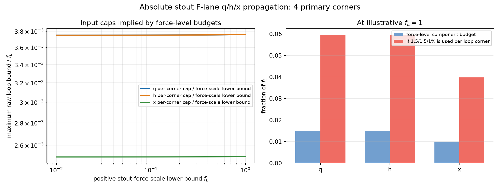

# Wilson absolute stout F-lane q/h/x force-budget propagation

**Formula-only CPU diagnostic.** No Wilson loop data, sealed split, GPU or QUDA input was read. `physical_score=null`; the ground-state force remains `GROUND_STATE_FORCE_UNCERTIFIED`.

## Result

The selected F-lane estimand is the **absolute stout ground-state force** `U0_stout(3)-U0_stout(2)`. Its q/h/x contamination propagates through **4 stout loop corners**: `R=2,3` and adjacent times `T=5,6`. Identity has the same ground-state spectrum under the shared action and static-source convention, so its four corners remain a consistency diagnostic and are excluded from the primary budget. If each loop corner has `delta=log(1+q+h+x)`, the conservative primary bound sums the four stout `delta` bounds. For separate component accounting, `log(1+q+h+x) <= log(1+q)+log(1+h)+log(1+x)` for nonnegative inputs.

At illustrative positive force-scale lower bound `f_L=1`, interpreting the draft `1.5% / 1.5% / 1%` values as **raw per-corner caps** gives q/h/x force-bound fractions `0.0596`, `0.0596`, `0.0398`. Each exceeds its corresponding force-level budget. The combined exact log envelope is `0.1569 f_L`; after the proposed model (`1%`) and statistical (`5%`) allowances, the total is `0.2189 f_L`, above the `10%` total tolerance. The identity-kernel comparison envelope is separately reported in `protocol.json` and does not enter this primary total.

For a uniform raw component cap `c` across the four stout corners, requiring its propagated force contribution to be no larger than `epsilon*f_L` yields

```text
4 log(1+c) <= epsilon*f_L
c <= expm1(epsilon*f_L/4).
```

At `f_L=1`, the resulting raw loop caps are q=`0.0037570`, h=`0.0037570`, x=`0.0025031`. These are planning calculations, not measured q/h/x values or accepted production inputs. `cap_sensitivity.csv` and the figure show how the required raw caps change with the yet-unknown positive stout-force scale.



## Denominators and flow

- Deterministic formula scenarios: planned/valid/failed/abstained = `50/50/0/0`.
- Physical evidence gate: `1/0/0/1`; independent stout loop envelopes, positive force-scale lower bound, propagated model bound and reviewer receipt are absent.

```text
positive stout-force scale lower bound + q/h/x bounds at 4 stout corners
  -> log envelopes -> 4-term absolute-force bound
  -> identity corners -> shared-spectrum consistency diagnostic only
  -> compare q/h/x component budgets in force units
  -> add model-truncation and statistical bounds
  -> <=10% total gate AND independent receipts/review
  -> otherwise ABSTAIN; physical_score remains null
```

The output is conditional algebra only. It neither verifies physical positivity nor establishes any q/h/x envelope, spectral-model error, statistical coverage, or positive force-scale lower bound. Source hashes and all output identities are in `protocol.json` and `artifact_hashes.json`; the shared numeric-conversion source is retained as `snapshot_core_numerics.py`.
