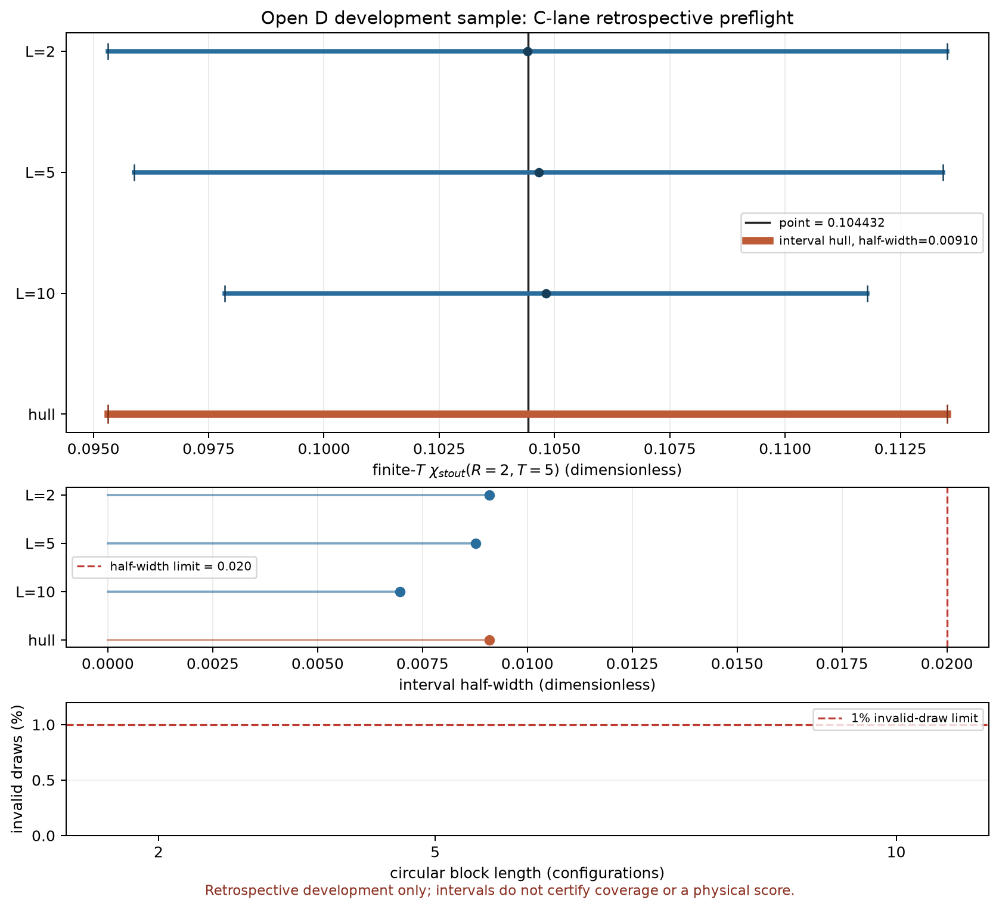

# Wilson C-lane open-development preflight

**Status:** `RETROSPECTIVE_DEVELOPMENT_ONLY_NOT_CONFIRMATION`; `physical_score=null`; no physical gate is closed by this report.

## Data boundary and identity

This run reads only the pinned D-chain development transaction, IDs 0–99: `development.npz`, `development_provenance.json`, and `development.commit.json`. The NPZ, provenance, generation, loop-array fingerprint, and frozen source fingerprints are checked before analysis. Validation, gap, shared holdout, and confirmation files are never opened. Input hashes are recorded in `summary.json` and `protocol.json`; bootstrap estimates and this source are covered by `manifest.json`.

The open package is 16^4, beta=6, periodic in all directions, with `N_t=16`. The selected spatial kernel is `stout_rho0.1_n5` (stout rho=0.1, five steps). Four loop means use the same IDs and, in each bootstrap draw, the same sampled configuration indices:

```text
chi(2,5) = -[log Wbar(3,6) + log Wbar(2,5) - log Wbar(3,5) - log Wbar(2,6)]
```

## Procedure and denominator

The script forms the four full-sample means, then uses 10,000 circular moving-block bootstrap draws at each block length `L=2,5,10`. The deterministic seed is `20,261,125 + L`. Every draw resamples exactly 100 saved-configuration positions and applies the formula only if all four required means are finite and positive. Invalid draws stay in the planned denominator. Each interval is the equal-tail 97.5% percentile interval (lane alpha=0.025); the reported uncertainty envelope is the hull over the three block-length intervals.

| Quantity | Result |
|---|---:|
| Configurations planned | 100 |
| Full-sample four-loop means positive | True |
| Point estimate | 0.10443172 |
| Bootstrap draws planned / valid / invalid | 30000 / 30000 / 0 |
| Hull lower / upper | 0.09531340 / 0.11350806 |
| Hull half-width; target | 0.00909733 ; 0.020 |
| Empirical numeric preflight | PASS |



## Interpretation and limits

The interval hull checks the selected numeric precision rule on an already-observed development sample. Even if its width is below 0.02 and invalid draws are at most 1%, it does **not** establish bootstrap coverage, finite dependence, a plateau, a ground-state force, or an independent calibration result. D0–99 has already been used for development and possible selection, so it cannot be relabelled as confirmation. A separately authorized, previously unobserved calibration package is still required for an evidence-bearing C-lane measurement.

This is the absolute finite-`T` Creutz observable at `R=2,T=5`. It is not the F-lane ground-state discrete static force. The package contains only `N_t=16` loop data; it has no independent 3x3 GEVP/spectral receipt or matched `N_t=32` thermal data, so the F lane remains `GROUND_STATE_FORCE_UNCERTIFIED`.

Text data flow: `pinned open D development transaction -> verify hashes/split/IDs/kernel -> four paired loop means -> circular L=2/5/10 resampling -> keep invalid draws in denominator -> 97.5% intervals -> interval hull and numeric gates -> retrospective-only report; independent calibration and physical certification remain NOT_READY`.

Rerun from the repository root with the open package path supplied explicitly:

```bash
python -m tasks.wilson_loop.c_lane_open_development_diagnostic \
  --input-dir /path/to/results/wilson_loop/s16t16d_development_20261120
```

The default output directory is next to this report and fails closed if it already exists. The script never copies the input NPZ into the repository.
