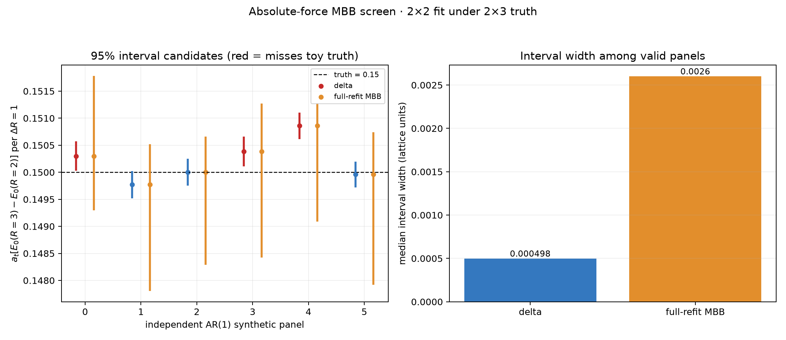

# Absolute stout ground-force full-refit bootstrap screen

**Status:** `SYNTHETIC_SCREENING_ONLY_FULL_REFIT_MBB`. The fit uses a 2-vacuum x 2-static model on a fixed positive-spectrum 2-vacuum x 3-static synthetic truth; no physical score is produced.

## Frozen method and outcome

- Independent panels: `6`; `96` ordered blocks/panel; AR(1) `rho=0.5`, relative noise `0.003`; panel seeds `2026113800 + panel_index`.
- Each panel gets `39` circular moving-block resamples of length `8` and a complete regularized 2x2 GLS refit. Any failed refit abstains that panel's percentile interval.
- Bootstrap refits denominator: `234/234/0/0` planned/valid/failed/abstained; panel interval denominator `6/6/0/0`.
- Delta intervals: `3/6` contain the exact force; full-refit MBB intervals: `6/6` contain it. Their median widths are `0.0004981055899855591` and `0.0026003444192108094` lattice units.
- With `B=39`, the equal-tail 95% interval uses the sample minimum and maximum. This is deliberately reported as a coarse method screen, not a calibrated interval.



## Data flow

```text
six disjoint AR(1) panels -> full 2x2 GLS fit -> circular length-8 block resample -> hash-bound raw snapshot -> full GLS refit -> retain failures -> 95% extreme-order interval vs exact 2x3 toy force
```

## Interpretation and limits

The bootstrap reproduces sampling variation under the panel's empirical block process, but a refit of the same misspecified 2x2 model cannot remove omitted-state bias. Six panels and B=39 are too small for coverage claims. This result may reject a method candidate; it cannot certify physical force uncertainty or replace an independently justified model-truncation envelope.

No Wilson measurements, GEVP data, sealed splits, GPU or QUDA were accessed. C/F stay `NOT_READY/UNCERTIFIED`; F stays `GROUND_STATE_FORCE_UNCERTIFIED`; `physical_score=null`.
