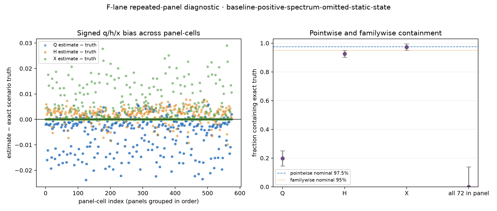
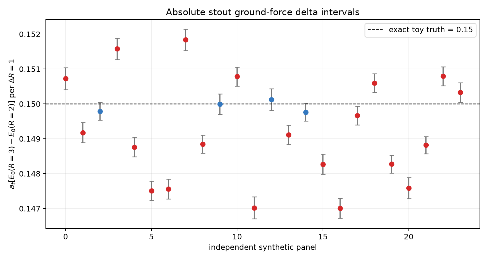

# Wilson F lane: repeated-panel coverage diagnostic

**Status:** `SYNTHETIC_SCREENING_ONLY_ABSOLUTE_FORCE_ESTIMATOR_BRIDGE`. This is not a physical Wilson measurement or certification; `physical_score=null`, F remains `GROUND_STATE_FORCE_UNCERTIFIED`.

## Frozen design and result

- `24` independent synthetic panels, `96` blocks per panel; truth: `2 vacuum x 3 static states; fit fixed at 2 x 2`; fit: `2 vacuum x 2 static`; relative noise `0.003`; noise model `{'model': 'iid_gaussian', 'scale_by_T': {}}`; seed rule `numpy default_rng(2026113600 + panel_index); disjoint from prior screens`.
- Every panel uses the same regularized full-covariance GLS and finite-difference delta intervals: one-sided 97.5% pointwise, plus Bonferroni-72 familywise upper bounds. No interval/shrinkage/window was tuned on these panels.
- Fit denominator: `24/24` valid, `0` failed; q/h/x planned cells `1728`. Unique matrix hashes: `24/24`.
- Pointwise pooled descriptive containment: `1207/1728 = 0.698`; interpret with the panel-cluster term means and intervals in the summary because cells within a fit are correlated.
- Entire 72-term Bonferroni family contained in `0/24` panels (`0.000`), Wilson 95% MC interval `[0.0, 0.1379762046749802]`.
- Absolute stout-force normal-delta interval: `4/24` valid panels contain exact toy truth `0.15`; planned/valid/failed/abstained `24/24/0/0`; Wilson 95% Monte Carlo interval `[0.06678676328632951, 0.3585307064969906]`.
- The force interval uses the inverse whitened-Jacobian covariance and a two-sided normal delta approximation. It is included to expose estimator-specific behavior, not to claim finite-sample calibration.





## Data flow

```text
freeze scenario truth/noise + 2x2 fit + interval rules -> disjoint seed per panel -> write and hash raw matrix snapshot -> same GLS fit -> compare 72 q/h/x uppers and absolute-force normal interval with exact toy truth -> keep separate coverage/failure denominators -> physical F gate abstains
```

## Interpretation and limits

Checks only whether the current two-sector GLS absolute stout ground-force normal-delta interval contains the exact force in one fixed 2-vacuum x 3-static truth while fitting 2 x 2. It does not calibrate physical coverage or validate the source/exporter convention.

The source/NPZ snapshots, fit-start ledger, panel/cell CSVs, protocol, figures and hashes are retained; full parameter vectors are omitted because the raw inputs and derived coverage cells are sufficient to replay and inspect this diagnostic. Synthetic CPU screening does not validate physical source/exporter/thermal/mixed/force receipts. No GPU/QUDA or sealed data were used.
