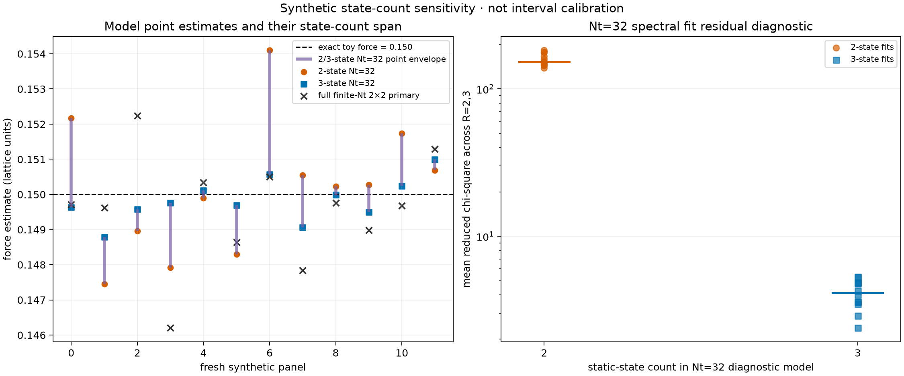

# Absolute stout force: state-count sensitivity screen

**Status:** `SYNTHETIC_MODEL_SENSITIVITY_SCREEN_ONLY`. This report compares point estimates from two Nt=32 spectral models; its span is not a confidence interval.

## Protocol and outcome

- 12 fresh panels; 96 ordered blocks/panel; stationary AR(1) `rho=0.5`; relative noise `0.003`; seeds `2026114000 + panel_index`.
- The primary reference fit is the current regularized 2-vacuum × 2-static finite-Nt GLS over `Nt={16,32}`, `T=3…7`. The sensitivity fits separately model each radius using matched `Nt=32`, `T=3…7`, with two or three static states.
- The plotted state-count span is simply `[min(F_2state,F_3state), max(F_2state,F_3state)]`. Any failed/rank-deficient state-count fit abstains that panel envelope.
- Exact synthetic primary force: `0.14999999999999997` lattice units. The two-point-estimate span contains it in `5/12` valid panels; this fraction is descriptive and is not interval coverage. Median span width is `0.001362019455343283` lattice units.



## Data flow

```text
fresh positive-spectrum 2-vacuum × 3-static matrices
  -> current full finite-Nt 2×2 primary fit
  -> matched Nt=32, per-R 2-state and 3-state GLS fits
  -> force point-estimate span + fit residual diagnostics
  -> retain every panel, failures, raw matrices, one shared lane contract, source/artifact hashes
```

## Interpretation and limits

The matched-Nt 2/3-state fits are not the same estimator as the full finite-Nt two-vacuum primary. Their point span has no within-model uncertainty construction, and this one generator/noise stratum cannot establish coverage. A useful next implementation must either extend the finite-Nt primary to a controlled third static state or build an estimator-matched constrained profile, then compare statistical intervals and truncation envelopes separately across the prespecified difficult strata.

No production Wilson matrices, GEVP data, sealed split, GPU or QUDA were accessed. The physical score remains null; F remains `GROUND_STATE_FORCE_UNCERTIFIED`.
