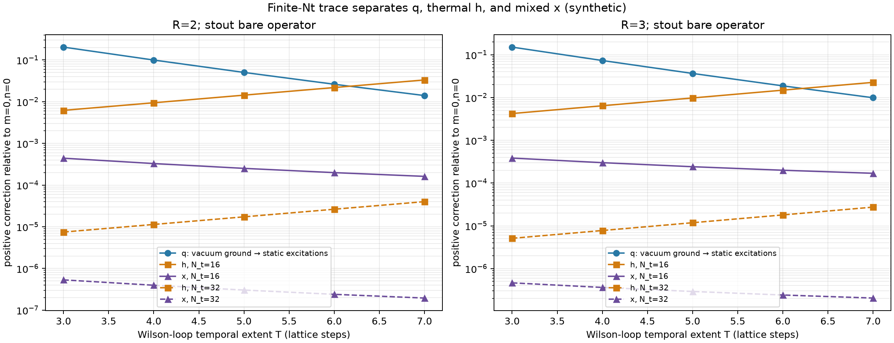

# Finite-`N_t` transfer-trace split of Wilson F-lane q/h/x

**Synthetic diagnostic only:** `physical_score=null`, no Wilson measurements or sealed inputs were read, and no GPU/QUDA work was run. The script evaluates an exact, hand-set finite-state transfer-matrix trace; it does not fit raw correlators or estimate interval coverage.

## Why this diagnostic was added

The selected F-lane contract already separates a forward excited-state term `q`, a complementary-time thermal term `h`, and a mixed term `x`, then propagates them as `log1p(q+h+x)`. The contract did not yet state how those terms correspond to the finite temporal trace of a Wilson loop. The static-potential derivation in [Della Morte et al. (2010)](https://arxiv.org/abs/1012.3037) writes a finite-`N_t` trace with a vacuum-sector transfer matrix and a static-source-sector transfer matrix (their Eq. 2.5); in the `N_t→∞` limit it reduces to a positive sum over static-source states weighted by squared overlaps (their Eq. 2.6). The split below is my proposed interpretation of that trace, not a reviewer-approved production model.

## Model and mapping

For vacuum-sector state `m`, static-source state `n`, and bare smearing operator `k`, the toy uses

```text
C_ij(R,T;N_t) = Z0(N_t)^-1 * sum_(m,n) exp[-eps_m*(N_t-T)]
                * exp[-V_n(R)*T] * A_i,mn(R) * conj(A_j,mn(R))
Z0(N_t) = sum_m exp[-eps_m*N_t]
q_k = sum_(n>0) |A_(0,n,k)/A_(0,0,k)|^2 exp[-(V_n-V_0)*T]
h_k = sum_(m>0) |A_(m,0,k)/A_(0,0,k)|^2 exp[-eps_m*(N_t-T)]
x_k = sum_(m>0,n>0) |A_(m,n,k)/A_(0,0,k)|^2
      * exp[-eps_m*(N_t-T) - (V_n-V_0)*T]
C_kk / C_kk^(0,0) = 1 + q_k + h_k + x_k
```

The `q` row is the vacuum ground state `m=0` with excited static-source states `n>0`; it uses the same bare-operator identity as the selected kernel-indexed cells. `h` contains excited vacuum-sector states with the static-source ground state. `x` contains terms excited in both sectors. A real producer may have endpoint-time offsets; this toy absorbs constant endpoint factors into `A` and assumes time-local insertion operators. The production exporter must declare its exact time origin before the formula is used.

The plotted example holds the spectrum and overlaps fixed while changing `N_t=16` to `32`. `q` is unchanged; `h` and `x` decrease with the complementary extent. For `R=2`, stout at `T=5`, the toy gives `q=0.0503607`, `h(N_t=16)=0.0143545`, `h(N_t=32)=1.73193e-05`, and `x(N_t=16)=0.000251899`. These values illustrate the algebra only.



## Checks and limits

- Full `C_ij` matrices are Hermitian positive semidefinite; all 60 `R × operator × N_t × T` q/h/x cells reconstruct their diagonal trace exactly. Maximum absolute decomposition residual: `4.44e-16`.
- `q` does not change when only `N_t` changes, while the chosen positive toy thermal contribution `h` decreases when `N_t` doubles. This is the mathematical separation being tested; it does not establish the size or monotonicity of measured thermal errors in this task.
- Denominators (planned/valid/failed/abstained): decomposition `60/60/0/0`; matrix checks `20/20/0/0`; physical measurements `0/0/0/0`; certification gate `1/0/0/1`.

The finite trace does **not** by itself identify `q`, `h`, or `x` from noisy production data. That requires a reviewed source/sink convention, raw cross-correlator matrix, appropriate state model, covariance-aware fit, and simultaneous one-sided coverage. It also does not replace the separate finite-`T` Creutz lane. Keep `NOT_READY/UNCERTIFIED`, `GROUND_STATE_FORCE_UNCERTIFIED`, and `physical_score=null`.
