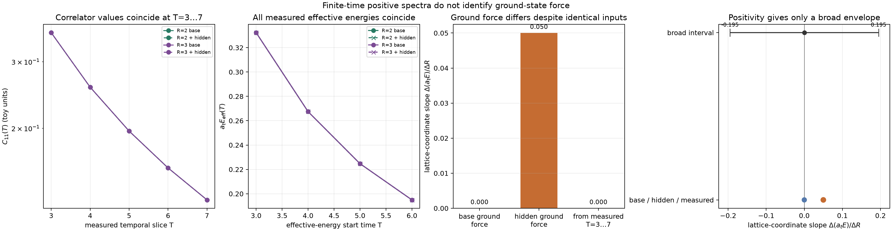

# Finite-time positive-spectrum non-identifiability witness

**Classification:** `DETERMINISTIC_POSITIVE_SPECTRUM_NONIDENTIFIABILITY_WITNESS_NOT_PHYSICAL_FORCE`. This is a deterministic analytic toy; no measured or sealed data, GPU, or QUDA input was used. `physical_score=null`.

## Frozen construction

The measured positive-time slices are `T=[3, 4, 5, 6, 7]` at radii `R=[2, 3]`, matching the current two-sector F-lane time slices. For each operator direction, the base correlator is a positive spectral sum with transfer eigenvalues `x_n=exp(-a_t E_n)=[0.15, 0.32, 0.51, 0.7, 0.9]` and positive weights `[0.9, 0.7, 0.5, 0.35, 0.2]`. The three operator overlap directions are orthogonal with positive Gram weights `[1.0, 0.8, 0.6]`, making every 3×3 correlator matrix positive definite.

For each radius `R`, the alternative adds a previously absent positive-amplitude ground state with amplitude `epsilon=1e-06` and `a_t E_0(R)=0.030` at R=2, `0.080` at R=3. Its transfer eigenvalue is larger than every base eigenvalue. The five old-state weights are adjusted by solving the square moment equations on exactly `T=3…7`; all adjusted weights remain positive (minimum `0.199998`).

Because `V[t,n]=x_n**t` is invertible for these distinct positive nodes and consecutive time slices, the alternative weights satisfy `V w_alt + epsilon v_hidden = V w_base`. Thus the complete 3×3 matrices at all ten `(R,T)` points agree to relative residual `7.750e-17` (the exact-real construction agrees identically). Yet the base ground energies are both `0.105361` and its R=2→3 ground force is `0.000`; the alternative ground energies are `[0.03, 0.08]` and force is `0.050`. The finite-time effective-energy force formed from the measured slices is `0.000e+00` for both.



## Text diagnostic

```text
positive base spectrum -> 3x3 C_ij(R,T), R=2,3 and T=3..7
                         | exact five-time moment equations
add tiny positive lower-energy state at each R
                         | solve for adjusted old weights (all stay positive)
same ten observed matrices / same effective energies
                         | different R-dependence of E0
ground force 0.000 vs 0.050 while observed finite-time force remains 0.000
```

## Interpretation and limits

This is a constructive non-identifiability result for the chosen finite set of positive-time correlator matrices. More generally, for a finite moment vector in the interior of the positive moment cone, a sufficiently small new positive atom can be added at a transfer eigenvalue above the assumed largest node, while nearby positive weights on the old nodes preserve every observed moment exactly. The hidden transfer eigenvalue can approach 1 while its positive amplitude shrinks, so these finite observations do not establish a positive lower gap or an overlap floor. Positivity together with a declared nonnegative-energy convention can still imply a broad envelope; this witness shows that the finite-time data alone do not identify a unique ground force or establish the tight project-specific model-truncation budget required by the F-lane contract. An independently justified overlap/gap/support restriction or equivalent receipt is needed to narrow that envelope. With noisy data the indistinguishable set only grows.

Under the **additional convention** that every ground energy is nonnegative, positive spectral weights imply `0 <= E0(R) <= min_T E_eff(R,T)`. Applied to this toy, that gives only `ground force in [-0.194949, 0.194949]`, a width of `0.389898` in lattice-coordinate units. This contains both witnesses, but it is broad; the nonnegative-energy convention itself must be checked for the production energy normalization, especially if an additive static-energy subtraction is used.

The witness does **not** say the hidden spectrum is realized in the project, quantify the actual force error, include finite-`N_t` winding/thermal or mixed-sector `h/x`, identify the production exporter convention, or establish the size of any valid spectral prior. The positivity-only range therefore does not set the Wilson force budget. It instead shows why an independently sourced spectral restriction is required before the F-lane model-truncation component can be made tight enough for the selected budget. Keep F=`GROUND_STATE_FORCE_UNCERTIFIED`, both Wilson lanes `NOT_READY/UNCERTIFIED`, `physical_score=null`, and sealed inputs closed.

## Reproduction and evidence

Run from repository root with `python -m tasks.wilson_loop.f_lane_finite_time_ground_force_nonidentifiability`. The output directory is no-clobber. `spectra_and_correlators.npz` retains the base and alternative 3×3 matrices; `finite_time_observables.csv` retains every planned radius-time row; `witness_parameters.json`, `protocol.json`, `summary.json`, source snapshot and artifact hashes record the complete construction. The deterministic denominator is **10/10/0/0** `(R,T)` matrix points (planned/valid/failed/abstained) for each spectrum. These are toy algebra points, not Monte Carlo panels or physical observations.
