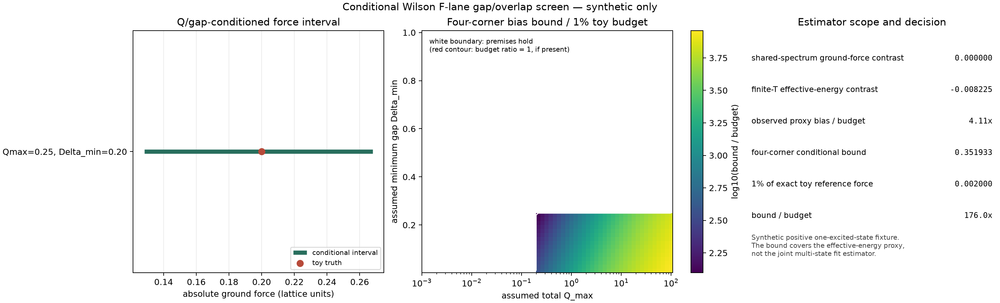

# Conditional gap/overlap force screen

**Classification:** `CONDITIONAL_POSITIVE_SPECTRUM_EFFECTIVE_ENERGY_SCREEN_NOT_PHYSICAL_RECEIPT`. The inputs are a deterministic positive one-excited-state toy. No Wilson measurement, sealed split, GPU, or QUDA data were read; `physical_score=null`.

## Scope correction for the preceding finite-time witness

The repository's selected F-lane estimand is the stout-minus-identity difference in ground-state force. In a shared transfer matrix, the ground-state energy at each R is common to all interpolating operators, so that exact ground-state difference is identically zero. The preceding non-identifiability witness varies the **absolute** force between two spectra; within each spectrum its operator directions share the same energies, so the selected stout-minus-identity difference remains zero in both. That witness therefore establishes non-identifiability of the absolute force, but it does not by itself demonstrate non-identifiability of the selected kernel-difference estimand or calibrate its joint-fit truncation error.

This screen keeps those quantities separate: it gives a conditional interval for the absolute force, reports the exact shared-spectrum ground-force contrast as zero, and bounds the finite-time effective-energy contrast's excited-state bias. The last bound is **not** a validated bound for the repository's multi-state joint-fit estimator.

## Formula and conditions

For positive forward spectral weights, write `C_k,R(T)=A0_k,R exp(-E0(R) T) [1+rho_k,R(T)]`, where `rho(T)=sum_n r_n exp(-Delta_n T)`. If the external conditions `sum_n r_n <= Q_max` and `Delta_n >= Delta_min` hold for each kernel/radius, then:

```text
0 <= E_eff,k,R(T)-E0(R)
  = log[(1+rho(T))/(1+rho(T+1))]
  <= log1p(Q_max exp(-Delta_min T)) = b_k,R(T)
E0(R) in intersection_{k,T} [E_eff,k,R(T)-b_k,R(T), E_eff,k,R(T)]
F_abs in [L_E0(R=3)-U_E0(R=2), U_E0(R=3)-L_E0(R=2)] / DeltaR
|F_eff,stout-F_eff,identity| <= sum_{k in {stout,identity}, R in {2,3}} b_k,R(5)
```

The interval is invariant under a common additive static-energy subtraction; it does not assume `E0>=0`. The `Q_max` and `Delta_min` values remain assumptions until independently bounded from an authorized spectrum receipt. No Monte Carlo coverage is claimed.

## Toy screen result

The fixture uses shared `E0(R=2,3)=(-0.250,-0.050)`, giving absolute force `0.200` and exact stout-minus-identity ground-force difference `0`. Kernel/radius overlap ratios range from `0.08` to `0.20`; gaps range from `0.25` to `0.45`. With display assumptions `Q_max=0.25`, `Delta_min=0.20`, the conditional absolute-force interval is `[0.128243, 0.267936]` and contains the toy truth.
At T=5 the finite-time effective-energy contrast is `-0.008225` while the true shared-spectrum contrast is zero. Its observed absolute toy bias is `0.008225`, or `4.11x` the budget. The four-corner conditional bias bound is `0.351933`. Against the toy exact reference-force lower value `0.200`, the one-percent model-truncation budget is `0.002000`; the conservative bound is `176.0x` that limit and therefore does not pass this toy screen.



The deterministic grid has 3721 planned `(Q_max, Delta_min)` points. The toy premises hold at 495 points; all such points cover the toy absolute force, and 0 meet the one-percent proxy-bias budget. This is algebraic sensitivity, not a statistical coverage rate.

## Limits and handoff

This result connects the scalar `Q exp(-Delta_min T)` envelope in `ground_state_bound.py` to effective-energy intervals and to the sum of four kernel/radius proxy-bias terms. The `spectral_q_bound_reader.py` supplies a different, fit-receipt-dependent sum over statewise overlap-ratio and gap bounds; its successful parsing remains conditional, not proof that the bounds have coverage. Neither route validates the multi-state joint-fit estimator, finite-Nt thermal/mixed contributions, omitted-state coverage, or the selected physical force contrast.

For a production advance, the independent receipt must establish each kernel/radius `Q_max` and `Delta_min`, their simultaneous coverage, and the shared transfer-spectrum convention. Then an estimator-specific bridge must compare the actual joint-fit force contrast with this conservative effective-energy proxy on disjoint calibration inputs. Until then keep both Wilson lanes `NOT_READY/UNCERTIFIED`, F=`GROUND_STATE_FORCE_UNCERTIFIED`, and `physical_score=null`; sealed inputs remain closed.

## Reproduction

Run from the repository root: `python -m tasks.wilson_loop.f_lane_gap_overlap_force_screen`. The output directory is no-clobber. `protocol.json`, `conditional_gap_overlap_grid.csv`, `summary.json`, the figure, and `source_snapshot/` bind the assumptions and source bytes. The synthetic denominator is 4/4/0/0 kernel-radius corners; the parameter-grid denominator is 3,721 deterministic cells.
