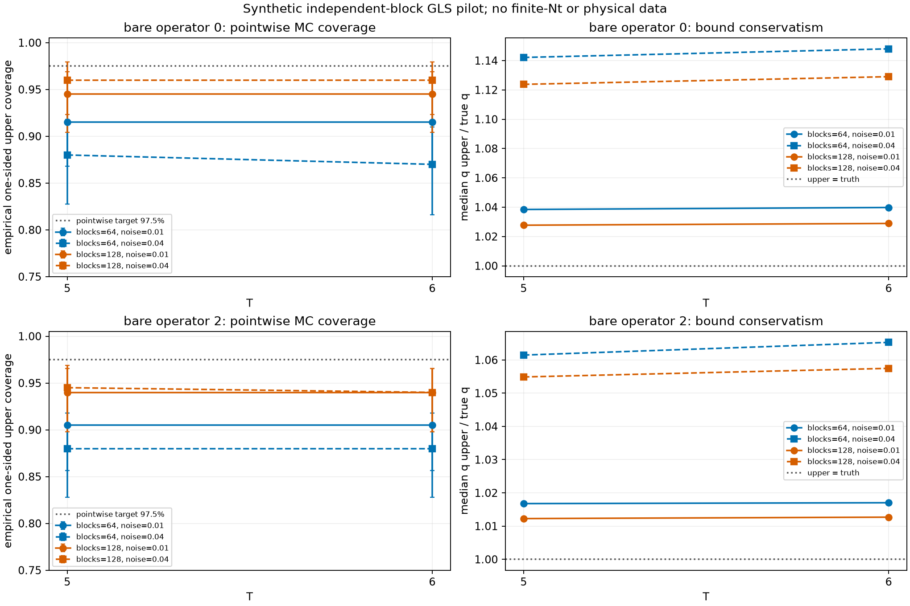
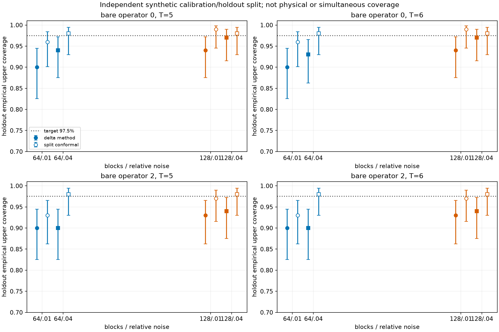

# Wilson F-lane synthetic joint spectral GLS pilot

**SYNTHETIC METHOD DIAGNOSTIC ONLY.** No raw Wilson inputs, source snapshots, sealed splits, GPU or QUDA data were accessed. `physical_score=null`; F remains `GROUND_STATE_FORCE_UNCERTIFIED`.

## Model and calculation

The generator uses exactly three positive forward states and three bare operators, with one shared energy spectrum across every real and imaginary component of the 3×3 matrices at `t=1..7`. Each synthetic panel has independent Gaussian block vectors; the fit estimates the full 63×63 covariance from those same blocks, applies the explicitly illustrative 25% diagonal shrinkage and `1e-10` relative eigenvalue floor, whitens the joint residual, and fits 18 common energy/overlap parameters. GEVP at `t0=1` initializes the fit. The pointwise q upper is `qhat + 1.95996*delta_method_SE`, with parameter covariance from the inverse whitened information matrix.

The q cells use bare basis operators 0 and 2 at `T=5,6`, matching the selected object semantics. The delta-method parameter covariance is the inverse whitened information matrix; it is not multiplied by reduced chi-square because the fitted GLS covariance already estimates the mean covariance. The resulting intervals are pointwise, not familywise; this experiment measures coverage only under the stated synthetic design and does not establish general or physical coverage. It does not resample fitted spectra or include model-selection uncertainty.

The grid has 800 synthetic panels (200 per noise × block-count cell) and 3200 q cells; panel planned/valid/failed/abstained = `800/800/0/0`, q-cell planned/valid/failed/abstained = `3200/3200/0/0`. The pointwise delta upper covers `0.870–0.960` against a 0.975 target; exact per-cell Wilson Monte Carlo intervals and upper/truth ratios are in `coverage_summary.csv`.
All `16/16` pointwise delta coverage estimates are below 0.975; `14/16` cells also have 95% Wilson Monte Carlo upper limits below target. This is evidence against using this uncalibrated delta rule for the chosen synthetic regime.

## Independent split-calibration check

Within each exact operator/time/noise/block stratum, replicate IDs `0:100` calibrate the studentized one-sided score `(q_true - qhat)/SE`; IDs `100:200` form a disjoint holdout. The finite-sample rank is `ceil((n_cal+1)*0.975)`. Failed or missing calibration q values enter as `+infinity`; if the rank exceeds the planned calibration count or the selected quantile is infinite, the interval method abstains rather than returning a finite bound. The diagnostic produced finite conformal multipliers for `16/16` strata.

On valid holdout q cells, ordinary delta upper coverage is `0.900–0.970`. Split-conformal upper coverage is `0.930–0.990` across finite-calibrator strata.
For the split-conformal holdout, `2/16` strata have a 95% Wilson Monte Carlo upper limit below 0.975; preserve that finite-holdout uncertainty alongside the exchangeability-based marginal guarantee.
Across finite-calibrator strata, median `q_upper/q_true` ranges from `1.017` to `1.246`; cell-level conservatism is recorded in `calibration_summary.csv`.
The split-conformal statement is marginal and only applies under exchangeability within these exact synthetic strata. Calibration panels use simulator truth unavailable for a real physical force; this is a candidate calibration pattern, not an authorized Wilson receipt or simultaneous q/h/x bound.

## Limits and next work

This best-case generator has exactly the fitted state count, forward-only infinite-time spectrum, known stationary independent synthetic blocks and Gaussian noise. It does not model omitted levels, finite-`N_t` thermal `h`, mixed `x`, shared-chain dependence, production endpoint semantics, raw exporter layout, force/reference propagation or the full familywise q/h/x budget. The 25% shrinkage/floor and delta method are candidate numerical choices, not an approved production covariance or interval rule. Even better same-generator split-conformal coverage would not certify the physical lane.

The next software-only stress should add an omitted fourth state, near-degenerate gaps, near-zero bare ground overlaps, and covariance estimates with fewer effective blocks; retain failures and compare profile/bootstrap intervals before any reader/gate connection. Production integration still requires an independently reviewed exporter, authorized immutable raw snapshot and calibration split. Keep `NOT_READY/UNCERTIFIED`, `GROUND_STATE_FORCE_UNCERTIFIED`, and `physical_score=null`.

Text flow: `exact 3-state source -> correlated synthetic block matrices -> same-block covariance/shrinkage -> whiten all matrix residuals -> joint ordered-spectrum fit -> pointwise bare-operator q upper -> per-cell Monte Carlo coverage + denominator figure -> certification abstains`.
