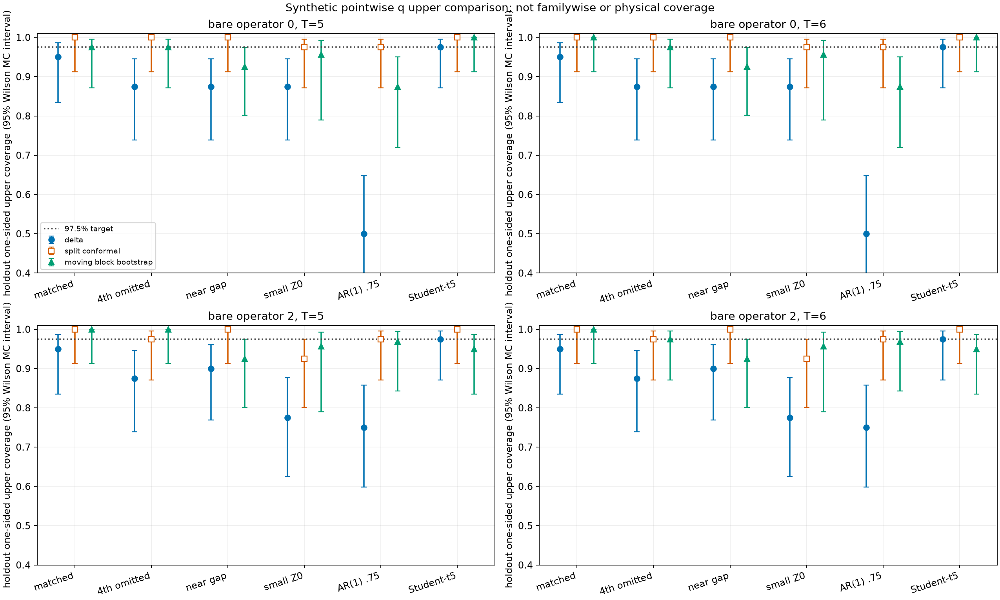

# Wilson F-lane moving-block bootstrap interval pilot

**Synthetic CPU diagnostic only.** The input is the hash-verified tracked six-scenario synthetic stress bundle. No Wilson measurement, sealed split, GPU or QUDA data were read. `physical_score=null`; F remains `GROUND_STATE_FORCE_UNCERTIFIED`.

## Fixed design and interval rules

For each of 6 scenarios, the run uses the 40 disjoint holdout panels from the six-scenario report, and draws `40` circular moving-block resamples per panel with fixed block length `8` from `96` ordered blocks. Length 8 is chosen to span the approximate AR(1) integrated correlation scale at rho 0.75 (about 7 blocks); the same rule is held fixed across all scenarios. Each resample refits the full three-state joint GLS model. Pointwise q cells are bare operators 0/2 at T=5/6.

The moving-block upper is the empirical order statistic at rank `ceil((B+1)*0.975)` among refit q estimates. A failed/missing bootstrap q estimate is +infinity; if the selected order statistic is infinite, the interval abstains. With B=40, tail resolution is coarse and the selected statistic is the sample maximum; report this as a pilot only. Comparators use the same holdout panels: pointwise delta upper, split-conformal upper calibrated on the separate first 40 synthetic panels, and moving-block bootstrap upper.

## Results

Outer panels planned/valid/failed/abstained = `240/240/0/0`; bootstrap refits = `9600/9510/90/0`; bootstrap q estimates = `38400/38040/360/0`; moving-block intervals = `960/860/0/100`. Full per-cell 95% Wilson MC intervals, widths and calibration values are in `method_comparison.csv` and `calibration_summary.csv`.

- `matched_3state_independent`: delta: coverage `0.950–0.950`, median upper/truth `1.066–1.160`; split_conformal: coverage `1.000–1.000`, median upper/truth `1.120–1.233`; moving_block_bootstrap: coverage `0.975–1.000`, median upper/truth `1.085–1.232`.
- `omitted_4th_state`: delta: coverage `0.875–0.875`, median upper/truth `1.049–1.105`; split_conformal: coverage `0.975–1.000`, median upper/truth `1.078–1.210`; moving_block_bootstrap: coverage `0.975–1.000`, median upper/truth `1.070–1.157`.
- `near_degenerate_first_gap`: delta: coverage `0.875–0.900`, median upper/truth `1.375–1.451`; split_conformal: coverage `1.000–1.000`, median upper/truth `2.195–2.456`; moving_block_bootstrap: coverage `0.925–0.925`, median upper/truth `1.726–1.945`.
- `small_ground_overlap_operator_2`: delta: coverage `0.775–0.875`, median upper/truth `1.247–1.404`; split_conformal: coverage `0.925–0.975`, median upper/truth `1.366–1.700`; moving_block_bootstrap: coverage `0.957–0.957`, median upper/truth `1.322–1.854`.
- `ar1_block_rho_0p75`: delta: coverage `0.500–0.750`, median upper/truth `1.015–1.043`; split_conformal: coverage `0.975–0.975`, median upper/truth `1.227–1.456`; moving_block_bootstrap: coverage `0.875–0.969`, median upper/truth `1.203–1.377`.
- `student_t5_independent`: delta: coverage `0.975–0.975`, median upper/truth `1.053–1.120`; split_conformal: coverage `1.000–1.000`, median upper/truth `1.068–1.153`; moving_block_bootstrap: coverage `0.950–1.000`, median upper/truth `1.069–1.162`.

## Interpretation and limits

The comparison is pointwise across independent synthetic panels within each exact scenario. Bootstrap refits are conditional on the generated panel; they do not correct omitted-state bias or prove positive-spectrum assumptions. The B=40 upper-tail estimate is highly discrete, and this run does not tune block length or account for uncertainty in choosing it. Split-conformal has a separate finite-sample exchangeability argument across panels; moving-block bootstrap does not inherit that guarantee. None of these intervals controls simultaneous q/h/x familywise coverage.

Text flow: `hash-check six-scenario stress bundle -> use fixed 40-panel holdout -> regenerate each deterministic panel from its seed -> circular length-8 block resamples -> refit 3-state full-covariance GLS -> retain every bootstrap failure as +infinity -> compare interval coverage/width/abstention -> certification abstains`.

No bound from this report may enter `spectral_q_bound_reader` or the force gate. Remaining work includes a larger-bootstrap stability scan, block-length sensitivity fixed before evaluation, a profile-likelihood comparator, familywise q/h/x coverage, and real authorized calibration snapshots with independent contamination receipts. Keep `NOT_READY/UNCERTIFIED`, `GROUND_STATE_FORCE_UNCERTIFIED`, and `physical_score=null`.

Reproduce with `PYTHONPATH=. python -B -m tasks.wilson_loop.f_lane_joint_spectral_mbb_diagnostic --output tasks/wilson_loop/f_lane_joint_spectral_mbb_20261126_v1 --outer-panels-per-scenario 40 --bootstrap-replicates 40 --block-length 8`. Source and artifact hashes are recorded in `protocol.json`, `summary.json`, and `artifact_hashes.json`.
