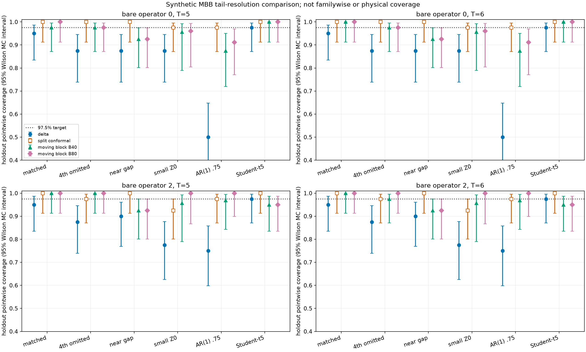

# Wilson F-lane moving-block bootstrap B=80 stability extension

**Synthetic CPU diagnostic only.** The hash-verified B=40 report is reused and extended with deterministic bootstrap indices 40–79; no measurement, sealed split, GPU or QUDA data were read. `physical_score=null`; F remains `GROUND_STATE_FORCE_UNCERTIFIED`.

## Fixed design

The same 6 scenarios, 40-panel calibration/holdout split and length-8 circular blocks are retained. Existing B=40 refits are checked by artifact SHA-256 and reused without modification; only 9600 additional full 3-state GLS refits are run. B=80 uses rank `ceil(81×0.975)=79`; failed/missing q draws remain `+infinity`. The same holdout panels compare delta, split-conformal, MBB B=40 and MBB B=80. This is a tail-resolution sensitivity check, not an independent coverage validation.

## Results

Additional refits planned/valid/failed/abstained = `9600/9520/80/0`; additional q estimates = `38400/38080/320/0`; B=80 intervals = `960/876/0/84`. Cell-level MC intervals, widths and abstentions are in `method_comparison.csv`.

- `matched_3state_independent`: delta coverage `0.950–0.950`, valid/planned `[(40, 40)]`; split_conformal coverage `1.000–1.000`, valid/planned `[(40, 40)]`; moving_block_B40 coverage `0.975–1.000`, valid/planned `[(40, 40)]`; moving_block_B80 coverage `1.000–1.000`, valid/planned `[(40, 40)]`.
- `omitted_4th_state`: delta coverage `0.875–0.875`, valid/planned `[(40, 40)]`; split_conformal coverage `0.975–1.000`, valid/planned `[(40, 40)]`; moving_block_B40 coverage `0.975–1.000`, valid/planned `[(40, 40)]`; moving_block_B80 coverage `0.975–1.000`, valid/planned `[(40, 40)]`.
- `near_degenerate_first_gap`: delta coverage `0.875–0.900`, valid/planned `[(40, 40)]`; split_conformal coverage `1.000–1.000`, valid/planned `[(40, 40)]`; moving_block_B40 coverage `0.925–0.925`, valid/planned `[(40, 40)]`; moving_block_B80 coverage `0.925–0.925`, valid/planned `[(40, 40)]`.
- `small_ground_overlap_operator_2`: delta coverage `0.775–0.875`, valid/planned `[(40, 40)]`; split_conformal coverage `0.925–0.975`, valid/planned `[(40, 40)]`; moving_block_B40 coverage `0.957–0.957`, valid/planned `[(23, 40)]`; moving_block_B80 coverage `0.960–1.000`, valid/planned `[(25, 40)]`.
- `ar1_block_rho_0p75`: delta coverage `0.500–0.750`, valid/planned `[(40, 40)]`; split_conformal coverage `0.975–0.975`, valid/planned `[(40, 40)]`; moving_block_B40 coverage `0.875–0.969`, valid/planned `[(32, 40)]`; moving_block_B80 coverage `0.912–1.000`, valid/planned `[(34, 40)]`.
- `student_t5_independent`: delta coverage `0.975–0.975`, valid/planned `[(40, 40)]`; split_conformal coverage `1.000–1.000`, valid/planned `[(40, 40)]`; moving_block_B40 coverage `0.950–1.000`, valid/planned `[(40, 40)]`; moving_block_B80 coverage `0.950–1.000`, valid/planned `[(40, 40)]`.

## Interpretation and limits

B=80 can show whether B=40's maximum order statistic materially changes, but it cannot repair structural bias from fitting three states to a four-state truth, near-degenerate identifiability, or unmodeled chain dependence. Coverage is conditional on finite, reported intervals; abstentions remain in the denominators. No q/h/x familywise guarantee is formed, and this report does not authorize a bound for the physical gate.

Text flow: `verify B=40 artifact/source hashes -> preserve indices 0:40 -> add deterministic indices 40:80 -> refit same full GLS on fixed holdout panels -> B=40/B=80/delta/conformal coverage, widths and abstentions -> certification abstains`.

Reproduce with `PYTHONPATH=. python -B -m tasks.wilson_loop.f_lane_joint_spectral_mbb_b80_diagnostic --output tasks/wilson_loop/f_lane_joint_spectral_mbb_b80_20261126_v1`. Source and output hashes are in `protocol.json`, `summary.json` and `artifact_hashes.json`.
