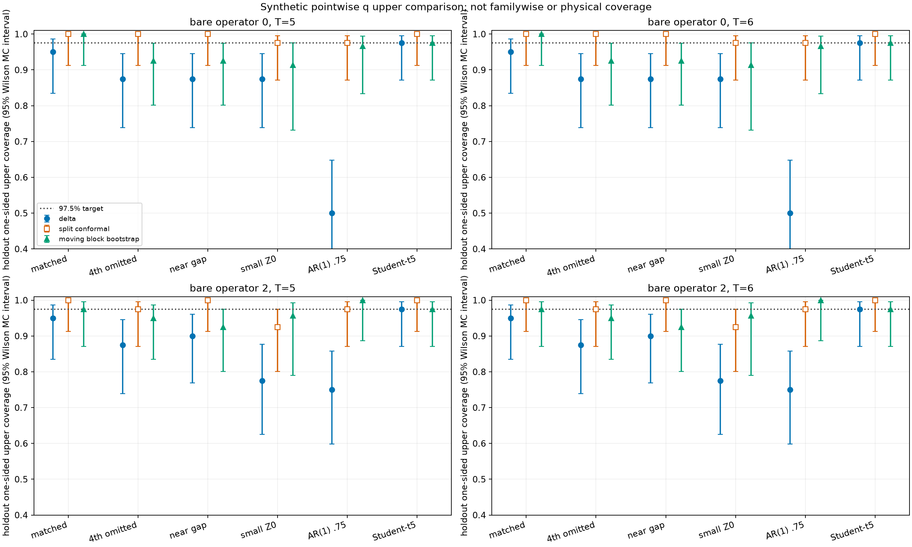

# Wilson F-lane MBB length-sensitivity cell

**Synthetic CPU diagnostic only.** This report reuses the hash-verified six-scenario stress bundle. It reads no Wilson measurements, sealed split, GPU, or QUDA data. `physical_score=null`; F remains `GROUND_STATE_FORCE_UNCERTIFIED`.

This is the pre-registered `L=10` cell in the fixed `L={6,8,10}` scan. The `L=8` baseline was inspected before this scan; this child is not an independent confirmation and cannot select a preferred length. All cells use the same deterministic holdout panel seeds, 40 calibration panels and 40 holdout panels per scenario, `B=40`, and upper order-statistic rank 40. Bootstrap seed keys are shared across lengths; the sampled circular chunk layout changes with L.

## Results

Planned/valid/failed/abstained: holdout panels `240/240/0/0`; bootstrap refits `9600/9512/88/0`; moving-block intervals `960/852/0/108`. Interval coverage is conditional on valid intervals; the table retains the full denominator.

| Scenario | Operator | T | Planned/valid/failed/abstained | Coverage (95% Wilson MC interval) | Median upper / truth |
|---|---:|---:|---:|---:|---:|
| `matched_3state_independent` | 0 | 5 | 40/40/0/0 | 1.000 [0.912, 1.000] | 1.212 |
| `matched_3state_independent` | 0 | 6 | 40/40/0/0 | 1.000 [0.912, 1.000] | 1.222 |
| `matched_3state_independent` | 2 | 5 | 40/40/0/0 | 0.975 [0.871, 0.996] | 1.099 |
| `matched_3state_independent` | 2 | 6 | 40/40/0/0 | 0.975 [0.871, 0.996] | 1.103 |
| `omitted_4th_state` | 0 | 5 | 40/40/0/0 | 0.925 [0.801, 0.974] | 1.170 |
| `omitted_4th_state` | 0 | 6 | 40/40/0/0 | 0.925 [0.801, 0.974] | 1.179 |
| `omitted_4th_state` | 2 | 5 | 40/40/0/0 | 0.950 [0.835, 0.986] | 1.074 |
| `omitted_4th_state` | 2 | 6 | 40/40/0/0 | 0.950 [0.835, 0.986] | 1.074 |
| `near_degenerate_first_gap` | 0 | 5 | 40/40/0/0 | 0.925 [0.801, 0.974] | 2.011 |
| `near_degenerate_first_gap` | 0 | 6 | 40/40/0/0 | 0.925 [0.801, 0.974] | 2.026 |
| `near_degenerate_first_gap` | 2 | 5 | 40/40/0/0 | 0.925 [0.801, 0.974] | 1.821 |
| `near_degenerate_first_gap` | 2 | 6 | 40/40/0/0 | 0.925 [0.801, 0.974] | 1.831 |
| `small_ground_overlap_operator_2` | 0 | 5 | 40/23/0/17 | 0.913 [0.732, 0.976] | 1.285 |
| `small_ground_overlap_operator_2` | 0 | 6 | 40/23/0/17 | 0.913 [0.732, 0.976] | 1.293 |
| `small_ground_overlap_operator_2` | 2 | 5 | 40/23/0/17 | 0.957 [0.790, 0.992] | 1.883 |
| `small_ground_overlap_operator_2` | 2 | 6 | 40/23/0/17 | 0.957 [0.790, 0.992] | 1.884 |
| `ar1_block_rho_0p75` | 0 | 5 | 40/30/0/10 | 0.967 [0.833, 0.994] | 1.445 |
| `ar1_block_rho_0p75` | 0 | 6 | 40/30/0/10 | 0.967 [0.833, 0.994] | 1.457 |
| `ar1_block_rho_0p75` | 2 | 5 | 40/30/0/10 | 1.000 [0.886, 1.000] | 1.208 |
| `ar1_block_rho_0p75` | 2 | 6 | 40/30/0/10 | 1.000 [0.886, 1.000] | 1.217 |
| `student_t5_independent` | 0 | 5 | 40/40/0/0 | 0.975 [0.871, 0.996] | 1.143 |
| `student_t5_independent` | 0 | 6 | 40/40/0/0 | 0.975 [0.871, 0.996] | 1.148 |
| `student_t5_independent` | 2 | 5 | 40/40/0/0 | 0.975 [0.871, 0.996] | 1.069 |
| `student_t5_independent` | 2 | 6 | 40/40/0/0 | 0.975 [0.871, 0.996] | 1.073 |

## Interpretation and limits

This cell varies only the circular block length around the previously used `L=8`. It uses the same already-inspected synthetic holdout panels. Any coverage change is descriptive sensitivity to the resampling scheme under this generator; it is not a new coverage guarantee, not a tuning target, and not evidence about HMC-chain correlation. Failed/missing bootstrap q estimates remain `+infinity` when forming the upper order statistic, and all planned intervals remain in the denominator.

No result from this report may enter the q reader or force gate. `L=6`, `L=8`, and `L=10` remain diagnostic-only regardless of which cell looks best. The pre-registered scan stops after these three values; further block-length or B tuning on this generator/holdout is out of scope. Real F-lane evidence still requires authorized raw cross-correlator snapshots, independently reviewed spectrum/overlap, finite-`N_t` thermal `h`, mixed-sector `x`, paired force/reference uncertainty, contamination bounds, and independent review.

Text flow: `verify stress-bundle hashes -> regenerate the fixed holdout panels from shared seeds -> circular MBB with this pre-fixed L and B=40 -> refit joint 3-state GLS -> retain failed q draws as +infinity -> compare pointwise coverage, Wilson MC intervals, width, and abstention -> certification abstains`.

Reproduce this child through `PYTHONPATH=. python -B -m tasks.wilson_loop.f_lane_joint_spectral_mbb_length_sensitivity --output tasks/wilson_loop/f_lane_joint_spectral_mbb_length_sensitivity_20261126_v1`. Source and artifact hashes are recorded in `protocol.json`, `summary.json`, and `artifact_hashes.json`.
