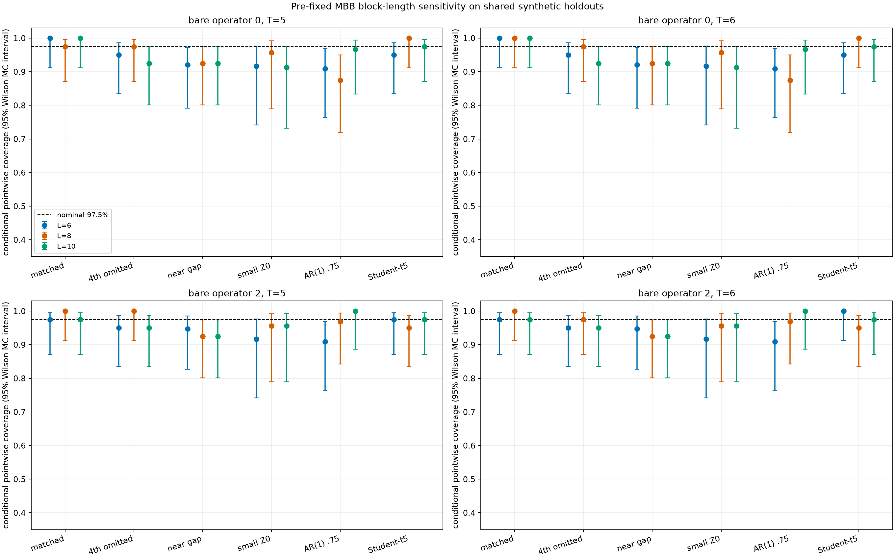

# Wilson F-lane MBB block-length sensitivity

**Synthetic CPU diagnostic only.** This fixed scan reuses the same hash-verified six-scenario stress bundle and the same 240 deterministic holdout panels. It reads no Wilson measurements, sealed split, GPU, or QUDA data. `physical_score=null`; F remains `GROUND_STATE_FORCE_UNCERTIFIED`.

## Frozen design

The length family was frozen before execution as `L={6,8,10}`. The already-reviewed B=40 `L=8` report is reused; only `L=6` and `L=10` were newly run. Each length uses the same first 40 calibration and last 40 holdout panels per scenario, `B=40`, rank 40, the same outer panel seeds, and the same bootstrap seed keys. The circular chunk layouts differ by L, as intended. This is a descriptive sensitivity scan on the same holdout, not an independent confirmation or a new calibration.

The seed-key audit matched `9600/9600` `(scenario, holdout panel, bootstrap index)` keys across all three lengths. The figure gives per-cell conditional coverage and 95% Wilson Monte Carlo intervals. An `x` means zero valid intervals; its displayed y=0.5 position is only a plotting placeholder, not a 50% estimate. The dashed line is the nominal pointwise 97.5% target; no familywise `q/h/x` guarantee is tested.

## Full cell diagnostics

| Scenario | L | Planned/valid/failed/abstained | Yield | Cell coverages (op0 T5/T6; op2 T5/T6) |
|---|---:|---:|---:|---|
| `matched_3state_independent` | 6 | 160/160/0/0 | 1.000 | op0 T5: 1.000 [0.912, 1.000], n=40/40; op0 T6: 1.000 [0.912, 1.000], n=40/40; op2 T5: 0.975 [0.871, 0.996], n=40/40; op2 T6: 0.975 [0.871, 0.996], n=40/40 |
| `matched_3state_independent` | 8 | 160/160/0/0 | 1.000 | op0 T5: 0.975 [0.871, 0.996], n=40/40; op0 T6: 1.000 [0.912, 1.000], n=40/40; op2 T5: 1.000 [0.912, 1.000], n=40/40; op2 T6: 1.000 [0.912, 1.000], n=40/40 |
| `matched_3state_independent` | 10 | 160/160/0/0 | 1.000 | op0 T5: 1.000 [0.912, 1.000], n=40/40; op0 T6: 1.000 [0.912, 1.000], n=40/40; op2 T5: 0.975 [0.871, 0.996], n=40/40; op2 T6: 0.975 [0.871, 0.996], n=40/40 |
| `omitted_4th_state` | 6 | 160/160/0/0 | 1.000 | op0 T5: 0.950 [0.835, 0.986], n=40/40; op0 T6: 0.950 [0.835, 0.986], n=40/40; op2 T5: 0.950 [0.835, 0.986], n=40/40; op2 T6: 0.950 [0.835, 0.986], n=40/40 |
| `omitted_4th_state` | 8 | 160/160/0/0 | 1.000 | op0 T5: 0.975 [0.871, 0.996], n=40/40; op0 T6: 0.975 [0.871, 0.996], n=40/40; op2 T5: 1.000 [0.912, 1.000], n=40/40; op2 T6: 0.975 [0.871, 0.996], n=40/40 |
| `omitted_4th_state` | 10 | 160/160/0/0 | 1.000 | op0 T5: 0.925 [0.801, 0.974], n=40/40; op0 T6: 0.925 [0.801, 0.974], n=40/40; op2 T5: 0.950 [0.835, 0.986], n=40/40; op2 T6: 0.950 [0.835, 0.986], n=40/40 |
| `near_degenerate_first_gap` | 6 | 160/152/0/8 | 0.950 | op0 T5: 0.921 [0.792, 0.973], n=38/40; op0 T6: 0.921 [0.792, 0.973], n=38/40; op2 T5: 0.947 [0.827, 0.985], n=38/40; op2 T6: 0.947 [0.827, 0.985], n=38/40 |
| `near_degenerate_first_gap` | 8 | 160/160/0/0 | 1.000 | op0 T5: 0.925 [0.801, 0.974], n=40/40; op0 T6: 0.925 [0.801, 0.974], n=40/40; op2 T5: 0.925 [0.801, 0.974], n=40/40; op2 T6: 0.925 [0.801, 0.974], n=40/40 |
| `near_degenerate_first_gap` | 10 | 160/160/0/0 | 1.000 | op0 T5: 0.925 [0.801, 0.974], n=40/40; op0 T6: 0.925 [0.801, 0.974], n=40/40; op2 T5: 0.925 [0.801, 0.974], n=40/40; op2 T6: 0.925 [0.801, 0.974], n=40/40 |
| `small_ground_overlap_operator_2` | 6 | 160/96/0/64 | 0.600 | op0 T5: 0.917 [0.742, 0.977], n=24/40; op0 T6: 0.917 [0.742, 0.977], n=24/40; op2 T5: 0.917 [0.742, 0.977], n=24/40; op2 T6: 0.917 [0.742, 0.977], n=24/40 |
| `small_ground_overlap_operator_2` | 8 | 160/92/0/68 | 0.575 | op0 T5: 0.957 [0.790, 0.992], n=23/40; op0 T6: 0.957 [0.790, 0.992], n=23/40; op2 T5: 0.957 [0.790, 0.992], n=23/40; op2 T6: 0.957 [0.790, 0.992], n=23/40 |
| `small_ground_overlap_operator_2` | 10 | 160/92/0/68 | 0.575 | op0 T5: 0.913 [0.732, 0.976], n=23/40; op0 T6: 0.913 [0.732, 0.976], n=23/40; op2 T5: 0.957 [0.790, 0.992], n=23/40; op2 T6: 0.957 [0.790, 0.992], n=23/40 |
| `ar1_block_rho_0p75` | 6 | 160/132/0/28 | 0.825 | op0 T5: 0.909 [0.764, 0.969], n=33/40; op0 T6: 0.909 [0.764, 0.969], n=33/40; op2 T5: 0.909 [0.764, 0.969], n=33/40; op2 T6: 0.909 [0.764, 0.969], n=33/40 |
| `ar1_block_rho_0p75` | 8 | 160/128/0/32 | 0.800 | op0 T5: 0.875 [0.719, 0.950], n=32/40; op0 T6: 0.875 [0.719, 0.950], n=32/40; op2 T5: 0.969 [0.843, 0.994], n=32/40; op2 T6: 0.969 [0.843, 0.994], n=32/40 |
| `ar1_block_rho_0p75` | 10 | 160/120/0/40 | 0.750 | op0 T5: 0.967 [0.833, 0.994], n=30/40; op0 T6: 0.967 [0.833, 0.994], n=30/40; op2 T5: 1.000 [0.886, 1.000], n=30/40; op2 T6: 1.000 [0.886, 1.000], n=30/40 |
| `student_t5_independent` | 6 | 160/160/0/0 | 1.000 | op0 T5: 0.950 [0.835, 0.986], n=40/40; op0 T6: 0.950 [0.835, 0.986], n=40/40; op2 T5: 0.975 [0.871, 0.996], n=40/40; op2 T6: 1.000 [0.912, 1.000], n=40/40 |
| `student_t5_independent` | 8 | 160/160/0/0 | 1.000 | op0 T5: 1.000 [0.912, 1.000], n=40/40; op0 T6: 1.000 [0.912, 1.000], n=40/40; op2 T5: 0.950 [0.835, 0.986], n=40/40; op2 T6: 0.950 [0.835, 0.986], n=40/40 |
| `student_t5_independent` | 10 | 160/160/0/0 | 1.000 | op0 T5: 0.975 [0.871, 0.996], n=40/40; op0 T6: 0.975 [0.871, 0.996], n=40/40; op2 T5: 0.975 [0.871, 0.996], n=40/40; op2 T6: 0.975 [0.871, 0.996], n=40/40 |

Counts use planned/valid/failed/abstained interval denominators. Coverage and its MC interval are conditional on valid intervals, while yield exposes how many planned intervals remain reportable. `length_sensitivity.csv` contains every individual q cell, including coverage differences from L=8 and median upper/truth.

## Denominators

| L | Planned/valid/failed/abstained intervals |
|---:|---:|
| 6 | 960/860/0/100 |
| 8 | 960/860/0/100 |
| 10 | 960/852/0/108 |
| Combined three-length sensitivity entries | 2880/2572/0/308 |

The combined row counts repeated analyses of shared holdout intervals; it does not represent 720 independent observations. The 240 outer holdout panels are valid once, not three times. Physical measurements remain `0/0/0/0`; certification remains `1/0/0/1` with abstention.

## Interpretation and stopping rule

Any change across L describes the sensitivity of this MBB procedure under the chosen synthetic generator. It does not establish the true HMC correlation length. Failed or missing bootstrap q estimates remain `+infinity` in the upper order statistic, and their associated intervals stay in the planned denominator. A higher conditional coverage at one L cannot compensate for poor yield or justify selecting that L after viewing the holdout.

The scan stops at the pre-fixed `L={6,8,10}` family. No length is promoted, no further B/L tuning is performed on this generator/holdout, and none of these bounds enters the q reader or force gate. Physical F-lane work still needs authorized raw cross-correlator snapshots, independently reviewed spectrum/overlap, finite-`N_t` thermal `h`, mixed-sector `x`, paired force/reference uncertainty, contamination bounds, and independent review. Keep `NOT_READY/UNCERTIFIED`, `GROUND_STATE_FORCE_UNCERTIFIED`, and `physical_score=null`.

Text flow: `verify existing L8 B40 report and fixed stress bundle -> run only L6 and L10 using the same deterministic holdouts -> compare all 24 q cells per length -> report MC intervals and P/V/F/A counts -> stop the synthetic scan -> physical certification abstains`.

Derived-only recovery note: the L=6 and L=10 refits had completed and their per-length artifacts passed SHA-256 checks, but the first combined plot build stopped on a `1.0` point estimate versus a Wilson upper endpoint of `0.9999999999999999`. The plot and top-level report were rebuilt from those frozen child CSVs; no fit, bootstrap draw, or length choice was rerun or changed. The plotted interval endpoint was expanded only to include the point estimate within floating-point roundoff.
The child directories contain the full per-length bootstrap draws, interval tables, plots, source snapshots, and hash manifests. The top-level `protocol.json`, `summary.json`, and `artifact_hashes.json` bind the combined analysis and its inputs.
