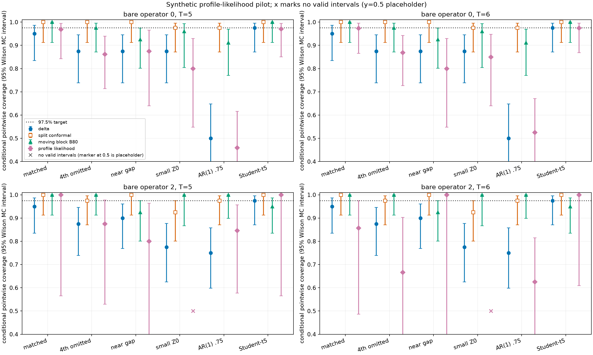

# Wilson F-lane profile-likelihood upper-bound pilot

**Synthetic CPU method diagnostic only.** It reuses the verified six-scenario GLS stress inputs and B=80 report for comparisons. No Wilson measurement, sealed split, GPU or QUDA data were read. `physical_score=null`; F remains `GROUND_STATE_FORCE_UNCERTIFIED`.

## Fixed method

The same first-40 calibration / next-40-panel holdout design is used. For each panel, a three-state GLS fit estimates the full regularized covariance once; the profile keeps that covariance fixed and maximizes q under `chi2(q)-chi2_min <= 3.841458820694`, the plug-in one-degree-of-freedom chi-square cutoff corresponding to a two-sided 95% likelihood-ratio set / one-sided 97.5% endpoint under regular Wilks conditions. For bare operator 0 the ground overlap is eliminated algebraically; for operator 2 its complex phase is retained and magnitude reconstructed. SLSQP uses analytic model, profile-transform and constraint Jacobians. Failed or infeasible optimizer results are `FAILED`; a successful solution hitting a fit-domain parameter boundary is `ABSTAIN`.

In the figure, an `x` marks a cell with no valid intervals; its y-position at 0.5 is only a plotting placeholder, not measured 50% coverage.

Profile interval denominators planned/valid/failed/abstained = `960/432/528/0`. The 240 holdout panels all generated, but only 432/960 profile limits were valid. Of 528 optimizer failures, messages were `452 iteration-limit`, `54 positive-directional-derivative`, `20 incompatible-constraint`, and `2 singular-subproblem`; 102 failed runs also touched at least one parameter bound. Iteration count median/max was `704/1000`. Failure status takes precedence over the boundary counter, hence zero separately classified abstentions.

## Per-scenario denominators and conditional pointwise coverage

Each coverage value is conditional on valid intervals only; the valid count is shown beside it, out of the planned number per operator/time cell. It is not an unconditional coverage estimate when optimizer failures are common.

| Scenario | valid | failed | abstained | profile coverage by cell |
|---|---:|---:|---:|---|
| `matched_3state_independent` | 82 | 78 | 0 | op0,T5: 0.969 (32/40 valid) op0,T6: 0.974 (38/40 valid) op2,T5: 1.000 (5/40 valid) op2,T6: 0.857 (7/40 valid) |
| `omitted_4th_state` | 88 | 72 | 0 | op0,T5: 0.861 (36/40 valid) op0,T6: 0.868 (38/40 valid) op2,T5: 0.875 (8/40 valid) op2,T6: 0.667 (6/40 valid) |
| `near_degenerate_first_gap` | 37 | 123 | 0 | op0,T5: 0.875 (16/40 valid) op0,T6: 0.800 (15/40 valid) op2,T5: 0.800 (5/40 valid) op2,T6: 1.000 (1/40 valid) |
| `small_ground_overlap_operator_2` | 35 | 125 | 0 | op0,T5: 0.800 (15/40 valid) op0,T6: 0.850 (20/40 valid) op2,T5: no valid interval op2,T6: no valid interval |
| `ar1_block_rho_0p75` | 106 | 54 | 0 | op0,T5: 0.459 (37/40 valid) op0,T6: 0.525 (40/40 valid) op2,T5: 0.846 (13/40 valid) op2,T6: 0.625 (16/40 valid) |
| `student_t5_independent` | 84 | 76 | 0 | op0,T5: 0.971 (34/40 valid) op0,T6: 0.974 (39/40 valid) op2,T5: 1.000 (5/40 valid) op2,T6: 1.000 (6/40 valid) |

The raw rows include pointwise Wilson Monte Carlo intervals, optimizer status, chi-square displacement, boundary hits and interval widths in `profile_intervals.csv` and `method_comparison.csv`.

## Limits

This is not a finite-sample guarantee. The covariance is estimated then treated as fixed, the profile optimizer is local, the likelihood-ratio cutoff assumes regularity, and near-zero overlaps or active bounds violate those conditions. Omitted-state bias, AR(1) block dependence, finite-Nt thermal h, mixed x and familywise q/h/x control remain outside the profile. Do not judge coverage without the failure denominator. No interval may enter the spectral q reader or F gate.

Text flow: `verify B80/stress hashes -> hold same synthetic panels and per-panel covariance -> fit three-state GLS -> eliminate selected ground-overlap magnitude using q -> maximize q inside fixed chi-square LR set -> retain optimizer failures/bound hits in P/V/F/A -> compare conditional coverage -> physical certification abstains`.

Reproduce the fits with `PYTHONPATH=. python -B -m tasks.wilson_loop.f_lane_joint_spectral_profile_diagnostic --output tasks/wilson_loop/f_lane_joint_spectral_profile_20261126_v1`. To refresh only plot, explanation and hashes from frozen CSV rows without rerunning fits, add `--refresh-derived`. Source/artifact hashes are recorded in the report.
