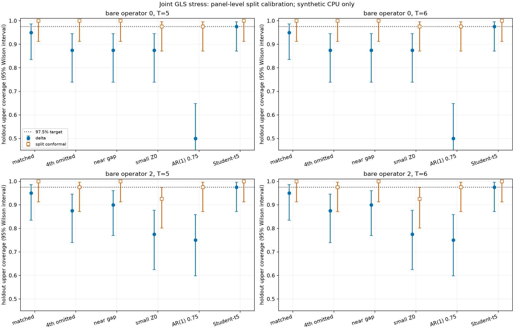
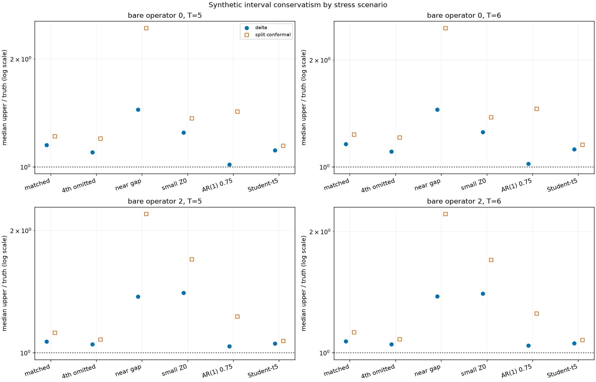

# Wilson F-lane joint-spectrum stress report

**Synthetic CPU diagnostic only.** No Wilson measurement, sealed input, GPU or QUDA data were read. `physical_score=null`; F remains `GROUND_STATE_FORCE_UNCERTIFIED`.

## Design and fixed run conditions

The run has 6 truth scenarios, `80` independent panels per scenario, `96` blocks per panel, relative noise `0.04`, and a fixed three-state GLS fit over `t=1..7`. Bare q cells are operators `(0, 2)` at `T=(5, 6)`. The first `40` panel IDs in each scenario calibrate the one-sided split-conformal score; the remaining `40` are holdout. The two intervals compared are pointwise `qhat+1.95996*SE_delta` and split-conformal `qhat+c*SE_delta`.

The stress cases are: matched three-state independent Gaussian blocks; a four-state truth fitted with three states; a near-degenerate first gap `E1-E0=0.025`; a small bare ground overlap `|Z0(operator 2)|=0.04`; stationary AR(1) block dependence `rho=0.75`; and independent multivariate Student-t innovations with 5 degrees of freedom, rescaled to the same covariance. The AR(1) case has approximate effective block count `N(1-rho)/(1+rho)`; the GLS standard error still uses the existing iid sample-covariance rule, so this is an intentional stress of that assumption.

## Results

Synthetic panel planned/valid/failed/abstained = `480/480/0/0`; q-cell planned/valid/failed/abstained = `1920/1920/0/0`. Conformal strata planned/finite/abstained = `24/24/0`. Holdout q cells planned = `960`; delta valid/failed/abstained = `960/0/0`; conformal valid/failed/abstained = `960/0/0`. Cell-wise 95% Wilson Monte Carlo intervals and median upper/truth ratios are in `coverage_summary.csv`.

Scenario-wise findings across the four bare-operator/time q cells:
- `matched_3state_independent`: delta coverage `0.950–0.950`, median upper/truth `1.066–1.160`, Wilson-MC upper below target `0/4`; conformal coverage `1.000–1.000`, median upper/truth `1.120–1.233`, Wilson-MC upper below target `0/4`.
- `omitted_4th_state`: delta coverage `0.875–0.875`, median upper/truth `1.049–1.105`, Wilson-MC upper below target `4/4`; conformal coverage `0.975–1.000`, median upper/truth `1.078–1.210`, Wilson-MC upper below target `0/4`.
- `near_degenerate_first_gap`: delta coverage `0.875–0.900`, median upper/truth `1.375–1.451`, Wilson-MC upper below target `4/4`; conformal coverage `1.000–1.000`, median upper/truth `2.195–2.456`, Wilson-MC upper below target `0/4`.
- `small_ground_overlap_operator_2`: delta coverage `0.775–0.875`, median upper/truth `1.247–1.404`, Wilson-MC upper below target `4/4`; conformal coverage `0.925–0.975`, median upper/truth `1.366–1.700`, Wilson-MC upper below target `2/4`.
- `ar1_block_rho_0p75`: delta coverage `0.500–0.750`, median upper/truth `1.015–1.043`, Wilson-MC upper below target `4/4`; conformal coverage `0.975–0.975`, median upper/truth `1.227–1.456`, Wilson-MC upper below target `0/4`.
- `student_t5_independent`: delta coverage `0.975–0.975`, median upper/truth `1.053–1.120`, Wilson-MC upper below target `0/4`; conformal coverage `1.000–1.000`, median upper/truth `1.068–1.153`, Wilson-MC upper below target `0/4`.

Interpret coverage only within each exact synthetic scenario and q cell. At 40 holdout panels, Wilson intervals remain broad; split conformal is marginal across exchangeable synthetic panels and does not guarantee each finite holdout stratum will hit 97.5%. A finite calibrator in this design is not a physical calibration receipt.

## Data flow and limits

Text flow: `fixed truth scenario -> 96 same-panel correlated matrix blocks -> fit three-state full-covariance GLS -> compute q estimate/delta SE -> calibrate only on panel IDs 0:40 -> evaluate on disjoint IDs 40:80 -> preserve fit, calibration, holdout and abstention denominators -> certification abstains`.

This tests only interval behavior for controlled positive spectra. It does not validate the assumed positive spectral model for production Wilson loops, finite-`N_t` thermal `h`, mixed-sector `x`, force/reference propagation, chain receipts, or simultaneous familywise q/h/x coverage. The generator uses independent panels; dependence is within each AR(1) panel, while Student-t tails are independent across blocks. Full state profile likelihood, moving-block bootstrap, model-averaged intervals, and q/h/x familywise calibration remain open software research. No output from this report may enter `spectral_q_bound_reader` or the force gate.

Next software work, if the chosen interval is still under study: add a moving-block bootstrap/profile-likelihood comparator and report its failed-fit and interval-abstention denominators under the same six scenarios. Production work still requires reviewed definitions, authorized immutable calibration bytes and independent contamination receipts. Keep `NOT_READY/UNCERTIFIED`, `GROUND_STATE_FORCE_UNCERTIFIED`, and `physical_score=null`.

Reproduce with `PYTHONPATH=. python -B -m tasks.wilson_loop.f_lane_joint_spectral_stress_diagnostic --output tasks/wilson_loop/f_lane_joint_spectral_stress_20261126_v1 --panels-per-scenario 80 --n-blocks 96`. Source/artifact hashes and full scenario values are recorded in `protocol.json`, `summary.json`, and `artifact_hashes.json`.
