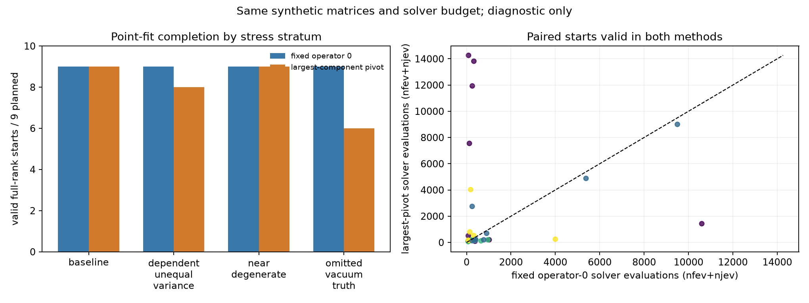

# Paired Wilson point-fit screen: fixed and largest-component phase charts

**Classification:** exploratory CPU method-feasibility screen on reused open synthetic data. It is not profile coverage calibration or a physical force result.

## Frozen comparison

The v1 finite-difference run was stopped after 23 minutes during the first fit; zero fit outcomes were observed. This v2 rerun keeps all 12 panels, the same raw matrix snapshot, block covariance, Nt=32 three-static initializer, three epsilon/overlap-scale starts, TRF solver, `x_scale='jac'`, `max_nfev=8000`, `1e-10` tolerances, and rank-67 validity rule. The only protocol revision is using the already implemented analytic Jacobian for each chart; fixed operator 0 is the largest-pivot chart with all pivot indices set to zero, so both Jacobians share one tested derivative implementation in their own coordinates. Every start remains in the planned denominator.

Profile-follow-up rule: continue to a paired profile comparison only if the pivot chart rescues at least one baseline-invalid start, or saves at least 20% median solver evaluations (`nfev+njev`) in at least two strata among pairs valid in both methods, with no valid-start count loss in any stratum.

## Results

- Panel initializer denominator: `12/12/0/0` (planned/valid/failed/abstained).
- Captured source files: `36/36/0/0` (planned/valid/failed/abstained).
- Fixed operator-0 chart starts: `36/36/0` (planned/valid/failed-or-abstained).
- Largest-component chart starts: `36/32/4` (planned/valid/failed-or-abstained).
- Paired starts valid in both: `32`; pivot rescues over baseline: `0`.
- Median solver-evaluation savings by stratum: `{"baseline": -4.560311284046692, "dependent_unequal_variance": 0.2147083685545224, "near_degenerate": 0.32456140350877194, "omitted_vacuum_truth": -1.3669724770642202}`.
- Largest max absolute difference between paired initial model vectors: `1.11e-16`.
- Frozen profile-follow-up rule result: `advance=False`.

## Interpretation and limits

This screen compares point fits only. It does not calculate force intervals, truth containment, finite-sample coverage, q/h/x contamination, or physical score. The panels were previously used in method development, so they are not held-out confirmation data. The exact-zero-operator0 fixture is a separate algebraic representation check and is not among these panels. Source hashes bind local bytes but do not authenticate a data owner or independent review. No production Wilson, sealed input, GPU, or QUDA was accessed. C finite-T Creutz and F ground-state force stay separate; physical statuses remain NOT_READY/UNCERTIFIED and `physical_score=null`.

## Reproduction and audit

Run `python tasks/wilson_loop/f_lane_pivot_chart_fit_comparison.py --output <new-empty-directory>`. `protocol.json` freezes panel IDs, starts, solver, budget, acceptance rule and profile-follow-up threshold. `paired_start_results.csv`, `panel_summary.csv` and `captured_inputs.csv` retain full denominators and byte digests; source and artifact SHA-256 maps are included. The v1 runtime-cancelled attempt is retained in its own folder and must not be counted as fit evidence.
