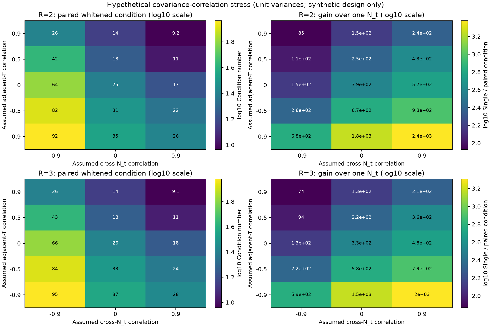

# F-lane q/h/x covariance-correlation sensitivity

**Synthetic design stress only.** This report asks whether the paired `N_t=16+32` grid keeps a better column-shape condition number than either single-extent grid under a small, declared family of hypothetical observation correlations.

## Assumed covariance and calculation

All observations are assigned unit variance. The correlation model is separable:

```text
Sigma = R_Nt ⊗ R_T
R_T[i,j] = rho_T^|T_i-T_j|, T=3..7
R_Nt = [[1,rho_Nt],[rho_Nt,1]] for the paired extent grid
W = L^-1 K, where Sigma = L L^T
```

The scan uses `rho_T=[-0.9, -0.5, 0.0, 0.5, 0.9]` and `rho_Nt=[-0.9, 0.0, 0.9]`, both inside the positive-definite range. It varies correlation only; it does not guess row-dependent variances or tune the covariance to make either design look better. `covariance_scenarios.csv` includes raw and column-scaled whitened metrics for each radius and plan.



Across the 30 paired scenarios, the shape-condition improvement factor (single extent / paired extents) ranges from **73.59× to 2390.10×**. This is conditional on equal marginal variances, the separable correlation family, and the companion toy energies. The heatmap's lower panels show the same factor; upper panels show the paired whitened condition number itself.

## Interpretation limits and denominators

This sensitivity scan says that the `N_t=16+32` column shapes remain better separated across these hypothetical correlation patterns. It does not say which pattern describes a Wilson ensemble. It also cannot restore absolute signal lost from the `N_t=32` thermal/mixed columns: column scaling removes amplitude, and the covariance variances were set to one by construction. Production decisions require covariance estimated from authorized raw matrix blocks and the existing force-unit budget.

- Hypothetical covariance scenarios: `50/50/0/0` (planned/valid/failed/abstained).
- Physical measurements: `0/0/0/0`; certification gate: `1/0/0/1`.
- No spectral fit, bootstrap coverage, q/h/x interval, or force bound is calculated.
- Keep `NOT_READY/UNCERTIFIED`, `GROUND_STATE_FORCE_UNCERTIFIED`, and `physical_score=null`.

The next fitter should estimate the block covariance from one immutable raw-matrix snapshot, whiten the full real/imaginary matrix-element residual vector, then report raw and whitened profile information alongside the unscaled mode norms. No covariance floor or acceptance threshold is selected by this report; singular or unstable production covariance must remain an abstention until a reviewed regularization rule exists.
