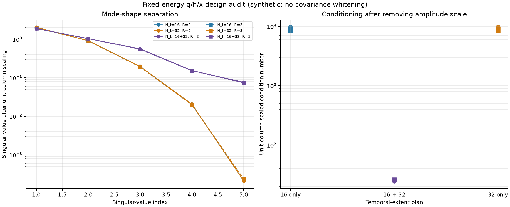

# Finite-`N_t` q/h/x design identifiability (fixed-energy toy)

**Classification: synthetic design audit only.** It evaluates the linear correction kernels implied by the two-sector trace proposal using the companion toy's hand-set energies. It does not fit measurements, estimate noise or covariance, or supply any physical contamination bound.

## Question and data flow

For fixed toy energies, the normalized diagonal trace has five unknown correction amplitudes after fixing the ground-sector coefficient to one:

```text
q_1, q_2: m=0, n=1,2
h:       m=1, n=0
x_1,x_2: m=1, n=1,2
K_mn(T,N_t) = exp[-eps_m*(N_t-T) - (V_n-V_0)*T]

selected (N_t,T) rows -> five-column kernel matrix -> raw SVD
                                           -> unit-column-scaled SVD
```

The selected toy grid uses `T=3..7`, `N_t=16`, `N_t=32`, and both `R=2,3`. It compares a single-extent grid with the matched pair `(16,32)`. The image shows singular values after column scaling and their condition number; the CSV also retains raw condition numbers, numerical rank tolerances, and column norms.



For `R=2`, the unit-column-scaled condition number is `9.63e+03` for `N_t=16` alone and `9.63e+03` for `N_t=32` alone, versus `24.9` for the paired `(16,32)` grid. The paired grid improves the shape-only condition by about `386.8x`. Its raw condition number is `6.71e+03`; raw single-extent values are `2.24e+06` and `1.86e+09`.

| `R` | `N_t` plan | Raw condition number | Unit-column-scaled condition number |
|---:|:---|---:|---:|
| 2 | 16 | 2.24e+06 | 9.63e+03 |
| 2 | 32 | 1.86e+09 | 9.63e+03 |
| 2 | 16+32 | 6.71e+03 | 24.9 |
| 3 | 16 | 1.92e+06 | 8.59e+03 |
| 3 | 32 | 1.59e+09 | 8.59e+03 |
| 3 | 16+32 | 6.7e+03 | 25.9 |

The improvement is conditional on the fixed energies and chosen `T` grid. For the hand-set toy, the `N_t=32` thermal/mixed columns are about 830 times smaller in norm than their `N_t=16` counterparts, so unit-column scaling removes a major practical signal penalty. A covariance-weighted information matrix could change both ordering and conditioning; none is supplied here. Numerical ranks use the reported scale-specific SVD tolerance; this is a floating-point rank diagnostic, not an acceptance threshold.

An explicit degeneracy stress check uses the paired grid at `R=2`. With the second and third static energies separated by `1e-6` in `a_t*E`, the five modes remain numerically full rank but the scaled condition number rises to `8.71e+06`. At exact degeneracy the scaled numerical rank falls to `3` and the condition number is left undefined. This is a failure-mode check for the linear kernels; it does not establish the gap resolution or tolerance needed for production.

## Denominators and limits

- Fixed-energy design cells: planned/valid/failed/abstained = `6/6/0/0` (`R=2,3` × three `N_t` plans).
- Physical measurements: `0/0/0/0`; certification gate: `1/0/0/1`.
- The weakest singular vector and all singular values are in `design_metrics.csv`; source versions and generator parameters are in `protocol.json` and `artifact_hashes.json`.

This result suggests the next fitter should report raw and covariance-whitened profile information, plus column-scaled diagnostics, and should test exact/near-degenerate gaps. It does **not** validate the selected `N_t=32` thermal receipt, show that h/x are resolvable above production noise, or close the F-lane fit/coverage gate. Keep `NOT_READY/UNCERTIFIED`, `GROUND_STATE_FORCE_UNCERTIFIED`, and `physical_score=null`.
