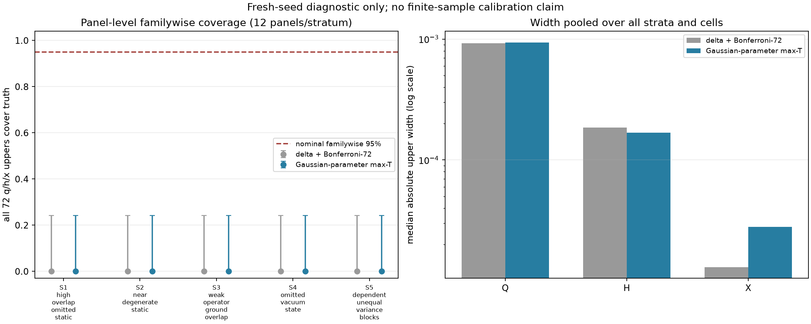

# Wilson F q/h/x Gaussian-parameter max-T interval screen

**Status:** `SYNTHETIC_SCREENING_ONLY_NOT_CALIBRATION`; no production Cij, GPU/QUDA, sealed split, or physical score. `physical_score=null`; F remains `GROUND_STATE_FORCE_UNCERTIFIED`.

## Frozen candidate and decision rule

- Candidate: fit the unchanged regularized full-covariance 2-vacuum × 2-static GLS model; draw `2048` parameter vectors from the inverse-whitened-Jacobian Gaussian approximation; transform all 72 q/h/x terms; studentize each term; use the higher empirical `95%` quantile of the maximum one-sided studentized deviation as a simultaneous upper critical value.
- Baseline: same-panel finite-difference delta-normal upper with Bonferroni-72 correction. No fit window, covariance shrinkage, or interval is changed on these panels.
- Fresh seeds: `2026113400 + 100 * stratum_index + panel_index; both indices are zero-based`; the range is disjoint from both prior synthetic screen seed ranges in `protocol.json`.
- Pre-set screen rule: If any stratum has fewer than 10/12 valid panel-level familywise successes, or any max-T panel interval abstains, stop this candidate. If every stratum reaches at least 10/12 with no interval abstentions, it is only eligible for separately reviewed confirmatory calibration; no synthetic screen certifies coverage.

## Results

| Stratum | Fit valid/12 | Delta familywise | max-T familywise | max-T valid intervals | max-T draw failed/abstained |
|---|---:|---:|---:|---:|---:|
| S1_high_overlap_omitted_static | 12/12 | 0/12 | 0/12 | 10/12 | 1871/0 |
| S2_near_degenerate_static | 12/12 | 0/12 | 0/12 | 12/12 | 0/0 |
| S3_weak_operator_ground_overlap | 12/12 | 0/12 | 0/12 | 12/12 | 0/0 |
| S4_omitted_vacuum_state | 12/12 | 0/12 | 0/12 | 11/12 | 937/0 |
| S5_dependent_unequal_variance_blocks | 12/12 | 0/12 | 0/12 | 9/12 | 2726/0 |

Median of stratum medians for absolute upper width (dimensionless; max-T excludes abstained intervals):

| Term | Delta + Bonferroni-72 | Gaussian-parameter max-T |
|---|---:|---:|
| Q | 0.000926107 | 0.000937284 |
| H | 0.000185088 | 0.000167591 |
| X | 1.29932e-05 | 2.7951e-05 |

## Text diagnosis and limits

Across 60 planned panels, both methods had 0 familywise successes in every 12-panel stratum (delta 0/60; max-T 0/60). The max-T interval was available on 54/60 panels and abstained on 6/60. The plotted width medians show q widths were similar, max-T h widths somewhat smaller, and max-T x widths larger; these widths do not offset the observed zero familywise coverage. Candidate disposition under the pre-set exploratory rule is `NO_GO_FOR_THIS_GAUSSIAN_PARAMETER_MAXT_CANDIDATE`. Twelve panels per stratum yield wide Monte Carlo uncertainty; passing this screen would only justify considering a reviewed 606-panel confirmatory design, never a calibration or physical claim.

The max-T draw is conditional on the fitted covariance and the fixed 2×2 spectral model. It accounts for nonlinear q/h/x transformation and their fitted covariance correlation, but it does not repair omitted-state bias, near-degenerate model misspecification, weak-overlap identifiability, an incorrect covariance model, nonstationarity, or a wrong exporter convention. Its chi-square/Jacobian covariance is asymptotic and not itself calibrated. No independent reviewer or production receipt is supplied by this run.

Data flow: `frozen 5-stratum truth/noise protocol -> fresh disjoint panel seeds -> immutable raw Hermitian 3x3 snapshots -> same full-covariance 2x2 GLS fit -> fitted parameter estimate/covariance -> 2048 Gaussian parameter draws -> max over 72 studentized q/h/x deviations -> paired delta/max-T familywise and width summaries -> stop/continue screening decision`.

Source bytes are copied under `source_snapshot/`; raw per-panel NPZ/manifests and interval draw denominators are retained. SHA-256 artifacts are in `artifact_hashes.json`. The report never certifies the ground-state static force; keep `NOT_READY/UNCERTIFIED`, `GROUND_STATE_FORCE_UNCERTIFIED`, and `physical_score=null`.
