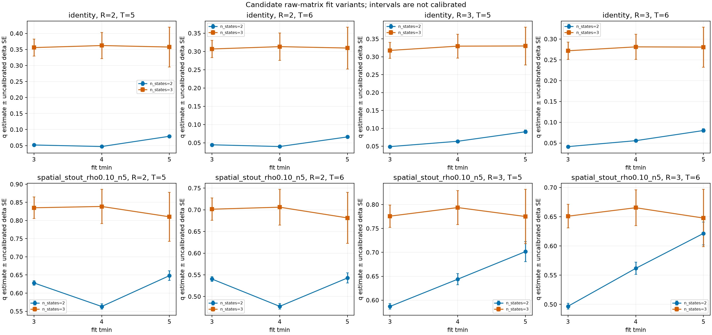

# Wilson F-lane raw matrix → joint fit candidate

**Synthetic CPU diagnostic only.** Input bytes are generated from an exact three-state positive forward spectrum with independent Gaussian block noise. No Wilson measurement, sealed split, GPU or QUDA data were read. `physical_score=null`; F remains `GROUND_STATE_FORCE_UNCERTIFIED`.

## Calculation and plot

The existing strict raw-matrix reader validates and parses the captured manifest+NPZ snapshot, including the ordered basis `[identity, APE, stout]`, R/time axes, Hermitian matrix shape and split/hash preflight. This wrapper consumes the returned matrices from those same captured bytes. For each `R=2,3`, it fits one shared matrix spectrum for every `tmin=3,4,5` and `n_states=2,3`, on times `tmin..7`, using all three basis operators and same-block covariance. Each joint fit yields three bare-basis q estimates at `T=5,6`; the 36 kernel/R/tmin/state variants are derived from 12 common matrix fits.

Each panel fixes kernel, `R`, and `T`; the horizontal axis is `tmin`, while color/marker distinguish the two state counts. Error bars are pointwise delta-method standard errors, not calibrated intervals. The separate 800-panel coverage diagnostic in [`f_lane_joint_spectral_gls_20261126_v1/README.md`](f_lane_joint_spectral_gls_20261126_v1/README.md) found undercoverage in the same exact-three-state setting; therefore these q upper candidates are explicitly **not** suitable inputs to the selected q reader or force gate.

## Denominators and data flow

Joint matrix fits planned/valid/failed/abstained = `12/12/0/0`; kernel fit variants = `36/36/0/0`; q candidate cells = `72/72/0/0`. Physical matrix inputs `0/0/0/0`; certification gate `1/0/0/1`.

Text flow: `synthetic manifest+matrix NPZ -> one immutable SourceByteSnapshot -> raw reader validates and returns matrices -> 12 common 2/3-state GLS fits -> 36 kernel-fit variants + 72 q candidates -> coverage calibration fails/unknown -> no selected q envelope or physical gate`.

## Scope boundary

This is not yet a production evaluator. It does not calculate ratio/gap support intervals, apply the selected endpoint alpha allocation across all fits, form the full familywise maximum envelope, model omitted states/finite-`N_t`/thermal `h`/mixed `x`/chain dependence, or recompute force/reference summaries. The q reader schema consumes upper ratios and lower gaps; this report has only exploratory direct q estimates and delta errors. The `1.95996` multiplier is known to under-cover in the linked independent-panel stress. Independent review, a production cross-correlator exporter, authorized immutable calibration snapshot, calibrated familywise intervals and contamination receipts remain required. Preserve `NOT_READY/UNCERTIFIED`, `GROUND_STATE_FORCE_UNCERTIFIED`, and `physical_score=null`.

See `fit_status.csv`, `fit_variants.csv`, `q_candidates.csv`, `protocol.json`, `summary.json` and `artifact_hashes.json` for all fit statuses and hashes.
