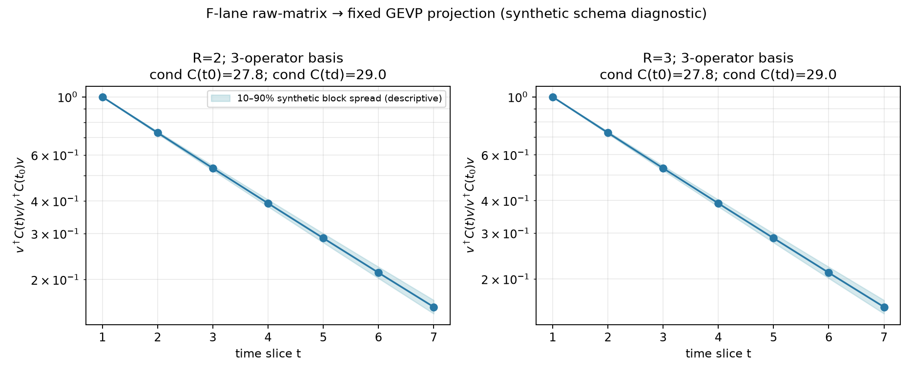

# F-lane raw matrix snapshot reader: synthetic diagnostic

This package validates a two-file immutable source snapshot (`manifest` + NPZ), checks NPZ size before allocation, and enforces one 3×3 cross-correlator matrix per `R`. The ordered matrix basis is `identity`, `ape_alpha0.4_n5`, `spatial_stout_rho0.10_n5`; the data shape is `[block, R, t, sink_operator, source_operator]`. It solves one fixed principal GEVP vector at `t0=1`, `td=2` per R and projects `v† C_block(R,t) v`.

The panels show the two R values. Bands are the 10–90% spread across 24 deterministic synthetic blocks; they are descriptive, not confidence intervals and not evidence that blocks are independent. `physical_score=null`; the F lane remains `GROUND_STATE_FORCE_UNCERTIFIED`.

## Data-flow and limits

`captured manifest + NPZ bytes → strict schema/hash/split/axis validation → NPZ preflight → mean C(t0), C(td) per R → fixed principal GEVP → block projection → CSV/figure`.

The GEVP projection is one composite operator per R. It must not be copied into three separate identity/APE/stout q cells. The selected q-bound contract is kernel-indexed, so a reviewed fit must decide whether those q cells refer to the bare basis overlaps or another precisely defined operator object. No fit of energies or overlaps, q envelope, interval, coverage calibration, finite-`N_t` backward propagation, thermal `h`, mixed `x`, force propagation, or physical gate is implemented. The repository also lacks a raw cross-correlator producer; diagonal loop arrays do not determine off-diagonal matrix elements.

Denominators (planned/valid/failed/abstained): source files `2/2/0/0`; R projection cells `2/2/0/0`; R×time values `14/14/0/0`; physical measurement inputs `0/0/0/0`; physical q/interval/certification `1/0/0/1`.

See `protocol.json`, `summary.json`, and `artifact_hashes.json` for exact source identities and scope.
