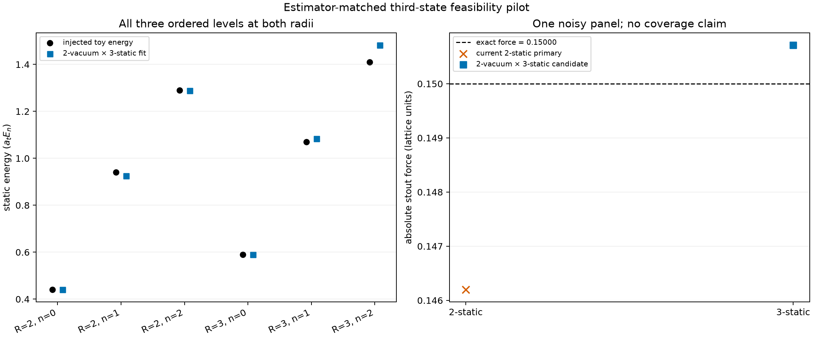

# Finite-Nt two-vacuum × three-static-state fit pilot

**Status:** `SINGLE_PANEL_SYNTHETIC_FIT_FEASIBILITY`. One synthetic panel tests exact forward-model identity, local fit rank and initialization behavior; it is not a coverage study.

## Model and data flow

The fitted matrix model is

```text
C_ij(R,T;Nt) = Z(Nt)^(-1) Σ_(m=0..1,n=0..2)
               exp[-eps_m (Nt-T)] exp[-V_n(R) T] A_(mn,i) A*_(mn,j)
F_abs = V_0(R=3) - V_0(R=2),  ΔR=1
```

The flow is `exact positive 2×3 truth -> AR(1) noisy 96-block panel -> current 2×2 fit and new full finite-Nt 2×3 fit -> retain 67-coordinate rank/condition/multi-start receipts and figure`.

## Pilot outcome

- The noiseless forward identity test has maximum absolute component discrepancy `1.11e-16`.
- The 2×3 fit status is `three_static_fit_candidate`, local Jacobian rank **67 / 67**, condition number **6.48e+04**, and reduced GLS objective **6.125**.
- Exact force is `0.150000`; current 2×2 estimate is `0.146195`; 2×3 estimate is `0.150716`. The 2×3 absolute error is `0.000716` lattice units.
- Multi-start attempts: `3/3` full-rank; valid objective range `692.081…729.520`. A converged start with a larger objective is retained rather than hidden.



## Interpretation and limits

This pilot shows the same finite-Nt forward model can be evaluated and locally fit with three static states for this one noisy toy panel. Rank 67/67 is local; the condition number, multi-start spread and one-panel force error motivate a broader identifiability screen. The GLS objective is not calibrated goodness-of-fit, and its inverse-Jacobian force standard error is not calibrated uncertainty. Do not use this candidate for certification or connect it to the force summary reader.

No production Wilson data, GEVP, sealed split, GPU or QUDA was used. F remains `GROUND_STATE_FORCE_UNCERTIFIED`, `physical_score=null`.
