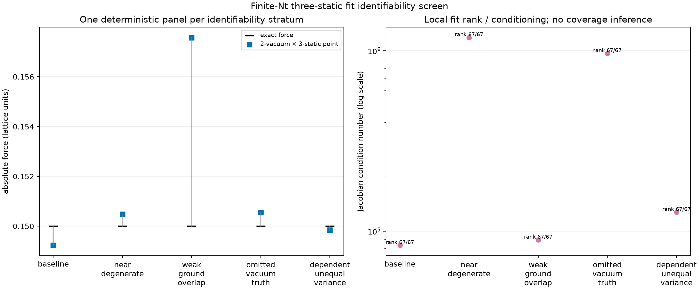

# Finite-Nt three-static fit identifiability screen

**Status:** `DETERMINISTIC_SYNTHETIC_IDENTIFIABILITY_SCREEN`. One deterministic fresh panel per stress stratum is a feasibility and negative-control screen; it is not a coverage study.

## Strata and data flow

- Baseline positive 2-vacuum × 3-static trace.
- Near-degenerate first static gap: `E_1-E_0=0.035` at each radius.
- Weak ground overlap: all ground-transition overlap vectors scaled by `0.05`.
- Omitted-vacuum truth: one vacuum state generated, two fit.
- Dependent/unequal-variance blocks: AR(1) `rho=0.75`, with time scales `{3:0.50, 4:1.40, 5:0.80, 6:1.80, 7:0.65}`.

Each stratum uses 96 blocks, relative noise `0.003`, and seed `2026114200 + stratum_index`. Data flow:

```text
frozen positive-spectrum stress truth
  -> raw finite-Nt matrices with the declared block/noise process
  -> captured manifest + source snapshot
  -> Nt=32 3-state initializer -> full finite-Nt 2-vacuum × 3-static GLS
  -> retain rank, condition, force error, all starts/failures and raw matrices
```



## Results

| Stratum | Fit result | Local rank | Condition number | Force point | Absolute point error |
|---|---|---:|---:|---:|---:|
| baseline | three_static_fit_candidate | 67/67 | 8.353e+04 | 0.1492 | 0.0007656 |
| near_degenerate | three_static_fit_candidate | 67/67 | 1.185e+06 | 0.1505 | 0.0004796 |
| weak_ground_overlap | three_static_fit_candidate | 67/67 | 8.948e+04 | 0.1576 | 0.007576 |
| omitted_vacuum_truth | three_static_fit_candidate | 67/67 | 9.672e+05 | 0.1506 | 0.0005534 |
| dependent_unequal_variance | three_static_fit_candidate | 67/67 | 1.274e+05 | 0.1498 | 0.0001515 |

There are **5/5** valid panel fits, **0** failed and **0** abstained. One panel per stress cannot estimate coverage or failure rates. In particular, local rank is not global identifiability. The weak-ground-overlap profile has the largest visible force error, while the near-degenerate profile has the poorest conditioning; neither observation is a general bound.

## Interpretation and limits

These tests assess candidate initialization and local fit stability only. The GLS objective and inverse-Jacobian force SE are uncalibrated. Do not connect this candidate to the physical force summary reader or interpret its point errors as a confidence interval.

No production Wilson matrices, GEVP data, sealed split, GPU or QUDA were accessed. F remains `GROUND_STATE_FORCE_UNCERTIFIED` and `physical_score=null`.

**Report recovery note:** the fit pass completed and persisted all panel receipts; the first README render stopped on an unescaped literal dictionary brace. This finalized report updates the README, source hash and artifact manifest using the already-saved raw matrices and fit results; no panel was refit or removed.
