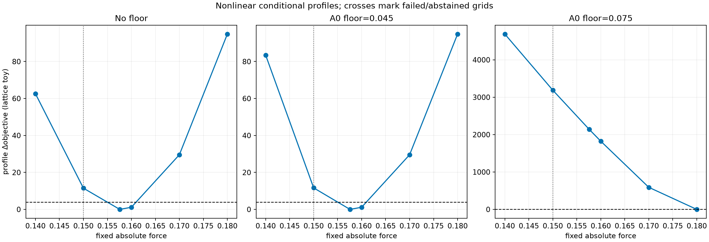

# Nonlinear weak-overlap force profile

**Classification:** synthetic conditional profile feasibility; not a calibrated interval or physical force result.

## Method

This reuses the earlier weak-overlap panel, fixes `F=E0(R=3)-E0(R=2)` exactly on the declared grid, and nonlinearly refits nuisance energies/overlaps under each hypothetical lower bound on `min_R |A[m=0,n=0,operator=0]|`. The finite-`Nt` model Jacobian is analytic; the report checks it against central finite differences before running the profiles. Each cell retains two starts and all failure/abstention outcomes.

Analytic Jacobian check: max absolute difference `8.82e-12`, max scaled difference `8.82e-12`, all finite `True`.

## Results and interpretation

Profile cells valid: `18/18`; failed/abstained: `0`. Start fits valid: `36/36`; failed/abstained starts: `0`.
Without an independent production floor receipt the physical gate is `ABSTAIN_NO_INDEPENDENT_OVERLAP_FLOOR`. No floor in this report can be used as physical evidence.
Per-floor grid profile sets and clipping flags are in `summary.json`; every start's objective, rank, condition, nfev, force constraint and fit coordinates are in `profile_fit_receipts.json`.

The plotted `Δobjective=3.84` rule is a nominal likelihood-ratio reference only. One reused panel, two starts per cell, covariance regularization, and grid spacing do not establish coverage or global identifiability. No production Wilson matrices, sealed split, GPU or QUDA was read; `physical_score=null` and F remains `GROUND_STATE_FORCE_UNCERTIFIED`.
