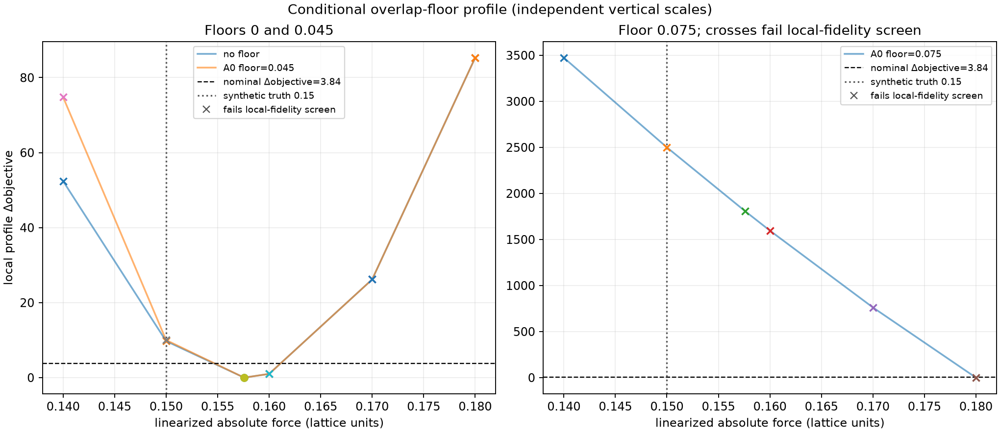

# Conditional weak-overlap force profile

**Classification:** one-panel synthetic sensitivity analysis. The floor values are hypothetical in the toy endpoint normalization. This is not physical calibration or a production confidence interval.



## Decision rule

```text
no independent open-calibration overlap-floor receipt
  -> ABSTAIN_NO_INDEPENDENT_OVERLAP_FLOOR
  -> do not emit a physical force interval or physical score
```

The synthetic curve computation is a conditional local-sensitivity exercise. It reuses the weak-ground-overlap panel from the preceding screen, computes one central finite-difference whitened residual Jacobian at its captured fit, and constrains the linearized force `F=E0(R=3)-E0(R=2)` on a coarse grid. For each floor/grid point, an active-set Gauss-Newton KKT solve profiles the local nuisance displacement, with the floor applied to `min_R |A[m=0,n=0,operator=0]|`. This is a **linearized local profile**, not a nonlinear refit. A point is retained as locally valid only if its nonlinear objective differs from the linearized objective by at most 10% of the larger profile change or 3.84, its exact force mismatch is at most `0.0025`, and its largest parameter shift is at most `0.25`. The nominal `Δobjective=3.84` line is not calibrated for 95% coverage.

## Receipts and limits

- Raw-matrix origin hash: `ba7ec51abe947eb5c9d070c8b4c3460ed0a2d286bc8bf7e3c385255919582921`
- Local profile points: `2/18` valid; failed=`0`; abstained=`16`
- The independent-floor gate is `ABSTAIN_NO_INDEPENDENT_OVERLAP_FLOOR`. No production overlap floor or review receipt exists in this report.
- Per-floor conditional grid sets and clipping flags are in `summary.json`; pointwise profile rows are in `profile_grid.csv`.
- The source matrix, captured fit, contract, profile data, code snapshots, and checksums are retained for audit.

No production Wilson data, sealed split, GPU, or QUDA was read. `physical_score=null`; both lanes remain `NOT_READY/UNCERTIFIED`, F remains `GROUND_STATE_FORCE_UNCERTIFIED`.
