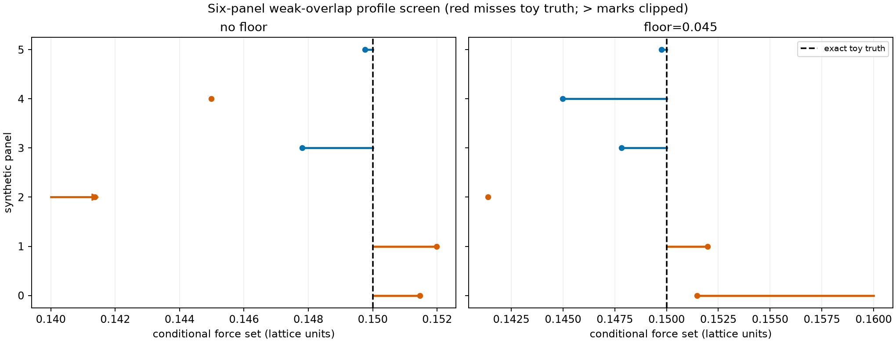

# Weak-overlap nonlinear profile calibration screen

**Classification:** six-panel, single-DGP synthetic coverage screen. This is not publication-grade calibration or a physical force result.

## Results

Candidate-fit panels valid: `6/6`. Nonlinear profile cells valid: `72/72`; failed/abstained `0`. Start fits valid: `144/144`; failed/abstained `0`.

Each interval is the hull of grid values with `Δobjective<=3.84`; profiles add the panel's candidate point estimate to a fixed shared grid. Red intervals miss exact toy force `0.15`; blue intervals contain it; right-pointing markers mean the grid endpoint clipped the conditional set. Per-floor coverage numerators, eligible denominators and Wilson 95% binomial intervals are in `summary.json`.

The `0.045` floor equals the known minimum overlap generated in this toy. It is an oracle condition for simulation only, not a measured or independently reviewed production lower bound. Without an independent floor receipt, the physical gate remains `ABSTAIN_NO_INDEPENDENT_OVERLAP_FLOOR`.

Six replicates from one positive-spectrum weak-overlap DGP have wide Monte Carlo uncertainty. The nominal threshold is not calibrated; two starts do not establish global identifiability. No production Wilson matrices, sealed split, GPU or QUDA was accessed. `physical_score=null`; C/F remain `NOT_READY/UNCERTIFIED` and F remains `GROUND_STATE_FORCE_UNCERTIFIED`.
