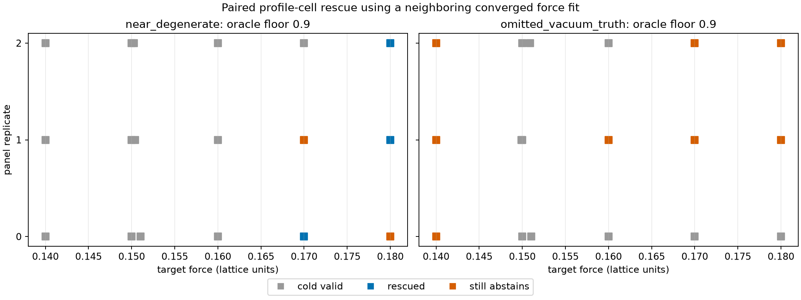

# Wilson profile continuation start-rescue screen

**Classification:** paired numerical-rescue experiment on existing synthetic panels; not calibration.

The screen reruns 13 failed cells from three near-degenerate and three omitted-vacuum panels. Each rerun keeps the original captured point fit as one start and adds a second start copied from the nearest cold-valid force cell at the same floor.

Neighbor continuation recovered 3 cells; continuation starts valid **3/26**. These are paired retries on the same matrices, not independent fits or new coverage samples.

| Stratum | Phase | Complete profiles | Truth containment | Incomplete profiles | Wilson 95% interval |
| --- | --- | ---: | ---: | ---: | ---: |
| near_degenerate | cold | 0/3 | NA | 3 | NA |
| near_degenerate | neighbor_continuation | 1/3 | 0/1 | 2 | [0.000, 0.793] |
| omitted_vacuum_truth | cold | 0/3 | NA | 3 | NA |
| omitted_vacuum_truth | neighbor_continuation | 0/3 | NA | 3 | NA |

Containment uses complete, unclipped intervals only; `NA` means no eligible interval. The panel count is three per stratum, so binomial intervals are descriptive and very wide. The force grid and nominal `Δobjective<=3.84` rule remain uncalibrated.

### Failure anatomy from saved attempts

| Attempt set | Invalid starts | Reached `max_nfev=1600` | Local Jacobian rank 66/66 | Condition number, median / maximum | Ground-overlap floor slack, minimum / maximum |
| --- | ---: | ---: | ---: | ---: | ---: |
| Cold-invalid cells | 26 | 26 | 26 | `6.43e6 / 1.10e10` | `0 / 0.132` |
| Failed neighbor retries | 23 | 23 | 23 | `1.76e6 / 1.10e10` | `0 / 0.132` |

This is a read-only summary of stored per-start receipts, not another fit run. All failed attempts hit the evaluation cap while retaining full local numerical rank; this points to convergence/conditioning difficulty in these saved cells, not a demonstrated rank deficiency. Full local rank does not establish global identifiability. Zero floor slack means at least one fitted ground overlap sat on the imposed toy bound.
