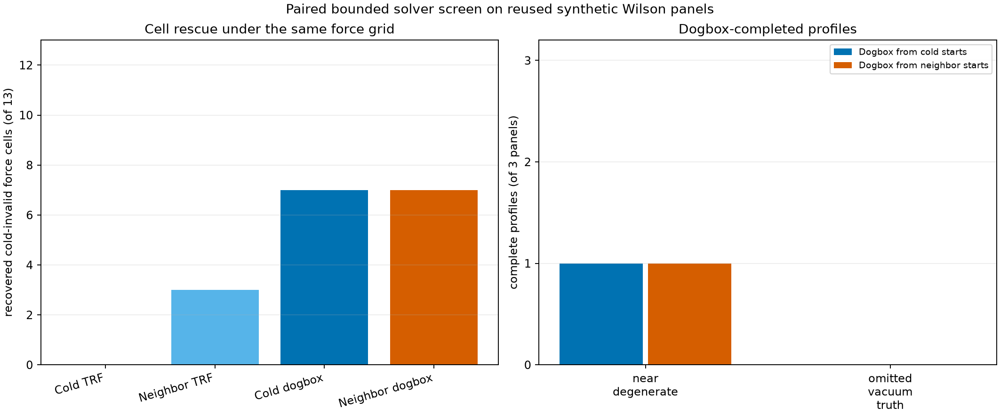

# Wilson bounded solver comparison: dogbox versus saved TRF

**Classification:** paired numerical experiment on six reused synthetic panels; not a calibration study.

The comparison reuses 6 panels, the oracle toy floor `0.9`, the same force grid, full-covariance objective, analytic Jacobian, bounds, starts and `max_nfev=1600`. Only the bounded least-squares method changes from the saved `trf` runs to `dogbox`; both use `x_scale='jac'`. The candidate solver ran 39 unique start/force cases; duplicate captured-fit cases shared between the cold and neighbor branches were run once, then paired against both receipts.

| Attempt branch | TRF valid starts | Dogbox valid starts | Dogbox failed at `nfev=1600` | Dogbox `nfev` median / max |
| --- | ---: | ---: | ---: | ---: |
| Cold captured + lower-excited starts | 0/26 | 13/26 | 13/26 | 1423 / 1600 |
| Captured + nearest-force neighbor starts | 3/26 | 13/26 | 13/26 | 1423 / 1600 |

| Failed-cell branch | TRF recovered | Dogbox recovered |
| --- | ---: | ---: |
| Cold captured + lower-excited starts | 0/13 | 7/13 |
| Captured + nearest-force neighbor starts | 3/13 | 7/13 |

| Method | Stratum | Complete profiles | Unclipped truth-containing profiles |
| --- | --- | ---: | ---: |
| Cold TRF | near_degenerate | 0/3 | 0/0 |
| Cold TRF | omitted_vacuum_truth | 0/3 | 0/0 |
| Neighbor TRF | near_degenerate | 1/3 | 0/1 |
| Neighbor TRF | omitted_vacuum_truth | 0/3 | 0/0 |
| Cold dogbox | near_degenerate | 1/3 | 0/1 |
| Cold dogbox | omitted_vacuum_truth | 0/3 | 0/0 |
| Neighbor dogbox | near_degenerate | 1/3 | 0/1 |
| Neighbor dogbox | omitted_vacuum_truth | 0/3 | 0/0 |

These six panels only support a solver-failure comparison on the selected toy strata. If dogbox recovers cells, it changes numerical completion but does not establish that the `Δobjective<=3.84` profile set has valid coverage; the single existing near-degenerate interval remains a miss unless an actual reported result shows otherwise. No floor, start, force-grid, objective, covariance, eligibility or truth rule was changed.

Although dogbox validates 13/26 starts in each branch and recovers 7/13 cells, the extra cell recoveries do not complete any additional panel relative to the existing neighbor-TRF run: only the same near-degenerate replicate is complete, and its interval excludes toy truth. The omitted-vacuum stratum remains 0/3 complete. Thus dogbox improves local solver completion but does not improve the decision-relevant profile outcome in this fixed screen.

The paired attempt table records start-vector SHA, TRF and dogbox validity, objective, evaluation count, rank, condition number and dogbox scaled optimality. Source snapshots and input artifact hashes make this run auditable. No production Wilson input, sealed data, GPU or QUDA was touched. C finite-T Creutz and F ground-state force remain separate; status stays `NOT_READY/UNCERTIFIED`, F=`GROUND_STATE_FORCE_UNCERTIFIED`, `physical_score=null`.
