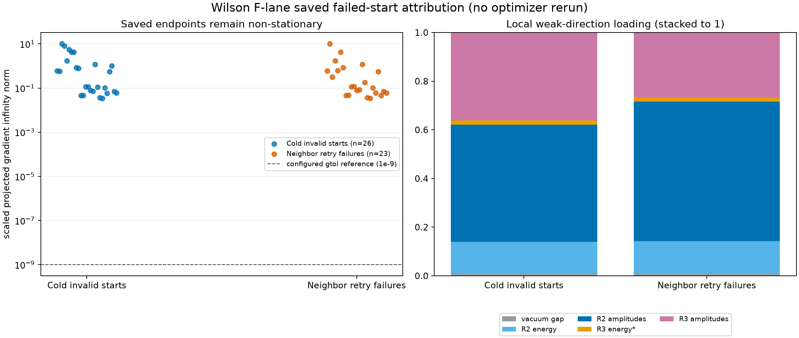

# Wilson saved-endpoint stationarity attribution

**Classification:** read-only diagnosis of saved synthetic optimizer endpoints; not a new fit, calibration, or physical result.

Both input reports passed their full artifact-hash manifests before the selected raw panels and receipts were read. For each stored failed start, the script recomputed the whitened residual and analytic Jacobian at the saved coordinates, checked the reconstructed objective and condition number against the receipt, and computed a box-projected gradient scaled by Jacobian column norms. No optimizer was rerun.

| Attempt set | Failed starts | At 1600 evaluation cap | Full local rank | Scaled projected gradient median / p90 / max | Above configured `gtol=1e-9` reference |
| --- | ---: | ---: | ---: | ---: | ---: |
| Cold-invalid starts | 26 | 26 | 26/26 | 0.339 / 4.91 / 10.3 | 26/26 |
| Failed neighbor retries | 23 | 23 | 23/23 | 0.115 / 1.64 / 10.3 | 23/23 |

The recomputed objective and condition number match their saved receipts within the declared numerical tolerance. Every failed endpoint remains far above the configured gradient tolerance reference after bound projection, so these saved runs stopped at the evaluation cap while still making a nontrivial first-order descent direction available. This supports a convergence/conditioning diagnosis for these endpoints; it does not show that the profile minimum is absent or that the force is globally identifiable.

After unit-normalizing each nonzero Jacobian column, the weakest local direction has mean squared loading on R2 amplitudes `0.482` for cold failures and `0.573` for neighbor failures. The other loadings are reported in `summary.json` and drawn at right. Because the coordinates are standardized by local column sensitivity, and because the direction is evaluated at nonconverged endpoints, this only nominates R2 amplitude tradeoffs for a future fixed-budget solver comparison; it does not prove global non-identifiability.

A bounded next experiment is therefore a paired solver/parameter-scaling comparison on the same six panels and 49 failed-start targets. Keep the floor, force grid, objective, covariance, starts and `max_nfev` fixed; record objective, projected gradient, bound activity, and rescue count. Accept a numerical change only if it reduces the residual stationarity failure without changing the data model or eligibility rule. Do not expand seeds or label the resulting profile calibrated.

All matrices are reused synthetic panels. No production `C_ij`, sealed split, GPU or QUDA is used. The physical reader remains `ABSTAIN_NO_INDEPENDENT_OVERLAP_FLOOR`; C finite-T Creutz and F ground-state force remain separate; status remains `NOT_READY/UNCERTIFIED`, F=`GROUND_STATE_FORCE_UNCERTIFIED`, `physical_score=null`.
