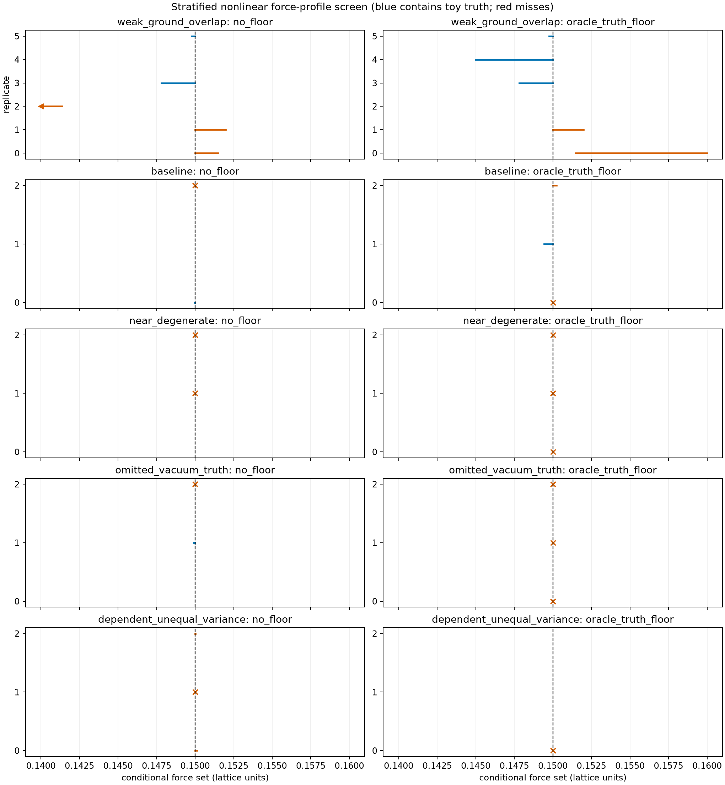

# Stratified Wilson nonlinear force-profile screen

**Classification:** small synthetic stress map; not physical calibration.

The screen reuses six hash-verified weak-overlap panels from the prior report and adds three new panels each for baseline, near-degenerate, omitted-vacuum truth, and dependent/unequal-variance strata. Each panel compares no floor with a floor equal to the generator's known toy overlap minimum; that oracle value is not an independent production receipt.

Panel fits valid: `18/18`. Profile cells valid: `195/216`; failed/abstained cells `21`. Start fits valid: `380/432`; failed/abstained `52`.

The table reports complete, unclipped profile sets, toy-truth containment and Wilson 95% binomial intervals. The containment denominator includes only complete, unclipped intervals; `NA` means no profile interval was evaluable, not zero coverage. Small replicate counts mean these are only screening diagnostics. The nominal objective threshold and grid are uncalibrated; the profiles do not show global identifiability.

| Stratum | Floor | Planned | Complete | Unclipped | Truth contained | Clipped | Failed/abstained | Wilson 95% interval |
| --- | ---: | ---: | ---: | ---: | ---: | ---: | ---: | ---: |
| weak ground overlap | none | 6 | 6 | 5 | 2 | 1 | 0 | [0.118, 0.769] |
| weak ground overlap | toy oracle 0.045 | 6 | 6 | 6 | 3 | 0 | 0 | [0.188, 0.812] |
| baseline | none | 3 | 2 | 2 | 1 | 0 | 1 | [0.095, 0.905] |
| baseline | toy oracle 0.9 | 3 | 2 | 2 | 1 | 0 | 1 | [0.095, 0.905] |
| near-degenerate | none | 3 | 1 | 1 | 0 | 0 | 2 | [0.000, 0.793] |
| near-degenerate | toy oracle 0.9 | 3 | 0 | 0 | NA | 0 | 3 | NA |
| omitted-vacuum truth | none | 3 | 2 | 2 | 1 | 0 | 1 | [0.095, 0.905] |
| omitted-vacuum truth | toy oracle 0.9 | 3 | 0 | 0 | NA | 0 | 3 | NA |
| dependent / unequal variance | none | 3 | 2 | 2 | 0 | 0 | 1 | [0.000, 0.658] |
| dependent / unequal variance | toy oracle 0.9 | 3 | 2 | 2 | 0 | 0 | 1 | [0.000, 0.658] |

Without an independently reviewed open-calibration floor receipt the physical force reader remains `ABSTAIN_NO_INDEPENDENT_OVERLAP_FLOOR`. No production Wilson matrices, sealed data, GPU or QUDA were used; both lanes remain `NOT_READY/UNCERTIFIED`, F remains `GROUND_STATE_FORCE_UNCERTIFIED`, and `physical_score=null`.
