# Wilson F-lane finite-`N_t` transfer-trace reader: synthetic CPU diagnostic

**Status:** candidate software path only. This report uses a synthetic fit
summary, does not read raw Wilson correlators, and does not certify the proposed
finite-`N_t` interpretation or the ground-state force.

## Data flow and definition

```mermaid
flowchart LR
  S[One captured byte snapshot] --> V[Manifest, split, hashes, axes]
  V --> C[Captured lane-contract semantics]
  C --> F[Caller-supplied fitted energies and overlaps]
  F --> Q[Compute q, h, x for R/kernel/T/Nt]
  Q --> R[Check full trace against 1+q+h+x]
  R --> D[Diagnostic only; physical_score is null]
  D -. missing .-> U[Two-sector finite-Nt fit linked to raw C_ij bytes]
  U -. missing .-> B[Coverage, thermal/mixed receipts, force budget]
```



The repository already has a separate raw-matrix snapshot reader and a
candidate full-matrix GLS fit for the forward static-source q term
(`f_lane_raw_matrix_snapshot_diagnostic.py` and
`f_lane_raw_matrix_joint_fit_diagnostic.py`). That candidate fits 2/3 static
states and reports pointwise delta-method q errors, but it does not fit the
vacuum-sector energies `eps_m` or the two-sector transition overlaps `A_i,mn`
required here; its interval calibration is also explicitly not certified. The
new consumer therefore does not duplicate that reader/fit or imply that its
output already supplies this transfer-trace summary.

For each selected cell, the reader uses the proposed diagonal trace

```text
C_kk(R,T;Nt) = Z0(Nt)^-1 sum_(m,n)
               exp[-eps_m (Nt-T)] exp[-V_n(R) T] |A_k,mn(R)|^2
Z0(Nt) = sum_m exp[-eps_m Nt]
```

and normalizes by the `(m,n)=(0,0)` term. It partitions the remaining positive
terms into `q: m=0,n>0`, `h: m>0,n=0`, and `x: m>0,n>0`. The direct full-trace
ratio must agree numerically with `1+q+h+x`. This is an algebra check on the
proposed factorized endpoint convention; it does not establish that a
production Wilson-loop exporter obeys that convention.

## Synthetic fixture and denominator

`tests/test_wilson_f_lane_transfer_trace_reader.py` constructs 3 vacuum levels,
3 static levels at each of `R={2,3}`, and complex transition-overlap pairs for
the three ordered bare kernels `(identity, APE, stout)`. It uses `T={5,6}` and
`Nt={16,32}`. The fixture verifies all 24 planned `R × kernel × T × Nt` cells:

| Unit | Planned | Valid | Failed | Abstained |
|---|---:|---:|---:|---:|
| Captured source file | 3 | 3 | 0 | 0 |
| Positive-fixture q/h/x cell | 24 | 24 | 0 | 0 |
| Zero-ground-overlap negative fixture | 24 | 20 | 4 | 0 |
| Authorized production measurement | 0 | 0 | 0 | 0 |
| F-lane certification gate | 1 | 0 | 0 | 1 |

All q/h/x components are nonnegative and the maximum tested trace-decomposition
residual is below `1e-12`. A negative fixture sets one bare operator's ground
overlap to zero; its four corresponding `R=2 × T × Nt` cells remain failed,
yielding `24/20/4/0`. The focused suite has **11 passed**, including retained
source-fingerprint verification. Tests reject a sealed F split, stale fit
hash, incorrect kernel-to-basis map, unordered spectrum, and malformed overlap
axes, a manifest/protocol hash mismatch, and an extra radius row. The fixture is deterministic and is generated in the test itself; no
Wilson production or sealed bytes are opened.

## What remains open

The reader accepts a supplied spectrum/overlap JSON summary. It does not fit
that two-sector summary from raw `C_ij(R,t)`, estimate uncertainty, calibrate
coverage, bound omitted states, or make a matched-`Nt=32` thermal /
mixed-sector receipt. The next software task is to extend the existing raw
matrix candidate fit under an independently reviewed exporter definition so it
emits the two-sector energies/overlaps from the same captured bytes, then
connect that output to this q/h/x consumer. Independent review must first check
the production insertion-time, source/sink, boundary-trace and normalization
conventions. The force-unit error budget, production access and authorization
are separate gates. The task remains
`NOT_READY/UNCERTIFIED`, F=`GROUND_STATE_FORCE_UNCERTIFIED`, and
`physical_score=null`.

## Implementation snapshot and hash audit

The report retains the exact reader, selected lane contract, shared snapshot
integrity helper and regression test used for this diagnostic. Their paths and
SHA-256 digests are listed in [`source_hashes.json`](source_hashes.json); the
`snapshot_*` files preserve the captured bytes. Source dependency P/V/F/A is
`4/4/0/0`. The artifact manifest covers this README, `source_hashes.json` and
the four snapshots: `6/6/0/0` hashes match; `artifact_hashes.json` is excluded
from its own hash set. The focused test verifies both the source-to-snapshot
identity and each listed artifact digest. This records code identity for the
algebra diagnostic; it does not authenticate the fit summary or its physical
interpretation.
