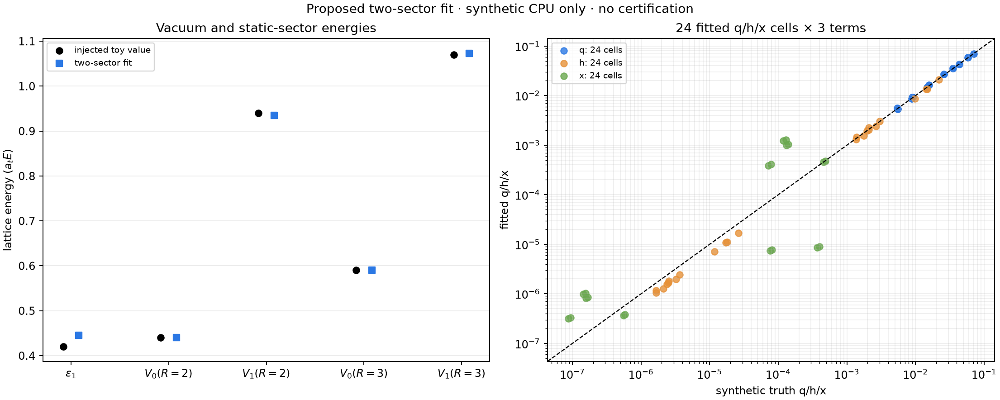

# Wilson F-lane proposed two-sector fit: synthetic CPU pilot

**Status:** method prototype only. The input is generated from the proposed two-sector formula; no Wilson measurement, sealed split, GPU/QUDA data or physical receipt was used. `physical_score=null`; the ground-state force remains uncertified.

## Fixed inputs and model

- `N_blocks=96`, deterministic seed `2026112712`, relative per-block Hermitian noise `0.003`; `R=[2, 3]`, `N_t=[16, 32]`, `T=[3, 4, 5, 6, 7]`.
- Synthetic truth uses two vacuum states and two static-source states, with the first two states from the task's existing finite-trace toy. Parameters are not used to construct fit starts except the Nt=32 one-sector GEVP initializer; the vacuum-excitation start grid is fixed at 0.15/0.30/0.55.
- The candidate fits the lane contract's draft trace `C_ij = Z0^-1 sum_mn exp[-eps_m(Nt-T)-V_n(R)T] A_i,mn A*_j,mn` and fixes `eps_0=0`, ordered positive energies, and one phase convention per overlap vector.
- Objective: diagonal inverse-standard-error weighted least squares over 180 Hermitian matrix components; 45 parameters; three deterministic starting points. It ignores cross-component covariance and does not calculate parameter or q/h/x confidence intervals.

## Result

- Fit status: `two_sector_fit_candidate`; fit denominator `{'planned': 1, 'valid': 1, 'failed': 0, 'abstained': 0}`; q/h/x cells `{'planned': 24, 'valid': 24, 'failed': 0, 'abstained': 0}`.
- Parameter rank/size: `45/45`; Jacobian condition number `123500.47576204207`; diagonal chi-square `111.63399464169404` (not calibrated).
- Absolute energy errors versus the injected toy: `{'epsilon_1_abs_error': 0.025025109692543124, 'static_energy_abs_error_by_R': {'2': [0.00010142032931931277, 0.00474610800446329], '3': [0.00010956910193637981, 0.0032508739232419703]}}`.
- Per-term q/h/x absolute errors across the 24 cells: `{'q': {'max_absolute_error': 0.0009353080089100629, 'median_absolute_error': 0.00043907323945291486}, 'h': {'max_absolute_error': 0.001259899062011861, 'median_absolute_error': 1.7371703283997137e-05}, 'x': {'max_absolute_error': 0.0011574203346370528, 'median_absolute_error': 1.0546214980640891e-06}}`.



The left panel compares the fitted vacuum/static energies to the toy truth. The right panel compares fitted q/h/x terms to the same toy truth; it is not a coverage plot. Internal `1+q+h+x` reconstruction is checked by the transfer-trace reader algebra, not by an independent measurement.

## Data flow and limits

```text
synthetic finite-Nt matrix NPZ + manifest + selected lane contract
  -> one immutable SourceByteSnapshot -> strict axes/hash/Hermitian checks
  -> Nt=32 forward two-state GEVP initializer -> three fixed starts
  -> joint two-sector diagonal-weight fit -> q/h/x reconstruction -> diagnostic only
```

This closes only the synthetic CPU fit path for the draft two-sector equation. It does not validate the endpoint/time-origin convention, positive factorization of the production exporter, full covariance, omitted-state truncation, simultaneous coverage, thermal/mixed error budget, reference force, or independent reviewer/authorization. The C lane remains the selected finite-T Creutz estimand and is not merged with this F-lane toy.

## Source identity

`source_hashes.json` records exact reader, fit, initializer, toy-generator, contract and test bytes. `artifact_hashes.json` covers all report files other than itself.

| file | SHA-256 |
|---|---|
| `two_sector_fit_candidate.py` | `617431cbcbb452402d65bd9f2067b0132644a74fe732cae3d6bc7cd91809879c` |
| `joint_forward_fit.py` | `ec4493db7f4a267a78122acdc95559a1f8cea6d041644fd2dd1a2ccb297adc6f` |
| `transfer_trace_reader.py` | `4dadca6b7ec517b6618006c11bb54c347421e1dcf082efc131f5f036a5971874` |
| `finite_trace_toy.py` | `c827bfd084f9ebd1f9176fe7aad6e356f97c47a3960f85637b959a98ccf27e08` |
| `raw_matrix_reader.py` | `719137e557d82a9ec00c620ebb558e2d176fc751d274d2c12c7b6bef29748702` |
| `source_integrity.py` | `97db76f7e448be77711e837039536e4134e243d7f23d667b5d7f888b64392a7d` |
| `lane_contract_v2.json` | `f06ae77ab0fedc18a3d47aafad12fc956456702a0de7cdde3f6b1b8309abce95` |
| `test_two_sector_fit.py` | `909744c5ae6970b9f30901a4417779dd02b84dca6061b3d926d12072adc2f8c2` |
| `fit_diagnostic.py` | `5897cdd0ee0332d962e73d24224032a58d013465b6838b7d711e269f063985fd` |
