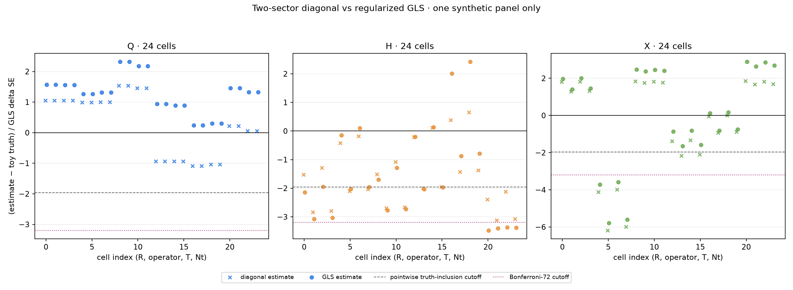

# Wilson F-lane two-sector diagonal/GLS comparison

**Status:** synthetic CPU method diagnostic from one known-truth panel. This is not interval-coverage evidence or a physical Wilson measurement; `physical_score=null` and the force remains uncertified.

## Fixed comparison

Both fits use the same immutable 96-block raw-matrix snapshot, two vacuum states, two static states, 45 parameters, 180 real Hermitian components, the same three starts, and the draft finite-`Nt` trace convention. The baseline uses diagonal inverse-SE weights. The GLS candidate estimates the block-mean covariance, applies fixed 25% diagonal shrinkage and a `1e-10` relative eigenvalue floor, then whitens the full residual.

- Diagonal: status `two_sector_fit_candidate`, rank `45/45`, chi-square `111.634`, Jacobian condition `123500`.
- Regularized GLS: status `two_sector_fit_candidate`, rank `45/45`, chi-square `238.308`, Jacobian condition `65389.9`.
- Covariance: {'block_count': 96, 'component_count': 180, 'diagonal_shrinkage': 0.25, 'eigenvalue_floor_relative': 1e-10, 'raw_min_eigenvalue': -1.6917182608235078e-24, 'shrunk_min_eigenvalue': 2.465060547844122e-12, 'regularized_min_eigenvalue': 2.465060547844122e-12, 'max_eigenvalue': 1.041614237703075e-08, 'condition_number': 4225.511777445157, 'floor_active_count': 0, 'covariance_of': 'sample mean'}.
- Of the 72 known-truth q/h/x terms, the pointwise upper includes truth in `56/72`; the Bonferroni-72 upper includes truth in `64/72`. This is a single draw and must not be called coverage.
- Median/max absolute GLS error in estimated delta-SE units: `1.614` / `5.795`.
- The diagonal and GLS chi-square values use different residual metrics and are not directly comparable as goodness-of-fit tests; neither p-value nor finite-sample fit calibration is supplied.



The plot compares diagonal and GLS point-estimate errors in units of the GLS delta-method standard error. A point above the dashed `-1.96` line means the pointwise 97.5% one-sided upper includes truth in this single panel; a point above the dotted Bonferroni-72 cutoff means the analogous approximate simultaneous upper includes it. These are asymptotic diagnostics, not calibrated bounds. The plotted cells share fitted parameters and are correlated.

## Data flow and limits

```text
one synthetic raw-matrix bundle -> immutable source snapshot -> same two-sector model and fixed starts
  -> diagonal fit + regularized full-covariance GLS fit -> q/h/x delta-method bounds -> one-draw plot/text report
```

The covariance has 180 components but only 96 blocks, so its unregularized estimate is rank deficient. The fixed shrinkage yields a numerical metric; it does not establish covariance accuracy or finite-sample inference. The delta method treats the regularized covariance as fixed and omits optimizer-start, fit-window, state-count, covariance-estimation and dependence uncertainty. A next useful CPU step is a preregistered repeated-panel calibration that changes the data-generating mechanism (at minimum omitted third-sector levels, near-degenerate gaps, weak ground overlap, and block dependence), retaining all failures and simultaneous q/h/x denominators. Do not route these limits or this report to the physical F gate.

## Source identity

The protocol stores source SHA-256 values and exact source snapshots. The artifact manifest hashes every report file other than itself.

| source | SHA-256 |
|---|---|
| `two_sector_fit_candidate.py` | `41e7b52022e97bc8a901a92926e9fcea5deee95b4ff55db69c74845aa8faaf2e` |
| `two_sector_fit_diagnostic.py` | `e86eca8e99c0359326f014989e304bff608bad27ec72dfb3113885fe46e3a4d5` |
| `two_sector_gls_diagnostic.py` | `e0747614a2f5eb665963fb66cf20bc56d8719b4b65f31050928d0824526e3afc` |
| `joint_forward_fit.py` | `ec4493db7f4a267a78122acdc95559a1f8cea6d041644fd2dd1a2ccb297adc6f` |
| `transfer_trace_reader.py` | `4dadca6b7ec517b6618006c11bb54c347421e1dcf082efc131f5f036a5971874` |
| `finite_trace_toy.py` | `c827bfd084f9ebd1f9176fe7aad6e356f97c47a3960f85637b959a98ccf27e08` |
| `raw_matrix_reader.py` | `719137e557d82a9ec00c620ebb558e2d176fc751d274d2c12c7b6bef29748702` |
| `source_integrity.py` | `45a941a63937c56dc365049617e393f4f23209dc9a432e38e4f2937a22ec26a6` |
| `npz_safety.py` | `af60a75cf78a1b0812ccebaf690fc69c3522fcfd3ab54cf5c06aea925c22d750` |
| `lane_contract_v2.json` | `f06ae77ab0fedc18a3d47aafad12fc956456702a0de7cdde3f6b1b8309abce95` |
| `test_two_sector_fit.py` | `6d2f0ab18b6ed75075c9ddb13c2541899631a2c03d7e24f88ddda3e95cf230e3` |
