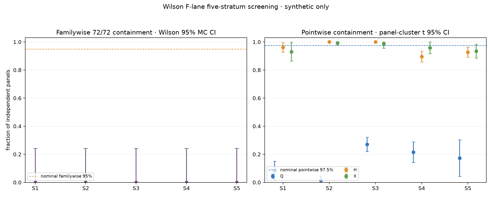
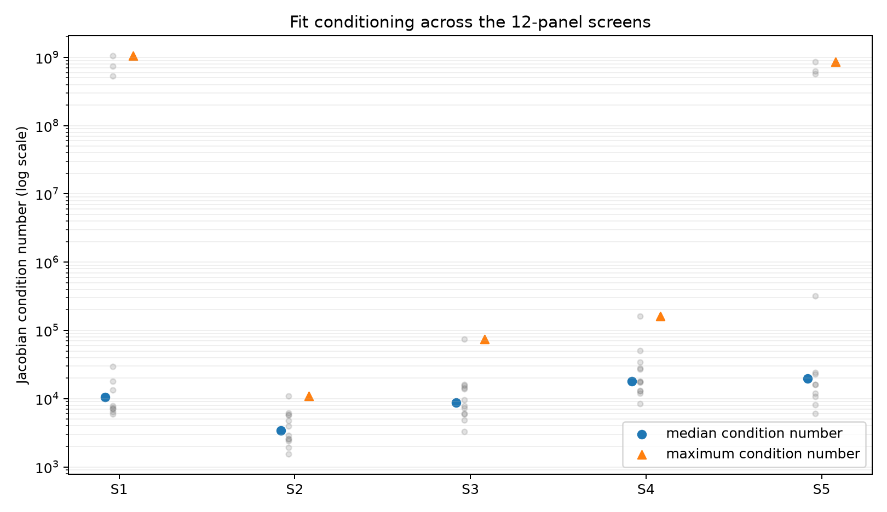
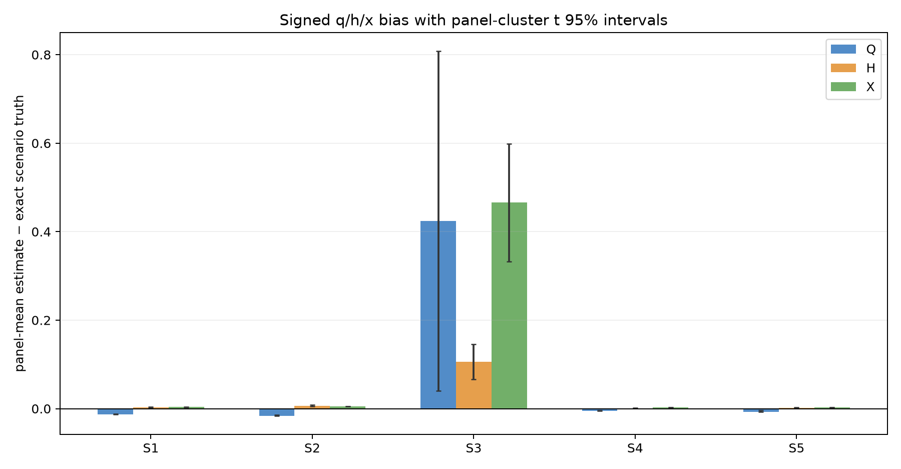

# Wilson F lane: five-stratum synthetic screen

**Status:** `SYNTHETIC_SCREENING_ONLY_NOT_CALIBRATION`. The screen does not open sealed data, run GPU/QUDA, create a physical score, or certify the ground-state static force. `physical_score=null`; F remains `GROUND_STATE_FORCE_UNCERTIFIED`.

## Frozen design

- Five predeclared strata, 12 independent panels per stratum, 96 blocks per panel; 60 panels total.
- Seeds follow `2026112900 + 100*stratum_index + panel_index`, disjoint from the previous 24-panel run (`2026112800..2026112823`). Each raw matrix NPZ and its input manifest/hash are retained under the corresponding stratum directory.
- Every stratum uses the same fixed 2-vacuum × 2-static fitted model, 25% diagonal shrinkage, relative eigenvalue floor `1e-10`, three starts, 72 q/h/x cells, one-sided 97.5% pointwise uppers, and Bonferroni-72 familywise 95% uppers.
- The 12-panel results are a screening-only signal. They cannot certify coverage and cannot be used to tune the interval, shrinkage, fit window, or DGP.
- Frozen truth/noise changes: S1 multiplies the omitted `n=2` amplitudes by `1.5`; S2 sets `V(2)=[0.44,0.94,0.965]` and `V(3)=[0.59,1.07,1.095]`; S3 scales both vacuum-sector ground overlaps for operator 2 by `0.04`; S4 adds `epsilon=0.70` with third-vacuum amplitudes `0.25` times the original ground-vacuum amplitudes; S5 uses stationary AR(1) `rho=0.50` with innovation scales `T={3,4,5}:0.5`, `T=6:1`, `T=7:2`. The full machine-readable frozen specification is in [protocol.json](protocol.json).

## Per-stratum result ledger

| Stratum | Fit valid / planned | q/h/x cells valid / planned | Familywise successes / panels | Familywise Wilson 95% MC interval | Median Jacobian condition |
|---|---:|---:|---:|---:|---:|
| S1_high_overlap_omitted_static | 12/12 | 864/864 | 0/12 (0.000) | [0.000, 0.242] | 1.061e+04
| S2_near_degenerate_static | 12/12 | 864/864 | 0/12 (0.000) | [0.000, 0.242] | 3418
| S3_weak_operator_ground_overlap | 12/12 | 864/864 | 0/12 (0.000) | [0.000, 0.242] | 8696
| S4_omitted_vacuum_state | 12/12 | 864/864 | 0/12 (0.000) | [0.000, 0.242] | 1.786e+04
| S5_dependent_unequal_variance_blocks | 12/12 | 864/864 | 0/12 (0.000) | [0.000, 0.242] | 1.955e+04







## Data flow

```text
freeze five truth/noise transforms -> assign disjoint stratum/panel seeds -> draw 60 Hermitian block panels -> hash raw input -> fit the same 2x2 GLS and compute the same 72 uppers -> retain fit failures/abstentions and cell-level bias -> plot panel-cluster and familywise summaries -> leave physical F gate abstaining
```

## Reading the screen

The five strata all had `0/12` familywise panels, with the same Wilson 95% Monte Carlo interval `[0.000, 0.242]`. This is a strong warning for the frozen 2×2 delta family in these examples, but `n=12` is too small to infer that the true coverage is zero. Pointwise panel-cluster means (`q, h, x`) were: S1 `(0.083, 0.962, 0.931)`, S2 `(0.014, 1.000, 0.993)`, S3 `(0.271, 1.000, 0.986)`, S4 `(0.215, 0.896, 0.958)`, and S5 `(0.174, 0.927, 0.934)`. The q term is the consistent weak point across all five screens; h/x also fall below their nominal 97.5% in several strata. These are descriptive estimates, not corrected or confirmatory comparisons.

All `60/60` fits converged with Jacobian rank `45/45`, and all `4320/4320` q/h/x cells were produced. This does not imply numerical stability: the median condition number ranged from `3.42e3` (S2) to `1.95e4` (S5), while the maxima reached `1.06e9` in S1 and `8.64e8` in S5. The condition plot shows those high-tail panels even though the optimizer returned a valid full-rank fit.

S3 is a particularly clear weak-overlap tail diagnostic. Its mean signed q/h/x biases over valid cells were `(0.425, 0.106, 0.466)`, while the medians were near zero `(-0.0035, 0.0025, 0.0020)`. A few panels therefore dominate the means: the largest absolute q, h, and x errors were `7.66`, `2.77`, and `8.68`, respectively. The fit remained full rank, so the relevant signal is the unstable ratio/tail behavior, not an optimizer failure count. S1/S2 q coverage was only `0.083/0.014`; S4 also showed lower h coverage (`0.896`), consistent with the omitted-vacuum stress affecting finite-`N_t` sectors. S5 retained only `0.174` q coverage despite generating stationary AR(1) blocks and T-dependent scales. None of these patterns identifies a valid replacement interval.

The pointwise bars are averaged within each panel before the t interval, so the independent sampling unit is the panel. Familywise bars count a panel as success only when the fit is valid and all 72 q/h/x upper bounds contain their exact synthetic truth. Per-cell signed bias and all panel/cell denominators are in `signed_bias_summary.csv`, `panel_results.csv`, and `cell_coverage.csv`; the figures have accompanying interpretations here.

The separately frozen confirmation calculation remains `606` independent panels per stratum and at least `588/606` familywise successes per stratum, under its declared `p=0.98` planning alternative and five-stratum multiplicity rule. This screen is not a substitute. The production F lane still lacks the production correlator/exporter convention evidence, matched-`Nt=32` thermal/mixed receipts, force/reference error budget, and independent review required for physical interpretation. The finite-`T` Creutz C lane remains separate.

All graphics have a corresponding text interpretation above and raw data/results are retained. No GPU/QUDA or sealed data were used.

After the initial screen, per-stratum plot titles and y-axis wording were shortened so S4's three-vacuum truth is represented correctly without overlapping text. The five plots were re-rendered from the saved panel/cell CSVs; all fit estimates, denominators, and raw NPZ inputs are unchanged. The archived diagnostic source hashes were updated to this rendering version, then all child/root artifact manifests were recalculated and checked.
