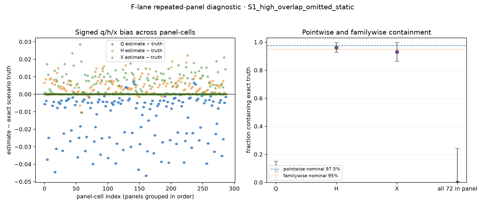

# Wilson F lane: repeated-panel coverage diagnostic

**Status:** `SYNTHETIC_SCREENING_ONLY_NOT_CALIBRATION`. This is not a physical Wilson measurement or certification; `physical_score=null`, F remains `GROUND_STATE_FORCE_UNCERTIFIED`.

## Frozen design and result

- `12` independent synthetic panels, `96` blocks per panel; truth: `2 vacuum x 3 static states; original energies and vacuum spectrum`; fit: `2 vacuum x 2 static (fixed across all strata)`; relative noise `0.003`; noise model `{'model': 'iid_gaussian', 'scale_by_T': {}}`; seed rule `numpy default_rng(2026112900 + panel_index); base follows 2026112900 + 100*stratum_index`.
- Every panel uses the same regularized full-covariance GLS and finite-difference delta intervals: one-sided 97.5% pointwise, plus Bonferroni-72 familywise upper bounds. No interval/shrinkage/window was tuned on these panels.
- Fit denominator: `12/12` valid, `0` failed; q/h/x planned cells `864`. Unique matrix hashes: `12/12`.
- Pointwise pooled descriptive containment: `569/864 = 0.659`; interpret with the panel-cluster term means and intervals in the summary because cells within a fit are correlated.
- Entire 72-term Bonferroni family contained in `0/12` panels (`0.000`), Wilson 95% MC interval `[2.7755575615628914e-17, 0.24249400665524085]`.



## Data flow

```text
freeze scenario truth/noise + 2x2 fit + interval rule -> disjoint seed per panel -> write and hash raw matrix snapshot -> same GLS fit -> compare all 72 q/h/x upper bounds to exact scenario truth -> panel-cluster coverage and failure ledger -> physical F gate abstains
```

## Interpretation and limits

This is the frozen 12-panel screen for `S1_high_overlap_omitted_static`. It is used to identify qualitative failure modes and exercise the reproducible report path. The familywise Wilson interval and panel-cluster pointwise intervals are descriptive Monte Carlo summaries at this small n; they do not establish calibration or pass the separately frozen five-stratum confirmatory rule (606 panels and at least 588 familywise successes per stratum).

The source/NPZ snapshots, fit-start ledger, panel/cell CSVs, protocol, PNG and hashes are retained; full parameter vectors are omitted because the raw inputs and derived coverage cells are sufficient to replay and inspect this diagnostic. Synthetic CPU screening does not validate physical source/exporter/thermal/mixed/force receipts. No GPU/QUDA or sealed data were used.
