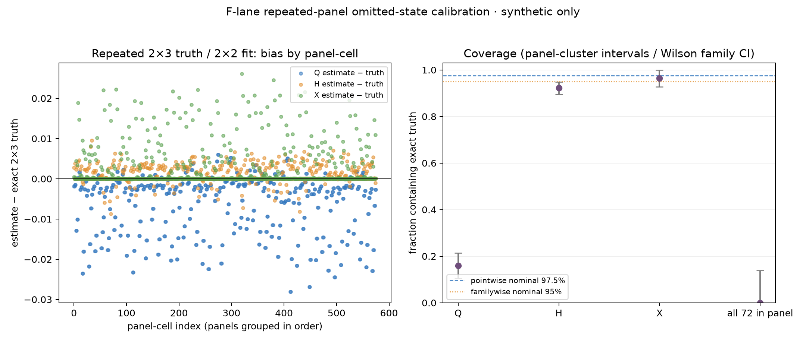

# Wilson F lane: repeated omitted-state coverage stress

**Status:** diagnostic-only repeated-sampling calibration under one synthetic, deliberately misspecified generator. This is not a physical Wilson measurement or certification; `physical_score=null`, F remains `GROUND_STATE_FORCE_UNCERTIFIED`.

## Frozen design and result

- `24` independent synthetic panels, `96` Gaussian blocks per panel, fixed 2-vacuum × 3-static truth and fixed 2 × 2 fitted model; relative noise `0.003`; seed rule `2026112800+panel_index`.
- Every panel uses the same regularized full-covariance GLS and finite-difference delta intervals: one-sided 97.5% pointwise, plus Bonferroni-72 familywise upper bounds. No interval/shrinkage/window was tuned on these panels.
- Fit denominator: `24/24` valid, `0` failed; q/h/x planned cells `1728`. Unique matrix hashes: `24/24`.
- Pointwise pooled descriptive containment: `1178/1728 = 0.682`; interpret with the panel-cluster term means and intervals in the summary because cells within a fit are correlated.
- Entire 72-term Bonferroni family contained in `0/24` panels (`0.000`), Wilson 95% MC interval `[1.3877787807814457e-17, 0.13797620467498017]`.



## Data flow

```text
freeze 2x3 truth + 2x2 fit + interval rule -> independent seed per panel -> write and hash raw matrix snapshot -> same GLS fit -> compare all 72 q/h/x upper bounds to exact 2x3 truth -> panel-cluster coverage and failure ledger -> physical F gate abstains
```

## Interpretation and limits

The repeated panels estimate coverage only for this fixed omitted-third-static-state design and noise model. The fit-model misspecification is intentional, so poor coverage means the fixed 2x2 delta rule is not robust to this tested truncation; it does not identify which alternative interval is valid. The number of independent panels is small for tight Monte Carlo conclusions; cells are clustered by panel and the familywise event is the independent-panel unit.

The source/NPZ snapshots, fit-start ledger, panel/cell CSVs, protocol, PNG and hashes are retained; full parameter vectors are omitted because the raw inputs and derived coverage cells are sufficient to replay and inspect this diagnostic. Open items include near-degenerate and weak-ground-overlap strata, omitted vacuum states, correlated/unequal-covariance noise, larger independent validation panels, third-state/profile/bootstrap recovery, and physical source/exporter/thermal/mixed/force receipts plus independent review. No GPU/QUDA or sealed data were used.
