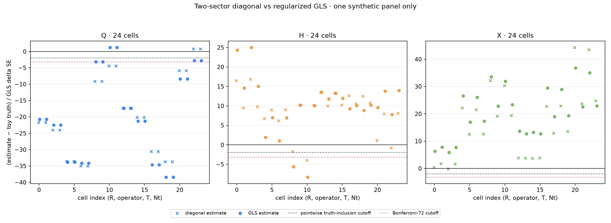

# Wilson F-lane two-sector omitted-state stress

**Status:** one synthetic CPU panel with deliberate state-count misspecification. This is a bias diagnostic, not repeated-sampling coverage or physical Wilson evidence. `physical_score=null`; F remains uncertified.

## Frozen comparison

- Generator: `96` iid Gaussian noisy blocks, seed `2026112739`, relative noise `0.003`; truth has two vacuum states and three static-source states.
- Both fit candidates retain two vacuum and two static-source states (45 parameters, 180 Hermitian components), identical three starts and the same raw snapshot. The third static level is deliberately omitted from the fitted model.
- Baseline uses diagonal inverse-SE weights. GLS uses block-mean covariance with fixed 25% diagonal shrinkage and `1e-10` relative eigenvalue floor; q/h/x intervals use a finite-difference delta method.
- Of 72 known-truth q/h/x terms, pointwise upper bounds contain `48/72`; Bonferroni-72 upper bounds contain `52/72`.
- The plot shows `(estimate - full three-state truth)/GLS delta SE`. Values below the one-sided upper-bound cutoff indicate missed truth in this one draw.



These are single-panel containment counts, not coverage rates. The interval is conditional on a misspecified 2x2 model and treats estimated covariance as fixed; this stress does not calibrate the candidate interval. It shows why a full-rank fit and narrow asymptotic intervals can fail to protect against omitted spectral states.

## Data flow and next diagnostic

```text
2x3 synthetic trace + iid block noise -> immutable raw-matrix snapshot -> same 2x2 model under diagonal and GLS weights -> q/h/x delta intervals -> 72 known-truth misspecification checks -> physical F gate abstains
```

The next calibration should repeat independent panels over predeclared omitted-level amplitudes/gaps, near-degeneracy, weak ground overlap and correlated blocks; retain fit failures and use Monte Carlo intervals for pointwise and familywise coverage. Do not tune the shrinkage/floor or interval rule against the same panels used for final calibration. Production endpoint conventions, raw `C_ij`, matched `N_t=32`, reference force, contamination/error receipts and independent review remain absent.

## Source identity

All diagnostic source bytes and SHA-256 digests are retained in this directory; `artifact_hashes.json` covers the report bundle.
