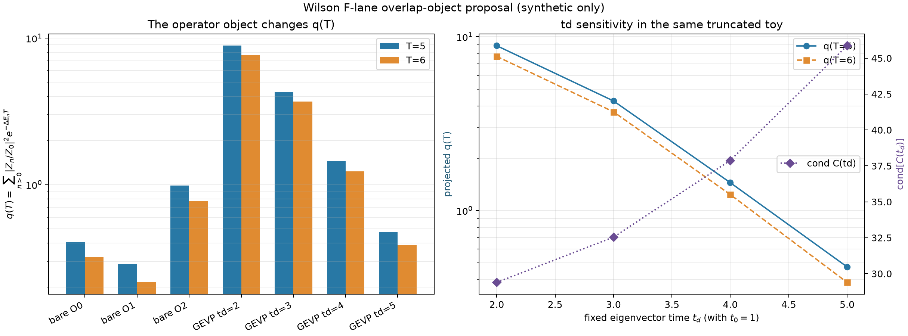

# Wilson F-lane GEVP overlap-object diagnostic

This is a deterministic synthetic forward-spectrum method proposal. It does not read Wilson measurements, open sealed data, or certify a physical force.

## Candidate definition

Interpret `t0=1` as the metric-reference matrix and `td=2` as the fixed time at which the principal GEVP eigenvector is solved once. Normalize `v0` by `v0† C(t0) v0 = 1`. For the matrix convention `C_ij(t)=Σ_n Z_ni Z*_nj exp(-E_n t)`, use the projected overlap `Z_n(v0)=Σ_i conj(v0_i) Z_ni`, and define `q_v(T)=Σ_{n>0}|Z_n(v0)/Z_0(v0)|² exp[-(E_n-E_0)T]`. The eigenvector is held fixed for T=5 and 6.

This resolves the object ambiguity as a review candidate. It does not change `lane_contract_v2.json` or connect the candidate to the F gate.

## What the toy shows

In the four-state/three-operator toy, selected `td=2` gives q(T=5)=8.88191 and q(T=6)=7.71059; the largest of the three original basis operators gives 0.987982 and 0.774168. The projected q is therefore 8.99x and 9.96x those maxima. This is evidence that the operator object cannot be left implicit in this toy, not a claim that GEVP worsens physical contamination.

The right panel varies the fixed diagonalization time. q(T) changes strongly with td while the same exact four-state spectrum and three-operator basis are held fixed. It also shows `cond[C(td)]`; this is only the exact toy matrix condition number, not the condition of a noisy covariance-weighted fit.

## Denominators and boundaries

Bare operator×T cells: 6/6/0/0. GEVP td×T cells: 16/16/0/0. Physical raw inputs: 0/0/0/0. F certification gate: 1/0/0/1. Cell counts are planned/valid/failed/abstained.

The toy has no measurement noise, bootstrap interval, finite-Nt backward propagation, matched-Nt=32 thermal term, mixed-sector bound, reference-force interval, or model-truncation budget. `q(T)` is not itself the finite-T effective-energy bias. Keep `GROUND_STATE_FORCE_UNCERTIFIED`, `NOT_READY/UNCERTIFIED`, and `physical_score=null`.

## Reproducibility

`overlap_object_q.csv` contains every operator×T and td×T cell. `protocol.json` records the exact synthetic spectrum and the candidate method definitions. `summary.json` gives the results and denominators. `artifact_hashes.json` binds the report, CSV, image, protocol, summary, source snapshots and selected v2 contract.
