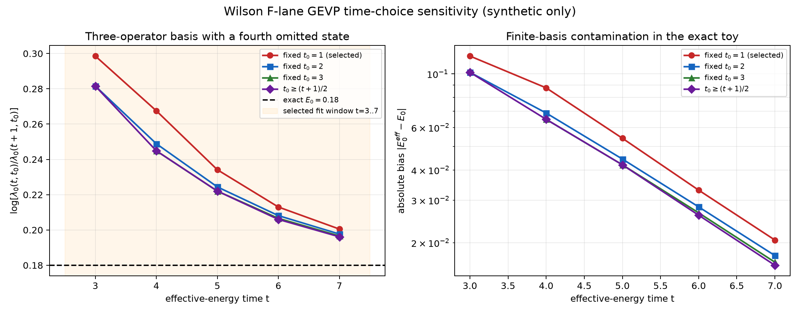

# Wilson F-lane GEVP truncation diagnostic

**Synthetic, data-free method diagnostic.** It uses a positive forward spectral sum with four known energy levels and only three operators. It does not read Wilson data, produce q/h/x receipts, calibrate intervals, or change the F-lane certification status. `physical_score=null`.

## Formula and result

The standard moving GEVP is

```text
C(t) v_n(t,t0) = lambda_n(t,t0) C(t0) v_n(t,t0),  t > t0
E_eff,n(t,t0) = log[lambda_n(t,t0) / lambda_n(t+1,t0)].
```

The toy matrix is exactly `C_ij(t)=sum_n Z_ni Z*_nj exp(-E_n t)`. A three-operator basis resolves only three of its four states. The omitted fourth state produces nonzero effective-energy bias even though every matrix and energy is known exactly. The selected contract uses `t0=1`; its largest absolute bias over `t=3..7` is **0.118567** in this toy. The purple curve changes `t0` with `t` so the more restrictive condition holds for both time points used by the finite difference; its largest bias is **0.101543**. This is a sensitivity comparison, not a universal bound or a proposed threshold.



The test with exactly three states checks the finite-basis algebra: for a full-rank three-operator overlap matrix, the principal correlator gives the exact ground energy up to floating-point error. Adding one omitted state supplies a controlled negative fixture. `effective_energies.csv` retains every planned `(mode,t,t0)` point and the `C(t0)` condition number.

## Applicability boundary and protocol issue

The primary GEVP analysis by Blossier et al. defines the moving problem and effective energy, then analyzes omitted-state corrections. It assumes finite-time contributions can be neglected and states that the temporal extent must be large; its improved `t0 >= t/2` asymptotic behavior is a sufficient regime for a faster correction, not a universal finite-time certification. The project has `N_t=16` and a separate matched-`N_t=32` thermal lane, so this forward-only toy cannot validate the physical model. Source: [Blossier et al., *On the generalized eigenvalue method for energies and matrix elements in lattice field theory*](https://arxiv.org/abs/0902.1265), especially §§2.1–2.2.

There is also a concrete metadata ambiguity: the selected contract records both `t0=1` and `td=2`, but neither the raw reader nor the q-support receipt defines whether `td` is a fixed eigenvector diagonalization time, a time in the moving GEVP, or another fit parameter. This diagnostic uses the standard moving GEVP and does not assign semantics to `td`. Before a raw-matrix producer is wired to the q reader, the contract should freeze one definition and state whether the overlap ratios are for original smearing operators or GEVP-projected operators. Those ratios are not interchangeable without a derivation.

Text flow: `exact 4-state forward spectrum -> 3x3 C(t) matrices -> moving GEVP at fixed t0 -> effective ground energy over t=3..7 -> compare t0=1,2,3 and t0>=ceil((t+1)/2) -> bias/conditioning plot`. The diagnostic denominator is **19/19/0/0** deterministic GEVP points; the physical-input denominator is `0/0/0/0`, and the physical certification gate is `1/0/0/1`.

## Next step

Freeze the meaning of `td` and the operator whose overlap ratio enters `q`. Then implement the raw-matrix same-byte reader and fit producer against that reviewed definition, including finite-`N_t` treatment and paired resampling. Coverage, positive-spectrum assumptions, matched thermal `h`, mixed `x`, raw force/reference bootstrap, independent review, and owner authorization remain open. Keep the lane `GROUND_STATE_FORCE_UNCERTIFIED` until those receipts exist.
