# wilson_loop：CPU 验收结论与下一阶段

### 当前 CPU 验证快照（2026-11-28）

PR #6 当前 checkout 最新全仓 CPU suite 为 **600 passed in 89.08 s**，包含 Wilson 最大分量 phase chart、固定 operator-0 零 pivot 的解析 Jacobian 等价回归，以及此前的 C-lane capture/hash、D04 helper source-map、profile/continuation 回归。新增 chart 定向测试为 **6 passed in 1.08 s**。这只是 CPU 软件/合成诊断证据，未读取 Wilson 生产测量或 sealed split，也没有 GPU/QUDA 执行。PR #5 Pion TODO 最近记录其全仓 suite **349 passed**；本轮未改或重跑 PR #5。物理状态仍为 `NOT_READY/UNCERTIFIED`、F=`GROUND_STATE_FORCE_UNCERTIFIED`、`physical_score=null`。

### 2026-11-26 历史附件链接审计

本文件 156 个 Markdown links 均已可解析：当前 checkout 内的目标保持相对路径；原历史报告/决策文件已从当前 checkout 移除的 72 个链接，现固定指向 fork 中仍可达的 Git commit permalink。历史正文、数字与结论未改写；这些旧报告仍只作为其原有范围内的历史诊断，不是新的物理证据。

## 下一次执行包（C/F 主 estimand 与门限已自选）

停止同一 synthetic generator/holdout 上的 block-length、bootstrap 次数或 seed 扫描。下一步只在有 owner/reviewer 审核和授权的 calibration source package 到位后接线；完整 source hashes 只能证明字节身份，不能替代 coverage、污染或物理解释收据。

1. **C：有限-$T$ Creutz。**保持单独主点 `stout_rho0.1_n5, R=2, T=5`，按当前 map `chi=-log(W(3,6) W(2,5)/(W(3,5) W(2,6)))` 组合四个同配置 loop means；source 包绑定 manifest、loop NPZ 与 summary，明确同一 calibration split、configuration/trajectory IDs、kernel/R/T 轴、action、geometry、边界、loop normalization 和 hash。现有 [`c_lane_snapshot_reader.py`](c_lane_snapshot_reader.py) 可从同一 immutable snapshot 重算区间摘要并交给 gate；它不认证 interval coverage。推断门保持两 lane family `alpha_C=0.025`、paired circular block bootstrap `L={2,5,10}`、每长度 10,000 draws、invalid fraction `<=1%`、hull half-width `<=0.02`；还必须另交独立 Markov gap/TV 或已证明 finite-dependence envelope、coverage receipt 与 C map/sign reviewer。缺任一项就保留 C-lane `ABSTAIN`。
2. **F：基态离散静态力。**保持 `R_mid=2.5` 的 stout-minus-identity ground-state force，与 C finite-$T$ observable 分开。最小原始输入为同一 paired calibration configurations 上 `R={2,3}`、三个 bare operator `identity / APE(alpha=0.4,n=5) / spatial stout(rho=0.10,n=5)` 的完整 `3x3` cross-correlator matrices；分别提供 `N_t=16` 与 matched `N_t=32` manifest/bytes、`t=1..7`、矩阵指标顺序、trajectory/config IDs、action/geometry/boundary 和 operator/link provenance。当前版本化 raw-matrix reader 只做 schema 检查与 GEVP projection；它没有输出经校准的 kernel-indexed `q` upper bound，也没有 physical F evaluator。下一位应先让 joint fit 从同一 snapshot 读出各 bare operator 的 ground/excited overlap，再单独形成 `q`、matched-`N_t=32` thermal `h`、mixed `x` 与 spectral-model bounds；不能把 GEVP 的单一投影态复制成三个 operator 的 q 证据。
3. **F force-level 门。**同一 chain 上提供 force interval 与正 reference-force 的 paired draws、reference fit、完整 planned fit/window/family 分母；`q/h/x/model` 四项须给 simultaneous envelopes 并通过 8-corner propagation 到 `a_s*a_t*F`。固定系统项上限为 `1.5%/1.5%/1.0%/1.0%`、系统合计 `<=5%`、统计 half-width `<=5%`、线性合计 `<=10%`，且 reference-force simultaneous lower bound `>0`；统计/系统 family allocation 按 `evidence_adapter.py` 合同收据，不得将同源误差按独立项平方和缩小。

**图文验收物：**C 给出四 loop means 与 ratio 符号的数据流图、依赖/coverage 收据、按 `L=2/5/10` 的区间 hull 和 invalid fraction 图；F 给出 `3x3` cross-correlator eigenvalue/condition 与时间的图、按 kernel/R/Nt 分面的 `q/h/x` upper-envelope 图，以及传播到 force 单位的 8-corner waterfall/预算图。每图写明真实/合成来源、source hash、split、`planned/valid/failed/abstained` 分母和是否有独立 truth。没有获准 calibration bytes、coverage/contamination receipts、独立 reviewer 或设备授权时，不启动生产拟合/GPU、不打开 sealed/confirmation 数据；C/F 均维持 `NOT_READY/UNCERTIFIED`、F=`GROUND_STATE_FORCE_UNCERTIFIED`、`physical_score=null`。

### 2026-11-26 F-lane 有限-$N_t$ transfer-trace snapshot reader

新增 [`f_lane_transfer_trace_reader.py`](f_lane_transfer_trace_reader.py)，让已选的有限-$N_t$ transfer-trace q/h/x 定义有一个严格的 CPU consumer：它只从同一个 `SourceByteSnapshot` 读取 manifest、fit-summary JSON 和 lane contract bytes，核对 open F calibration split、`S16T16`/Wilson-$\beta=6$、`R={2,3}`、三个 kernel 的有序语义、`T={5,6}`、`N_t={16,32}`、source/fit hashes 以及 contract 中 `two_sector_transfer_trace_qhx_v1` 和 kernel→裸基算符映射。对调用方提供的有序真空能谱、静态能谱和复 overlap pairs，它逐格计算 `q (m=0,n>0)`、`h (m>0,n=0)`、`x (m>0,n>0)`，并把完整 trace ratio 与 `1+q+h+x` 对照。没有路径二次读取、physical score 或 certification 输出。

文字流程：`同一 snapshot 的 manifest + protocol + 拟合 summary -> hash/schema/split/轴序验证 -> 按所选 transfer trace 计算 q/h/x -> 直接 trace 恒等式核对 -> diagnostic only`。确定性合成 fixture 的 captured source files 为 `3/3/0/0`，正例 `R×kernel×T×N_t` cells 为 `24/24/0/0`；ground overlap 为零的负例保留 `24/20/4/0`，全部正例 sector 非负且重构残差 `<1e-12`；生产 measurement `0/0/0/0`，F-lane certification gate `1/0/0/1`。新增 `tests/test_wilson_f_lane_transfer_trace_reader.py` **10 passed**，覆盖捕获后路径替换、封存 split、fit/protocol hashes、错 kernel 映射、错误谱序、额外 R 行、overlap 形状及零 ground-overlap 失败分母。图式数据流、公式、denominator 与边界见[synthetic reader report](f_lane_transfer_trace_reader_cpu_20261126_v1/README.md)。

此增量只消费**调用方已经拟合好的** two-sector spectrum/overlap summary，不由它本身解析原始 `C_ij(R,t)`、不估计不确定度/coverage、不生成 q/h/x simultaneous upper bound，也没有得到 matched-`N_t=32` thermal `h`、mixed `x`、truncation 或 force-unit receipt。代码库里已有独立 raw-matrix snapshot reader 和 forward static-sector joint-GLS candidate；后者只输出 q 点估计与未校准 delta-method error，不产生这里所需的 vacuum-sector `eps_m`、`A_i,mn` two-sector fit summary，其区间也不构成证据收据。因此不要重复实现 raw parser 或把既有 q candidate 当作 q/h/x fit。下一软件边界是在 reviewer 核准的 exporter 定义下，扩展现有 joint-fit candidate，从同一个 raw matrix snapshot 派生 `eps_m`、`V_n(R)`、`A_i,mn(R)` 和完整失败分母，再接到本 reader；随后用 exact/omitted-state/near-degenerate/near-singular fixtures 做 covariance/coverage 校准。生产 source/sink/time-origin convention、真实 reference、污染界、独立审阅和授权未齐之前不读 production/sealed 数据、不启动 GPU/QUDA，维持 `NOT_READY/UNCERTIFIED`、F=`GROUND_STATE_FORCE_UNCERTIFIED`、`physical_score=null`。

### 2026-11-26 F-lane q/h/x kernel 的线性可辨识性诊断（合成输入）

新增 [`f_lane_qhx_design_identifiability.py`](f_lane_qhx_design_identifiability.py)、[数值表、奇异值图和复现说明](f_lane_qhx_design_identifiability_20261126_v1/README.md)，并加入 [`test_wilson_f_lane_qhx_design_identifiability.py`](../../tests/test_wilson_f_lane_qhx_design_identifiability.py)。这里固定 finite-`N_t` toy 的手设能量，按五个未知修正系数构造

```text
K_mn(T,N_t) = exp[-eps_m (N_t-T) - (V_n-V_0)T]
columns = q_static_1, q_static_2, h_vacuum_1, x_mixed_1, x_mixed_2
grid = R=2,3; T=3..7; N_t=16 only, 32 only, or the paired 16+32 design
```

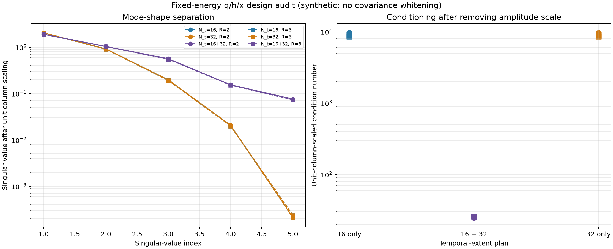

对手设能量的 6 个主设计 cell，`R=2` 的单位列归一化条件数从 `N_t=16` 单独时 `9.63e3` 降到配对 `N_t=16,32` 时 `24.9`；`R=3` 从 `8.59e3` 降到 `25.9`。raw 条件数对应约 `2.24e6 → 6.71e3` 和 `1.92e6 → 6.70e3`。这说明在这组固定能量下，不同 `N_t` 的行提供了有用的列形状差异。另一面，toy 的 `N_t=32` thermal/mixed 列范数只有 `N_t=16` 的约 `1.21e-3`（约小 829 倍）；单位列归一化移除了这个绝对信号惩罚，所以不能拿 shape-only 条件数宣称生产上 h/x 可测。

附加简并压力检查显示：静态能量间隔设为 `1e-6`（`a_t E` 单位）时，配对设计仍数值满秩，但归一化条件数约 `8.71e6`；精确简并时数值秩降到 3，条件数按定义记为 null。报告记录 raw/scaled 两种 SVD 数值秩容差。测试检查了配对设计、thermal/mixed 振幅压低、精确/近简并、非法输入、欠定矩阵和输出 hash。

当前证据等级：`ran: PYTHONPATH=. PYTHONDONTWRITEBYTECODE=1 /Users/zhaodianjun/.venv/bin/pytest -q -p no:cacheprovider tests/test_wilson_f_lane_qhx_design_identifiability.py`，本次修正后的 13 项测试通过；协方差敏感度诊断加入前，Wilson 文件集合计 `135 passed`、PR #6 全仓 CPU suite `368 passed`；加入后分别为 `142 passed` 与 `375 passed`。固定能量设计 cell `6/6/0/0`，物理测量 `0/0/0/0`，认证门 `1/0/0/1`（planned/valid/failed/abstained）。这只是固定能量下的线性 kernel 几何；未使用真实谱、测量协方差、bootstrap 或 coverage，未拟合 q/h/x，也不收紧任何物理界。

**接下来实施者应做：**(1) 先由独立 reviewer 对照 Wilson exporter 确认插入时间、边界条件和 source/sink 指标，再冻结每个 `K_mn` 的生产输入定义；(2) 仅对已授权、未封存的 raw matrix snapshot 估计 block covariance，在每个 bootstrap replica 中同时做 joint fit，并报告 raw、协方差白化和按列缩放的 profile/Fisher 信息、近简并诊断及覆盖率；(3) 用现行 force/error-budget gate 反推生产 h/x 的允许上界，不从这份 toy 条件数指定阈值；(4) 若不同 `N_t` 的 thermal/mixed mode 在协方差白化后仍无法与拟合误差/力误差预算分开，则输出 abstain，并调整可执行的 `N_t,T` 设计后重新校准。继续保持 `NOT_READY/UNCERTIFIED`、F=`GROUND_STATE_FORCE_UNCERTIFIED`、`physical_score=null`，不读取封存 split。

### 2026-11-26 F-lane q/h/x 设计的协方差相关性敏感度（等方差合成情景）

新增 [`f_lane_qhx_covariance_stress_diagnostic.py`](f_lane_qhx_covariance_stress_diagnostic.py) 与[条件数热图/场景表](f_lane_qhx_covariance_stress_20261126_v1/README.md)。它把上一节未加权设计扩展为 `L^{-1}K`，但不拟合“生产协方差”：所有行方差固定为 1，只扫描 `R_T[i,j]=rho_T^|T_i-T_j|`（`rho_T=-0.9,-0.5,0,0.5,0.9`）以及配对 `N_t` 间 `rho_Nt=-0.9,0,0.9` 的可分离正定相关模型；不加 covariance floor 或人为正则。

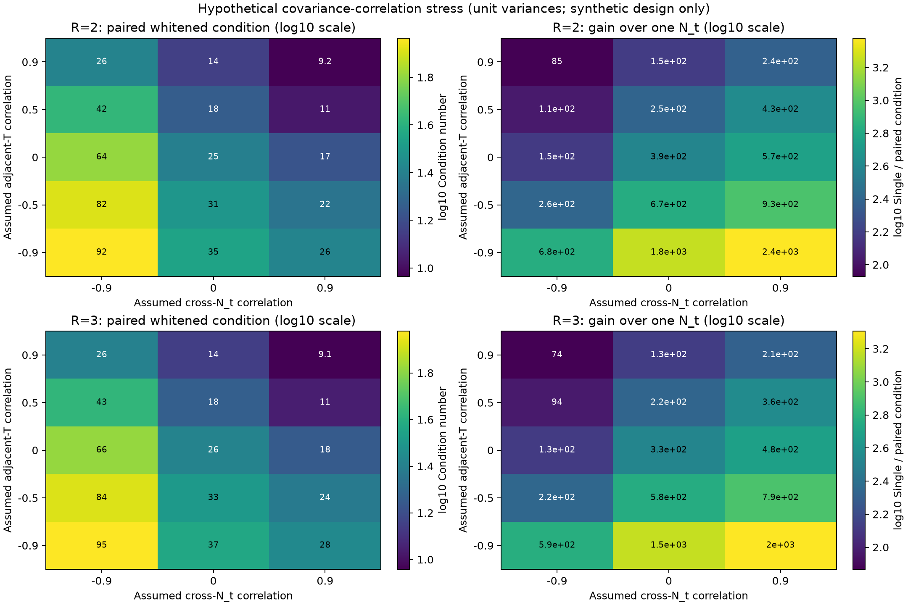

50 个假设场景全部数值满秩。单位列归一化的配对/单 `N_t` 条件数改善因子，在 30 个 paired 场景内为 `73.6×–2390×`。高负 `T` 相关、负 `N_t` 跨相关会使条件数明显变差，但这组 toy 的配对形状仍优于单一 `N_t`。这只说明该可分离相关结构族下的形状敏感度；单位列归一化和等方差假设仍抹去了 `N_t=32` thermal/mixed 的绝对信号衰减，也没有用相关系数的测量来源支持任何一个场景。

测试覆盖 `Sigma=I` 时回到原始设计、协方差对称/正定、非对称/奇异/非正定矩阵 fail closed、完整 50 格分母以及报告/source/artifact hashes。`ran: PYTHONPATH=. PYTHONDONTWRITEBYTECODE=1 /Users/zhaodianjun/.venv/bin/pytest -q -p no:cacheprovider tests/test_wilson_f_lane_qhx_covariance_stress.py`：7 项通过；假设协方差格点 `50/50/0/0`，物理测量 `0/0/0/0`，认证门 `1/0/0/1`。本报告没有 joint fit、bootstrap、coverage、q/h/x interval 或 force bound。

**接续工作：**唯一能把本敏感度升级为统计判断的数据仍是同一 immutable raw-matrix snapshot 的实测 block covariance。接线时需用完整实/虚矩阵元素和跨时间 covariance 白化 residual；若有效 block 数不足导致 covariance 奇异，不能套用本报告的 correlation matrix，也不能未审阅就加 floor；应保留失败分母并 abstain，或由独立统计 reviewer 先定正则化与覆盖校准规则。之后再将每个 replicate 的 joint spectral fit、裸 kernel overlap/gap、coverage intervals 传给 q-bound reader，最后根据现行 force-unit budget 决定允许的 `h/x` 上界。继续保持 `NOT_READY/UNCERTIFIED`、F=`GROUND_STATE_FORCE_UNCERTIFIED`、`physical_score=null`，不读取封存 split。

### 2026-11-26 F-lane kernel-indexed q 对象已选定为裸 smearing 基算符

我把之前留下的“kernel-indexed q 到底对应裸 basis overlap 还是 GEVP composite overlap”定为一个可执行方法默认值：`q_k(R,T)` 对应产生该 kernel correlator 的**裸 smearing 基算符**。原因是合同中的 force q cells 按 stout / identity kernel 分行；每个 q 必须与同一 kernel 的相关函数和 force corner 一一对应。一次 GEVP 求出的线性组合是另一个复合算符，不能复制成各 kernel 的 q。GEVP 仍可用于状态识别、joint-fit 初始化和截断敏感度检查。

| kernel ID | joint `C_ij` fit 的 basis operator ID | q cell 用途 |
|---|---|---|
| `identity` | `identity` | force candidate/reference 比较 |
| `ape_alpha0.4_n5` | `APE` | 描述性对照，不计入 force systematic family |
| `spatial_stout_rho0.10_n5` | `stout` | force candidate/reference 比较 |

精确定义写入 [`lane_contract_v2.json`](lane_contract_v2.json)：

```text
C_ij(R,t) = Σ_n Z_ni(R) Z*_nj(R) exp[-E_n(R)t]
ratio_upper[n] bounds |Z_nk(R)/Z_0k(R)|²
q_k(R,T) = Σ_(n>0) |Z_nk(R)/Z_0k(R)|² exp[-(E_n(R)-E_0(R))T]
```

这里的 ratio 上界来自**对同一 R 的整张 3×3 cross-correlator 矩阵做联合谱拟合**，不是从三个对角数组拼出矩阵。选择裸 basis 定义把 kernel-indexed observable、overlap ratio 和 force q corner 接在一起；[GEVP 方法原文](https://arxiv.org/abs/0902.1265)说明 GEVP 本身构造输入插值算符的线性组合，因此 bare operator 与 GEVP composite 的 overlap 对象不能混称。方法选择是我的研究默认值，仍需要独立 reviewer 审核本任务的算符与正谱约定，不能当作生产授权或认证。

新增 [`q_cell_semantics_diagnostic.py`](q_cell_semantics_diagnostic.py) 与[图文 toy 报告](../../results/wilson_loop/q_cell_semantics_diagnostic_20261126_v1/README.md)。确定性四态 toy 在 `T=5` 的 identity / APE / stout bare q 分别为 `0.407 / 0.288 / 0.988`，`T=6` 为 `0.319 / 0.215 / 0.774`；同一 toy 的 `td=2` GEVP-composite q 是 `8.882 / 7.711`。这个差距说明若不写明 overlap 对象，同一个谱会产生不可互换的 q；它**不**说明真实 GEVP 更差，也不决定生产污染大小。图显示了对象映射，纵轴为对数尺度。

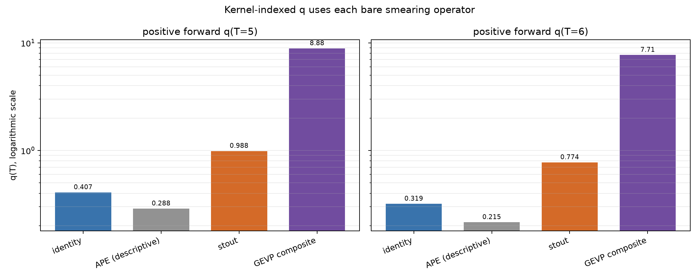

reader 的 fit input schema 已升为 `wilson-f-bare-basis-overlap-support-v2`：必须显式给 `overlap_definition_id`，并对每个 variant 核验 `kernel_id → basis_operator_id`；旧 v1 或错误映射会 abstain。聚焦合同/reader 测试 **27 passed**；把 force-snapshot 集成夹具同步到 v2 后，Wilson 全集 **112 passed**、PR #6 当前 checkout 全仓 CPU suite **345 passed**。报告分母为 selected bare operator×T `4/4/0/0`、描述性 APE `2/2/0/0`、独立 GEVP composite diagnostic `2/2/0/0`、物理测量 `0/0/0/0`、认证门 `1/0/0/1`（planned/valid/failed/abstained）。

这也补充了 LatticeArena 的通用扩展方向：矩阵 schema 除 shape 外应绑定有序语义轴、operator/object ID、单位和转换来源；共享设计建议见 [`framework_extensibility.md`](../../doc/framework_extensibility.md#extension-point-semantic-array-axes-and-derived-objects)。当前 reader 仍是 task-specific 校验，不宣称已有通用 typed-array runtime。

**仍未完成：**该默认值要经独立 physics review；需要受审的 raw cross-correlator exporter 和同一 snapshot 的 `C_ij` bytes、joint finite-`N_t` 2/3-state fit、平方 overlap/gap 的 simultaneous one-sided coverage、遗漏态/近简并与近零 `Z_0` 的敏感度、matched-`N_t=32` thermal `h`、mixed-sector `x` 的生产上界、谱截断以及 force/reference paired intervals。有限-$N_t$ 的 q/h/x sector 对应现已有下方的数据-free 方法提案，但其 source/sink 时序仍须 reviewer 与 exporter 核对，不能替代这些输入。玩具数值不能填 receipt。旧版报告中“mapping unresolved”是当时状态快照，现由本节的 method default 取代；其数据-free/uncertified 限制仍有效。继续保持 `NOT_READY/UNCERTIFIED`、F=`GROUND_STATE_FORCE_UNCERTIFIED`、`physical_score=null`，不打开封存数据、不启动 GPU/QUDA。

### 2026-11-26 F-lane 有限-$N_t$ transfer trace → q/h/x 方法提案

有限温 Wilson loop 的 transfer-matrix 表示含真空 sector 与静态源 sector 的迹；[Della Morte et al. (2010), Eqs. 2.5–2.6](https://arxiv.org/abs/1012.3037)给出有限-$N_t$ trace，并展示 $N_t\to\infty$ 时的静态源谱和重叠平方。基于这个结构，本轮把 F contract 的 q/h/x 解释写为**可证伪的方法默认值**，不是生产谱模型：

```text
C_ij(R,T;N_t) = Z0(N_t)^-1 Σ_(m,n) exp[-eps_m (N_t-T)]
                exp[-V_n(R)T] A_i,mn(R) A*_j,mn(R)
Z0(N_t) = Σ_m exp[-eps_m N_t]
q: m=0, n>0       h: m>0, n=0       x: m>0, n>0
C_kk / C_kk^(0,0) = 1 + q_k + h_k + x_k
delta_log = log(1 + q_k + h_k + x_k)
```

在此拆分下，`q` 是真空基态传播到静态源激发态的正向污染，`h` 是补时间长度 $N_t-T$ 上的真空激发，`x` 同时激发两 sector。分母的 $Z_0(N_t)$ 在相对基态贡献中约去。该映射是从文献 trace 结构推导出的**推断**；矩阵元素是否能按给定端点算符分解成 $A_iA_j^*$、源/汇是否局域于声明的时间片、静态能量是否采用相同基准，都需要独立审阅本仓的 exporter 后才可用于 production。

[`lane_contract_v2.json`](lane_contract_v2.json) 现登记 `two_sector_transfer_trace_qhx_v1`、分 sector 的 q/h/x 定义、正谱与端点假设，并标 `PROPOSED_TRACE_INTERPRETATION_REQUIRES_INDEPENDENT_REVIEW`。新增 [`f_lane_finite_nt_trace_diagnostic.py`](f_lane_finite_nt_trace_diagnostic.py) 和[图文诊断](f_lane_finite_nt_trace_diagnostic_20261126_v1/README.md)：有限态 toy 用 $R=2,3$、identity/APE/stout、$N_t=16,32$、$T=3…7$；20 个 $3\times3$ 矩阵均 Hermitian PSD，60/60 个算符格满足 `1+q+h+x` 重构，最大残差 $4.44\times10^{-16}$。图示固定 stout 算符时 `q` 不随 $N_t$ 变，而 `h/x` 在较大 $N_t$ 下按补时间指数下降；这只检查代数结构，不能证明真实热污染会如此小或满足当前误差预算。

示例数值（手设 toy，非测量）为 $R=2,T=5,$ stout：`q=0.0503607`；$N_t=16$ 时 `h=0.0143545, x=2.51899e-4`，$N_t=32$ 时 `h=1.73193e-5, x=3.03925e-7`。相应 `delta_log` 从 `0.0629439` 变成 `0.0491504`；图中 log 纵轴与 CSV 同目录记录所有格点。残差小仅表示用同一个手设有限谱生成并重构同一对象。

**接下来给实现者/reviewer 的工作顺序：**(1) 对照真实 Wilson-loop exporter 核验时间方向、source/sink insertion offset、边界 trace/归一化和 `C_ij` 指标顺序；如果 endpoint 不能因子化，修改 sector decomposition 后重做纯 toy 代数测试。(2) 在同一 immutable source snapshot 上导出非对角 `C_ij`，先对 synthetic exact two/three-state 和近简并反例做 covariance-aware fit 与 q/h/x reconstruction，再做遗漏态/近零 overlap 覆盖校准。(3) 只有 exporter/谱拟合经独立 review 后，才能生成真实 matched-$N_t=32$ thermal、mixed-sector、truncation 与 force-unit simultaneous receipts。物理 measurement 分母仍 `0/0/0/0`，认证门 `1/0/0/1`；维持 `NOT_READY/UNCERTIFIED`、`GROUND_STATE_FORCE_UNCERTIFIED` 和 `physical_score=null`。

### 2026-11-26 本 checkout 回归核验

新增 raw-matrix snapshot projection reader 后，当前 PR #6 worktree 的完整 Wilson 测试文件集 `tests/test_wilson*.py` 为 **111 passed**，截至本次 Optimize reader 增量后的完整 repository CPU suite 为 **344 passed**（2026-11-26）。Wilson 测试覆盖 lane contract、force-budget propagation、Markov 支持界、finite-`N_t` 代数、toy/randomized fixtures、C/F task adapter 的默认 source-byte fail-closed 行为，以及 GEVP 截断、overlap 对象和 raw-matrix snapshot 投影诊断；只确认软件和指定 toy 公式，不提供 C/F measurement、独立 q/h/x/GEVP/thermal receipt 或 coverage/calibration 证据。新 reader 使用同一 immutable `SourceByteSnapshot`，并在 `numpy.load` 前做 NPZ 资源预检；它只从 synthetic cross-correlator 生成投影 correlator，不做谱拟合、不产出 q 区间，也未接入物理 gate。Wilson adapter 默认要求 source root 与显式路径 map，source bytes 匹配后最多将 gate 推进到 draft；它仍未接入实际生产 RunSpec/source reader。PR #5 的共享 [`core/evidence.py` metadata contract](https://github.com/Greyyy-HJC/LatticeArena/blob/c7a4c9b2c8858d1fdf3499966a2223c45427bbc6/core/evidence.py)包含单 envelope 和 multi-envelope bundle gate；PR #5 的 Pion adapter/诊断另行保留。字节一致不认证真实来源、reviewer 独立性或物理内容。2026-11-26 查询 GitHub 时 PR #6 为 OPEN、`MERGEABLE/CLEAN`，未报告 checks；这只是当时状态。现有图文分析和 lane-specific 未决项如下文，仍保持 `NOT_READY/UNCERTIFIED`、F=`GROUND_STATE_FORCE_UNCERTIFIED`、`physical_score=null`。

### 2026-11-26 F-lane raw cross-correlator snapshot → GEVP 投影诊断

新增 [`f_lane_raw_matrix_snapshot_diagnostic.py`](f_lane_raw_matrix_snapshot_diagnostic.py) 与[图文报告](f_lane_raw_matrix_snapshot_diagnostic_20261126_v1/README.md)。**本段已按 schema 复核更正：**早期草稿把 3 个 basis operators 又重复放进外层 kernel 维，造成 6 个重复的 operator×R 投影；当前输入是一张 3×3 交叉相关矩阵 / R，`correlator_matrices` 的精确 shape 为 `[block, R, t, sink_operator, source_operator]`，三个有序基为 `identity / APE / spatial stout`。每个 R 独立用 ensemble mean 的 `C(t0=1), C(td=2)` 解一次 principal GEVP，以 `v†C(t0)v=1` 归一化，再用该固定向量投影各 block 的 `C_ij(R,t)`。reader 绑定同一 `SourceByteSnapshot` 的 manifest 与 NPZ，检查 captured-byte digest、calibration split、manifest/NPZ hash、精确 operator-basis/R/time 顺序、矩阵 shape/dtype/有限性/Hermiticity，并在 `numpy.load` 前调用 `core.npz_safety.validate_npz_payload`。流程为：`captured manifest+NPZ -> schema/hash/split/axis/资源检查 -> 每个 R 的 mean C(t0),C(td) -> 固定 GEVP -> block projection -> CSV/图`。

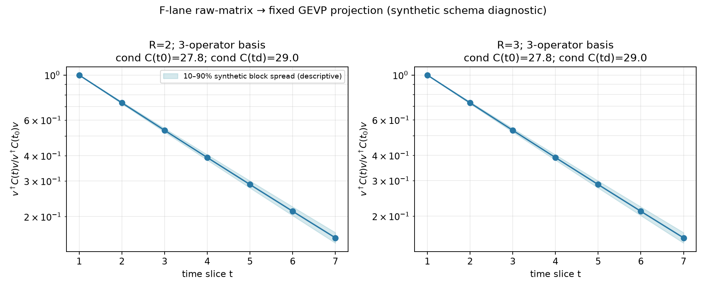

图中 24 个四态 forward-spectrum synthetic blocks 各生成两个 R 的 `t=1..7` 投影曲线；阴影是确定性 toy 的 10–90% block spread，只作描述，**不是置信区间或独立性证据**。更正后分母 planned/valid/failed/abstained：source files `2/2/0/0`；R projection `2/2/0/0`；R×time values `14/14/0/0`；物理 q/interval/certification `1/0/0/1`。物理 measurement/spectrum 输入为 `0/0/0/0`。报告同时记录 `physical_score=null`、`GROUND_STATE_FORCE_UNCERTIFIED`。聚焦测试 **11 passed**，Wilson 测试全集 **111 passed**，截至 Optimize reader 增量后的全仓 CPU suite **344 passed**（2026-11-26）。

本段报告生成时的缺口是：repo 没有 raw cross-correlator exporter，现存各 kernel 的对角 Wilson-loop 序列不能推回缺失的非对角 `C_ij`；manifest 要求 exporter 实际测量并固定 sink/source 指标及 smearing basis，不能复制对角元素。关于 q cell 对象的语义已由上方 2026-11-26 更新选定为裸 basis overlap；raw matrix reader 仍不拟合 state overlaps/gaps、不传播 paired interval、不处理有限-`N_t` backward/thermal `h`、mixed `x`、谱模型误差或 force/reference uncertainty。该 synthetic reader 只验证 schema、hash/split fail-closed 和线性代数，不估计生产污染或接入 gate。

**接续次序：**先由独立 reviewer 审 `C_ij` 定义、cross-term 生产测量与 `td` 候选，再开发有统计协方差的 GEVP/state-overlap fit 和成对 interval reducer；coverage 至少覆盖 exact three-state recovery、omitted-state bias、近简并/近奇异矩阵、finite-`N_t` 双向谱、small `Z_0(v)`、bootstrap 与覆盖率。随后才把真实同 snapshot raw matrix/fit receipts 接入 q-bound reader；仍须另有 matched-`N_t=32` thermal、mixed-sector、spectral truncation、reference-force 下界、独立 coverage/review 与数据授权。完成这些以前维持 `NOT_READY/UNCERTIFIED`、`GROUND_STATE_FORCE_UNCERTIFIED`、`physical_score=null`，不读封存 split、不启动 GPU/QUDA。

### 2026-11-25 当前接手：C/F 方法默认已提出，独立证据和认证门仍未完成

用户已选择保留两个不同 estimand：有限-$T$ Creutz 和基态离散静态力；随后要求执行者自行提出剩余规则。建议默认值已登记在 [`lane_contract_v2.json`](lane_contract_v2.json) 的 `selected_protocol` 与 `common` / `lanes` 草案映射中，状态仍为 `DRAFT_NOT_READY` / `METHOD_DEFAULTS_SELECTED_EVIDENCE_NOT_READY`。本次完成数据-free 映射，并在[结构检查器 v9](../../results/wilson_loop/lane_contract_diagnostic_20261125_v9/README.md)列出当前剩余字段；这不等于独立审阅、生产数据授权或物理认证。下方早期“等待选择 R/T/kernel/阈值”的说法由本节替代。

### 2026-11-25 F-lane q/h/x 到力级误差预算的传播已补齐（纯代数）

此前合同把 `q/h/x` 的 `1.5%/1.5%/1.0%` 与力级系统误差预算写在相邻字段，但没有明确这些百分数是逐 loop corner 上限，还是完成 stencil 传播后的力级上限。这个区别会改变结论。新 helper [`force_budget.py`](force_budget.py) 对两种 kernel、`R=2,3`、`t,t+1` 的 8 个带符号 loop corner 使用

```text
delta_k(R,t) = log(1 + q_k + h_k + x_k)
|Delta_R Delta_t delta_candidate - Delta_R Delta_t delta_reference|
  <= sum_over_8_corners delta_corner
  <= sum_corner log(1+q) + sum_corner log(1+h) + sum_corner log(1+x).
```

因此将 `1.5%/1.5%/1.0%` 明确解释为**相对正 reference-force 同时下界的、传播后的 q/h/x 力级预算**。若某个分量在 8 个 corner 都用同一 raw bound `c`，要满足分量预算 `epsilon`，输入必须满足 `c <= expm1(epsilon*f_L/8)`，其中 `f_L` 是独立统计下界；不得把力级百分数直接填成每个 loop 的 q/h/x raw bound。

[图文诊断](../../results/wilson_loop/force_budget_propagation_cpu_20261125_v1/README.md)扫描 50 个纯公式 `f_L` 情景，分母 `50/50/0/0`。在仅用于演示的 `f_L=1` 下，若误把每个 corner 的 raw bound 设为 `q=h=0.015`、`x=0.01`，传播后分量力界分别为 `0.1191`、`0.1191`、`0.0796` 倍 `f_L`，不是目标 `0.015/0.015/0.01`；加上 `1%` 模型截断和 `5%` 统计半宽后，保守总上界为 `0.3778 f_L`，高于 `10%` 门。按力级预算反解时，`f_L=1` 对应 raw corner 上限为 `q=h=0.00187676`、`x=0.00125078`。这些是假设算术，不是 Wilson 输入。合同与 `empty_contract()` 已同步写明 8-corner 布局和反解公式；专测 `29 passed`。

该检查不补出 `q/h/x`、正 reference-force 下界、谱模型截断或统计覆盖收据；物理证据分母仍为 `1/0/0/1`，Lane F 仍 `GROUND_STATE_FORCE_UNCERTIFIED`、`physical_score=null`。新模块及合同定向测试为 **29 passed**，当前 `tests/test_wilson*.py` 全集 **62 passed**。下一步只能用独立 receipts 填入逐 kernel/R/time 的 raw envelopes，经该传播器生成 force-unit bounds，再由 reviewer 核查谱假设与数据来源。

### 2026-11-25 C-lane 条件 Markov 支持界：替代方案已量化，仍不足以认证

[图文敏感度报告](../../results/wilson_loop/c_lane_markov_support_bound_20261125_v3/README.md)给有限-$T$ Creutz 提出一个与 block bootstrap 不同的条件路线：若每个 saved configuration 的 observable 确为 `ReTr(U_loop)/3∈[-1/3,1]`，先把四个 loop means 分别映射到 `[-1,1]`，用 Paulin corrected arXiv v5 Theorem 3.11 / Eq. (3.25) 做四个双侧 simultaneous marginal intervals（`F=4, alpha_C=0.025`），再将正值置信盒通过四项对数的单调性传播为 Creutz 区间。任一 loop-mean 下界不正或 half-width 超过 `0.02` 即 `ABSTAIN`。此处矩形联合区间忽略跨 loop 协方差，优点是覆盖论证明确，代价是很保守。

界限依赖 saved-configuration Markov chain 的齐次性、唯一平稳分布、伪谱隙正下界和测量支持域；HMC trajectory 间隔、经验自相关时间与 bootstrap draw 数都不能代替这些收据。当前 schema 没有生产 normalization、该 saved chain 的 `gamma_ps`、stationarity/burn-in TV 或独立 review receipt。本报告没有读取 loops 或其他 split，96 个纯公式 scenario 的分母为 planned/valid/failed/abstained=`96/7/0/89`；valid 仅表示假设下数学区间达到精度，并非数据结果。即便取最有利 `gamma_ps=1` 且四个样本均值 floor 达到 support 上界 1，半宽 `0.02` 仍需 222,616 个配置；若 floor 为 0.5 则需 3,343,119 个。对 `gamma_ps=0.1`，相应样本数为 2,226,156 与 33,431,187。故此路线不能支持当前小样本精度，也不替换提议的主 bootstrap 方案；它提供的是严格的条件备选和停止规则。若后续收到独立可审阅的 gap receipt，才值得评估更紧的真方差上界或 nonstationary-TV 版本；不能用当前 AR(1)/finite-dependence toy 推出 gap。

文字流程：`normalized bounded loop traces + saved-chain gamma_ps receipt -> four simultaneous mean boxes -> positivity check -> monotone Creutz interval -> 0.02 precision gate or ABSTAIN`。来源：[Paulin corrected arXiv v5](https://arxiv.org/html/1212.2015v5)。

实现回归：[Markov support-bound 单元测试](../../tests/test_wilson_c_lane_markov_bound.py)加当前 lane-contract 测试共 **26 passed**；图文报告的 hash 清单 **6/6 匹配**。这些检查覆盖公式、支撑域映射、对数传播、非正下界弃权和 no-data 报告身份，不检验实际链的 gap 或区间覆盖。

### 2026-11-25：C/F canonical mapping 与误差合同审计

`empty_contract()` 现在把已选的 C/F primary、显式四角 stencil、alpha allocation、精度目标或相对精度提案和谱计划映入 canonical `common` / `lanes`。proposal action/source descriptors 以 `_proposed` 标识；split、paired-block、独立 review、q/h/x、传播后的力误差和实际数据 receipt 仍为 null。检查器结果是 C lane `planned/valid/failed/abstained=1/0/1/0`、F lane `1/0/1/0`；C 留 3 个结构缺项，F 留 26 个，精确原因见 v9 JSON/README。另有 5 个物理运行阶段均 abstain (`5/0/0/5`)。完整的 8-fixture 结构表与分母为 `16/7/9/0`；没有新增 Wilson measurement。

审计发现并修正一个合同缺口：旧 F validator 要求 `finite_a` / `finite_volume` bounds，却漏掉用户选定的 `spectral_model_truncation` force-level bound。当前 primary 是固定格距、固定体积下的无量纲 lattice force `a_s a_t F`，连续极限和无限体积极限不属于它的 estimand；因此 schema 不应把这两种外推误差强制塞进当前预算。validator 现要求四个与选定 `5%` systematic budget 一致的 force-unit 项：excited-state、finite-$T$ thermal、mixed-sector、spectral-model truncation；24 个 q/h/x 输入 cell 和 4 个 model cell 仍按总计 28 个校准单元做 family-wise 分配。只有以后声明 continuum 或 thermodynamic estimand 时才另加相应外推界。因 primary 输出保持格点无量纲，合同明确允许不提供物理 $a_s,a_t$ 转换；若以后改为物理单位输出，则必须重新要求 spacing 及单位收据。

这轮只核对了合同/检查器结构，不是独立 reviewer 的物理签署。v9 中 synthetic C+F fixture 可达 `CONTRACT_COMPLETE_REQUIRES_HUMAN_REVIEW`，但真实 C/F lane 仍是 `NOT_READY`，`physical_score=null`，F 仍 `GROUND_STATE_FORCE_UNCERTIFIED`。图文报告区分 proposed caps 与 measured force bounds，不把 1.5%/1%/5%/10% 设计门伪装成数据。

- **共同设计：**16⁴、Wilson β=6、周期边界、`N_t=16`；提议 stout `rho=0.10,n=5` 为候选核，APE `alpha=0.4,n=5` 仅作弱场匹配描述对照，不声称非微扰 smear radius 等价。两个 co-primary lanes 在总 family-wise error probability `alpha=0.05` 下各分配 `0.025`；C lane 用双侧区间，F lane 再把统计 `0.0125` 分给双侧力差区间与单侧正 reference-force 下界、另 `0.0125` 给 systematics family。10,000 circular block-bootstrap draws，主 block length 5、敏感度 2/10，区间取 block-length hull。若任一必需 loop mean 无效则该 draw 无效；无效比例 `>1%` 或精度不达标即 abstain。
- **Lane C：**primary 提案为绝对有限时 `chi_stout(R=2,T=5)`，公式 `-[log Wbar(3,6)+log Wbar(2,5)-log Wbar(3,5)-log Wbar(2,6)]`；先对同一 paired configurations 求四个 loop means，再对正均值取 log；无量纲 half-width 目标 `0.02`。[`C-lane development preflight`](c_lane_open_development_diagnostic_20261125_v1/README.md)只重算已打开的 D0–99：点值 `0.10443172`，30,000/30,000 bootstrap draws 有效，L=2/5/10 区间 hull `[0.09531340,0.11350806]`、half-width `0.00909733`，通过数值 precision/invalid-draw preflight。报告附区间图、输入身份与文字数据流；同一 D0–99 已用于开发，故这不是独立 coverage calibration、confirmation、plateau 或 ground-state 证据，bootstrap 覆盖率也未建立。
- **Lane F：**primary 提案为 `R_mid=2.5` 的 stout-minus-identity ground-state force，`[U0_stout(3)-U0_stout(2)]-[U0_identity(3)-U0_identity(2)]`，单位 `a_s a_t F`。谱方案为 3×3 GEVP（identity/APE/stout，`R=2,3`，`t0=1,td=2`，窗口 `[3,7]`、`tmin=3,4,5`、2/3-state checks）并要求 matched `N_t=32` 热污染证据。相对正 reference-force simultaneous lower bound，提出 `q≤1.5%`、热污染 `h≤1.5%`、混合 `x≤1%`、谱模型截断 `≤1%`，systematic sum `≤5%`，statistical half-width `≤5%`，linear total `≤10%`；24 个 q/h/x 与 4 个模型项共 28 个 family-wise cells。全部独立谱/污染 receipts、reference 下界、common action/source/split hashes 和 physics review 仍为 null，因此 `GROUND_STATE_FORCE_UNCERTIFIED`。

**kernel 身份交叉核验（开发包层面已闭合，生产门仍开）：**合同 canonical ID `spatial_stout_rho0.10_n5` 与 D0–99 preflight 的显示名 `stout_rho0.1_n5` 通过结构化描述交叉核验为同一开发算符：`kind=stout, rho=0.1, steps=5, spatial links`。开发 protocol 明确记录参数；其 pinned `stout.py` / `kernels.py` SHA-256 与 Git 中的源代码 blob 一致；实现把 `name` 仅作为允许的 metadata，不用于运算分派。逐项证据、源码空间约定与限制见[身份交叉核验](../../results/wilson_loop/kernel_identity_crosswalk_20261125_v1/README.md)。这只解除历史 D0–99 preflight 的命名歧义；缺少独立 production-link/source/action receipt、confirmation 数据与 physics review，所以合同 operator/comparison gate 仍 abstain，状态仍为 `DRAFT_NOT_READY`、`physical_score=null`。APE `alpha=0.4` 与 stout `rho=0.1` 仍只是弱场首阶配对，不代表非微扰 smear-radius 等价。

**已完成但只支持方法/接口的诊断：**[`lane_contract_diagnostic_20261125_v8`](../../results/wilson_loop/lane_contract_diagnostic_20261125_v8/README.md)把 16 个结构 fixture（planned/valid/failed/abstained `16/7/9/0`）与五个物理阶段 abstain（`5/0/0/5`）分开，图文说明哪些字段缺失；[`finite_nt_randomized_stress_20261123_v1`](../../results/wilson_loop/finite_nt_randomized_stress_20261123_v1/README.md)在 4,000 个合成正谱样本上核对有限-$N_t$ 四点恒等式/包络，最大代数残差 `3.20e-14`，不代表物理污染覆盖；[`reference_window_open_development_20261125_v1`](reference_window_open_development_20261125_v1/README.md)归档 D0–99 的 A/B point-max `2.0965` 与 C centered/uncentered joint-q95 `2.7408/4.0844` 对照候选阈值 2.5，但阈值未校准且原 runner 未归档，所以不能冻结 reference 规则。

**新增覆盖率压力诊断（2026-11-25；合成方法校准，不是物理证据）：**[`c_lane_block_bootstrap_coverage_stress_20261125_v3`](../../results/wilson_loop/c_lane_block_bootstrap_coverage_stress_20261125_v3/README.md)用已知真值的四变量 lognormal AR(1) loops，扫描 adjacent-configuration `rho=0,0.3,0.6,0.8,0.9` 和 log-loop SD `0.10/0.35`；每个 `(rho,SD)` cell 有 240 个独立数据集、每个 L 有 800 draws，共 2,400 datasets，图给出覆盖率 Wilson MC intervals 与 median half-width。现行 L=2/5/10 hull 在 `rho=0.8/0.9` 的经验覆盖率分别为 `0.863/0.779`（SD 0.10；95% MC intervals `[0.813,0.900]` / `[0.723,0.827]`）和 `0.879/0.762`（SD 0.35；`[0.832,0.915]` / `[0.705,0.812]`），远低于名义 97.5%；把敏感度扩到 L=20/30 后仅升到 `0.875/0.812` 与 `0.900/0.792`，95% MC intervals 仍未接近名义覆盖。低相关 cell 也出现轻微 undercoverage；在 SD 0.10 下 half-width≤0.02 仅 `rho=0` 的 34/240 和 `rho=0.3` 的 2/240 达到，其余 cell 为 0/240。所有 loop means 正且分母为 planned/valid/failed/abstained=`2400/2400/0/0`。结论仅限所声明模型：block-length hull 和增加 draw 数不能替代实际依赖界；延长 block 有有限改善但没有解决高相关失覆盖。因此不改 `lane_contract_v2.json` 中已提的主 L=2/5/10 规则，也不据此估计真实 HMC rho。

**替代区间方法对照（2026-11-25；同一合成样本种子）：**[`c_lane_interval_alternative_coverage_20261125_v1`](../../results/wilson_loop/c_lane_interval_alternative_coverage_20261125_v1/README.md)在 2,400 个同分布样本上比较已知-rho 协方差 delta benchmark、Newey–West HAC bandwidth 5/10/20/30 和 stationary bootstrap mean-block 5/10/20；图示 coverage Wilson MC intervals 与 half-width。高相关 `rho=0.8/0.9` 时，已知参数 benchmark 覆盖率约 `0.975–0.988`；但它知道真实 rho/log-scale 且对非线性 Creutz 只用 delta 近似，不能部署，且低噪声 iid cell 覆盖率 `0.954`（95% MC `[0.920,0.974]`）也低于 nominal。HAC 在 `rho=0.9` 的最佳 bandwidth 覆盖率仅 `0.812`（SD 0.10）/`0.796`（SD 0.35），stationary bootstrap 的最好结果分别 `0.767/0.767`，对应 MC 区间均远低于 0.975；各自区间虽然比 covariance benchmark 窄，却不能支撑 nominal coverage。每个 method 的 planned/valid/failed/abstained dataset 分母为 `2400/2400/0/0`。因此当前被测的非参数区间都未跨越长相关假设场景的 calibration gate；不挑最有利 bandwidth/block，也不更改 C lane confirmation protocol。

**下一步：**(0) **已完成（PR #6）**：Wilson C/F task adapter 将 C 的四 loop means / chain support / gap-TV metadata 与 F 的 propagated force-unit q/h/x/spectral/thermal envelopes 分开映射到 `core/evidence.py`；缺项进入 `RunState.abstained`，完整 metadata/denominators 最多到 `draft`，不同 chain ID 不被解释为独立。(1) canonical stout ID 的开发包映射与 `selected_protocol -> common/lanes` 结构映射已经完成；独立 reviewer 仍须检查 `chi` 符号、loop 索引、force stencil、单位、边界、action/static-source 与两 lane alpha 分配，并审阅 4 项 force-level systematic bound 的传播和是否遗漏/重复计数，不得将两个 estimand 合并。(2) 覆盖校准的 AR(1)、有限依赖、颜色类 empirical-Bernstein 与 Markov 支持界报告已完成：不能只增加 draws、调 bandwidth/block，或假设一个未收据化的 gap；在没有独立、可证明的生产依赖 envelope / saved-chain `gamma_ps` 下界和 loop 支持域时 C lane 继续 `ABSTAIN`。不要重跑已完成 synthetic DGP；只有新证据能改变 release 可行性时，才做不同的纯 CPU 方法诊断。(3) 对 C lane 取得独立、获授权 calibration package 后再估计 precision/coverage，随后才冻结 confirmation。(4) 对 F lane，补独立 3×3 谱/overlap 与 matched-`N_t=32` 输入，逐项形成 q/h/x 和 model-truncation 上界、转换到力单位并给 simultaneous intervals；没有正 reference-force 下界即 abstain。(5) 任何新数据/设备运行前都需相应 owner 授权；不访问 gap、validation、shared holdout、confirmation 或 GPU/QUDA。所有新增诊断须带图或可复查文字，列 planned/valid/failed/abstained 分母与失败原因。维持 `NOT_READY/UNCERTIFIED`、`GROUND_STATE_FORCE_UNCERTIFIED`、`physical_score=null`，本 TODO 保留。

### 2026-11-25 C-lane 颜色类 empirical-Bernstein 续查

[新诊断](../../results/wilson_loop/c_lane_colored_empirical_bernstein_20261125_v1/README.md)在已声明 Gaussian-copula Beta moving-sum 合成 DGP 上加入 Maurer–Pontil Theorem 11 颜色类 empirical-Bernstein，并扫描 `n={100,500,2000,5000}`、`m={0,5,10}`，每个参数 cell 250 个 paired-seed datasets。定理适用于相互独立但可不同分布的有界变量；本模拟中 `index mod (m+1)` 的每个 loop-coordinate 色类由不重叠创新构成独立样本。它仍条件依赖事前正确的色图与 support；真实 HMC 的 `m` 未知，不能把这个色图移植到生产。

每种方法 planned `12000` 个 dataset。颜色类 empirical-Bernstein 有 `1426` 个有限区间、`10574` 个触零无界区间；有限区间在该合成网格中 `1426/1426` 覆盖真值，逐 cell Wilson Monte Carlo 区间见 CSV（最小样本 cell 的区间很宽）。Graph-color Hoeffding 为 `0` 个有限、`12000` 个无界。**两者都没有 precision pass：valid/failed/abstained=`0/0/12000`，half-width `≤0.02` 通过数 `0/12000`。**有限的 empirical-Bernstein 区间只出现在 `m=0,n≥2000` 的 cell；其 cell median half-width 约 `1.025–5.144`，远高于 `0.02`。图显示有限区间覆盖、release fraction 和半宽随样本数变化。

结论：方差自适应能在这个合成 DGP 的部分弱依赖、大样本 cell 避免 Hoeffding 触零，但并未形成可用 C-lane 校准，也不改变主协议。下次不要仅扩充相同 DGP 的样本数；只有拿到独立审阅、事前可证明的生产依赖 envelope 和支持域后，才可评估这些 conditional bounds。无此输入时继续 `ABSTAIN`。理论依据：[Maurer & Pontil (2009), Theorem 11](https://arxiv.org/abs/0907.3740)。

### 2026-11-22 历史交接：两条 lane 已选，数值默认见上方 2026-11-25 提案

本段有限-$N_t$推导与候选物理界仍是有效理论背景；其中“暂不选 R/T/kernel”已由上方的 method-default proposal 更新。不得把 D0–99 development 诊断升级为确认性选择、基态认证或物理 score，也不得重跑已经归档的窗口 bootstrap、force 图、power-cost 或同一 toy。不得启动 GPU 或打开 D100–119、D120–139、D140–199；`GROUND_STATE_FORCE_UNCERTIFIED`、`physical_score=null` 和本 TODO 保留。

**2026-11-22 有限 `N_t=16` 理论审阅已完成：**见[谱分解、误差表与文字数据流](../../results/wilson_loop/finite_nt_thermal_bound_review_20261122/README.md)。transfer-matrix 展开将静态源激发项 `Q exp(−Δ_Q t)`、热迹无源激发项 `H exp(−Δ_0(N_t−t))` 和混合项分开；有限 `N_t` 下增大 `t` 会降低第一项的指数、同时缩短第二项的抑制区间。`N_t=16`、候选 `t=4…8` 的补时长是12…8，但缺少独立的谱间隙与 kernel-dependent overlaps，不能给出污染数值。Creutz lane可作为固定`k,R,t`的有限时观测量；ground-state force lane仍须将对数污染传播到`Δ_RΔ_t`层并满足事前误差预算。没有拟合、模拟或打开封存split。引用的有限温度迹表示与零温 Wilson-loop 谱表示分别来自原始论文[Appendix A](https://arxiv.org/abs/2110.11659)和[static-force spectral decomposition](https://doi.org/10.1103/PhysRevD.105.054514)。
**零温界的有限 `N_t` 接合审计也已完成：**已有 `|χ−f₀|≤log(1+Qe^{-Δt})` 仅在正的零温前向谱下成立；加入热迹与混合项后不能沿用单点 `Q/gap` bound。报告 §5 现在给出带独立 `Q/H/X/Δ` envelope 时的四角和 force-level 保守界。当前这些输入均未测得，所以它是未来认证合同，不构成当前 pass。

**当前可执行边界（由上方 2026-11-25 提案细化）：**不再从 D0–99 选择确认性 `R/T/kernel`，也不重跑现有 `Q/gap` toy/窗口 bootstrap。`R/T/kernel`、lane alpha、数值门和 F 的误差预算已有可审阅默认值；剩余缺口是独立 review、独立 calibration/confirmation receipts、谱与热污染界、common metadata 以及数据/设备授权。不得启动 GPU 或打开 D100–119、D120–139、D140–199。界限未闭合时继续 `NOT_READY/UNCERTIFIED`、`GROUND_STATE_FORCE_UNCERTIFIED`、`physical_score=null`。

### 当前用户决定：有限-T Creutz 与基态离散静态力同时保留为两个 estimand lane

**目标选择已完成；确认性物理输入与独立证据仍未冻结，TODO保留，`physical_score=null`。** 用户选择有限-T `χ_k(R,T)` 与 ground-state `f₀(R+1/2)=U₀(R+1)−U₀(R)`；2026-11-25 的默认 primary、kernel、精度/多重性和 F 污染预算见本文件开头与 [`lane_contract_v2.json`](lane_contract_v2.json)。[双 lane 定义、认证条件和文字数据流](https://github.com/DianjunZhao/LatticeArena/blob/54f0e97ba85b7f8f724c31d9f9d3512f040583a9/tasks/wilson_loop/estimand_decision_review.md#0-当前选择两条-estimand-lane-分开交付)仍保留为估计量背景；绝对势外锚不是当前 lane 的前置项。

**最新边界确认（2026-11-26）：**方法默认已提出，但不能把它写成物理认证或测量授权。C lane 的 D0–99 precision pass 仅为 retrospective numeric preflight；synthetic coverage 报告显示在长相关假设下已测的 block bootstrap、stationary bootstrap 与 HAC 均不能保证 nominal coverage，known-rho delta benchmark 又依赖生产不可得的真参数且有弱 undercoverage。**此前“kernel ID 映射和正式 `common/lanes` metadata 也未核实”已过时：**开发包 canonical kernel ID 与 preflight 名称的结构化身份 crosswalk、`selected_protocol -> common/lanes` 映射及 v9 检查报告均已完成；这不提供 production-link/source/action receipt、独立审阅或物理认证。F lane 的谱/热/mixed-sector receipts 仍全空。框架可复用方向见 [`framework_extensibility.md`](../../doc/framework_extensibility.md)：C lane 需绑定 loop support、归一化和共同 block-chain receipt，F lane 需绑定谱界并传播到 lattice-force 单位；建议的 shared typed evidence envelope 目前不是已实现 runtime。当前只在收到新、可审阅的数据-free方法问题时继续做依赖界/abstention 方法；生产 evidence 仍需独立 data receipt 与 owner authorization。不得启动 GPU，不打开 gap、validation 或 shared holdout。`GROUND_STATE_FORCE_UNCERTIFIED` 与 `physical_score=null` 保持，本 TODO 保留。

- **Lane C（有限-T Creutz）**：primary method default 为 stout kernel 下 `R=2,T=5` 的绝对 χ；window-slope force、T依赖及成本为 secondary 诊断。不同 smear 一般改变 overlap 与有限-T 值，故 paired `χ_k−χ_identity` 是观测量差，不能直接写成对共同真值的误差改善。数值 gate 即使通过，也须独立校准/确认后才可认证精度或预定义差值。
- **Lane F（基态离散静态力）**：primary method default 为固定格距/体积/静态源约定下 `R_mid=2.5` 的 `f₀` 差。窗口估计、χ长T趋势、同draw漂移只是 secondary 支持证据。目前 `GROUND_STATE_FORCE_UNCERTIFIED`。需要独立激发态/热污染界及谱/多-T证据；不能把 χ 的高精度、窗口漂移小或误差条窄当作基态认证。continuum/格距外推不在当前 primary estimand 内。

**历史接手指令（2026-11-21；lane contract 已在 §9 补齐）：**不再要求重交两套 analysis contract。当前唯一新增理论项见文首：补有限 `N_t` 热绕行边界的公式结构和所需独立输入。两lane仍可共用D0–99 draw作为development描述，但不能互相替代或称独立验证；不得从已看R/T挑确认性primary，亦不得访问D100–119/D120–139/D140–199。

### 2026-11-21 新增：同 draw 的窗口漂移与候选 difference-of-differences（CPU）

此前逐窗误差条不足以说明窗口差的精度；本轮补齐[同draw窗口contrast图文](https://github.com/DianjunZhao/LatticeArena/blob/54f0e97ba85b7f8f724c31d9f9d3512f040583a9/tasks/wilson_loop/force_window_contrast_20261121_v1/README.md)、[图](https://github.com/DianjunZhao/LatticeArena/blob/54f0e97ba85b7f8f724c31d9f9d3512f040583a9/tasks/wilson_loop/force_window_contrast_20261121_v1/late_minus_early.png)、[全部117行CSV](https://github.com/DianjunZhao/LatticeArena/blob/54f0e97ba85b7f8f724c31d9f9d3512f040583a9/tasks/wilson_loop/force_window_contrast_20261121_v1/contrasts.csv)与逐draw数组。只重放现有D0–99的5000个原block draw：冻结transaction三hash、protocol hash、原window-force逐项结果及保存的indices均完全匹配后才计算 `D=f_late−f_early` 和 `D_candidate−D_identity`。20个length-5 blocks，5000 planned/5000 valid/0 failed；5000不是独立gauge样本数。没有新生产或新模拟dataset。

identity late−early在Rmid=1.5/2.5/3.5分别为 `0.002348 / −0.028420 / 0.044858`，点态95% paired bootstrap区间为 `[−0.003148,0.007715] / [−0.051845,−0.001723] / [−0.048075,0.159858]`。Rmid=2.5给出实际窗口漂移警示；该区间未经多重性校准，不能升级为确认性拒绝。六个候选在此R的late−early漂移相对identity改变 `+0.00993…+0.01371`，六个paired区间均跨零；当前数据不能分辨“smearing减小窗口漂移”。Rmid=1.5六个候选各自漂移的点态区间不跨零，同样仅是开发期观察，不据此挑核或宣称物理偏差。

[脚本](https://github.com/DianjunZhao/LatticeArena/blob/54f0e97ba85b7f8f724c31d9f9d3512f040583a9/tasks/wilson_loop/force_window_contrast.py)拒绝覆盖已有输出；5项解析/输入self-check通过，既有force focused tests **4 passed**，图已视检。所有窗口对（nominal−early、late−nominal、late−early）、所有kernel/R和difference-of-differences均保留，不能只引用有利项。用户已选择有限-$T$ Creutz 与基态离散静态力两条独立 lane；目标选择不再是待办。**历史后续指令已由 2026-11-22 双 lane 审阅稿取代：**候选统计 contract、有限-$T$污染界、格距/体积误差项与文字数据流已经整理，不要重做。当前仍待审阅的是数值容差和确认性选择；未获审阅前，D0–99 contrast 只作开发诊断，`physical_score=null`，本 TODO 保留。

### 2026-11-21（Asia/Shanghai；2026-11-20 UTC）D 链 development 100/100 完成，A/B/C 与 APE/stout 图文诊断已运行

独立输出目录中的单配置 smoke job 128539204 已完成，D cfg 0 / HMC trajectory 401 的 NERSC checksum、raw SHA 和 loops/measurement receipt 均通过。图文诊断见 [smoke 报告](https://github.com/DianjunZhao/LatticeArena/blob/54f0e97ba85b7f8f724c31d9f9d3512f040583a9/results/wilson_loop/s16t16d_smoke_20261120/README.md)及[候选成本图](https://github.com/DianjunZhao/LatticeArena/blob/54f0e97ba85b7f8f724c31d9f9d3512f040583a9/results/wilson_loop/s16t16d_smoke_20261120/smoke_cost.png)：总计 463.45 s，其中 kernel 447.45 s；两种 10-step stout 候选分别耗时 173.34 s 与 176.38 s，APE 候选为 1.08–5.35 s。它只有一个配置，只能估算执行成本，不能比较物理效果。

历史稳定快照（2026-11-20 16:56 UTC，已被下列终态100/100复核取代）：98条连续记录 IDs 0–97、NPZ shape (98,7,4,5)，冻结 generation 与逐行 loops hash通过；冻结D manifest SHA=1ab67540cafe1ee12cafb3df653c47f30480e75b41b6b633dd7334c69cdd7f4d，raw gauge SHA / hmc_trajectory逐项匹配且trajectory 98/98唯一。未重读raw gauge。该时刻 scheduler仍RUNNING、elapsed 12:03:05，stdout到cfg97。

**终态与完整性（2026-11-20 17:08–17:14 UTC）**：既有 Slurm job **128540026** 以 `COMPLETED`、ExitCode `0:0` 结束，elapsed `12:15:58`（start 12:52:35 UTC，end 2026-11-21 01:08:33 集群本地时区）；日志最终到 cfg99。稳定三件套由 `check_resume(..., verify_gauge=False)` 返回100；IDs 0–99连续，NPZ shape `(100,7,4,5)`、loops全有限、generation=`dd38c39f21982307c5abc2d5093b93c2aa12ef8848d6f9136519b1f8054b619e`。最终 NPZ SHA=`da8cc5d72481475a8cd6d821692db2e21555c0bd5b1849747dc75a946dbd7209`，provenance SHA=`082ad7060e776f6e724ee02ac1de9c94e706332eb875019f3b9d1c45d4e9e82b`，marker SHA=`0ff2766e4550d0a687d051f44376af5528cb047b05c556912b50ad5c9833951a`；冻结manifest SHA仍为`1ab67540cafe1ee12cafb3df653c47f30480e75b41b6b633dd7334c69cdd7f4d`。逐配置 gauge SHA 与 `hmc_trajectory` 对照通过100/100，trajectory唯一100/100；没有重新读取raw gauge。仅将这三件套和 stdout/stderr 复制到[本地development副本](https://github.com/DianjunZhao/LatticeArena/tree/54f0e97ba85b7f8f724c31d9f9d3512f040583a9/results/wilson_loop/s16t16d_development_20261120)，没有复制raw gauge、gap、validation或holdout。

文件级 reference gate runner 已在完整事务上输出[development-only诊断](https://github.com/DianjunZhao/LatticeArena/blob/54f0e97ba85b7f8f724c31d9f9d3512f040583a9/results/wilson_loop/reference_gate_d_development_20261121/REFERENCE_REPORT.md)、[窗口/配对差图](https://github.com/DianjunZhao/LatticeArena/blob/54f0e97ba85b7f8f724c31d9f9d3512f040583a9/results/wilson_loop/reference_gate_d_development_20261121/reference_windows.png)、[signed-z图](https://github.com/DianjunZhao/LatticeArena/blob/54f0e97ba85b7f8f724c31d9f9d3512f040583a9/results/wilson_loop/reference_gate_d_development_20261121/reference_window_z.png)和[joint-max敏感性图](https://github.com/DianjunZhao/LatticeArena/blob/54f0e97ba85b7f8f724c31d9f9d3512f040583a9/results/wilson_loop/reference_gate_d_development_20261121/reference_joint_max.png)。在未冻结的阈值2.5下，A/B point-max提案统计量均为2.0965，显示 `PROPOSAL_DIAGNOSTIC_PASS`；C centered q95=2.7408、uncentered q95=4.0844，均显示 `REJECT_WINDOW_INSTABILITY`。三种提案给出不同结论，且未做family-wise calibration、无法发现所有窗口共有的偏移；runner状态仍为`PROPOSAL_NOT_FROZEN`，`production_score=null`，不能称reference物理认证。

新增[APE/stout配对风险与成本诊断](https://github.com/DianjunZhao/LatticeArena/blob/54f0e97ba85b7f8f724c31d9f9d3512f040583a9/results/wilson_loop/development_paired_diagnostic_20261121/PAIRED_REPORT.md)与[风险—成本图](https://github.com/DianjunZhao/LatticeArena/blob/54f0e97ba85b7f8f724c31d9f9d3512f040583a9/results/wilson_loop/development_paired_diagnostic_20261121/paired_risk_vs_cost.png)只使用相同D0–99开发样本、20个length-5 blocks和500×500共享draw。三个nominal T窗口下六个候选的 `risk(identity)/risk(candidate)` 点值约4.84–12.11，95% paired block-bootstrap区间下界约2.16–4.99；500次外层中498次有效、2次因identity bootstrap loop非正而保留为无效。该风险下降只是当前未认证reference上的开发样本统计量，不能证明物理势更准确或候选优于物理基线。实测每配置 `kernel+loop` 均值约：APE 5步0.75s、Stout 5步87.49s、APE 10步1.26s、Stout 10步174.79s；单GPU、同一顺序测量，不是 matched-walltime 比较。Stout约慢两个数量级而风险区间与相应APE接近；应将其作为实现效率/成本结论，不解释成物理不等价。

因此本任务仍未完成：窗口统计的解析复核已确认，同一数据上的 A/B/C 和其 family-wise 校准都无法排除跨所有窗口的共同势偏移；这是不可识别性，不是增加 bootstrap draws 或调阈值可解决的问题。推导与文本诊断见 [`reference_gate_design.md` §9](https://github.com/DianjunZhao/LatticeArena/blob/54f0e97ba85b7f8f724c31d9f9d3512f040583a9/tasks/wilson_loop/reference_gate_design.md)。候选离散静态力的 synthetic 负控现已完成：[`offset_free_force_diagnostic.py`](https://github.com/DianjunZhao/LatticeArena/blob/54f0e97ba85b7f8f724c31d9f9d3512f040583a9/tasks/wilson_loop/offset_free_force_diagnostic.py)、[图文报告与原始输出](https://github.com/DianjunZhao/LatticeArena/blob/54f0e97ba85b7f8f724c31d9f9d3512f040583a9/results/wilson_loop/offset_free_force_synthetic_20261121_v1/README.md)显示对共同偏移的最大力差为 `6.66e-16`，人为的 R 依赖偏移产生预期相邻力差 `0.020/0.030/0.050`；聚焦测试 3 passed。该诊断只验证代数和代码，不检测真实数据的共同误差、不校验基态。用户现已选择有限-T Creutz 与基态离散静态力两条 lane；两 lane 的 estimand、比较路径、失败/弃权规则、有限-$T$污染公式和格距/体积边界已在[`estimand_decision_review.md`](https://github.com/DianjunZhao/LatticeArena/blob/54f0e97ba85b7f8f724c31d9f9d3512f040583a9/tasks/wilson_loop/estimand_decision_review.md)审阅稿中，不应再作为 CPU 待办重复起草。未完成的是确认性数值选择及独立污染证据；当前保持 `NOT_READY/UNCERTIFIED`、`GROUND_STATE_FORCE_UNCERTIFIED` 与 `physical_score=null`。D120–139 当前未获授权；D100–119保持 gap，D140–199 shared holdout继续封存。

### 2026-11-21 新增：D0–99 offset-insensitive force 数据探索（CPU，未改变 estimand）

用已完整核验、已公开的 D0–99 loops 完成了 T-window slope force 与 Creutz ratio 两种估计量的配对探索；没有读取 D100–119、D120–139 或 D140–199。脚本为 [`development_force_diagnostic.py`](https://github.com/DianjunZhao/LatticeArena/blob/54f0e97ba85b7f8f724c31d9f9d3512f040583a9/tasks/wilson_loop/development_force_diagnostic.py)，图文、CSV、原始 bootstrap 索引及输入 hashes 见[诊断报告](https://github.com/DianjunZhao/LatticeArena/blob/54f0e97ba85b7f8f724c31d9f9d3512f040583a9/results/wilson_loop/development_force_diagnostic_20261121_v1/README.md)；聚焦 CPU tests **4 passed**。按长度5形成20个连续配置块，所有 kernel、R、T 与估计量共用5000个 block-bootstrap draws，5000/5000完整正值。identity 的 T-window force 在 $R+1/2=1.5$ 处约为0.186–0.189；在2.5处从早窗0.1173变到晚窗0.0888；在3.5处为0.0968/0.1097/0.1417，晚窗点态95%区间为[0.0458,0.2613]。identity Creutz force 在 $R+1/2=3.5,T=7\to8$ 为0.1815，点态区间[-0.0634,0.4948]。这些结果显示大R的 finite-T/window 敏感性和较宽不确定度，不支持当前样本建立稳定 plateau；APE/stout 配对差图只描述本 development 样本，不判定谁更接近真值。区间为未做 family-wise 校正的点态 bootstrap 区间，20个 blocks 而非5000个独立样本；分析没有产生 external anchor、ground-state 认证或 `physical_score`，也不授权 validation/holdout。

历史状态（约16:37 UTC，95/100；已由16:47 UTC核验更新）：约16:37 UTC对远端稳定提交三件套做只读核验：95条连续记录 IDs 0–94，NPZ shape (95,7,4,5)，generation=dd38c39f21982307c5abc2d5093b93c2aa12ef8848d6f9136519b1f8054b619e；NPZ SHA=d851226ed0681655a64ad8dcbadafc41a389b8f036b64827e6452acc3fecf406、provenance SHA=33c30c6879668619f61758854109ce07112c1fa6379fd86765a3f71908f26be5、marker SHA=2aabe784a34c5002312d1771266fb5526f564e5ee5f8ee58e72eee28b9dcb446。远端 check_resume(..., verify_gauge=False) 返回95；marker读前/读后文件hash稳定，IDs 0–94连续、loops有限、逐行loops hash及冻结generation通过；冻结D manifest SHA=1ab67540cafe1ee12cafb3df653c47f30480e75b41b6b633dd7334c69cdd7f4d，95条记录的raw gauge SHA与hmc_trajectory逐项匹配且trajectory 95/95唯一。未重读raw gauge；raw SHA和NERSC checksum来自测量时provenance。约16:34 UTC的squeue/sacct仍为RUNNING、elapsed 11:40:52，stdout最新为cfg94（441.06 s），End仍Unknown。文本进度：0–94已提交 | 95% | 5项待提交；未复制数据或运行统计分析。

历史快照（16:22 UTC bundle、16:23 UTC scheduler；当前终态与图文诊断见文首最新审计）：完整 D development IDs 0–99 作业 128540026 按冻结 RunSpec 运行（单 DCU，sbatch 请求 24 h）。16:22 UTC 只读核验远端稳定提交三件套：93 条连续记录 IDs 0–92，NPZ shape (93,7,4,5)，generation=dd38c39f21982307c5abc2d5093b93c2aa12ef8848d6f9136519b1f8054b619e；NPZ SHA=5bb5dbb0d3c96da98b8dfeb3f5c6e29f1b55d03d568017c796668209bc44d012、provenance SHA=8685438057d322f9f61758854109ce07112c1fa6379fd202cd51f90b56721261、marker SHA=a046d77f8eaef995d832e85edb14c0e5e9e921761af89b19075c8cf01752abe6、loops SHA=edf360c0dde75b63b436ec686591a8126f8c194ebd16124d7c76bc3d0879e2ce。远端 check_resume(..., verify_gauge=False) 返回93；marker读取前后稳定，IDs 0–92连续，loops全有限，逐行loops hash及冻结 generation 通过；读取冻结 D manifest 后，93条记录的 raw gauge SHA 与 hmc_trajectory 均逐项匹配，trajectory 93/93 唯一；manifest SHA=1ab67540cafe1ee12cafb3df653c47f30480e75b41b6b633dd7334c69cdd7f4d。没有重读raw gauge；raw SHA与NERSC checksum来自测量时的provenance。16:23 UTC 的 squeue/sacct 仍为 RUNNING、elapsed 11:31:08，stdout最新为cfg92（439.73 s），End仍Unknown。文本进度：0–92已提交 | 93% | 7项待提交；本轮只做状态和稳定事务/manifest 身份核验，没有复制数据或运行统计分析。

需保留的审计异常：较早两次61行快照的aggregate loops hash分别为ddcde900…与f0b7e961…。在较晚快照中，61/62行前缀 hash 与f0b7e961…及e42dfd1a…一致；差异仍集中在更早的ddcde900…快照。由于该快照没有逐行hash矩阵，无法区分早期结果被其他写入者替换与该次审计/快照错误。本地results/wilson_loop可见NPZ仅有旧版不同shape的development/validation数组和单配置smoke，没有当前D作业对应的61/62行备用bundle。16:22 UTC的93行历史bundle曾可由marker、逐行hash和check_resume独立验证；最终100行bundle也通过同类验证，但早期差异根因仍未知。作业结束后在最终报告中保留这一限制；若找到旧逐行收据或外部备份，再定位差异。完整100行终态核验前不运行reference/window、APE/stout score或统计分析。

**历史 RunSpec 分区（当前访问边界优先）：**D IDs 100–119保持 gap，D IDs 140–199继续封存；旧 RunSpec 曾把120–139列作内部验证候选，但该区间当前未获访问授权。Slurm脚本为 [wilson_d_development_20261120.sbatch](https://github.com/DianjunZhao/LatticeArena/blob/54f0e97ba85b7f8f724c31d9f9d3512f040583a9/tasks/wilson_loop/wilson_d_development_20261120.sbatch)。
### 2026-11-21 完整性复核：保留 TODO

Wilson-loop 生产测量、真实 APE/stout 配对和 physical score 尚未完成，本文件不能删除。若将“F4 的 ΔH / 接受率未做”理解为当前所有生产链，结论已过时：新 D/E 链的逐轨迹 ΔH、accept/reject、raw payload identity、自相关及图文诊断均已完成。仍缺的是旧 `protocol_v4` 所指 B 链的历史 receipt；它不阻塞当前 D 链测量，也不能用新链替代。P4 CPU synthetic gate / power-cost / nested-prefix 诊断已经完成；剩余 P4 工作是有 GPU 输入的 Wilson-loop 与 APE/stout 物理比较。

**历史完整 CPU/GPU-free suite（2026-11-21）**在当时工作树为 **385 passed, 1 skipped, 1 warning**；2026-11-22 随 Optimize matrix-free Chebyshev/sandwich CPU 增量重跑后为 **418 passed, 1 skipped, 1 warning**（命令和解释见 Optimize / Pion TODO）。唯一 skip 是缺少 CuPy 的 stout parity test；warning 是 Wilson projection rejection 测试的既有 `RuntimeWarning`。该 suite 不验证远端 QUDA、生产 APE/stout physics、reference 或 physical score。

**本次裁决与下一工作边界：**“F4 生产 ΔH/接受率未做”若指当前新链，则不正确；D/E 的 HMC receipt 和质量诊断已有图文。若特指旧 `protocol_v4`/B，则历史逐轨迹 receipt 仍缺，不能由 D/E 代替。P4 扩展控制也已有独立报告，不再重复同一 synthetic generator。用户已完成有限-T Creutz 与基态静态力的目标选择；[双 lane 决策记录](https://github.com/DianjunZhao/LatticeArena/blob/54f0e97ba85b7f8f724c31d9f9d3512f040583a9/tasks/wilson_loop/estimand_decision_review.md#0-当前选择两条-estimand-lane-分开交付)已包含候选估计量、比较族、有限-$T$/格距误差、失败/弃权规则及文字数据流，**下一位 agent 不再重交这份协议**。确认性数值仍未冻结；已读 D0–99 图只作开发证据，未获审阅和授权前不启动新 GPU、不打开 D120–139或shared holdout。

**后续指令（已由 2026-11-22 双 lane handoff 更新）：**两条 lane 的分析合同、统计路径、失败/弃权映射和有限-$N_t$ 热污染公式已形成可审阅文稿；不要重复起草，也不要从已查看的 D0–99 选择确认性 kernel/R/T。有限-T Creutz 的确认性 kernel/R/T、精度与多重性，以及基态力的谱/热污染容差和格距/体积误差仍需研究者审阅后才能冻结。当前维持 `NOT_READY/UNCERTIFIED` 与数据封存，不做拟合、bootstrap、GPU 或 split 读取。已有 force、window contrast 与 APE/stout 风险—成本结果都来自已观察的 D0–99 development 数据；未来若获准新增诊断，必须列 planned/valid/failed/abstained 分母、失败原因、图或可复查文字及适用边界。

**CPU 方法方案审阅稿已具备；不要重复起草。** [`reference_gate_design.md`](https://github.com/DianjunZhao/LatticeArena/blob/54f0e97ba85b7f8f724c31d9f9d3512f040583a9/tasks/wilson_loop/reference_gate_design.md) 已列共同数据流、A/B/C 窗口 gate 的定义差异和失败状态，给出共同偏移不可识别性的推导、离散静态力 / Creutz 的公式与有限-$T$/格距边界；双 lane 目标的具体分析合同现见 [`estimand_decision_review.md`](https://github.com/DianjunZhao/LatticeArena/blob/54f0e97ba85b7f8f724c31d9f9d3512f040583a9/tasks/wilson_loop/estimand_decision_review.md)。早期草案中的绝对势外锚是历史候选，不是当前两条 lane 的前置项。现有纯 CPU 测试和共同偏移负控均已完成；proposal 仍未冻结，没有 production score 或数据读取授权。参考文献只提供方法先例，不替本任务提供谱/热污染数值或认证当前数据。当前物理误差容差和确认性统计规则仍待研究者审阅，但不得因此重复同一 toy 或扩大 D0–99 诊断。

**历史接手指令（已完成）：**双 lane 的 estimand、候选统计路径、失败/弃权映射、文字数据流和有限 `N_t` 热绕行项审阅均已版本化；详见文首两份报告。不要重复起草或复算示意敏感度图。独立 gap/overlap、热态/混合项界仍无数据支持，所以 `GROUND_STATE_FORCE_UNCERTIFIED` 保持有效。

**历史执行指令（已完成，保留作审计记录）：**输入 manifest/raw hash preflight、单配置 GPU smoke、D IDs 0–99 development 测量、identity/receipt/失败审计、reference/window 图文及 APE/stout development 配对诊断均已完成；终态和限制见文首。不得再监控或提交旧作业，不得把旧的“reference gate 通过后测 D IDs 120–139”理解为当前授权。D IDs 100–119 保持 gap，120–139 未获授权，140–199 保持封存。未来若获准做独立确认，仍须报告逐配置 paired-risk 区间、reference/污染诊断、block-length 与 walltime 成本、失败/弃权表和解释文字；样本不足时标 `INCONCLUSIVE`。

### 2026-11-20 复核：新 D/E 链 F4 质量诊断已完成，物理 loop 对照仍未运行

本机没有 GPU/MPI 栈或本地 raw gauge 副本；远端 Kunshan 可运行 PyQUDA/DCU。本轮两条全新链已完成，并只把 receipt、逐轨迹日志、manifest 与诊断图文复制到本地，没有复制 raw gauge files。旧 live audit 已读取 S16T16/S16T16B/S16T16C 共500个 NERSC 文件，raw-file SHA 500/500匹配各自 manifest；三目录重叠 payload 相同，B/C还是同 seed replay，不能当独立 ensemble。图文与逐配置CSV见 [live archive audit](https://github.com/DianjunZhao/LatticeArena/blob/54f0e97ba85b7f8f724c31d9f9d3512f040583a9/results/kunshan_logs/live_archive_audit_v1/README.md)。不要再索取这批 gauge bytes 或重做 ID/hash crosswalk；当前未完成的是 Wilson-loop 生产测量与 matched-cost stout/APE 配对，不是 HMC 全轨迹 receipt。

### 2026-11-20 新 HMC 生产 receipt 与诊断已完成

receipt-preserving runner [`hmc_production.py`](https://github.com/DianjunZhao/LatticeArena/blob/54f0e97ba85b7f8f724c31d9f9d3512f040583a9/tasks/wilson_loop/hmc_production.py) 与[诊断器](https://github.com/DianjunZhao/LatticeArena/blob/54f0e97ba85b7f8f724c31d9f9d3512f040583a9/tasks/wilson_loop/hmc_production_diagnostic.py)通过本地 synthetic receipt 图文验证与 Kunshan CLI / Slurm `--test-only`。主链 protocol [`hmc_chain_20261120.json`](https://github.com/DianjunZhao/LatticeArena/blob/54f0e97ba85b7f8f724c31d9f9d3512f040583a9/tasks/wilson_loop/hmc_chain_20261120.json) 为16⁴、β=6、seed20261120、热化400、BAB(120 steps, τ=0.5)；job **128526595** 完成1396条轨迹，其中996条生产、982次接受，保存200个配置，raw payload hash 200/200通过。接受率 0.98594，exact binomial CP95 [0.9765,0.9923]；ΔH 均值0.00117、SD0.06184；plaquette均值0.5936106、初正配对τint约3.76。receipt、逐轨迹表、自相关/block表与四张图见[主链诊断](https://github.com/DianjunZhao/LatticeArena/blob/54f0e97ba85b7f8f724c31d9f9d3512f040583a9/results/wilson_loop/hmc_production_20261120/diagnostic/README.md)。

独立 anchor chain protocol [`hmc_anchor_20261121.json`](https://github.com/DianjunZhao/LatticeArena/blob/54f0e97ba85b7f8f724c31d9f9d3512f040583a9/tasks/wilson_loop/hmc_anchor_20261121.json) 使用seed20261121、另起随机SU(3) links、热化400；job **128528670** 完成896条轨迹，其中496条生产、483次接受，保存100个配置，payload hash 100/100通过。接受率0.97379，exact CP95 [0.9556,0.9860]；ΔH均值0.00320、SD0.05585；plaquette均值0.5937074、τint约4.03。见[独立链诊断](https://github.com/DianjunZhao/LatticeArena/blob/54f0e97ba85b7f8f724c31d9f9d3512f040583a9/results/wilson_loop/hmc_anchor_20261121/diagnostic/README.md)。[跨链图文对照](https://github.com/DianjunZhao/LatticeArena/blob/54f0e97ba85b7f8f724c31d9f9d3512f040583a9/results/wilson_loop/hmc_chain_comparison_20261120/README.md)显示 plaquette 均值差9.68×10⁻⁵；按 trajectory block length 1/2/5/10/20/50，其对 combined block SE 的比为3.29/2.59/1.97/1.60/1.30/1.01。block sensitivity 提示误差受自相关处理影响；两条单链的 acceptance/plaquette诊断不证明平衡、topological tunneling或物理正确性。`physical_status`仍为`NOT_RUN`。

本轮本机只读复核再次确认 D receipt/trajectory/manifest 的 200/200 和 E 的 100/100 行身份、trajectory 与记录 hash 一致；但本地副本中原始 NERSC 文件为 0/200 和 0/100，严格 `verify_inputs` 因缺失配置 0 的原始文件而不能在本机重算 payload SHA。逐字节 200/200、100/100 结论仍由 [Kunshan live archive audit](https://github.com/DianjunZhao/LatticeArena/blob/54f0e97ba85b7f8f724c31d9f9d3512f040583a9/results/kunshan_logs/live_archive_audit_v1/README.md) 的远端 raw-file 检查支持；本机复核只覆盖 receipt / log / manifest 内部一致性。

审计基线：此前全套 CPU / GPU-free 测试为 **170 passed, 1 skipped, 1 warning**；新增 Optimize 异常收据和 Pion bound-count 审计后的历史快照为 **222 passed, 1 skipped, 1 warning**。加入 D-only gap-profile / multi-start 后为 **243 passed, 1 skipped, 1 warning**；加入 Optimize contract tests 后为 **254 passed, 1 skipped, 1 warning**；加入 Pion 稳定两态执行器和 bootstrap receipt 后曾为 **265 passed, 1 skipped, 1 warning**；加入 Wilson 文件级 reference runner 后，最新全仓复跑为 **274 passed, 1 skipped, 1 warning**（2026-11-20，`PYTHONDONTWRITEBYTECODE=1 python3 -B -m pytest -q -p no:cacheprovider -rs`）。唯一跳过项是本机缺少 CuPy 的 stout parity test；warning 是已知 Wilson projection rejection `RuntimeWarning`。F4 新 D/E 链逐轨迹 ΔH/接受率及 P4 CPU synthetic controls 已完成；本文件仍保留，因为 Wilson-loop D production measurement、真实 APE/stout paired physics result 与正式 physical score 尚未完成。

### 2026-11-20 CPU 续查（提交 D 链 GPU 作业前的状态截面）

新增 [D 链 RunSpec](https://github.com/DianjunZhao/LatticeArena/blob/54f0e97ba85b7f8f724c31d9f9d3512f040583a9/tasks/wilson_loop/protocol_d_20261120.json)，绑定 HMC 输入 manifest SHA-256 `1ab67540…7f4d` 与测量/APE/stout/统计/身份源码 hashes。Wilson split 固定为 D IDs 0–99 development、100–119 gap、120–139 internal validation；D IDs 140–199 继续封存为 Pion/Optimize/Wilson 共用 blind holdout，规格没有授权读取或测量该区间。manifest 中 ID 是零基保存配置序号，每行 trajectory 用于和 HMC 轨迹交叉核验。

`measure.py` 新增 `measurement_input_manifest`：在导入 CuPy 前检查允许的 split、冻结源码 hash、manifest bytes hash/schema、ensemble、geometry、目标 IDs 与文件存在性；NERSC parser 在同一次读取中计算完整 raw-file SHA，并在把数组传到 GPU 前对照 HMC manifest 的逐配置 SHA。provenance 写入 manifest hash 与对应 trajectory。新测量记录 host read、device transfer、每候选 kernel/loop 时间；CuPy 计时点同步当前 stream，避免异步执行使 walltime 偏小。`total_seconds`涵盖读取/传输/测量，但不含压缩结果写盘、receipt和画图时间；运行报告需另列完整 job walltime。旧 protocol 未声明 manifest 时保持原行为。`stout.py` 现在跟随输入 backend，在 NumPy/CuPy 上使用相同的空间局域公式；CPU 分析所用 leading-order 弱场配对为 `rho=alpha/4`，协议明确它不等价于非微扰平滑半径。新候选及各参数配对都列在 RunSpec 中。

针对性验证：`test_wilson_loop.py`、stout 两组接口测试及新增 manifest preflight 测试共 **56 passed, 1 skipped**。测试覆盖 manifest/hash/split/holdout 拒绝路径、逐配置 raw SHA 对照、kernel/loop 分项计时、stout covariance/locality/identity 与默认 APE 不变；GPU backend 因本机没有 CuPy/CUDA 未实测。规格中的 D 120–139 仅20个验证配置（名义4个长度5 block），若区间宽则必须报告 `INCONCLUSIVE`，不能打开共享 holdout。此状态截面对应 full D job 提交前；后续 GPU smoke 与 job 128540026 进度见文首。

## 1. 当前已完成的有限范围

| 项目 | 结论与证据 |
| --- | --- |
| P0 pending 恢复 | 同一 spec 中断 2/3 后续到 3；IDs、loop 数组、逐行 hash 与 clean run 相同；ledger 区分增量成本。见 [恢复诊断](https://github.com/DianjunZhao/LatticeArena/blob/54f0e97ba85b7f8f724c31d9f9d3512f040583a9/results/wilson_loop/audit_20261119_resume/README.md)。 |
| P0b 投影域（有限范围完成） | 新的 126 格 determinant-phase 受控扫描中，支持域 63/63 通过，域外策略拒绝 63/63；输入相位控制误差最大 $8.2\times10^{-12}$，切口外双侧协变残差最大 $9.9\times10^{-11}$。精确切口端点 7 格出现中心分支协变跳变，已单列，未伪称全局连续。见 [受控相位图文诊断](https://github.com/DianjunZhao/LatticeArena/blob/54f0e97ba85b7f8f724c31d9f9d3512f040583a9/results/wilson_loop/audit_20261119_projection_domain_v2/README.md)。 |
| stout 可选 kernel | `build_kernel(..., kind=stout)` 显式 opt-in；默认 APE 分支逐值未变。`operator_contract_for('stout')` 声明 per-staple $\rho$ 与源码身份。原有小场 response、covariance/locality/坏参数/identity CPU 诊断见[三方案小场 loop response](https://github.com/DianjunZhao/LatticeArena/blob/54f0e97ba85b7f8f724c31d9f9d3512f040583a9/results/wilson_loop/audit_20261119_stout_interface/README.md)；NumPy/CuPy backend 已实现。桌面缺 CuPy 的 parity test 仍是 `SKIP`，Kunshan 单配置 GPU smoke 已通过；D0–99 全样本作业是否结束以文首最近可验证快照为准；尚无完整样本上的 APE/stout 物理比较。 |
| P1a 事务 | marker 原子替换；10 类缺文件/篡改故障均拒绝混拼。见 [事务矩阵](https://github.com/DianjunZhao/LatticeArena/blob/54f0e97ba85b7f8f724c31d9f9d3512f040583a9/results/wilson_loop/audit_20261119_transaction/README.md)。 |
| P1b NERSC checksum | 支持声明格式的 header 32-bit word sum；冷场 checksum `ff400000`；错误 header checksum 即使附正确私有 MD5 仍拒绝。见 [checksum 诊断](https://github.com/DianjunZhao/LatticeArena/blob/54f0e97ba85b7f8f724c31d9f9d3512f040583a9/results/wilson_loop/audit_20261119_nersc/README.md)。 |
| P2 invalid evaluate | 无效候选 score 为 null 并留 reason；坏 identity fail-closed；Vref 和 paired nominal 有检查。见 [invalid 诊断](https://github.com/DianjunZhao/LatticeArena/blob/54f0e97ba85b7f8f724c31d9f9d3512f040583a9/results/wilson_loop/audit_20261119_invalid/README.md)。 |
| P2b 统计口径 | coverage=0.983 是 toy 下的近似目标覆盖诊断，不是保守性证明；block / $\tau_{int}$ 依据与多重比较仍待更大生产实验。 |
| P3 有限 $N_t$ | [谱说明](https://github.com/DianjunZhao/LatticeArena/blob/6def5be2585fe5bed11d050ac7490147bc58e1d1/doc/finite_nt_scope.md)已澄清：有限周期热迹的正反传播项不是所有 Wilson 圈都可直接简化为等幅 cosh；窗口 paired z 按同 draw 差值计算，仍未进入 gate。 |
| F0–F3 框架 | receipts 绑定本次 code/input/run；缺 hash 不 PASS；比较器拒绝非正风险；proposal 有外部预算；RunState physical 与 conditional score 分离。当前 comparison 仍为 draft/failed，`physical_score=None`。 |
| Toy analytic force CPU audit | [新诊断](https://github.com/DianjunZhao/LatticeArena/blob/54f0e97ba85b7f8f724c31d9f9d3512f040583a9/results/wilson_loop/audit_20261120_hmc_force_fd_v3/README.md)比较两个 $2^4$ SU(3) 场中全部512个 link-generator 分量与中心差分，五个步长共5120行；场依赖 action 的显式坐标核对残差 $2.56\times10^{-13}$；解析力 leapfrog 的 $|\Delta H|$ 步长减半比约3.98–4.00，可逆性约 $10^{-15}$。首轮严格式点零点比较发现常数偏移−288，已保留于[v2 run review](https://github.com/DianjunZhao/LatticeArena/blob/54f0e97ba85b7f8f724c31d9f9d3512f040583a9/results/wilson_loop/audit_20261120_hmc_force_fd_v2/RUN_REVIEW.md)，v3 将其作为 gauge-independent 加法常数显式处理。该结果只关闭本地 toy action 的CPU导数检查，不验证production action或GPU/MPI。 |

## 2. 必须保留的负结果和状态边界

两态谱反例位于 [`spectral_physical_v1`](https://github.com/DianjunZhao/LatticeArena/blob/54f0e97ba85b7f8f724c31d9f9d3512f040583a9/results/wilson_loop/spectral_physical_v1/README.md)：$c_1$ 增至 0.5 时，
spread/$V$ 仍约 0.0058、当前 gate 通过，但短窗 bias/SE 达 32.5。`window_paired_z` 最大约 16.65，较旧的 naive
口径更敏感，但仍只是诊断、没有进 gate。**这证明当前 gate 对共同偏差有盲点，不证明 E0 已认证。**

图示：


历史 v3 APE 比值 263/233/222 是冻结诊断；execution receipts 状态仍为 conditional-only，不能称为 physical score。
旧 [Kunshan HMC 日志诊断](https://github.com/DianjunZhao/LatticeArena/blob/54f0e97ba85b7f8f724c31d9f9d3512f040583a9/results/wilson_loop/hmc_log_archive_diagnostic_v1/README.md)记录 S16T16 的 DONE=900 planned、rounded acceptance=0.972 和45个稀疏 ΔH checkpoints；旧[source-assisted reconstruction](https://github.com/DianjunZhao/LatticeArena/blob/54f0e97ba85b7f8f724c31d9f9d3512f040583a9/results/wilson_loop/hmc_acceptance_reconstruction_v2/README.md)只在历史运行使用当前脚本的条件下给875/896=97.656%，并保留分母敏感替代解释。新的 [live archive audit](https://github.com/DianjunZhao/LatticeArena/blob/54f0e97ba85b7f8f724c31d9f9d3512f040583a9/results/kunshan_logs/live_archive_audit_v1/README.md)核验了 B/C 两批各200个 SAVED files：路径、ID、trajectory、plaquette、raw SHA 对应 manifest 均逐项相符；两批各有70个共享 checkpoint，accept flag、plaquette、ΔH、累计接受率70/70一致。B 的 DONE=0.977 / planned 1400 唯一对应1368次接受；源码和批处理参数支持在traj1396提前停止，故 source-assisted实际率为1368/1396=97.994%，但没有 run-specific source hash，也没有未记录轨迹上的逐次决定。500/500个raw-file SHA各自匹配manifest；三组重叠payload相同率为100/100、100/100、200/200，解释了跨目录SHA差异为header字节变化。B/C同seed输出不是独立ensemble。详见[身份矩阵与重复payload图](https://github.com/DianjunZhao/LatticeArena/blob/54f0e97ba85b7f8f724c31d9f9d3512f040583a9/results/kunshan_logs/live_archive_audit_v1/identity_and_duplicate_payloads.png)及[稀疏HMC图](https://github.com/DianjunZhao/LatticeArena/blob/54f0e97ba85b7f8f724c31d9f9d3512f040583a9/results/kunshan_logs/live_archive_audit_v1/hmc_b_sparse_diagnostics.png)。这些归档仍不是完整protocol_v4 F4 receipt：缺每条trajectory ΔH/accept-reject、预声明热化cut及已论证的τ_int/block rule。

### P0b 已关闭：SU(3) determinant-phase 有限边界

旧 90 格扫描用一般 U(3) QR 因子，scalar `phase` 未控制实际 $\arg\det M$。本轮改成左右奇异向量行列式受控的独立新目录，
生成 [126 格 JSON / 图 / 文字诊断](https://github.com/DianjunZhao/LatticeArena/blob/54f0e97ba85b7f8f724c31d9f9d3512f040583a9/results/wilson_loop/audit_20261119_projection_domain_v2/README.md)。支持域 63/63
同时通过 unitarity 与 $SU(3)$ determinant 检查，域外 63/63 按策略拒绝；切口两侧与端点的 determinant 相位均已实际核验。
切口外协变通过，精确端点的 7 个协变 outlier 是 principal cube-root 的 $Z_3$ 分支敏感性，单独报告；不要求 branch cut
全局连续。范围仅覆盖条件数策略与声明的三个 scale，不外推到任意浮点范围。

## 3. F4：新 D/E 链质量诊断完成；旧 protocol_v4/B receipt 仍不完整

CPU schema 前置检查由 [F4 synthetic preflight](https://github.com/DianjunZhao/LatticeArena/blob/54f0e97ba85b7f8f724c31d9f9d3512f040583a9/results/wilson_loop/audit_20261119_f4_preflight/README.md) 覆盖：合法 synthetic control 只返回 `schema_ready`，15类缺失/篡改输入均拒绝。旧 `protocol_v4` 指向 `S16T16B`，其稀疏旧日志不能补成逐轨迹 production receipt；不得用新 D/E receipt 改写 B 的历史身份。**新独立 HMC 链 D/E 的完整逐轨迹 receipt、manifest/raw payload hash、自相关和图文诊断已经完成**，见本文件开头链接。D 链被选作新版 Wilson 测量输入；因此当前 Wilson 研究不需要再等旧 B 的 trajectory log，也不需要新开 HMC 链。D/E 的 HMC质量诊断仍不认证平衡、拓扑采样、Wilson-loop estimator 或 physical score。

旧 `S16T16B` 的 protocol_v4 receipt 是一项独立历史缺档，不是当前 Wilson 测量的前置条件。只有研究问题明确要求重建旧 B 结果时才追索原 Slurm receipt；若无法恢复，任何新运行都只能作为单独的新证据，不能补写或替代旧 B 身份。届时才适用下列完整记录要求：

本地 toy action 的解析力有限差分与解析力 leapfrog 已由上表所链的独立 CPU 诊断完成，**不再列为待做项**。首轮 `FAIL_TOY_CPU_CHECKS` 来自向量化 action 与标准 $6V$ 显式 action 的常数零点不同；常数偏移为−288且与场无关，v2 review保留首轮记录，v3通过了拆分后的冻结判据。该结果不替代目标 production HMC 的力梯度检查。

- 每 trajectory 保存完整 $\Delta H$、接受/拒绝、plaquette/topological 或既定热化观测量、trajectory ID 和输入/代码 hash。
- 预声明热化切除、分块长度与 $\tau_{int}$ 估计规则；接受率/平均 $\Delta H$ 给有限样本区间，并保留拒绝与异常 trajectory。
- 生产 receipt 必须由实际命令、运行环境、依赖和原始 trajectory 数据生成；缺项标 `NOT_RUN`，不得仅修改 `RunState`。
- 输出独立目录 `results/wilson_loop/hmc_production_<id>/`，至少包括原始 JSON、参数/receipt、失败行和可复查图：
  $\Delta H$ histogram、接受率随 trajectory 的滑动曲线、热化观测量与 plateau/window 诊断；另附带区间的文字表。
- 通过阈值需在采样前声明；如果数据不足或自相关过长，结果标 `INCONCLUSIVE`，不发 physical score。

## 4. 可选 P4：一次只扩一条物理路线

候选路线：stout / improved loop、multilevel、GEVP excited-state control、多个体积或新的 momentum sector。
不要一次堆叠多个变化。先选一个明确假设，匹配硬件、精度、统计预算和总成本，再跑成对对照。

首轮 stout 路线的 [synthetic null / two-state controls](https://github.com/DianjunZhao/LatticeArena/blob/54f0e97ba85b7f8f724c31d9f9d3512f040583a9/results/wilson_loop/audit_20261119_p4_controls/README.md)每类 40 datasets：旧 spread gate 在两态 common bias 下 80/80 PASS；已知真值 $E_0$ oracle diagnostic gate 80/80 abstain。80 个 gate decisions 在同一数据集内相关，不能当作 80 个独立样本，该轮仅是小样本 toy 诊断。

随后预注册的[每类 402 datasets 扩样](https://github.com/DianjunZhao/LatticeArena/blob/54f0e97ba85b7f8f724c31d9f9d3512f040583a9/results/wilson_loop/audit_20261119_p4_controls_n402/README.md)以 dataset 为统计单位，保留两个 estimator 的 joint outcome。Null 下 false-improvement 为 3/402（CP95 0.154%–2.165%），oracle 任一 abstain 为 4/402（0.272%–2.528%）；common-bias 下 legacy 两者通过 402/402（99.087%–100%），oracle 两者 abstain 402/402（99.087%–100%），未形成改善声明。common-bias 下虽有 28/402 risk-ratio intervals 排除 1，oracle gate 均弃权。CP95 只描述所定义 synthetic event rate，不能推出真实 gate 或物理显著性。

纯空间 stout 的 CPU small-gauge 算符切片已通过：[独立实现与残差表](https://github.com/DianjunZhao/LatticeArena/blob/54f0e97ba85b7f8f724c31d9f9d3512f040583a9/results/wilson_loop/audit_20261119_stout_cpu/README.md)在非立方 SU(3) 小场验证 gauge covariance、unitarity、determinant、时间局域、输入不变和 Wilson-loop gauge invariance，最大残差 $4.45\times10^{-15}$；rho→0 极限与坏输入拒绝也有测试。随后已接入[显式非默认 kernel/contract 路径](https://github.com/DianjunZhao/LatticeArena/blob/54f0e97ba85b7f8f724c31d9f9d3512f040583a9/results/wilson_loop/audit_20261119_stout_interface/README.md)，默认 APE 输出和 score identity 未变。小场响应表用同一 synthetic field 对比 identity / APE / stout，但只有一个确定性场，没有 ensemble SE/CI、匹配 smear radius 或 matched cost，故不作物理排序。生产测量与 stout/APE 物理对照仍未执行。

### 已完成：known-improvement gate control（CPU 合成）

[冻结方案、逐 dataset 结果、CP95 与图](https://github.com/DianjunZhao/LatticeArena/blob/54f0e97ba85b7f8f724c31d9f9d3512f040583a9/results/wilson_loop/audit_20261119_p4_known_improvement_v2/README.md)：402 个独立配对数据集，真实合成信号均为 $E_0=0.5$，candidate 噪声振幅为 baseline 的一半（输入噪声方差比精确为 4；风险比只在小噪声下近似为 4）。397/402 数据集两条 gate 均通过；最终改善判据检出 324/402，80.6%，CP95 [76.4%,84.3%]。78 个未检出中，5 个在 estimator gate 弃权，73 个两条 gate 通过但 ratio CI 下界仍不超过 1；一个代表性例的 point ratio=5.31，而 CI=[0.946,10.46]。这显示当前 16-block / 100-outer 配置对该强合成效应的检出率有限，不能据此声称生产功效。

同一批 raw blocks 的 [100 vs 1000 outer-draw 敏感性](https://github.com/DianjunZhao/LatticeArena/blob/54f0e97ba85b7f8f724c31d9f9d3512f040583a9/results/wilson_loop/audit_20261119_p4_known_improvement_sensitivity_v1/README.md)给出 323/402 检出，CP95 [76.1%,84.1%]；16 例变为检出、17 例反向变化。故个别界限会移动，但总体约 80% 检出率不是由 100 次 outer quantile 抽样主导；这不是新独立样本，不能与主结果合并。

### 已完成：配置预算与正向效应强度扫描

[runner `p4_power_cost.py`](https://github.com/DianjunZhao/LatticeArena/blob/54f0e97ba85b7f8f724c31d9f9d3512f040583a9/tasks/wilson_loop/p4_power_cost.py) 的预注册 9-cell CPU 扫描在每 cell 使用 402 个独立 paired datasets、固定 block length=5，扫描 16/32/64 blocks（80/160/320 个配置）和 candidate 噪声幅度比例 0.75/0.50/0.35。逐数据集诊断与趋势解释见 [方案与汇总](https://github.com/DianjunZhao/LatticeArena/blob/54f0e97ba85b7f8f724c31d9f9d3512f040583a9/results/wilson_loop/audit_20261119_p4_power_cost_v1/README.md)、[ANALYSIS](https://github.com/DianjunZhao/LatticeArena/blob/54f0e97ba85b7f8f724c31d9f9d3512f040583a9/results/wilson_loop/audit_20261119_p4_power_cost_v1/ANALYSIS.md) 和[功效图](https://github.com/DianjunZhao/LatticeArena/blob/54f0e97ba85b7f8f724c31d9f9d3512f040583a9/results/wilson_loop/audit_20261119_p4_power_cost_v1/power_vs_configurations.png)。

四倍输入噪声方差改善的检出数随预算为 324/402、350/402、369/402；320 configurations/dataset 首次通过预声明的点检出率≥0.90 且 pointwise CP95 下界≥0.85 规则。弱 1.78× 改善检出为 68/402、55/402、46/402，CP95 区间重叠；两条 estimator gates 通过数反而为 386/402、396/402、400/402，故低检出来自 ratio lower-bound 不过 1，而不是 gate 大量弃权。各预算用独立 dataset seeds，非单调点率不能解释为增样本降低功效；该预算比较现已另由 nested-prefix 配对设计复核，结果见下节。各 cell 0 failure；所有区间仅为逐 cell synthetic event-rate 区间，无 family-wise 或物理结论。

第一次实现因读取不存在的 `reference_nominal_window` 使 402 行全部失败，保留在 [v1 RUN_REVIEW](https://github.com/DianjunZhao/LatticeArena/blob/54f0e97ba85b7f8f724c31d9f9d3512f040583a9/results/wilson_loop/audit_20261119_p4_known_improvement_v1/RUN_REVIEW.md)，状态已改为 `FAILED_PROTOCOL_FIELD`；未与 v2 数据混用。

### 已完成：nested-prefix 配对预算敏感性

[预注册结果、逐数据集记录与图](https://github.com/DianjunZhao/LatticeArena/blob/54f0e97ba85b7f8f724c31d9f9d3512f040583a9/results/wilson_loop/audit_20261119_p4_nested_prefix_v2/README.md)使用每种效应 402 个独立 synthetic datasets；每份数据先生成 320 个配对配置，80/160/320 三档是同一数据的前缀。主关注弱效应（候选噪声振幅比 0.75、输入方差改善 1.78×）：检出数分别 53/402、51/402、55/402；配对差 160−80 为 −0.50 pp（bootstrap CI95 [−4.23,+3.23] pp），320−160 为 +1.00 pp [−2.74,+4.73] pp，320−80 为 +0.50 pp [−3.73,+4.73] pp。区间均跨零，现有模拟不能分辨弱效应的预算差异。图左侧给逐预算 CP95，右侧给同 dataset 的配对差区间。

4× 输入方差改善在 80/160/320 配置下检出 336/402、360/402、364/402；160−80 配对差 +5.97 pp [2.24,9.95] pp，而 320−160 为 +1.00 pp [−2.49,+4.48] pp。按预注册的点检出率≥0.90 且 CP95 下界≥0.85 规则，320 是本次测试中首个达标预算；这不表示 160→320 的边际增益已分辨。8.16× 效应接近检出率上限，预算差区间跨零。全 1206 行无执行失败。结果只测 oracle-anchor 单态 synthetic gate，不含真实 gauge 场、物理自相关、stout/APE 或 GPU 成本；`physical_status=NOT_RUN`。

交付内容：冻结 protocol 和盲测划分；观测量原始表；未收敛/失败样本；窗口与 block-length 敏感性；至少一张对照图
（误差/MC 区间、失败样本可见）或带完整误差口径的数值表。新 estimator 的 gate 必须先用两态污染反例和 null/improvement
模拟验证；不得靠把 `window_paired_z` 加进 score 就声称消除了系统偏差。

## 5. LatticeArena 可扩展部分

- 新观测量或算法接 `OperatorContract` / `MeasurementBundle`，显式声明 gauge covariance、Hermiticity、几何和能力。
- 新测量接 `RunSpec` / measurement plan 与 preflight；GPU 初始化前检查 source、边界、预算、identity 和 stop rule。
- 新评分方法接冻结 `score_spec`、paired comparator 和 `RunState`；物理分数需 execution receipt，诊断分另列。
- 新搜索策略接 `SearchAdapter`，由外部控制总预算和拒绝规则，保存 proposal/失败 trace。
- 新物理任务需要自己的强基线、null/known-signal calibration、blind split 与图表；共享框架不会自动带来统计认证。

## 6. 下一位 agent 的开工顺序

1. **CPU power-vs-cost 与 nested-prefix 配对预算诊断均已完成**：弱 1.78× 效应的 80/160/320 配对预算差区间均跨零；4× 改善在 320 配置达预注册检出率目标，但 160→320 的边际配对差仍跨零。不要再以现有 generator 追加同类数据或调 gate threshold。若后续需要缩小预算差异不确定度，应先说明它会改变哪项预算决策，再预注册更高精度目标和新的独立 seed 范围；同时扫描 block length 与物理自相关结构，并提供 paired-difference 图、逐配置误差区间及失败/弃权说明。
2. **HMC receipt 与 quality diagnosis 已完成，不再等待旧完整日志**：D/E 链 receipt、逐 trajectory ΔH/accept、manifest/raw-file hashes、thermalization trace、自相关和 block-length sensitivity 均有图文；跨链对照也已生成。旧 S16T16B/C 稀疏日志仍不能追溯为逐轨迹receipt，`protocol_v4` 指向旧 B 的历史身份不变。D 链的新版测量 RunSpec 已冻结为 [protocol_d_20261120.json](https://github.com/DianjunZhao/LatticeArena/blob/54f0e97ba85b7f8f724c31d9f9d3512f040583a9/tasks/wilson_loop/protocol_d_20261120.json)，并绑定输入 manifest 与相关源码 hashes；不要把新 D/E 报告伪装成 B 的 receipt，也不要把预检规格称为测量 receipt。
3. **D0–99 development GPU作业与双 lane 方案审阅均已完成，不重交、不覆盖**：job 128540026 `COMPLETED 0:0`，终态三件套、100/100逐行loops identity和manifest gauge hash/trajectory join均通过。本地副本、A/B/C图文与reference runner报告均已生成（详见文首）。A/B提案按未冻结统计量显示diagnostic pass，C centered/uncentered joint-max均拒绝；这些不一致的开发诊断不能挑选生产门。有限-T Creutz与基态离散静态力两条 lane 的合同见[当前决策记录§0](https://github.com/DianjunZhao/LatticeArena/blob/54f0e97ba85b7f8f724c31d9f9d3512f040583a9/tasks/wilson_loop/estimand_decision_review.md#0-当前选择两条-estimand-lane-分开交付)；下一位 agent 不重写合同、不追加 family-wise 模拟、不重复 force/power-cost 诊断，也不修改生产 gate。只有研究者审阅确认性参数和污染界并另行授权后，才计划新的测量或验证。
4. **APE/stout development配对风险—成本诊断已完成**：D0–99、20个length-5 blocks、500×500 paired bootstrap的分析和原始draw文件见[报告](https://github.com/DianjunZhao/LatticeArena/blob/54f0e97ba85b7f8f724c31d9f9d3512f040583a9/results/wilson_loop/development_paired_diagnostic_20261121/PAIRED_REPORT.md)、[风险—成本图](https://github.com/DianjunZhao/LatticeArena/blob/54f0e97ba85b7f8f724c31d9f9d3512f040583a9/results/wilson_loop/development_paired_diagnostic_20261121/paired_risk_vs_cost.png)及CSV。risk(identity)/risk(candidate)点值约4.84–12.11，但reference自身尚未认证，且这些development IDs已被观察；不能据此称物理改善。Stout候选每配置 `kernel+loop` 均值约87–175s，APE约0.75–1.27s，顺序单GPU运行不构成matched-walltime比较。旧指令“先闭合reference规则后测D120–139”已被双 lane 决策和当前封存边界取代；这些点值仍只是development诊断。20个配置不足时报告`INCONCLUSIVE`，不得读取D100–119 gap或D140–199 shared holdout。
5. 汇总 gate 时并列解释 §2 两态共同偏差、N=402 null/common-bias、known-improvement、独立 cell 的功效—成本扫描、nested-prefix 配对预算结果及 bootstrap-resolution 敏感性；不得合并相互独立的主实验数据。给出独立 dataset 数、通过/拒绝/失败/弃权计数、区间和适用边界。nested-prefix 结果只允许推断当前 synthetic generator 下的预算差异；若用于后续预算选择，需按“点检出率≥0.90 且 pointwise CP95 下界≥0.85”的原规则明确所达档位，不能用它弥补 gate 的共同偏差盲点。生产证据齐全前保持 `physical_score=None` / `NOT_RUN`；数据不足或自相关过长则标 `INCONCLUSIVE`。
6. 本地 toy force finite-difference 检查只认证 toy action；D/E HMC receipts也不认证 Wilson-loop estimator。若后续需要 production-force gradient check，绑定被测 action 源码，在同一左切向约定下提供逐 link/generator 残差热图、步长扫描、最大/中位误差及 Euclidean 边界约定说明。不要重复 toy v3，也不要把新链误称为 protocol_v4 旧 B 结果。

硬件范围说明：新 D/E 链的 production $\Delta H$/接受率和质量图文已经由 Kunshan 完成，不属于当前待办；旧 B `protocol_v4` 的历史 receipt 若要复核，先查原归档，不能用新链补写。D 链 GPU 测量、development 配对诊断、双 lane 理论/统计合同和有限-$N_t$ 热污染审阅均已完成。当前未闭合项是研究者审阅 lane-specific 的确认性 kernel/R/T、精度/多重性与谱/热污染容差，并在另行授权后取得必要的独立测量证据；外部绝对势锚不再是所选两条 lane 的默认前置项。共同偏移的不可识别性仍限制绝对势类声明，family-wise 校准只控制窗口比较族内错误率。P4 CPU synthetic controls已完成；不要重复固定 generator，也不要把合成结果升级为物理验证。

### D-development gate 可执行性检查：`NOT_READY`（2026-11-20 06:31:58 UTC）

**最近一次成功轮询（2026-11-20 08:12:10 UTC）**：job128540026当时为`RUNNING`，`sacct` elapsed=`03:19:37`、End=`Unknown`；stdout已写到cfg26。远端用Python读取provenance确认records为27行，IDs严格连续0–26；`development.commit.json` 的 generation 仍是`dd38c39f21982307c5abc2d5093b93c2aa12ef8848d6f9136519b1f8054b619e`，NPZ/provenance SHA与marker逐字节复核相符，分别为`b9956e9ad303a69068b6d7b15559611c58a7487d92c8a4155c96188f20775f6d`和`7bd9d5cc84acf4f40657b28e443edda991c8d99690de9c9adff1f8020bb5ba45`。stdout末尾cfg26耗时439.91 s。仍缺D27–99共73配置及最终终态收据；A/B/C对照仍`NOT_RUN_INCOMPLETE_DEVELOPMENT`。本轮只读取状态、日志末尾和提交三件套，没有复制或分析不完整前缀，也未访问其他split；**样本不完整，故不产出生产诊断图或score**。以下表保留06:31:58 UTC的详细检查快照。

**轮询边界（2026-11-20 08:34:16 UTC）**：本机没有`squeue`，经当前 `sshmini` 连接的远端也返回`command not found: squeue`；因此没有获得新 job state / elapsed / stdout 进度。08:12:10 UTC 的快照是最后一次已验证状态，不应视作当前状态。本轮未提交、重启作业、复制文件或读取不完整测量前缀；下次应在可用的 Kunshan Slurm 环境只读刷新该既有 job。

**历史稳定快照（2026-11-20 09:54 UTC）**：经 `ssh kunshan` 只读刷新，job 128540026 为 `RUNNING`，elapsed 05:01:50、End=`Unknown`；提交 generation=`dd38c39f21982307c5abc2d5093b93c2aa12ef8848d6f9136519b1f8054b619e`，稳定前缀40个配置 IDs 0–39。NPZ SHA=`ffd873c83740bdb9877a60ff32e90a79cc01e537fa9c41c587a4bfb1e53a9070`，provenance SHA=`23717dae299a580b157acf3d41b38aadd2c21f09903c52aa3afbe83fdbe1e44d`，loops SHA=`db03a21a41b016845ca8d38b1c21e5b185b27992a77004f2e2711bf2cecb2568`；三者匹配该时点 marker。此历史前缀不再用于当前进度或分析。

**历史稳定快照（2026-11-20 10:17:57 UTC）**：经 `ssh kunshan` 只读刷新，job 128540026 仍为 `RUNNING`，`sacct` elapsed 05:25:36、End=`Unknown`。远端提交 generation=`dd38c39f21982307c5abc2d5093b93c2aa12ef8848d6f9136519b1f8054b619e`、split=`development`；marker 读取前后未变，NPZ shape=`(44,7,4,5)`、IDs及provenance records严格连续0–43、loops全有限；44条逐行 loops hash 均匹配数组对应行。NPZ SHA=`3036feeb8f79cefbdeeb12c9f4c4e20c980c893eeee9fe60451c91c258288809`，provenance SHA=`12af4e470d4425e936183375bb1ab4d087bb24d522eb40b31ba8dc35de36c9b7`，loops array SHA=`ce3abb1cc265d6365c372448a024785b9dca079022f02cf97d6df7b80870e3d5`均匹配 marker。只核验该稳定提交，不分析增长中的非提交前缀；仍有56个配置未提交，故不做 gate、score 或统计结论；未重启/提交作业，未读 raw gauge 或其他 split。

**历史稳定快照（2026-11-20 10:28:46 UTC）**：job 128540026 仍为 `RUNNING`，`sacct` elapsed 05:36:19、End=`Unknown`。同一 generation 的稳定提交为 IDs 0–44 共45行，shape=`(45,7,4,5)`；逐行 identity/loops hash、marker 前后稳定性和有限性检查全部通过。NPZ SHA=`ae3e0d9e1e40c587224abc6d9c4c3223d345e37f84346d85e1bcd95f97ad9e5e`，provenance SHA=`816ee2355a78d6cc83a0b7ff14280613c9aa6a2a891bd4d8c0e21c96e832c674`，loops array SHA=`9b4a26cb9ce9d40f1197d9cd6cdb2d06ef9df6f8f6613e73591e012ffd5a6c84`均匹配 marker。只读验证没有分析未提交前缀；剩余55个配置，故不计算 gate/score或统计结论，也未读 raw gauge 或其他 split。

**历史稳定快照（2026-11-20 10:37:14 UTC）**：job 128540026 仍为 `RUNNING`，`sacct` elapsed 05:44:50、End=`Unknown`。同一 generation 的稳定提交为 IDs 0–45 共46行，shape=`(46,7,4,5)`；逐行 identity/loops hash、marker 前后稳定性和有限性检查全部通过。NPZ SHA=`a9d8ec9b8c8b71bbb428a2743c4cc434cf4458448a81fefbad6eb864b97689aa`，provenance SHA=`4de2a831899fd28eb7bc0e818d4f14039856af816a1120ca06b8df011863d490`，loops array SHA=`53ae16975e065fa0f946c4de8814b61274ddf447f52330fe8303399b28da457e`均匹配 marker。只读验证没有分析未提交前缀；剩余54个配置，故不计算 gate/score或统计结论，也未读 raw gauge 或其他 split。

**历史状态表（2026-11-20 10:51:53 UTC）**：该次只读获取既有 job 状态及 D-development 三件套；未读 raw gauge、gap/embargo、validation 或 shared holdout，没有重跑 GPU，也没有分析不完整前缀。

**历史状态表（约 2026-11-20 11:21 UTC）**：job 128540026 仍为 `RUNNING`，elapsed `06:28:47`、52个配置已提交。该次只读获取既有 job 状态及 D-development 三件套；未读 raw gauge、gap/embargo、validation 或 shared holdout，没有重跑 GPU，也没有分析不完整前缀。

**历史状态表（约 2026-11-20 11:44 UTC）**：job 128540026 仍为 `RUNNING`，elapsed `06:51:32`、55个配置已提交。该次只读获取既有 job 状态及 D-development 三件套；未读 raw gauge、gap/embargo、validation 或 shared holdout，没有重跑 GPU，也没有分析不完整前缀。

**历史状态表（约 2026-11-20 11:49 UTC）**：job 128540026 当时为 `RUNNING`，elapsed `06:56:38`、End=`Unknown`。该次只读获取既有 job 状态及 D-development 三件套；未读 raw gauge、gap/embargo、validation 或 shared holdout，没有重跑 GPU，也没有分析不完整前缀。

**历史状态截面（约 2026-11-20 12:22 UTC，已被文首更新取代）**：`sacct` 显示 job 128540026 仍为 `RUNNING`，elapsed `07:30:03`、End=`Unknown`。随后约 12:23 UTC 完成了最新三件套与逐行 identity 核验，稳定前缀为61/100；没有读取 raw gauge 或其他 split。

纯计算函数[reference_gate_diagnostic.py](https://github.com/DianjunZhao/LatticeArena/blob/54f0e97ba85b7f8f724c31d9f9d3512f040583a9/tasks/wilson_loop/reference_gate_diagnostic.py)本身仍只接收内存数组，不负责身份或 split 检查。新增[reference_gate_runner.py](https://github.com/DianjunZhao/LatticeArena/blob/54f0e97ba85b7f8f724c31d9f9d3512f040583a9/tasks/wilson_loop/reference_gate_runner.py)为文件级 fail-closed 前端：只接受完整 D-development 0–99 三件套，核验 frozen protocol / 源码 hash、generation、commit marker、NPZ/provenance bytes、ID顺序、逐行 loops hash、shape/finite、identity kernel、manifest hash 声明，以及每行唯一 trajectory ID 和 gauge SHA-256 字段；调用check_resume(..., verify_gauge=False)，不重新读取 manifest 或 raw gauge。不完整前缀会在创建输出目录前拒绝。真实D0–99的A/B/C development参考诊断已运行，结果见文首；该输出仍是proposal-only，不能作为生产门或physical score。

完整事务通过后，runner已在新目录生成 receipt、bootstrap index原始矩阵/hash、逐对比CSV、失败/弃权CSV、A/B/C决策表、参考势/配对差图、z热图、joint-max图及REFERENCE_REPORT.md。真实D0–99输出均标development_diagnostic_only / PROPOSAL_NOT_FROZEN，production_score=null；runner报告说明共同偏差盲点、未做family-wise calibration、未重读raw gauge。synthetic fixture定向测试仍为26 passed，只验证runner拒绝/产出边界；真实D结果另见文首报告。

### 16:22 UTC执行前缺项表（历史快照；后续均已在文首说明中完成）
| 必需项 | 历史观测（16:22 UTC稳定bundle；已由文首终态更新） | 当时缺项/条件 |
| --- | --- | --- |
| job 128540026 终态 | 16:23 UTC仍RUNNING，elapsed 11:31:08；93/100已提交，stdout到cfg92 | 等待既有job终态并记录最终State/ExitCode/End/full walltime与完整日志；不得重复提交 |
| development.npz | 16:22 UTC snapshot shape (93,7,4,5)、IDs 0–92连续、loops全有限；SHA=5bb5dbb0d3c96da98b8dfeb3f5c6e29f1b55d03d568017c796668209bc44d012 | 需完整shape (100,7,4,5)、IDs严格0–99；尚有7项 |
| development_provenance.json | 93条记录与NPZ IDs对齐，逐行loops hash通过、manifest raw SHA / hmc_trajectory 93/93匹配且唯一；SHA=8685438057d322f9f61758854109ce07112c1fa6379fd202cd51f90b56721261 | 终态复核剩余7条与raw SHA / trajectory字段；本轮没有重读raw gauge |
| development.commit.json | generation=dd38c39f21982307c5abc2d5093b93c2aa12ef8848d6f9136519b1f8054b619e；NPZ/provenance/loops hashes均匹配，marker SHA=a046d77f8eaef995d832e85edb14c0e5e9e921761af89b19075c8cf01752abe6，loops SHA=edf360c0dde75b63b436ec686591a8126f8c194ebd16124d7c76bc3d0879e2ce | 终态再次校验同一generation、marker、逐行hash与冻结身份；早期61行快照差异仍待解释 |
| 冻结身份 | check_resume(..., verify_gauge=False)返回93；generation、5项测量依赖、manifest identity、IDs/records/逐行loops hashes通过；93条trajectory IDs唯一 | 终态仍需运行同一只读检查并将receipt与完成输出绑定；不重读raw gauge |
| 本地公开 dev 副本 | results/wilson_loop/s16t16d_development_20261120/ 不存在 | 只在远端终态且三件套核验通过后复制development三件套与job日志；不复制raw gauge或其他split |
| A/B/C development数据诊断 | 均为NOT_RUN_INCOMPLETE_DEVELOPMENT；该16:22 UTC历史表截面为93/100 | 完整100行及终态审核通过后，生成development-only诊断图表；不改变生产门、不报physical score |

远端既有输出目录：`runs/wilson_production_d_20261120/results/wilson_loop/s16t16d_development_20261120/`；既有日志：`runs/wilson_production_d_20261120/logs/wilson_d_development_128540026.{out,err}`（均相对远端LatticeArena根目录）。

下一位可执行的前置条件清单：


1. **已完成**：既有job 128540026终态、100/100三件套、逐行loops identity、manifest join与轨迹唯一性已核验；开发事务副本和日志已归档。较早61行aggregate hash差异保留为未解释历史异常。
2. **已完成**：本地三件套校验通过100行/7核/4R/5T、ID顺序、generation、marker、source identity与逐行hash；没有重读raw gauge。
3. **已完成**：reference_gate_runner在真实development数据上生成A/B/C诊断表、失败表、bootstrap索引与三张图；proposal未冻结，生产score为null。
4. **已完成**：APE/stout配对风险/成本CSV、500×500原始draw和风险—成本图文已生成；效应边界和2个无效outer draw均已说明。
5. **CPU 方法学已有新进展，生产数据仍锁定。** §9共同偏移不可识别性、§10代数负控，以及[D0–99 force数据探索](https://github.com/DianjunZhao/LatticeArena/blob/54f0e97ba85b7f8f724c31d9f9d3512f040583a9/results/wilson_loop/development_force_diagnostic_20261121_v1/README.md)均已完成；不要重复固定toy或同一D0–99 force图。用户已选有限-T Creutz和基态静态力；下一步分别冻结有限-Tχ统计比较，以及f₀的有限-T/离散化污染控制、比较族、多重性和失败/弃权状态。若有一项新合成DGP校准会改变未来协议选择，先写预注册方案和图文覆盖/功效目标；不要重复已完成的固定generator。绝对势外锚仅作历史参考，不再是当前lane的前置项。未经protocol审阅和授权，不读D120–139、gap或shared holdout，也不提交新GPU job。

### 2026-11-21 补充：基态静态力的谱污染敏感度界（解析，未拟合）

[推导、适用条件与敏感度图](../../results/wilson_loop/ground_state_bound_20261121_v1/README.md)从正谱展开得到 `g_R(T)=log[(1+rho_R(T))/(1+rho_R(T+1))]`，以及有限-T Creutz 相对基态离散静态力的界 `|chi-f0| <= log(1+Q exp(-DeltaE_min T))`。图扫描的 Q 与能隙仅是示意输入，不是从 D 数据拟合或推断；脚本不重读 D0–99，更未访问 D100–199。4个时间切片共14,884个确定性格点；本轮跨任务 focused tests 26 passed（其中 Wilson 界模块7 passed），图和 artifact hashes 已核验。

这项解析界推进的是识别与方案设计，不认证当前基态力：它要求正的前向谱及可辩护的 overlap 总界/能隙下界；`Nt=16` 的热绕行贡献另需模型或上界。原先“下一位 agent 冻结 R/T/比较族”的建议已由用户要求保持未冻结所取代；有限 `N_t` 迹表示、误差分解和停止规则现已完成，见[专门报告](../../results/wilson_loop/finite_nt_thermal_bound_review_20261122/README.md)。若热绕行界不可识别，标 `GROUND_STATE_FORCE_UNCERTIFIED`，不得把有限-T结果重命名为基态结果，也不打开验证/holdout。两条 lane 的样本相关性需在后续联合报告中保留。
### 本轮补充：snapshot 来源在仓库内不可追溯

`results/wilson_loop/hmc_quality_v1/manifest_snapshot.json` 命中 `.gitignore` 的 `results/` 规则、未被 Git 跟踪，生成脚本无法从仓库追溯；但 raw-byte identity 已由 live audit 独立闭合：snapshot 的 200 个 hash 与远端 S16T16C raw-file SHA 200/200 相同，首 100 个虽与主 manifest 的完整文件 SHA 不同，但 header 后 payload 100/100 相同。该旧 snapshot 的生成命令/receipt 仍不可追溯；这不影响新 D/E 链已有的独立 receipt、逐轨迹数据和输入 manifest，也不阻塞 D 链 Wilson 测量。除非研究问题要求复现旧 `hmc_quality_v1` snapshot，否则不要重复追索 gauge bytes 或猜 hash convention。

**原始字节复核与状态记录（2026-11-20）**：远端只读 live audit 已证实 snapshot 的200项 hash 与 S16T16C 实际 raw files 逐项对应；主100项 manifest 与 snapshot 的前100项 hash虽0/100相同，但两边各自都与实际 raw file匹配，且header后payload 100/100一致。GEVP200测量 provenance 另有180/180条raw SHA匹配 S16T16C；Pion旧pilot有90/90条raw SHA匹配 S16T16。见 [live archive audit](https://github.com/DianjunZhao/LatticeArena/blob/54f0e97ba85b7f8f724c31d9f9d3512f040583a9/results/kunshan_logs/live_archive_audit_v1/README.md)。原 RunSpec 中的 GPU smoke 与 IDs 0–99 development 测量已启动；smoke已通过。job **128540026** 在06:31:58 UTC的进度（cfg0–12，共13/100）为历史截面，最新状态见上方轮询段。完整收据到位后只做development的A/B/C gate提案可执行性对照与APE/stout诊断，不选择或冻结生产门。当前授权不包括D IDs 120–139 validation；提案诊断不授权打开该split。交付逐配置能量/风险与 block-bootstrap 区间、reference/window 图、失败/弃权表、风险—walltime 图和解释文字。D IDs 100–119保持 gap，D IDs 140–199继续封存。D/E HMC逐轨迹 receipt 与质量图文已完成，不再把它们列为待办；physical score仍为`NOT_RUN`。

### 2026-11-26 共享 evidence schema v2 的 Wilson 接线要求

PR #5 的共享 gate 已使用 evidence-envelope v2。review 元数据要求 `reviewer_role_claim="independent"`、scope/receipt hash 与 `independence_claim_sha256`；这些字段只能索引审阅声明，不能认证 reviewer 身份、无利益冲突或真实独立性。为使 PR #6 可基于 `main` 单独检查，本 PR 携带 shared gate 的最小 runtime 和 schema tests，并由 Wilson-owned adapter 调用；Pion task adapter/诊断仍单独留在 PR #5。该时间点 task adapter 尚未接入逐字节门；2026-11-26 后续条目记录了 C/F 默认 byte-gate 接线，但真实 RunSpec/source reader 仍未连接。

- **C lane / finite-T Creutz：**单独绑定 stout `R=2,T=5` 主点、四个正 loop means、同一 saved-configuration chain 与归一化 map；要求对应 multiplicity、precision 和 inference receipt。现有 synthetic coverage 显示在长相关情景下常用 bootstrap/HAC 未保证名义覆盖；没有独立 gap/TV 或新覆盖校准时不得把旧 D0–99 bootstrap 升成 confirmation interval。
- **F lane / ground-state force：**单独绑定 `R_mid=2.5` 离散力 estimator、正 reference-force simultaneous lower bound、3×3 GEVP/operator provenance、matched `N_t=32` thermal evidence，以及 q/h/x + spectral-model error 经 8-corner stencil 后的 `a_s*a_t*F` 力级包络；统计、谱/热/mixed/model 项保持分立 receipts 与 family allocation。
- **负例与状态：**C/F chain、kernel、split、loop/force unit 或 source hash 串用；non-independent/self-review role；缺 independence-claim hash；任一 planned fit/window/corner 未运行；C loop positivity 或 F positive-reference lower bound 不成立；q/h/x 仅有单 loop 原始界而没有传播后的 force-unit 界。RunReceipt 逐项计 planned/valid/failed/abstained；完整元数据最多到 `draft`，缺证据则 `abstained`。

目前 C lane 独立覆盖/依赖收据与 F lane 独立谱、正 reference-force、`N_t=32` 热污染和 propagated-error receipts 都未提供。此接线说明不授权 GPU 或打开 gap、validation、shared holdout；维持 `NOT_READY/UNCERTIFIED`、`GROUND_STATE_FORCE_UNCERTIFIED` 与 `physical_score=null`。图文交付仍须给出 lane 分离的数据流、错误预算图或逐步骤文字及完整分母。

文字流程：`C: 同一配置上的四个正 loop means -> 有限-T Creutz 与预注册区间/精度门 -> 覆盖与依赖 receipt -> C lane 独立结论或 ABSTAIN`；`F: 3×3 GEVP + matched Nt=32 -> f0 正下界 -> q/h/x 与谱项通过 8-corner stencil 传播到 a_s*a_t*F -> 合计统计/系统误差门 -> F lane 独立结论或 GROUND_STATE_FORCE_UNCERTIFIED`。两条 lane 共享样本时保留相关性，但各自不能替另一条提供证书。

本轮与 Optimize 一起复跑 `tests/test_optimize*.py tests/test_wilson*.py`：**184 passed**。这是 CPU 软件/合同回归，不覆盖 C/F 生产测量、独立污染界、确认区间或 physical score。

PR #6 当前的 `apply_evidence_bundle_gate`：C lane 可将四个 loop/source/coverage receipts 组成一个原子 bundle；F lane 可将 GEVP、reference-force 与 q/h/x/thermal/spectral receipts 组成另一 bundle。C、F 是 co-primary estimands，adapter 维护 lane-specific RunState/denominators，不能让一条 lane 的 draft 代替另一条；链身份不同仍不构成独立性证明。

### 2026-11-26 Wilson C/F task adapter 接线与剩余边界

当前 PR #6 携带共享 evidence schema v2 的最小实现，并将 gate 接到 [`evidence_adapter.py`](evidence_adapter.py)；C 与 F 各自使用独立 envelope、receipt、统计预算和 RunState。Pion task-specific adapter/诊断仍单独留在 PR #5：

- `apply_wilson_creutz_gate` 固定 C 为有限温 `chi_stout(R=2,T=5)`。它绑定四个 paired loop means、`R/T/kernel/sign` map、coverage/dependence/authorization/review hashes；检验 3×10,000 = 30,000 个 length-2/5/10 bootstrap draws、invalid draw 比例 `<=1%` 及 dimensionless hull half-width `<=0.02`。数值 precision 通过仍只到 draft，不证明 coverage。
- `apply_wilson_force_gate` 固定 F 为 midpoint `R=2.5` 的 stout-minus-identity 基态力。它将 force interval 与正 reference-force 下界绑定在同一 paired chain；另外绑定 3×3 GEVP、excited `q`、matched `N_t=32` thermal `h`、mixed `x`、spectral-model truncation 与 8-corner propagation。分母要求 30,000 个 force interval draws、30,000 个 reference draws、36 个 GEVP fit variants、28 个 simultaneous systematic cells 和 1 个 matched-`N_t=32` receipt。四个 force-unit 系统项分别受 1.5%、1.5%、1.0%、1.0% 上限；系统合计 `<=5%`、统计 half-width `<=5%`、合计线性误差 `<=10%`，且 reference-force simultaneous lower bound 必须为正。

文字流程：`C calibration split -> 四个 loop means -> paired 30k bootstrap / L=2,5,10 hull -> 1% invalid + 0.02 precision 检查 -> C draft/abstain`；`F calibration inputs -> 3x3 GEVP + Nt32 thermal -> q/h/x/model 28 cells -> 每个角点传播到 a_s*a_t*F -> reference positivity + 5/5/10% budget -> F draft/abstain`。两个 lane 的 samples 可以相关，adapter 不从不同 chain ID 推断独立，也不让 C 的有限温 Creutz 结果替代基态力。

本轮 synthetic positive fixture 的可复查分母为：C `four_required_loop_means=4/4/0/0`、`paired_bootstrap_draws=30000/30000/0/0`；示例 hull `[0.09,0.11]`、half-width `0.01`、invalid `0`。F `force_interval_draws=30000/30000/0/0`、`positive_reference_draws=30000/30000/0/0`、`gevp_fit_variants=36/36/0/0`、`force_systematic_cells=28/28/0/0`、`matched_nt32_thermal_receipts=1/1/0/0`；示例正 reference lower bound `1.0`，四项 propagated force bounds 为 `.01/.01/.005/.005`，statistical half-width `.03`。这些全是 metadata/summary fixtures，非 Wilson measurement 或物理污染界。C/F adapter 专项 `5 passed`，与 Optimize adapter 合计 `10 passed`。

通用字节身份前置由 [`core/source_integrity.py`](../../core/source_integrity.py) 的 `verify_source_bytes` 提供；共享 `apply_evidence_gate_with_source_bytes` / bundle variant 会在 metadata gate 前核验调用方逐项映射的 root 内相对路径，完整报告每个 planned 文件的 valid/failed/abstained。临时文件专项 **6 passed**，shared gate 集成用例另计。当时 Wilson task adapter 尚未接入 source-byte wrapper；随后 2026-11-26 更新已将 wrapper 接入 C/F gate，但生产 RunSpec/reader 尚未提供真实 source path map。digest 只支持当前读到的字节匹配，不认证生产来源、授权、独立性或后续不可变性。即便 byte gate 完整也最多到 `draft`。

**继续工作：**独立 reviewer 仍须复核 C 依赖/coverage 方法、四 loop 符号与 paired inference，以及 F 的 `q/h/x` 物理定义、GEVP/热态适用条件、角点传播和系统项相关性/重复计数；软件侧需将 source-byte gate 接入实际 reader/RunSpec，并核对每个 lane 的期望 hash 与所读文件清单。实际 manifest、loop/GEVP/thermal 原始 bytes、独立 coverage 与 contamination receipts、授权收据尚未提供。故当前不重跑 Wilson 测量、不打开 gap/validation/holdout/confirmation、不做 GPU/QUDA，维持 `NOT_READY/UNCERTIFIED`、F=`GROUND_STATE_FORCE_UNCERTIFIED`、`physical_score=null`。真实诊断仍须附图或可复查文字，并按 lane 报告 planned/valid/failed/abstained 与失败原因。


### 2026-11-26 Wilson C/F task adapters 的 source-byte 默认门

本次把 shared source-byte wrappers 接入 C 与 F 两个 Wilson task gate。C 单 envelope 接受 `source_root + source_paths`；F 六路 bundle 接受同一 root 下按 route 区分的 `source_paths_by_envelope`。默认 `require_source_bytes=True`，缺 root 或 map 即使 metadata 摘要齐全也 abstain；只有 synthetic tests 显式传 `require_source_bytes=False` 且没有 source 参数时才使用 metadata-only 路径。给出部分路径时 wrapper 对 C 所有注册的 source-hash 项、F 所有 route 的注册 source-hash 项逐一计数；缺路径/文件是 abstained，hash mismatch/越界/read failure 是 failed，所有文件匹配才交给 shared metadata/receipt gate。完成仍只到 draft。

文字流程：`C 四 loop means + dependence/coverage/review/source hashes -> C map/precision gate -> root 下逐文件字节核验 -> C draft 或 abstained`；`F 六 route envelopes + force/GEVP/thermal/systematic receipts -> force-unit 与 28-cell 预算 gate -> 六 route 的 source hashes 展开成 planned 文件 denominator -> 原子字节核验 -> F draft 或 abstained`。逐 route 文件清单必须由真实调用者提供，adapter 不搜索 production tree，也不推断 chain 独立性。

新增 C 与 F 默认缺路径拒绝测试；缺路径时 source-file P/V/F/A 为 C `8/0/0/8`、F `53/0/0/53`。C 正向映射 8/8 文件有效，篡改 common receipt 后为 `8/1/7/0` 并 abstain；F 六路正向映射 53/53 文件有效，篡改 common receipt 后为 `53/6/47/0` 并原子 abstain。Wilson adapter suite 为 **9 passed**，Optimize/Wilson adapters 与 shared evidence/source-integrity tests 合计 **44 passed**；整个 checkout CPU suite **276 passed**，Optimize/Wilson test 文件组合 **202 passed**。目前没有真实 Wilson 路径映射，task adapter 的可用 C/F source 包仍未提交，因此这些 CPU fixtures 不是 production receipt。SHA-256 一致不认证 digest 来源、物理语义或审阅独立性，也不锁定读完后的文件。

下一步接线应让 C loop reader 与 F GEVP/thermal/force reader 在同一输入清单上产出其真正读取的路径和 hashes，再验证每个 receipt 文件与 reader 文件完全一致，保留 planned/valid/failed/abstained 和失败原因。独立 reviewer 仍需确认 C 依赖与 coverage、Creutz 符号/index、F 的谱/热污染定义和角点 force-unit 传播。没有获授权的真实 calibration files、独立 dependence/coverage receipts、matched-`N_t=32`/GEVP 污染界及 positive reference-force 时，不测 GPU/QUDA、不打开 sealed/confirmation 数据；状态仍为 `NOT_READY/UNCERTIFIED`、`GROUND_STATE_FORCE_UNCERTIFIED`、`physical_score=null`。


### 2026-11-26 Wilson 生产读入器目标盘点

只读检索当前 PR #6 checkout 后，没有找到 `tasks/wilson_loop/measure.py`、Wilson `protocol_d_*.json` 或 `measurement_input_manifest` 实现；当前 task-owned 实现是 lane contract、结构/诊断脚本和 C/F evidence adapter，没有接入所选 C/F measurement 的 live reader。历史 TODO/归档记录中的 reader、RunSpec 或远端任务不能据此视为当前 checkout 可调用的入口。故 source-byte API 目前只接受调用方显式给的路径，尚不能证明这些路径就是 C loop、F force、GEVP/thermal 计算真正读取的文件。

文字诊断：`当前 checkout: protocol/lane contract + archived diagnostics + adapter -> no selected-lane reader -> no production file map -> C/F remain abstained`。后续先补一个冻结、可审查的 C/F source reader/RunSpec：在读取前做 split、hash、geometry/action/kernel 和授权 preflight；同一 read transaction 产出所读文件清单、manifest/receipt hashes 与 source paths；随后才调用 task adapter，并以 CPU fixture 测试 reader/gate 清单一致、缺文件、篡改、split 拒绝和完整分母。当前代码盘点没有读取任何 gauge/loop/GEVP/thermal 数据，物理文件分母 `0/0/0/0`；没有启动 GPU/QUDA。该软件入口完成也不会补出独立 coverage、q/h/x bounds、正 reference-force 或 physics review，状态继续保持 `NOT_READY/UNCERTIFIED`、`GROUND_STATE_FORCE_UNCERTIFIED`、`physical_score=null`。

### 2026-11-26 C/F source snapshot 与 reader 分支核对

shared [`core/source_integrity.py`](../../core/source_integrity.py) 现提供有界 `capture_source_snapshot`，Wilson C 单 envelope 与 F 六路原子 bundle gate 可接收同一批 immutable snapshots。任务 reader 可先从 snapshot 的 `read_bytes(name)` 解析 loop/force/GEVP/thermal 数据，再将同一 snapshot 交给 gate；后者会重算保留字节的 SHA-256，并在结果写 `read_mode=immutable_snapshot`。默认捕获总量最多 64 MiB，超限文件不进入 snapshot，按 failed 处理；大 gauge field 仍需受审的流式 reader，不能提高上限来掩盖内存预算。

文字流程：`selected C/F source map -> read once into bounded snapshot -> C: parse four paired loops / F: parse force + GEVP + Nt32 receipts -> route-specific metadata/budget gate -> same snapshot byte gate -> lane draft or abstain`。合成负控在捕获后改写原路径，C 仍核验 `8/8`，F 六路仍原子核验 `53/53`；缺文件保持 planned，不能因其它 route 通过而部分 draft。PR #6 聚焦 shared/Optimize/Wilson adapter suite **52 passed**、完整 CPU suite **284 passed**；这些不是生产 gauge/loop/GEVP 输入。

此次 Git 核验还发现另一条本地历史分支 `fork/dianjun@54f0e97` 有 `tasks/wilson_loop/measure.py` 与 `protocol_d_20261120.json`；当前 PR #6 HEAD 不含它们，而且该分支携带大量与本 PR 无关的代码和结果差异。故“当前 checkout 没有 reader”仍准确，但不能写成“本地 Git 中从未存在 reader”；也不把整条分支或 D protocol 直接并入已选定的有限-$T$ Creutz / 基态力 lane，因为其中测量窗与方法未逐项对齐当前合同。

仍未完成的具体软件工作：审计是否能最小移植 `measure.py` 所依赖的 NERSC/identity/kernel 模块；不得绕开新 lane contract，且要把当前 C 的 `(R=2,T=5,stout)` 与 F 的 `R_mid=2.5` stencil 映射到同一 snapshot reader。加入 reader 实际解析对象与 receipt summary 的一致性测试、split/hash/action/kernel 拒绝、C/F planned denominator 和 route 原子失败图文，再由 reviewer 独立核验 Creutz 符号与 F 的谱/热污染定义。没有独立 coverage、matched-$N_t=32$、正 reference-force 与 q/h/x receipts 前不重测/不解封数据；保持 `NOT_READY/UNCERTIFIED`、`GROUND_STATE_FORCE_UNCERTIFIED`、`physical_score=null`。

### 2026-11-26 C-development 读入器接入 immutable snapshot

现有 [`c_lane_open_development_diagnostic.py`](c_lane_open_development_diagnostic.py) 的 pinned D-development 读入器现在将验证逻辑拆为“路径捕获 / snapshot 捕获 + 同一 bytes parser”两层。snapshot 模式只接受 `development.npz`、`development_provenance.json`、`development.commit.json` 三项显式命名输入；复核固定 D0–99 generation、NPZ/provenance/loop hashes、R/T 轴、周期边界、`stout_rho0.1_n5` 参数、依赖指纹、轨迹 ID 和数组有限性。`run(..., source_snapshot=...)` 可将这份 snapshot 直接交给原 diagnostic 与出图流程，且输出 protocol 记录 `read_mode=immutable_snapshot`，捕获后改写磁盘原文件不会改动分析输入。

文字流程：`三项已开放 D-development transaction bytes -> pinned hash/generation/split/kernel/action preflight -> 解析 loop[ID,kernel,R,T] -> 选 stout kernel -> 四 loop paired Creutz + block-length hull -> CSV/PNG/README，仍标记 RETROSPECTIVE_DEVELOPMENT_ONLY_NOT_CONFIRMATION`。新增 synthetic tests 覆盖完整解析、原路径覆写、额外 split 拒绝、交易项缺失、图文产物和 no-clobber；Wilson C/reader/lane 聚焦 suite **29 passed**。end-to-end fixture 的输入分母是 source-file `3/3/0/0` 与 synthetic configuration `100/100/0/0`；小型测试用 `24×3=72` 个 bootstrap draws，仅检查代码流和 artifact，不代表已校准的生产精度。当前真实物理输入读取分母仍为 `0/0/0/0`，没有运行这份历史 D0–99 data bundle，也没有 GPU/QUDA。

这关闭的是**开放 development diagnostic 的 same-bytes reader**，不是 C-lane calibration reader：pinned D0–99 是已观察的 retrospective development，不满足 calibration split 和独立 coverage 证据要求。此段记录时 F 还没有 snapshot reducer；后续已增加已拟合 GEVP support receipt 的 q reader 和 force-summary v2 reader，但仍没有 raw correlator/3×3 GEVP、thermal `h` 或 mixed-sector `x` reader，真实 F bounds 仍没有从物理 reader 派生。后续 C-calibration reader 已从同一 snapshot 重算并核对 interval summary，再将结果送入 C gate；仍待受审 production exporter/schema 的符合性、依赖/coverage receipts 和独立 reviewer。不得把 D0–99 diagnostic 升为 confirmation；继续保持 `NOT_READY/UNCERTIFIED`、F=`GROUND_STATE_FORCE_UNCERTIFIED`、`physical_score=null`，gap/validation/holdout/confirmation 数据封存。

本次在同一 bytes parser 中又补了两项 preflight：NPZ 内 `protocol_hash` 必须等于捕获 provenance protocol 的 canonical fingerprint，选取 C-lane loop 前要求整个 loop tensor 有限。此前只验证 transaction 中记录的 source hash 和 loop-array hash；现在再显式检查 provenance 与测量载荷的协议关联以及非有限值。对应 synthetic snapshot regression 已包含路径覆写、协议/transaction 拒绝、绘图产物和 no-clobber；它仍是 fixture，真实 D measurement 本轮未读取，生产 C/F adapter 仍不接收此 retrospective reader 输出。

随 PR #6 更新重跑的完整 CPU suite 当前为 **295 passed**；其中 Wilson source-snapshot reader regression 只使用测试构造的 bytes/合成 loop tensor，不读取归档的实际 D0–99 NPZ。此数是软件回归证据，不关闭 C coverage/calibration 或 F ground-state-force 证据门。


### 2026-11-26 F force summary 的 immutable-snapshot 代数读入器

新增 [`force_summary_reader.py`](force_summary_reader.py)，把旧 F gate 中“调用方提供 `force_summary` 数字、gate 另行查同名 SHA”的间接关系收紧为一条可复核数据流。初版只接受 `wilson-f-force-summary-input-v1`；该历史 schema 已被下文的 v2 顺序校验取代。reader 要求六个 F route 的 `SourceByteSnapshot` 都捕获同一份 summary bytes；解析时拒绝重复键、NaN/Inf、额外/缺失字段、错误单位、负值和错误 corner 形状。输入给出 `q/h/x` 各自 2 kernels × 4 corners 的非负 dimensionless bound，以及外部提供的正 reference-force 下界、statistical halfwidth、model-truncation bound 和无效 draw 计数。reader 用现有 [`force_budget.py`](force_budget.py) 重新计算 `Σ log(1+q)`, `Σ log(1+h)`, `Σ log(1+x)`、四项 systematic 总和与 statistical + systematic 总界，再把派生 summary 与同一 snapshots 交给 F evidence gate。

文字流程：`六路 immutable snapshots -> 6/6 同一 force-summary bytes -> strict schema/unit/shape check -> 2×4 q/h/x -> force-unit log1p propagation 重算 -> 对照现有 F gate thresholds/receipts/source hashes -> draft 或 abstain`。新增测试用合成 summary 确认 snapshot 捕获后磁盘文件被覆写仍使用原字节；source-file denominator=`53/53/0/0`，summary-route denominator=`6/6/0/0`，`physical_score=null`。q/h/x 单项、model、statistical 和总界都从 fixture 明确的输入重新计算；错配一个 route 的 summary hash会 `ABSTAIN`，错误 corner 维度也会 `ABSTAIN`。Wilson evidence adapter suite **11 passed**，PR #6 全仓 CPU suite **297 passed**。

此 reader 只校验确定性的角点到 force-unit 传播；并未从 raw Wilson loops 重建 force interval 或 positive reference，也未从 3×3 GEVP/overlap、matched-`N_t=32` 或 mixed-sector 数据推导 q/h/x。输入中的谱界、正 reference、statistical halfwidth 和 model truncation 仍是待独立来源支持的假设/摘要；成功最多到 `draft`，不认证摘要来源、reviewer 独立性或物理 bound。当前实际输入 planned/valid/failed/abstained=`0/0/0/0`，没有读 gauge/loop/GEVP/thermal bytes，没有 GPU/QUDA。

下一软件阶段应让 reviewed GEVP/thermal parsers从同一 snapshot 产出可追溯的谱、overlap、finite-`N_t` 和 mixed-sector quantities，再由明确的物理公式推导 q/h/x corners；对 force/reference bootstrap draws 也要从固定 `R=2,3`、`Rmid=2.5` stencil 同源重算 summary，而非接受调用方 summary 数字。需配 spectra/residual 与污染边界图或完整文字诊断，并逐项报告 planned/valid/failed/abstained。没有这些真实 calibration receipts、独立物理 review、positive reference-force 和数据授权前，继续保持 `NOT_READY/UNCERTIFIED`、`GROUND_STATE_FORCE_UNCERTIFIED` 与 `physical_score=null`；C finite-T Creutz lane仍独立。


### 2026-11-26 C-lane calibration 的同字节区间重算

新增 [`c_lane_snapshot_reader.py`](c_lane_snapshot_reader.py)，与既有锁定 D0–99 的 retrospective reader 分开：新入口只接受明确命名的 `C-calibration` snapshot，先核对 manifest、measurement NPZ、interval-summary 三种同源字节的 SHA-256，再校验 calibration split、16⁴ Wilson β=6、周期边界、R/T 轴、kernel 参数、manifest→NPZ 关联、递增 configuration IDs 与有限 loop tensor。它从 captured NPZ 选 `spatial_stout_rho0.10_n5`，按当前 C 合同的四个 loop means 与符号计算有限温 `χ(2,5)`，复用已有圆形 moving-block bootstrap，在 L=2/5/10 上用同一 draw indices 重算 97.5% 区间 hull、无效 draw 数和 halfwidth；之后逐项与 captured `interval_summary` 核对，再把派生 summary 和**同一 snapshot**传入 C gate。

文字流程：`C calibration manifest + loop matrix + interval summary -> hash/split/action/kernel/axis/ID preflight -> 四个 paired loop means -> L=2/5/10 bootstrap -> 30,000 draws 的 invalid denominator + percentile hull -> summary 数值与哈希一致才交 C gate -> draft/abstain`。合成端到端样例用 12 个常数 loop configuration，读入文件 `3/3/0/0`、配置 `12/12/0/0`、draw `30,000/30,000/0/0`，总 evidence source bytes `8/8/0/0`；捕获后覆写磁盘 NPZ 仍按快照通过，summary 值篡改和 validation/sealed split 均拒绝。Wilson evidence adapter suite **13 passed**，PR #6 全仓 CPU suite **299 passed**。这些常数 toy 只检查同字节传递、符号/轴和 denominator，不是覆盖率或物理数据证据；text-flow 包含 interval 与失败分母，因此本轮不伪造物理诊断图。

边界：reader 的 strict manifest/NPZ/summary schema 是本轮实现的数据接口约定，尚未从真实 measurement producer 的输出核准。确定 bootstrap seed 目前沿用既有 retrospective diagnostic 的 `20261125 + block_length`，当前 lane contract 冻结了 block lengths/draw count/alpha，却未单独冻结 seed；不得把此 seed 说成已审阅的研究决定。虽可重算 interval summary，bootstrap coverage calibration、依赖 gap/TV、输入 HMC provenance、review/authorization 内容仍由外部收据负责；示例的 `DRAFT_PENDING_TASK_VALIDATION` 也绝非统计或物理认证。实际 gauge/loop 输入读取仍为 `0/0/0/0`，未运行 GPU/QUDA。

后续软件工作：先让经审阅的 production measurement exporter 输出并冻结这些 manifest/NPZ schema、source hash 与 seed；另写测试覆盖 exporter↔reader agreement、所有 summary 字段/每个 block-length 的失败率、source map 缺项/错 hash、非有限或非正 ensemble means 和 byte-budget 超限。随后由独立 reviewer 审 C-lane block-bootstrap coverage 与 Creutz 公式；只有授权且独立的 calibration measurement/coverage receipts 到位后才能接入物理 lane。D0–99 retrospective 包永不因新 reader 改标为 calibration，validation/gap/shared holdout/confirmation 仍关闭。

### 2026-11-26 immutable NPZ 解压预算防护

C calibration loop reader、D0–99 retrospective snapshot parser 和 Optimize D06 q-matrix reader 现都在 `numpy.load` 前调用 [`core.npz_safety.validate_npz_payload`](../../core/npz_safety.py)。它验证 NPZ 成员为唯一、扁平的 `.npy` 项，读取受限 NPY header 检查 dtype/shape/声明长度，拒绝 object array，并将 ZIP 解压总量限制在 64 MiB。这个上限与 source snapshot 的压缩字节预算是两道不同检查；压缩小文件不能借高膨胀比迫使 NumPy 分配超预算数组。

文字流程：`captured compressed bytes -> ZIP/NPY 结构预检 -> 解压总量、成员计数与 array-header 长度通过 -> 原 task parser -> split/manifest/axis/inference checks`。shared preflight fixtures 覆盖正常压缩、膨胀拒绝、巨大 shape 欺骗、object dtype 和重复 member；连同 Optimize/C reader 回归定向 **33 passed**，PR #6 全仓 CPU suite **305 passed**。所有正向数据是合成 NPZ；C/F calibration 和实际 loop/spectrum source 分母仍为 `0/0/0/0`。

该防护只约束 NPZ snapshot parser 的预分配资源，不校验 ZIP CRC 之外的授权、data provenance、measurement producer 或物理语义；超过 64 MiB 解压预算的未来 GEVP/thermal 原始数据需设计流式读取并独立复核，不能为适配而取消预算。仍缺 C reader 与受审 production exporter/schema 的一致性、F 的原始 GEVP/thermal parser、coverage/contamination receipts 与研究审阅；`NOT_READY/UNCERTIFIED`、`GROUND_STATE_FORCE_UNCERTIFIED`、`physical_score=null` 不变。

### 2026-11-26 C lane bootstrap seed 与摘要 schema 冻结

当前 C reader 之前沿用 retrospective diagnostic 的 `SEED_BASE + block_length`，但 calibration 摘要没有声明 seed，故相同 JSON schema 可能代表不同随机数流。现将该计算默认提升到 `wilson-two-lane-selected-v2`：`bootstrap_seed_base=20261125`，每个 `L∈{2,5,10}` 的 NumPy `default_rng(seed_base+L)` 生成圆形 block indices；每个长度 10,000 draws，`alpha_lane=0.025`、central interval level 0.975、无效 draw 最大比例 0.01、halfwidth 目标 0.02。这个 seed 只是沿用已存在的 deterministic default 以固定复现路径，不是按观测结果挑 seed，也不解决 bootstrap coverage calibration。

`wilson-c-creutz-interval-summary-v2` 现要求 summary 同时声明方法、block lengths、draw 数、alpha、invalid-fraction cap、precision target、seed base/rule 和 interval level；reader 从选择合同取得 seed，以该值重算 interval，再与 snapshot 中声明的 resampling protocol 和区间/分母逐项比对。与合同不符的 seed 会在 interval 计算后被拒绝，不进入 C evidence gate。文字流程：`selected protocol v2 -> (L, draws, alpha, caps, seed rule) -> snapshot loop bytes -> deterministic paired bootstrap -> compare v2 summary + denominator -> gate or ABSTAIN`。

新增 synthetic 负控改变摘要 seed，验证其返回 `ABSTAIN_C_SUMMARY_RESAMPLING`；正控断言 reader 输出的 seed、block lengths 与选定合同一致。C lane + lane contract + C development reader 定向 suite **34 passed**；正向测量仍是 12 个常数 loop fixture，source/configuration/draw denominator 为 `3/3/0/0`、`12/12/0/0`、`30,000/30,000/0/0`，不验证 coverage 或有效样本数。实际 C calibration 文件分母仍 `0/0/0/0`，没有 GPU/QUDA、sealed split 或物理测量。

这关闭的是 seed 未声明导致的重现歧义；统计校准、独立 dependence/gap/TV receipt、真实 calibration exporter 对 v2 schema 的符合、独立 reviewer 与授权仍未完成。finite-`T` Creutz 和 ground-state force 仍是分开的 estimand；状态保持 `NOT_READY/UNCERTIFIED`、`GROUND_STATE_FORCE_UNCERTIFIED`、`physical_score=null`。

### 2026-11-26 C-development 报告绑定其 NPZ 预检源码

Retrospective C-development parser 现在在输出 `protocol.json` 和 `summary.json` 时记录诊断脚本与 `core/npz_safety.py` 两份 `analysis_source_sha256`，并将两份脚本副本放入新报告目录；`manifest.json` 以报告目录内相对路径覆盖每个文本、CSV、NPZ、PNG 和源码快照。这样即使输出写到项目目录之外，manifest 仍可自包含验证，不再依赖源文件恰好位于输出父目录。

图文数据流：`pinned D0–99 transaction snapshot -> NPZ preflight/parser -> paired Creutz + bootstrap -> README/CSV/PNG + parser source snapshots -> relative artifact manifest`。Wilson snapshot reader、lane-contract 和 source-integrity focused suite **33 passed**；测试按 manifest 验证每个产物哈希，并确认保存的 helper hash 等于 protocol 记录；PR #6 全仓 CPU suite **306 passed**。输入仍是 synthetic regression fixture，D0–99 物理数据并未重读；此改动不改变 retrospective-only 标记，也不建立 calibration coverage、F 谱污染界或生产 reader，lane physical status 仍 abstained/uncertified。

### 2026-11-26 F-lane 污染时间点与 GEVP overlap 上界 reducer

**补上的协议坐标：**旧 F 合同写了 3×3 GEVP 的 fit window `[3,7]`、`tmin={3,4,5}` 与 8 个 `q/h/x` loop corners（两个 kernel、`R=2,3`、`T,T+1`），却没有说明这 8 个角点使用哪个 `T`。这会让生产 parser 各自挑时间，导致边界数值不再对应同一 estimand。现提出 `T=5`、`T+1=6`：两点都在 `[3,7]` 内，也都落入全部三个 `[tmin,7]` 变体的实测窗口；这是协议方法默认值，仍待独立物理/统计 reviewer 审阅，未标成确认性物理输入。

新增 [`spectral_q_bound_reader.py`](spectral_q_bound_reader.py)，只接受 immutable snapshot 中严格格式的**已拟合 support receipt**，不接受路径 fallback。它要求 identity/APE/stout × `R=2,3` × `tmin=3,4,5` × 2/3-state 的 36 个 fit variants；对每个 kernel/R/T 计算正谱上界

```text
q_upper(T) = max_over_(tmin,state_count) sum_n ratio_upper[n] * exp(-gap_lower[n] * T),  T in {5,6}
```

选中的 identity 与 stout 产生 8 个可按力 stencil 顺序消费的 q cells，APE 另列 4 个描述性 basis cells。每个 q cell 的 alpha 按 systematics family `0.0125/28` 分配，再对 6 个 fit variants × 最多 2 个 excited states × ratio/gap 两侧端点预留 24 个 Bonferroni slots；二态模型未用的 slots 不重新分配。reader 检查 schema、units、split、source bytes/hash、variant completeness 和 alpha metadata，并返回最大值对应的 fit variant，**不验证**上游 marginal interval coverage 或正谱假设是否适用于真实 Wilson-loop correlator。

文字流程：`one captured fit-support receipt -> 36/36 GEVP fit variants + alpha/split/hash preflight -> 各 kernel/R/T=5,6 的 ratio_U exp(-gap_L*T) -> 六种时间窗/态数取最大 -> identity/stout 8 q cells + APE 4 descriptive cells -> 仅可送后续同源 force reducer，仍未认证`。合成正控 denominator 为 fit variants `36/36/0/0`、selected q cells `8/8/0/0`、APE cells `4/4/0/0`；缺 fit、重复 variant、状态数组错长、alpha 改写、错 hash 和 gap/validation/sealed split 都 fail closed。q-reader 初版定向 suite **26 passed**；当前 `tests/test_wilson*.py` 为 **89 passed**，PR #6 全仓 CPU suite 为 **316 passed**，`git diff --check` 通过。这些只验证 reducer 与草案结构，synthetic ratios/gaps 不是谱测量、覆盖率校准或污染证据；`physical_score=null`。

接线补充（2026-11-26）：F force-summary wrapper 现从 `q_excited` envelope 的 `gevp_receipt` hash 与同一 `SourceByteSnapshot` 调用 q reader，重算 36 个拟合支持 variants 与 8 个 q 上界；按 stout/identity 和 `(R,T)=(2,5),(2,6),(3,5),(3,6)` 的固定角点顺序，要求 force summary 提供的每个 q corner 不小于对应谱上界，之后才重算 q/h/x 的 force-unit budget 并将同一 snapshots 交给 F bundle gate。文字流程：`q_excited GEVP receipt bytes -> q_upper(T=5,6) -> compare all 8 q corners against force-summary JSON -> q/h/x force propagation -> same-byte F gate or ABSTAIN`。新增正控确认 fit variants `36/36/0/0`、selected q cells `8/8/0/0`、q force corners `8/8/0/0`；q 被低报的负控按 `8/0/8/0`（planned/valid/failed/abstained）逐角点失败并保持 `RunState.abstained`。Wilson evidence adapter + q-reader 定向套件 **23 passed**，完整 Wilson suite **89 passed**，PR #6 全仓 CPU suite **316 passed**。这些都是 synthetic fit-support / force-summary bytes，不给谱假设、上游区间 coverage、h/x 或 force 数据背书。仍未实现/验证：raw correlator-matrix reader、3×3 GEVP 与 overlap/gap interval producer、上游 simultaneous coverage、matched-`N_t=32` thermal `h`、mixed `x`、模型截断四格、force/reference bootstrap 从原始 paired loops 同源重算，以及独立 reviewer/owner authorization。q reader 的输入仍是已经拟合的 support summary；正谱假设和 confidence bounds 不由它验证。F gate 当前能核对 q 不低报并传播调用方提供的 h/x、reference-force 和 model/statistical summaries，但后几项仍需同源 reader/独立 receipts。不得用合成接口打开封存数据或启动 GPU/QUDA；F 继续 `GROUND_STATE_FORCE_UNCERTIFIED`，C finite-`T` Creutz 仍为不同 estimand，双 lane `NOT_READY/UNCERTIFIED`。

### 2026-11-26 F force-summary corner 顺序显式化

复核 q→force 接线时发现 schema v1 只要求 `q/h/x` 是 `2×4` 矩阵，没有在原始 summary 中声明两行对应哪个 kernel、四列对应哪个 `(R,T)`。reader 自身的 q 顺序是 `spatial_stout_rho0.10_n5, identity`，角点为 `R2_T5, R2_T6, R3_T5, R3_T6`；若生产 exporter 交换顺序，数值仍能通过 shape 与预算检查，却可能把 q 上界比较到错误角点。现将 strict input schema 升至 v2，强制携带并逐项比较 `force_kernel_order` 与 `force_corner_order`，仅接受上述两种 canonical order，缺项、反序或其他映射均 fail closed。

文字流程：`same six route snapshots -> strict v2 JSON -> assert kernel rows [stout, identity] and columns [R2_T5, R2_T6, R3_T5, R3_T6] -> compare eight q cells with same-snapshot spectral bounds -> propagate q/h/x -> same-snapshot F gate or ABSTAIN`。positive synthetic fixture 的 summary route denominator 为 `6/6/0/0`、bundle 为 `1/1/0/0`、q force corners 为 `8/8/0/0`；kernel-row 反序和 corner-column 反序两种负控各自得到 summary bundle `1/0/1/0`、八个后续 q corners abstained，RunState 进入 abstained。完整 `tests/test_wilson*.py` **90 passed**；PR #6 全仓 CPU suite **317 passed**。生产输入分母仍 `0/0/0/0`；v2 只固定数组语义，不证明原始 GEVP、thermal `h`、mixed `x`、force/reference bootstrap、coverage、authority 或 reviewer 独立性。schema 迁移仅适用于未来受审 exporter；不得改读封存数据，F 仍 `GROUND_STATE_FORCE_UNCERTIFIED`、双 lane `NOT_READY/UNCERTIFIED`、`physical_score=null`。

### 2026-11-26 F-lane moving-GEVP 截断敏感度诊断与 `td` 合同歧义

新增 [`gevp_t0_truncation_diagnostic.py`](gevp_t0_truncation_diagnostic.py) 和[图文报告](gevp_t0_truncation_diagnostic_20261126_v1/README.md)。它以已知四态、三算符正向谱矩阵 `C_ij(t)=Σ_n Z_ni Z*_nj exp(-E_n t)`，按 moving GEVP `C(t)v=λ(t,t0)C(t0)v` 计算 `E_eff=log[λ0(t,t0)/λ0(t+1,t0)]`，比较选定 `t0=1`、固定 `t0=2,3` 和对有限差分两端均满足 `t0≥(t+1)/2` 的敏感度曲线。选定 fit window `t=3…7` 中最大绝对能量偏差分别为 `0.118567`（t0=1）、`0.101543`（t0=2）、`0.064864`（t0=3）、`0.101543`（逐点条件路线）；单位为 `a_t E`。三态恰满秩 fixture 恢复精确基态，加入第四态后的三算符截断产生非零偏差。GEVP 点分母=`19/19/0/0`，物理输入=`0/0/0/0`，认证门=`1/0/0/1`。新测试 **4 passed**；增补后 Wilson 全集 **94 passed**、PR #6 全仓 CPU suite **321 passed**。

这项结果是完全确定的正向、无限时间 extent、无噪声 toy；它不是拟合或覆盖率证据。Blossier 等原始 GEVP 分析给出 moving-GEVP 与 effective-energy 定义，并明确把有限时间 extent 项忽略在近似里，要求时间 extent 足够大；其 `t0≥t/2` 条件用于得到较快的渐近修正阶，并非有限 `N_t` 误差证书。[原文](https://arxiv.org/abs/0902.1265)。本项目 `N_t=16` 的 q 与 matched-`N_t=32` thermal `h` 不能由本 toy 合并推断。

复核当前 [`lane_contract_v2.json`](lane_contract_v2.json) 与 [`spectral_q_bound_reader.py`](spectral_q_bound_reader.py) 还发现：合同写了 `t0=1, td=2`，reader 只核对这两个整数，却没有定义 `td` 是固定 eigenvector diagonalization time、moving GEVP 的某个时间，还是 fit 参数；也未定义 `overlap_ratio_upper` 指原始 smear operator overlaps 还是 GEVP-projected operator overlaps。两者在一般截断谱中不能静默互换。后一节已给出候选固定向量/投影 overlap 定义和 raw-matrix snapshot projection reader；它们仍未写入 lane contract，也未接 q-bound reader。接 gate 前仍须独立审阅该对象定义，并实现上游 cross-correlator producer、状态重叠拟合和区间传播。

文字流程：`4-state exact forward spectrum -> 3x3 C(t) -> fixed-t0 GEVP -> t=3..7 effective-energy pairs -> t0/basis-truncation sensitivity -> identify overlap-object ambiguity -> candidate fixed-vector definition + raw snapshot projection -> keep F uncertified`。raw snapshot reader 的 synthetic schema/投影层现已完成；仍待 `td`/overlap 合同的独立审阅、真实 cross-correlator exporter、covariance-aware GEVP/overlap fit 和 paired interval producer。后续覆盖应含 exact three-state recovery、omitted-state bias、非正/近奇异矩阵、finite-`N_t`、small `Z_0`、bootstrap coverage 与 split/hash；没有经审阅的 producer/consumer 合同、覆盖率、热污染、mixed-sector、force/reference receipts 与授权前，不连接物理 gate，保持 `GROUND_STATE_FORCE_UNCERTIFIED`、`NOT_READY/UNCERTIFIED`、`physical_score=null`。

### 2026-11-26 F-lane `td` / overlap 对象提案及精确谱 toy

新增 [`gevp_overlap_object_diagnostic.py`](gevp_overlap_object_diagnostic.py)、5 个定向回归和[图文诊断包](gevp_overlap_object_diagnostic_20261126_v1/README.md)。为使后续 reader 有唯一可执行定义，先给出候选默认值：`t0=1` 是广义本征问题的 metric reference；`td=2` 是固定一次的 principal-vector 求解时间，解 `C(td)v0=λ0 C(t0)v0` 并取最大正本征值向量，以 `v0†C(t0)v0=1` 归一化。按本任务相关函数约定 `C_ij(t)=Σ_n Z_ni Z*_nj exp(-E_n t)`，将此向量定义出的固定投影算符 overlap 设为 `Z_n(v0)=Σ_i v0_i* Z_ni`，并计算

```text
q_v(T) = Σ_{n>0} |Z_n(v0)/Z_0(v0)|² exp[-(E_n-E_0)T],  T∈{5,6}.
```

这是一项**供独立审阅的合同提案**，尚未写入 `lane_contract_v2.json`，也未接入 q-bound reader 或物理 gate。有限四态、三算符、无限时间 extent、无噪声 toy 显示对象差异非常大：`td=2` 投影的 `q(5),q(6)=8.8819,7.7106`；三个原始算符中的最大值为 `0.9880,0.7742`，前者分别约为后者的 `8.99×,9.96×`。保持同一四态谱，只改固定投影时间 `td=3,4,5`，`q(5)` 变为 `4.2709,1.4458,0.4735`；与此同时 `cond[C(td)]` 从 `29.4` 增至 `45.9`。因此当前数据结构中的 `overlap_ratio_upper` 必须明确是某个固定 GEVP-projected operator 的逐态比值，不能接受未说明是原始 smear 基还是投影态的数组。toy 的 `q(T)` 只表示正向谱污染项，不等于有效能量偏差；结果不意味着真实投影必然更差，也不确定生产 `td`。

图文流程：`exact 4-state spectrum + 3 bare operators -> solve (td,t0) principal vector -> C(t0)-normalize and fix phase -> derive projected Z_n -> q(T=5,6) -> compare original-basis objects and td choices -> reviewer candidate only; F remains uncertified`。分母：原始算符×T 单元 `6/6/0/0`，GEVP `td×T` 单元 `16/16/0/0`，物理 correlator/spectrum 输入 `0/0/0/0`，认证门 `1/0/0/1`（planned/valid/failed/abstained）。新增测试验证三态恰满秩时 excited overlaps 消去、第四态截断时 q 对象/td 敏感、向量缩放/相位与可逆 operator-basis 变换不改 q，以及奇异 metric/零基态 overlap 拒绝；新增定向测试 **6 passed**，全复跑结果见本节最新验证快照。

本段固定 GEVP-projected q 是历史候选，现不作为 kernel-indexed q 的合同对象；当前对象选择见本文顶部。独立物理 reviewer 仍需审 `C_ij` 共轭/指标约定、裸 kernel↔basis 映射、正谱适用性，以及 `td=2` 作为拟合辅助/状态标签是否合适；实现侧仍需同一 `SourceByteSnapshot` 的 raw 3×3 matrix → covariance-aware joint state/overlap fit → paired interval reader。覆盖要包括有噪声 bootstrap、有限-`N_t` 双向谱、近简并态、接近零的 `Z_0(k)`、GEVP 投影向量换相位/基变换和估计覆盖率。没有受审合同、同字节 raw correlator、matched-`N_t=32` 热项、mixed `x`、force/reference intervals、独立 coverage/review 与授权之前，不能由 toy 数据填入 `q`，不能连接 F gate；继续 `GROUND_STATE_FORCE_UNCERTIFIED`、`NOT_READY/UNCERTIFIED`、`physical_score=null`。

### 2026-11-26 F-lane covariance-aware joint spectrum 与 q 上界覆盖诊断

新增 [`f_lane_joint_spectral_gls_diagnostic.py`](f_lane_joint_spectral_gls_diagnostic.py)、[`test_wilson_f_lane_joint_spectral_gls.py`](../../tests/test_wilson_f_lane_joint_spectral_gls.py) 与[可复核报告](f_lane_joint_spectral_gls_20261126_v1/README.md)。脚本在每份 synthetic panel 内，从 3×3 Hermitian correlator 的 `t=1..7`、共 63 个独立实/虚分量估计同一 full covariance，经候选 25% diagonal shrinkage 与 `1e-10` eigen floor 后白化联合拟合 18 个共享能量/overlap 参数；`t0=1` GEVP 只用于初始化。评估 bare operator 0/2、`T=5,6` 上 `qhat + 1.95996 SE_delta` 的逐点上界。每种 noise/block 数的 200 panels 按预先固定 replicate index 分为 100 calibration + 100 holdout；另用 `(q_true-qhat)/SE_delta` 的有限样本 split-conformal 次序统计量产生独立 synthetic holdout 上界，`ceil((n_cal+1)×0.975)` 超出计划样本或分位为无穷时记为 abstain。报告同时保留覆盖率 Wilson MC 区间、逐 panel/逐 q cell 表、脚本快照、source/artifact hashes 与图。

首选 delta-method 对照在 800/800 panels、3200/3200 q cells 都有效，但 16/16 单元的覆盖点估计仅为 `0.870–0.960`，全部低于 `0.975` 目标；其中 14/16 单元的 Wilson 95% Monte Carlo 上限也低于目标，故本合成设计下不应将未校准 delta rule 作为 q certification 基线。split-conformal 在 16/16 strata 得到有限 calibration multiplier，holdout `1600/1600` 有效，点覆盖为 `0.930–0.990`；仍有 2/16 strata 的 Wilson MC 上限低于 0.975。中位 `q_upper/q_true` 为 `1.017–1.246`，显示覆盖与保守度的代价。有限样本 split-conformal 的边际保证依赖同一 stratum 内 exchangeability；这次固定 synthetic holdout 有 MC 波动，不能把理论保证写成每个有限测试批次均达到名义值。

图文流程：`exact 3-state source -> independent noisy block matrices -> same-block covariance/shrinkage -> GEVP init + joint GLS fit -> pointwise q/delta upper -> calibration IDs 0:100 choose conformal score rank -> disjoint IDs 100:200 estimate holdout coverage and bound conservatism -> physical F gate abstains`。运行分母为 synthetic panels `800/800/0/0`、pointwise q cells `3200/3200/0/0`、conformal finite calibrator strata `16/16/0/0`、holdout q cells `1600/1600/0/0`；实际 Wilson measurement/source bytes `0/0/0/0`，认证门 `1/0/0/1`。定向测试 **9 passed**；报告 9 个 artifact hashes 与 source snapshot 均核对一致。测试只覆盖 CPU/synthetic numerical path，不运行 GPU/QUDA。

负结果及下一步：上述 generator 恰好三态、无限时间 extent、独立 Gaussian block、同源估 covariance，且校准 truth 由 simulator 已知；它没有 omitted fourth state、近简并谱、接近零的裸 ground overlap、finite-`N_t` 热项 `h`、mixed-sector `x`、HMC chain dependence、`q/h/x` familywise 预算或生产力/reference propagation。应先扩为 omitted-state / small-overlap / non-Gaussian 与 block-chain stress，比较 split-conformal、block bootstrap 和 profile bound，并按完整 q/h/x family 报 coverage 与 abstention；不能因这次同生成器的 conformal 点覆盖接近 0.975 就把方法接入物理 gate。raw same-byte matrix parser、真实 calibration truth/授权、独立 contamination receipts 和 reviewer 仍未完成；继续 `NOT_READY/UNCERTIFIED`、F=`GROUND_STATE_FORCE_UNCERTIFIED`、`physical_score=null`，C finite-`T` Creutz lane保持独立。

### 2026-11-26 raw matrix snapshot → joint GLS fit variants 接线

在既有 [`f_lane_raw_matrix_snapshot_diagnostic.py`](f_lane_raw_matrix_snapshot_diagnostic.py) 的严格 manifest+NPZ parser 上新增 [`f_lane_raw_matrix_joint_fit_diagnostic.py`](f_lane_raw_matrix_joint_fit_diagnostic.py)。该入口把 reader 已校验的 `correlator_matrices` 从同一 `SourceByteSnapshot` 交给 3×3 Hermitian full-covariance joint fitter；没有重新读原路径。按当前 selected q contract 的 `[identity, APE, stout]` 裸 basis 映射，对每个 `R=2,3` 运行 `tmin=3,4,5`、`n_states=2,3`、拟合时间 `tmin..7`。每个共享矩阵谱 fit 同时估计三个 bare basis 的 `q(T=5,6)`，因此报告有 12 个 joint fits、36 个 kernel/R/window/state fit variants、72 个 q candidate cells。两态 GEVP 初值在 `C(t0)` 的两个主正特征子空间内求解；遇到 block 数不大于 `9×N_t` 时先按完整 raw covariance 样本门记 abstain。

80-block synthetic snapshot 正控的分母为 source bytes `2/2/0/0`、joint fits `12/12/0/0`、kernel variants `36/36/0/0`、q candidates `72/72/0/0`；8-block 负控对应 `12/0/0/12`、`36/0/0/36`、`72/0/0/72`。snapshot 捕获后改写两个输入路径，wrapper 仍以捕获 bytes 完成相同 fit 并匹配原哈希。诊断包包含按 kernel/R/T 分面的 q 图、每个 fit/variant/q cell 的 CSV、method/contract/source snapshots 与 artifact hashes；raw-matrix joint-fit 定向测试 **3 passed**，joint-GLS coverage tests **9 passed**，Wilson 全集 **154 passed**，PR #6 全仓 CPU suite **389 passed**。数据流：`captured manifest+matrix NPZ -> strict raw reader -> same-snapshot 3×3 matrices -> 12 full-covariance 2/3-state fits -> 36 kernel variants -> 72 q estimates/uncalibrated delta errors -> gate abstains`。

此接线只产出探索用 `qhat` 与 delta standard error，没有 `ratio_upper/gap_lower` support、endpoint alpha slots、六 variants 的 familywise envelope，也未接到 `spectral_q_bound_reader` 或 F gate。紧邻的 800-panel coverage study 已在同一 exact-three-state 条件下发现 delta upper 明显 undercoverage；故本报告中的 `q_upper` 明确标为未校准且不得用作物理输入。拟合仍以 exact-three-state synthetic Gaussian snapshot 生成，未验证 omitted-state、finite-`N_t`、真实非高斯/链依赖、热态 `h`、mixed `x` 或 positive reference force；生产 cross-correlator exporter、授权 calibration bytes、上游 interval coverage、independent review 与污染 receipts 仍缺。继续 `NOT_READY/UNCERTIFIED`、F=`GROUND_STATE_FORCE_UNCERTIFIED`、`physical_score=null`，C finite-`T` Creutz lane保持独立。

### 2026-11-26 joint GLS 区间的失配与块相关压力诊断

按上一节明确的 CPU-only 下一步，新增 [`f_lane_joint_spectral_stress_diagnostic.py`](f_lane_joint_spectral_stress_diagnostic.py)、[`test_wilson_f_lane_joint_spectral_stress_diagnostic.py`](../../tests/test_wilson_f_lane_joint_spectral_stress_diagnostic.py) 和[图文审阅包](f_lane_joint_spectral_stress_20261126_v1/README.md)。固定六种正向谱场景：matched 三态独立高斯块、四态真值由三态模型拟合、首激发能隙 `E1-E0=0.025`、裸算符 2 的基态 overlap `|Z0|=0.04`、每 panel 内 stationary AR(1) 块相关 `rho=0.75`、以及协方差匹配的独立 Student-t5 块创新。每种 80 个独立 panel，每 panel 96 blocks、相对噪声 4%、拟合时间 `t=1…7`；每种场景前 40 panels 作 split-conformal 校准、后 40 作留出。AR(1) 的近似有效 block 数为 `96*(1-rho)/(1+rho)≈13.7`，而被测 GLS 仍使用 IID 样本协方差除以 96，正好暴露独立块假设失效时的风险。所有 q 都在 bare operators 0/2、`T=5,6` 逐点评估；不控制 q/h/x 联合家族错误率。

六类生成器共 `480/480/0/0`（planned/valid/failed/abstained）拟合 panel、`1920/1920/0/0` q cells；其中 `960/960/0/0` 留出 q cells 有效，24/24 conformal strata 有有限校准量。delta upper 的留出覆盖率分别为 matched `0.950`、第四态遗漏 `0.875`、近简并 `0.875–0.900`、小 overlap `0.775–0.875`、AR(1) `0.500–0.750`、Student-t5 `0.975`；除 matched 与 Student-t5 外，其余场景各 4 个 q cell 的 Wilson 95% Monte Carlo 上限均低于 0.975。split-conformal 的点覆盖分别为 `1.000`、`0.975–1.000`、`1.000`、`0.925–0.975`、`0.975`、`1.000`；小 overlap 场景仍有 2/4 cell 的 Monte Carlo 上限低于目标，不能由有限样本点估计宣称逐 cell 覆盖达标。各场景 conformal median `q_upper/q_true` 范围依次为 `1.120–1.233`、`1.078–1.210`、`2.195–2.456`、`1.366–1.700`、`1.227–1.456`、`1.068–1.153`；近简并上的覆盖改善伴随约 2.2–2.5 倍保守上界。独立 Student-t5 下 delta 与 conformal 都覆盖较好，但只说明这次有限样本和自由度 5 的协方差匹配生成器。图中蓝点为 delta、橙色空心点为 split-conformal，误差条为各 40 个留出 panel 的 Wilson 95% 区间。

文字流程：`六种 truth/noise/dependence scenario -> 每 panel 96 correlated/noisy 3x3 matrices -> 固定三态 full-covariance GLS fit -> 前40 panel 校准 (q_true-qhat)/SE -> 后40 panel 分别计算 delta/conformal pointwise upper -> 覆盖率/区间宽度/Wilson MC 图与完整分母 -> certification abstains`。`tests/test_wilson_f_lane_joint_spectral_stress_diagnostic.py` **6 passed**；PR #6 完整 CPU suite **395 passed**，Wilson 定向 suite **160 passed**（本轮 Wilson 专项计数为旧 154 项 + 新增 6 项）；本报告 9 个产物 SHA-256 全匹配，`git diff --check` 通过。物理测量分母 `0/0/0/0`，认证门 `1/0/0/1`。

解释与边界：在选定 synthetic scenario 内，split-conformal 的 panel-level exchangeability 在这些有限 holdout 中通常比 delta 规则稳健；它使用模拟 truth 校准，不能直接移植到物理样本。独立 panel 内的 AR(1) 序列不破坏跨 panel exchangeability，但它让 IID delta SE 严重低估不确定度；同样也说明真实分析必须估计链相关时间或采用有证据支持的依赖区间。Student-t5 结果没有重现严重欠覆盖，说明本次偏差主要由模型失配、弱 overlap 与块相关驱动，不能笼统归因于“非高斯”。近简并谱令 joint fit 条件数中位数升至约 `850`（对照 matched 约 `364`），且 conformal 上界明显增宽。当前实验尚未比较 moving-block bootstrap/profile-likelihood，也未纳入 finite-`N_t` 热项 `h`、mixed `x`、生产正谱适用性和全 familywise q/h/x envelope；不得将点态 synthetic conformal 上界送入 q reader/F gate。保持双 estimand 分离：C 使用有限-$T$ Creutz，F 使用基态静态力；两者均 `NOT_READY/UNCERTIFIED`，F 为 `GROUND_STATE_FORCE_UNCERTIFIED`，`physical_score=null`。下一个 CPU 诊断应在同六个预设 scenario 上加 moving-block bootstrap/profile-likelihood，逐 panel 记录失败和 abstention；生产推进仍须等独立 reviewer、获准 calibration snapshot 与污染 receipts。

### 2026-11-26 joint GLS 区间的 circular moving-block bootstrap 对照

按上节的 CPU-only handoff，新增 [`f_lane_joint_spectral_mbb_diagnostic.py`](f_lane_joint_spectral_mbb_diagnostic.py)、[`test_wilson_f_lane_joint_spectral_mbb_diagnostic.py`](../../tests/test_wilson_f_lane_joint_spectral_mbb_diagnostic.py) 和[图文报告](f_lane_joint_spectral_mbb_20261126_v1/README.md)。输入是经 artifact/source SHA-256 核验的六场景 synthetic GLS stress bundle。每场景固定使用独立前 40 panels 校准 split-conformal、后 40 panels 测试；在每个留出 panel 的 96 个顺序 block 上以 circular moving-block 重抽、固定 block length `L=8`、每 panel `B=40` 次，并对每次重抽完整重拟合三态 full-covariance GLS。`L=8` 依据 AR(1) `rho=0.75` 的约 7-block integrated correlation scale 预先固定，所有情景共用；没有用测试结果调参。MBB 单侧 97.5% 使用 `ceil((B+1)*0.975)` 次序统计量，因此 `B=40` 时取样本最大值；任何失败/缺失的 q bootstrap 值按 `+infinity` 处理，抽样数不足或所选次序统计量无穷即 abstain。此 `B` 的尾部解析度很粗，结果是方法 pilot。

总分母为 holdout panel `240/240/0/0`、bootstrap refit `9600/9510/90/0`、q bootstrap estimates `38400/38040/360/0`、MBB q intervals `960/860/0/100`（均为 planned/valid/failed/abstained）；90 次失败拟合来自 small-`Z0` `77` 次与 AR(1) `13` 次。small-`Z0` 有 `68/160` 个 q interval abstain（每个 cell 17/40），AR(1) 有 `32/160` abstain（每个 cell 8/40）；其它四个场景各 `160/160` 有效。条件于有效区间的 MBB 覆盖范围分别为 matched `0.975–1.000`、omitted-4th `0.975–1.000`、near-degenerate `0.925`、small-`Z0` `0.957`（仅 `23/40` 有效）、AR(1) `0.875–0.969`（`32/40` 有效）、Student-t5 `0.950–1.000`。同一留出样本的 conformal 范围分别为 `1.000`、`0.975–1.000`、`1.000`、`0.925–0.975`、`0.975`、`1.000`；Wilson 95% Monte Carlo 区间和中位上界/真值比均逐 cell 保存在 `method_comparison.csv`。

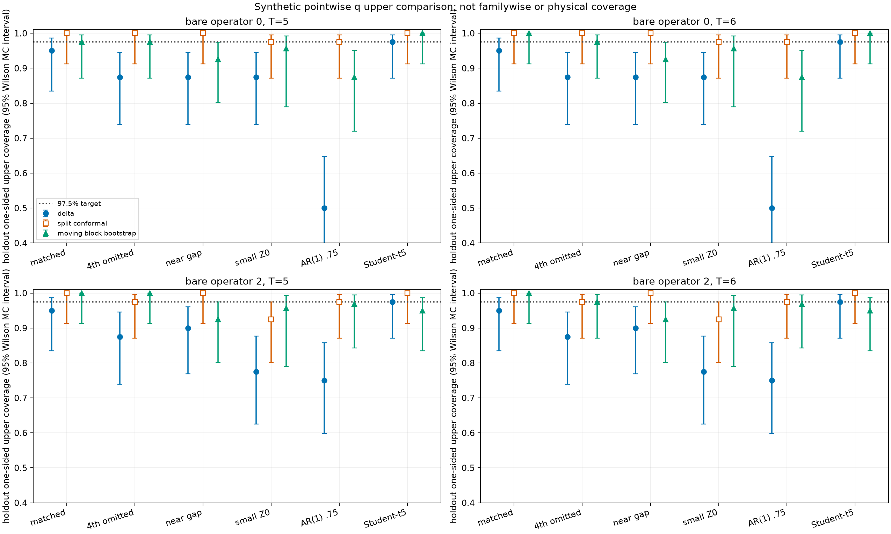

结论仅限这些模拟：moving-block 处理 AR(1) 的点估计比 IID delta 明显改善，但 operator 0 的覆盖为 `0.875` 且有 20% cell abstention，未达到目标；近简并场景 MBB 为 `0.925`，明显低于同样本 conformal 的 `1.000`，所以不应把 MBB 提升为 F-lane 认证候选。small-`Z0` 的 `0.957` 覆盖只基于约 58% 可报告区间，不能忽略其高失败/弃权率。Split-conformal 在这些合成 panel 上总体较好，但仍依赖 calibration/holdout panel exchangeability 和模拟真值，不能转作真实链保证。该 MBB 是基于拟合 qhat 的重抽分位数，不校正三态模型结构性偏差，也不包含 thermal `h`、mixed `x`、正谱适用性、q/h/x familywise 多重性或 production contamination。

图文流程：`验证六场景来源 hashes -> 固定 40 校准 / 40 留出 -> 对留出每 panel 做 L=8 circular block resampling × 40 -> 失败值记 +infinity -> 重拟合 3-state GLS 并形成逐点 q upper -> delta/conformal/MBB 同样本比较 coverage、MC 区间、宽度与 abstention -> 物理认证 abstain`。新增测试 **6 passed**，覆盖 circular chunk adjacency/seed 确定性、有限样本秩、失败弃权、输入 source hash、报告图文、分母和 no-clobber；Optimize+Wilson 定向集合 `318 passed`（Optimize `152`、Wilson `166`），PR #6 全仓 CPU suite `401 passed`。报告目录 **11/11** artifact hashes 一致，代码 source hashes 匹配；本轮未读取 Wilson measurement/封存 split/GPU，物理分母 `0/0/0/0`，认证 `1/0/0/1`，状态保持 `NOT_READY/UNCERTIFIED`、F=`GROUND_STATE_FORCE_UNCERTIFIED`、`physical_score=null`。剩余 CPU 项改为较高 `B` 的尾部稳定性、小范围事先固定的 `L` 敏感度，以及 profile-likelihood 对照；若这些方法仍在 near-gap / small-overlap / AR(1) cell 欠覆盖或高弃权，就全部维持 diagnostic-only。之后真实推进仍需同字节 production correlator、有限-$N_t$ `h`、mixed `x`、reference-force 与独立 review/授权。

### 2026-11-26 joint GLS 区间的 B=80 moving-block bootstrap 尾部稳定性复核

依照上一节“只补尾部抽样数，不重调 L”的方案，新增 [`f_lane_joint_spectral_mbb_b80_diagnostic.py`](f_lane_joint_spectral_mbb_b80_diagnostic.py)、[`test_wilson_f_lane_joint_spectral_mbb_b80_diagnostic.py`](../../tests/test_wilson_f_lane_joint_spectral_mbb_b80_diagnostic.py) 与[图文报告](f_lane_joint_spectral_mbb_b80_20261126_v1/README.md)。脚本先逐项验证 B=40 报告的 artifact/source hashes，原样复用 bootstrap indices `0:40`，再按原 seed 公式只补 indices `40:80`；六个 scenario、40 个独立 holdout panel/场景、`L=8` 和 q 家族定义均不变。B=80 的 97.5% 次序统计量 rank=`79`，有失败值仍按 `+infinity` 保留，所以一次失败不必然导致弃权，两个或更多失败可能将 rank 推到无穷值。该方案只改善尾部分辨率，不提供新的有限样本 coverage 定理。

全量分母：新增重拟合 `9600/9520/80/0`、新增 q estimates `38400/38080/320/0`；合并原 B=40 与新增抽样后，B=80 refits=`19200/19030/170/0`、q estimates=`76800/76120/680/0`；B=80 q intervals=`960/876/0/84`（planned/valid/failed/abstained）。相较 B=40 的 100 个区间弃权，B=80 降至 84；small-`Z0` 仍每 q cell `25/40` 可报告、`15/40` 弃权，AR(1) 每 cell `34/40` 可报告、`6/40` 弃权。

条件于有效区间的 B=80 覆盖率范围：matched `1.000`、omitted-4th `0.975–1.000`、near-degenerate `0.925`、small-`Z0` `0.960–1.000`、AR(1) `0.912–1.000`、Student-t5 `0.950–1.000`。其中 near-gap 与 B=40 一样保持 `0.925`，说明加大 B 没有解决这一失覆盖；AR(1) 比 B=40 的 `0.875–0.969` 有改善，但部分 cell 仍达不到 0.975 且存在弃权。small-`Z0` 仅约 `62.5%` intervals 可报告，故其较高的条件覆盖不能单独作为可用性证据。图中的每格仍只有 40 个 outer holdout panels，Wilson Monte Carlo 区间宽；逐格 coverage、MC 区间、区间宽度和 P/V/F/A 分母在 `method_comparison.csv`。

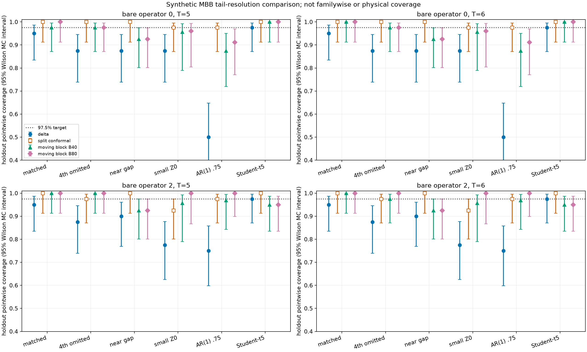

解释：增加 bootstrap 次数只让经验尾分位更细，不能修复三态拟合遗漏态的偏差、近简并谱的识别困难或真实链依赖未知。MBB 仍不如同场景 split-conformal 稳健，且 conformal 也只对声明的跨 panel exchangeability 条件成立；两者均不得送入 q reader/F gate。报告 hashes **12/12** 一致，来源文件与协议 hashes 匹配；B=80 smoke **5 passed**；Optimize+Wilson 定向集合 **323 passed**（Optimize 152、Wilson 171），PR #6 全仓 CPU suite **406 passed**。文字流程：`验证 B40 report -> 复用相同留出 panel 的40个既有 draws -> 固定 seed 补40个 draws -> rank79 合成 B80 upper -> 对比覆盖、宽度、弃权 -> 认证仍 abstain`。物理 measurement 分母 `0/0/0/0`、认证 `1/0/0/1`，继续 `NOT_READY/UNCERTIFIED`、F=`GROUND_STATE_FORCE_UNCERTIFIED`、`physical_score=null`。

后续 CPU 工作缩小为 profile-likelihood 上界对照，以及只有在先验固定区间方案下才做的 L 敏感度；若 profile 也不能在 near-gap / small-overlap / AR(1) 场景同时达到覆盖并控制弃权，应停止继续调纯 bootstrap 参数，保留 abstain 并等待真实 calibration/source receipts、污染项和独立 review。

### 2026-11-26 F-lane profile-likelihood 对照完成：失败率使其保持 diagnostic-only

已完成 [`f_lane_joint_spectral_profile_diagnostic.py`](f_lane_joint_spectral_profile_diagnostic.py) 的完整合成 CPU pilot，并生成[图文报告](f_lane_joint_spectral_profile_20261126_v1/README.md)、[逐区间与逐格 CSV](f_lane_joint_spectral_profile_20261126_v1/profile_intervals.csv)及[覆盖图](f_lane_joint_spectral_profile_20261126_v1/method_coverage.png)。区间定义为固定每 panel regularized covariance 的三态 joint-GLS profile：最大化 $q$，约束 `chi2(q)-chi2_min <= 3.841458820694`。该 cutoff 在 regular Wilks 假设下对应双侧95% LR set 的上端点；这里既没有有限样本保证，也没有 profile 对协方差估计误差的传播。拟合用解析 model/profile-transform/constraint Jacobian 的 SLSQP；报告 source snapshot、输入报告和各 artifact hashes 均可核对。图中 `x` 表示该 cell 无有效区间，画在 $y=0.5$ 仅为视觉占位，**不是 50% 覆盖率**。

全量 planned/valid/failed/abstained 分母为 `960/432/528/0`；holdout panel 为 `240/240/0/0`，物理测量 `0/0/0/0`，认证门 `1/0/0/1`。528 个失败中，452 次达到 1000 iteration 上限、54 次报告 positive directional derivative、20 次约束不兼容、2 次 LSQ 子问题奇异；失败记录的 iteration 中位数/最大值为 `704/1000`，其中102次同时触及参数边界。由于失败状态优先级高于边界弃权，此次单独计为 abstained 的是0；边界触碰已保留在逐行收据。

逐情景诊断（profile coverage 均条件于有效区间；每个 operator/time cell 计划40个）：

| 情景 | valid/failed/abstained | op0 T5 / T6 覆盖率（有效数） | op2 T5 / T6 覆盖率（有效数） |
|---|---:|---:|---:|
| matched 三态 IID | 82/78/0 | 0.969 (32), 0.974 (38) | 1.000 (5), 0.857 (7) |
| 遗漏第四态 | 88/72/0 | 0.861 (36), 0.868 (38) | 0.875 (8), 0.667 (6) |
| 近简并能隙 | 37/123/0 | 0.875 (16), 0.800 (15) | 0.800 (5), 1.000 (1) |
| 小 ground overlap | 35/125/0 | 0.800 (15), 0.850 (20) | 无有效区间 (0), 无有效区间 (0) |
| AR(1), rho=0.75 | 106/54/0 | 0.459 (37), 0.525 (40) | 0.846 (13), 0.625 (16) |
| Student-t5 IID | 84/76/0 | 0.971 (34), 0.974 (39) | 1.000 (5), 1.000 (6) |

文字结论：遗漏态与 AR(1) 下显著欠覆盖；近简并和小 overlap 有大量失败，成功区间的条件覆盖不能代表全部计划样本。与同一 panel 上的 B=80 MBB / split-conformal 对照相比，本 profile 方法在遗漏态、近简并及 AR(1) 都没有显示可接受的 coverage-and-yield 组合；`method_comparison.csv` 给出每格 MC interval 和有效分母。故停止把 profile-likelihood 作为 q 上界候选，不将其送进 `spectral_q_bound_reader.py` 或 F gate，也不通过只筛成功 optimizer 结果声称覆盖已校准。F 仍 `GROUND_STATE_FORCE_UNCERTIFIED`、`physical_score=null`。

图文流程：`校验 B80 与 stress 输入 hashes -> 固定六类合成 panel 与 per-panel covariance -> 三态 joint GLS -> 解析重参数化固定 q 做约束 profile -> 记录 960 项 P/V/F/A、边界与失败原因 -> 仅对有效项报告点态 coverage/MC interval -> F 认证 abstain`。本节 7 项定向测试通过；本轮全仓 CPU suite **413 passed**，Wilson 定向 suite **178 passed**，Optimize+Wilson 定向 suite **330 passed**。README 与覆盖图可由冻结的 CSV 用 `--refresh-derived` 重建，不重新拟合；协议会记录这项 derived-only 刷新。图、数字与输入范围均为 synthetic CPU evidence，不支持 production Wilson 的误差或污染界。

剩余工作不是再扩大 B 或隐去失败：若仍要保留 profile 研究，只能先用独立实现审阅及已知参数解析 toy 检查数值算法，再预先冻结 multi-start 或一维 q-profile 路线并按全分母校准；若 yield/coverage 仍差则删除候选。完成物理 F lane 仍需要 owner/reviewer 审阅后的 raw cross-correlator snapshot、overlap/gap 与有限-$N_t$ 热污染 `h`、mixed-sector `x`、同源 paired force/reference 误差预算以及其独立数据/授权收据；在用户指定的数据封存状态下不读取任何 sealed split，也不启动 GPU/QUDA。

### 2026-11-26 block-length sensitivity 预注册（执行前冻结；已完成）

为补完 B40/B80 handoff 中“只有先验固定方案才做 `L` 敏感度”的剩余 CPU 项，先固定比较族 `L={6,8,10}`：`L=8` 使用既有 B40/B80 报告，新增只跑 `L=6` 与 `L=10`；三个值在 baseline 结果之后做的是**同一组六情景 synthetic holdout 上的描述性方法敏感度**，不构成独立确认或新的覆盖率校准。`L=6/10` 分别位于既定 `L=8` 两侧各2个配置块，不按此次扫描结果再改候选值。

冻结的共同设置：六个既有场景、前40 calibration / 后40 holdout panels、每 cell 40 个 circular moving-block refits、相同 panel/bootstrap-index seed 流、97.5% 上界次序统计量 `rank=40`；失败 q draw 继续视为 `+infinity`，不能从分母删掉。逐格并列 P/V/F/A、coverage 与 Wilson MC interval、有效区间比例和 median upper/true；按 op0/op2、T=5/6 画四面板覆盖图。报告须显式注明三个 L 共用相同 holdout，且 `L=8` 的原 B40 结果已被看过；不据此挑出“最佳 L”、不调整下一个确认方案，也不送入 q reader/F gate。

停止规则：完成这两个预固定 scan 后，不再继续用同一 generator/holdout 调 block length 或 B；无论某个 L 的有限样本点覆盖如何，全部仍为 diagnostic-only。只有获得新的独立 calibration panels、明确的 dependence/coverage 目标与独立 review 后，才讨论新的候选。真实 F lane 的谱、热项 `h`、mixed 项 `x`、force/reference budget 与授权边界保持上一段状态。

### 2026-11-26 block-length sensitivity 扫描完成：L=6/8/10 均保持 diagnostic-only

按上方冻结方案完成[总览报告、逐格表和覆盖图](f_lane_joint_spectral_mbb_length_sensitivity_20261126_v1/README.md)，代码为[`f_lane_joint_spectral_mbb_length_sensitivity.py`](f_lane_joint_spectral_mbb_length_sensitivity.py)，测试为[`test_wilson_f_lane_joint_spectral_mbb_length_sensitivity.py`](../../tests/test_wilson_f_lane_joint_spectral_mbb_length_sensitivity.py)。`L=8` 复用先前已看过的 B=40 结果；仅新跑 `L=6,10`。同一 240 个 deterministic holdout panels、40 个 calibration panels/scenario、40 个 holdout panels/scenario、每 panel `B=40`、上界 rank 40 不变。三个长度共用 `9,600/9,600` 个 `(scenario, panel, bootstrap-index)` seed keys；每个 L 的圆形 chunk layout 按其 block length 改变。该 seed coupling 与相同面板配对使结果适合描述配置敏感度，但不是独立重复。

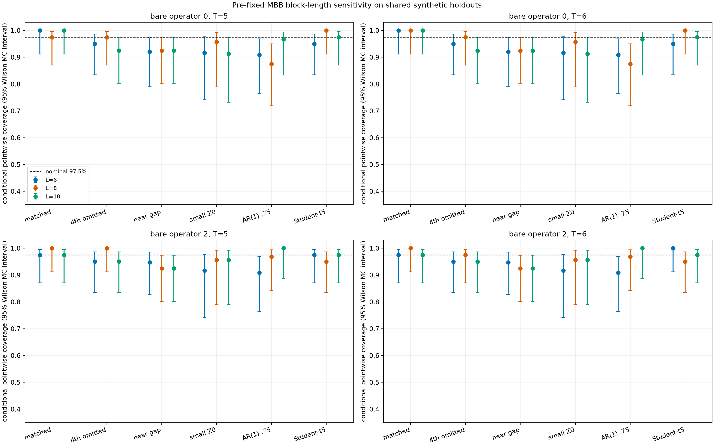

| L | q interval planned/valid/failed/abstained | bootstrap refit planned/valid/failed |
|---:|---:|---:|
| 6 | 960/860/0/100 | 9,600/9,522/78 |
| 8 | 960/860/0/100 | 9,600/9,510/90 |
| 10 | 960/852/0/108 | 9,600/9,512/88 |
| 三长度重复分析项合计 | 2,880/2,572/0/308 | 不是独立的 2,880 个样本 |

三长度都复用同一 240 holdout panels；因此合计 interval 行是重复分析条目，不得当作 720 个独立 panel。分情景、四个 operator/time q cell 的 coverage 均为**条件于有效区间**，完整逐格 `n/40`、95% Wilson MC intervals、median upper/truth 和相对 L=8 的差值在 `length_sensitivity.csv`：

| 情景 | L=6 valid / coverage 范围 | L=8 valid / coverage 范围 | L=10 valid / coverage 范围 |
|---|---:|---:|---:|
| matched 三态 IID | 160/160；0.975–1.000 | 160/160；0.975–1.000 | 160/160；0.975–1.000 |
| 遗漏第四态 | 160/160；0.950 | 160/160；0.975–1.000 | 160/160；0.925–0.950 |
| 近简并能隙 | 152/160；0.921–0.947 | 160/160；0.925 | 160/160；0.925 |
| 小 ground overlap | 96/160；0.917 | 92/160；0.957 | 92/160；0.913–0.957 |
| AR(1), rho=0.75 | 132/160；0.909 | 128/160；0.875–0.969 | 120/160；0.967–1.000 |
| Student-t5 IID | 160/160；0.950–1.000 | 160/160；0.950–1.000 | 160/160；0.975 |

解读：此扫描没有给出一个跨压力情景全面占优的 L。`L=10` 的 AR(1) 条件覆盖较高，但该场景 160 个 q interval 中仅 120 个有效；`L=8` 在遗漏第四态场景较高；小 overlap 的 yield 在三个 L 都偏低；近简并覆盖约 0.92–0.95。每格仅 40 个 holdout panel，MC 区间较宽，且扫描重复使用同一 synthetic holdout。图中 `x` 若出现代表零有效区间，y=0.5 仅作绘图占位；此图这次的所有 MBB cell 均有至少一个有效区间。故不从已观察 holdout 选 L、不继续调 B/L，也不把结果送入 q reader/F gate。

首次生成总图时，Wilson 上端点 `0.9999999999999999` 与覆盖点 `1.0` 出现 1 ulp 的浮点次序差，导致 matplotlib 拒绝负误差条。所有 L=6/10 拟合与 bootstrap CSV 已完成并留存；随后仅对通过 SHA-256 的冻结子报告重建总表和图，绘图端点只在 `1e-12` roundoff 内扩展以包含点估计，实质不相容仍会报错；没有重拟合或改变规则。报告明确记录这是 derived-only recovery。

本轮 `py_compile` 通过；本文件 6 项定向测试通过；PR #6 全仓 CPU suite **419 passed**；`git diff --check` 通过。顶层产物 hash **6/6**、L=6 和 L=10 各 **12/12** 匹配，9,600/9,600 seed keys 一致。以上仅为 synthetic CPU 方法敏感度：物理 Wilson measurement `0/0/0/0`、认证门 `1/0/0/1`，维持 `NOT_READY/UNCERTIFIED`、F=`GROUND_STATE_FORCE_UNCERTIFIED`、`physical_score=null`。下一步不再增加同一 generator/holdout 的 L/B 扫描；只在取得独立 calibration panels、授权 raw cross-correlator/spectrum/thermal/mixed/reference receipts 和独立 reviewer 后，推进物理 C/F lane。

### 2026-11-27 F-lane transfer-trace 报告的源码身份封存

复核已有[q/h/x 代数诊断](f_lane_transfer_trace_reader_cpu_20261126_v1/README.md)时发现，图文报告列出了分母与公式，但没有记录形成结果的 reader、lane contract、snapshot integrity 实现和测试文件版本。现为报告保留这四项源码副本，`source_hashes.json` 绑定原路径与 SHA-256，`artifact_hashes.json` 校验 README、source manifest 和四份快照。文字流程：`reader + selected lane contract + SourceByteSnapshot helper + deterministic regression -> 4/4/0/0 source identity -> same-snapshot q/h/x algebra fixtures -> 6/6/0/0 report artifact hashes -> diagnostic only`。真实测量 `0/0/0/0`、F certification `1/0/0/1` 未变。

新增的 report-integrity 测试逐一确认仓库源码与保存快照逐字节一致，并重算所有 artifact digests；`tests/test_wilson_f_lane_transfer_trace_reader.py` **11 passed**。本轮 Wilson 专项 **195 passed**，Optimize+Wilson **354 passed**，PR #6 全仓 CPU suite **437 passed**，`git diff --check` 通过。这只锁定代码与报告身份，不验证调用方 spectrum/overlap summary 的物理来源，也不增加 coverage、thermal `h`、mixed `x` 或 force 误差证据。

后续的非封存软件边界仍是让经独立审阅的 two-sector fit 从同一 raw `C_ij(R,t)` snapshot 生成 `eps_m`、`V_n(R)`、`A_i,mn(R)` 和全分母，再接入 q/h/x reader；在 insertion-time/source-sink/boundary-trace 约定未审阅前不写新物理公式。缺 production bytes、污染/误差预算或授权时保持有限-$T$ Creutz 与基态静态力双 lane 分离、`NOT_READY/UNCERTIFIED`、F=`GROUND_STATE_FORCE_UNCERTIFIED`、`physical_score=null`，不读 sealed split、不启动 GPU/QUDA。

### 2026-11-27 proposed two-sector raw-matrix fit 的 synthetic CPU pilot

为继续上一节的软件工作，新增[`f_lane_two_sector_fit_candidate.py`](f_lane_two_sector_fit_candidate.py)：从 immutable `SourceByteSnapshot` 读取 `N_t={16,32}`、`R={2,3}`、`T=3..7` 的 synthetic Hermitian `3x3 C_ij` block 数据；严格核对 manifest、lane-contract/hash、axis order、split 和全部矩阵 Hermiticity，然后以 `N_t=32` 的 forward 2-state fit 初始化一个 2-vacuum × 2-static proposed trace fit。按合同草案固定 `eps_0=0`、两 sector 有序能量和每个 transition-overlap vector 的相位约定；45 个自由参数共同拟合 180 个实矩阵分量，三组固定 `(eps_1 start, excited-overlap scale)={(0.15,0.20),(0.30,0.35),(0.55,0.50)}`，同一份 snapshot 产出 `eps_m,V_n(R),A_i,mn(R)` 与 `q/h/x` 点值。目标函数仅使用各分量 block-SE 的对角权重；不估 full covariance 或 confidence interval。

[图文报告包](f_lane_two_sector_fit_cpu_20261127_v1/README.md)使用 96 个合成 block、相对噪声 `0.003`。三个开始点均收敛到 `chi2_diagonal=111.634` 左右；拟合 Jacobian rank `45/45`，但条件数约 `1.24e5`，说明完整秩不等于参数稳定。`eps_1` toy 偏差为 `0.0250`；`V_0,V_1` 最大偏差约 `0.00475`。24 个 q/h/x cell 均输出，逐分量 `q/h/x` 的最大绝对 toy 偏差约 `9.35e-4 / 1.26e-3 / 1.16e-3`，中位数约 `4.39e-4 / 1.74e-5 / 1.05e-6`；这些是已知双态 generator 下拟合点值误差，不能解释成统计覆盖或物理污染 bound。图左对照 injected 与 fitted spectrum，图右比较 24 cells 的 q/h/x 拟合值和 generator truth。

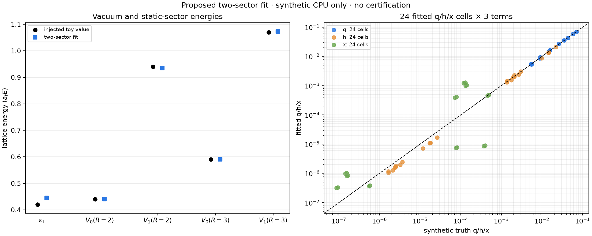

文字流程：`synthetic raw matrix NPZ + manifest + lane contract -> immutable snapshot -> axis/hash/Hermitian preflight -> Nt=32 forward fit initializer -> 三个 two-sector fit starts -> 45参数联合拟合 -> 24个 q/h/x cell -> diagnostic only`。专项测试 **3 passed**，涵盖 full-rank fit、same-snapshot immutability、closed split、错轴、non-Hermitian 和 stale bytes；PR #6 本轮全仓 CPU suite **442 passed**，`git diff --check` 通过。报告 artifact hashes `19/19`、源码快照 `9/9` 匹配。这个 pilot 只验证了已提议公式在一个匹配 generator 中的 CPU 可实现性：endpoint/source-sink/time-origin 与生产 exporter 的对应仍未经独立审阅；对角权重忽略跨分量 covariance，chi-square 未校准，未测遗漏态、近简并/弱 overlap 的 interval coverage，也未生成 q/h/x simultaneous upper receipts。故不得把拟合摘要送入 F gate；有限-$T$ Creutz C lane仍与此分开，生产 `ground_state_discrete_static_force` 继续 `GROUND_STATE_FORCE_UNCERTIFIED`，总体 `NOT_READY/UNCERTIFIED`、`physical_score=null`，不读 sealed split、不启动 GPU/QUDA。

### 2026-11-27 Wilson C/F 估计量与实现公式自审

对照 `lane_contract_v2.json`、`finite_nt_toy.py`、`f_lane_two_sector_fit_candidate.py` 与 `force_budget.py` 做源码级代数核对。C 主点是有限时间的
`chi(R=2,T=5)=-log W(3,6)-log W(2,5)+log W(3,5)+log W(2,6)`，代码先对配对样本 loop means 做正值检查，再按该符号组合 log；它不是 ground-state force。F 主点仍单独为
`[V_stout(3)-V_stout(2)]-[V_identity(3)-V_identity(2)]`，单位 `a_s*a_t*F`。two-sector candidate 按合同使用 `Z0(N_t)^-1 sum exp[-eps_m(N_t-T)] exp[-V_n(R)T] A_i,mn A*_j,mn`；`q/h/x` 分别取 `(m=0,n>0)/(m>0,n=0)/(m>0,n>0)`，其 `delta_log=log(1+q+h+x)`。force helper 对两种 kernel、R=2/3、T/T+1 共 8 个角的 `log1p` 上界求和，使用 `log(1+q+h+x)<=log1p(q)+log1p(h)+log1p(x)`，故是保守三角界，不依赖跨 kernel 或跨角误差独立。

文字流程：`四个同配置 C loop means -> finite-T Creutz log stencil`；独立 F 流程为 `同一 R=2,3 的 3x3 C_ij(N_t,T) -> proposed two-sector spectrum/overlaps -> q/h/x -> 8 force corners -> positive reference-force lower bound + statistical/systematic budgets -> F gate`。公式与当前 contract/helper 一致，但这是本仓源码自审，不是独立 physics review。检索当前 checkout 的 tasks/tests/doc 只找到诊断消费者，没有找到实际生产 Wilson-loop exporter；因此无法从 producer 核实端点、插入时间、方向、边界 trace/归一化或矩阵 source/sink 指标。两-sector candidate 仍以每分量 diagonal SE 加权，45 参数/180 实分量；其 synthetic exact-generator pilot 没有遗漏态、近简并、weak-ground-overlap、协方差覆盖或 simultaneous q/h/x upper bounds。

本项没有新跑测试或新增数据，关闭的是 C/F 估计量、符号和误差传播公式之间的静态一致性检查。不得把公式一致性写成污染小、coverage 通过或生产输出正确。C 仍需获准 calibration loop bytes、coverage/dependence receipt 与 reviewer；F 仍需真实 `3x3` raw matrix、matched `N_t=32` thermal/mixed inputs、经审阅的 exporter convention、joint-fit simultaneous coverage、reference-force/statistical receipts 和独立审阅。两条 lane 保持分开；缺输入时 C/F 均 `ABSTAIN/NOT_READY`、F=`GROUND_STATE_FORCE_UNCERTIFIED`、`physical_score=null`，sealed split closed，不启动 GPU/QUDA。

### 2026-11-27 F two-sector NPZ 解压预算接线

复核 `f_lane_two_sector_fit_candidate.py` 时发现，它对 raw matrix snapshot 校验 byte hash 后直接调用 `numpy.load`，没有在解压前调用共享的 `core.npz_safety.validate_npz_payload`。现在 reader 会先执行默认 64 MiB 的 NPY 成员总展开预算、header、object dtype 和重复成员预检，再进入 `numpy.load`；预检失败保留为明确错误并在数组分配前停止。未来该 fit diagnostic 的源码快照清单也已加入 `core/npz_safety.py`。

文字流程：`captured compressed NPZ bytes -> exact hash/manifest check -> ZIP/NPY uncompressed-size + header preflight -> numpy.load -> matrix schema/Hermiticity checks -> fit`。新增回归用例将预算收紧到 1 KiB，并把 `numpy.load` 替换为“若调用即失败”的 sentinel；预检以 `uncompressed size limit` 拒绝后，sentinel 未触发。`tests/test_wilson_f_lane_two_sector_fit_candidate.py` **4 passed**。共享 NPZ 预检另验证不支持压缩、加密成员和损坏 DEFLATE 都规范化成 reader 可处理的 `ValueError`；source snapshot 超预算只多读 1 字节后停止；`tests/test_source_integrity.py` **17 passed**。PR #6 整仓 CPU suite **447 passed in 72.47 s**。更新后的历史 transfer-trace 完整性测试只验证留存快照与 artifact manifest 内部哈希一致，不要求 2026-11-26 的 frozen source bytes 等于当前活跃代码；冻结报告本身未改写。既有 `f_lane_two_sector_fit_cpu_20261127_v1` 仍是修改前的冻结历史报告，不改写其源码快照或 `9/9` hashes；真实 Wilson 输入分母仍 `0/0/0/0`，没有新增 q/h/x、coverage 或 force evidence。后续所有物理边界保持不变：需 exporter/physics review、获准 raw `C_ij`、污染与误差收据后才进入 calibration；不读 sealed data、不启动 GPU/QUDA，F 仍 `GROUND_STATE_FORCE_UNCERTIFIED`、`physical_score=null`。

### 2026-11-27 Wilson C-lane 报告绑定 snapshot helper

source-map audit 发现 C-lane open-development generator 通过 `SourceByteSnapshot` 读取三份输入，却未把 `core/source_integrity.py` 写入 protocol 的 `analysis_source_sha256`，也没有随报告保留 helper bytes。现加入 source hash、`snapshot_core_source_integrity.py` 和 artifact manifest 条目。随后发现 generator 对代码文件分别“先 hash、后复制”，两次文件读取之间有源码变化的竞态；现改为在读取任务输入前逐一捕获代码文件，且每个文件只读一次，再从同一份 captured bytes 计算 digest 和写入 report snapshot。回归测试在源码首次读取后立即改写原路径，并要求 input reader 运行前源码捕获已经完成；报告 digest、归档源码 bytes 和 manifest 必须仍来自同一份捕获字节。`tests/test_wilson_source_snapshot_reader.py` **3 passed in 0.52 s**；PR #6 全仓 CPU suite **448 passed in 72.61 s**。

文字流程：`captured development inputs -> capture each analysis-source byte string once -> hash and retain that same byte string -> protocol source map + report manifest -> integrity test`。这只修复后续生成报告的代码身份链；未重跑或改写旧版 C 报告，也没有新增 Wilson measurement、独立 dependence/coverage receipt 或 F-lane contamination evidence。C 仍是 finite-`T` Creutz，F 仍是 ground-state static force；两条 lane 保持分开及 `NOT_READY/UNCERTIFIED`、F=`GROUND_STATE_FORCE_UNCERTIFIED`、`physical_score=null`，不读 sealed split、不运行 GPU/QUDA。

### 2026-11-27 two-sector full-covariance GLS 与 q/h/x delta 区间 pilot

在 `f_lane_two_sector_fit_candidate.py` 增加可选 `regularized_full_covariance` 拟合：从同一 96-block、180-component 的 captured matrix snapshot 估计 block-mean covariance，固定 25% diagonal shrinkage 和 `1e-10` relative eigenvalue floor，经 Cholesky whitening 最小化完整 Hermitian residual；由 whitened Jacobian information 计算参数协方差，再用有限差分传播到 72 个 q/h/x 分量，同时输出单侧 97.5% pointwise 与 95% Bonferroni-72 normal upper。原 diagonal 路径保留为同字节对照。新增[对照报告](f_lane_two_sector_gls_20261127_v1/README.md)、[逐 cell CSV](f_lane_two_sector_gls_20261127_v1/qhx_comparison.csv)和[标准化误差图](f_lane_two_sector_gls_20261127_v1/standardized_errors.png)，协议、源码快照及 artifact hashes 同包保存。

本次同一合成 panel 上两个 fit 都是 `45/45` full rank。Jacobian condition number 从 diagonal 的 `1.235e5` 降至 GLS 的 `6.539e4`，GLS 的拟合统计量为 `238.31`；两个 chi-square 使用不同 residual metric，不可直接互比，且均未做有限样本 GOF 校准。协方差来自 `96<180` 个 block，原始 covariance 确实 rank-deficient，固定 shrinkage 只是得到正定数值 metric。单个已知真值 panel 中，pointwise upper 包含 `56/72` 个 q/h/x truth，Bonferroni upper 包含 `64/72`；这不是重复抽样覆盖率，但足以提示当前 delta 区间不应接认证门。图的纵轴是 `(estimate - truth)/GLS delta SE`，低于相应 cutoff 的点表示该单侧上界没有包含本次 toy truth。

```text
同一 immutable synthetic NPZ -> diagonal fit 与 shrinkage-GLS fit -> Jacobian delta covariance -> 72 个 q/h/x 上界 -> 一次真值包含诊断 -> physical gate abstain
```

`tests/test_wilson_f_lane_two_sector_fit_candidate.py` 当前定向 **6 passed**；此处新加的测试覆盖目标模式校验、covariance shrink/floor diagnostics、72 项区间的次序以及仍为 diagnostic-only。已知边界：这里的 72 项共享拟合参数并相互相关；delta 法把估计 covariance 当作固定量，未传播 covariance 估计误差、block dependence、优化器/模型选择或 state-count uncertainty；只有一个正好匹配双态模型的 Gaussian panel，不能推出 pointwise 或 familywise coverage。

后续 CPU 校准不再扫描这个同一个 generator/seed。应冻结新 DGP 与独立 seeds，至少覆盖 omitted third vacuum/static levels、near-degenerate gaps、weak bare ground overlap、block AR(1)/unequal covariance；对失败 fit 与区间也保留完整分母，比较 delta、studentized 与全流程 block bootstrap 的 pointwise 和 72-term simultaneous coverage、弃权率、区间宽度及 Monte Carlo 误差。覆盖规则通过之前，不把此 candidate 接入 q/h/x reader 或 force gate。生产端点/source-sink/time-origin 约定、真实 `3x3 C_ij`、`N_t=32` 配对输入、reference force 与 contamination/error receipts 仍需外部数据及独立 review；C lane finite-`T` Creutz 不与 F lane 混合，状态继续 `NOT_READY/UNCERTIFIED`、F=`GROUND_STATE_FORCE_UNCERTIFIED`、`physical_score=null`，不读 sealed split、不运行 GPU/QUDA。

### 2026-11-28 F-lane 遗漏静态态的独立重复面板覆盖诊断

为把上一节单面板 `48/72` 与 `52/72` 的包含计数升级为真正的重复抽样诊断，新增 [`f_lane_two_sector_omitted_coverage_diagnostic.py`](f_lane_two_sector_omitted_coverage_diagnostic.py) 和[完整图文报告](f_lane_two_sector_omitted_coverage_20261128_v1/README.md)。固定同一已知 `2 vacuum × 3 static` finite-`N_t` 谱作为 truth、拟合模型仍为 `2×2`，每 panel 96 个独立 Gaussian blocks、相对噪声 `0.003`；24 个独立随机流使用 `default_rng(2026112800 + panel)`，不依结果调拟合窗、shrinkage 或区间。每 panel 用同一 regularized full-covariance GLS、固定 25% diagonal shrinkage / `1e-10` eigenvalue floor、45 参数 three-start fit；输出 72 项 q/h/x 单侧 97.5% pointwise 与 Bonferroni-72 95% family upper。24 份 raw NPZ/manifest 共用一份 lane contract，另保存 panel/cell 摘要 CSV 与 72 个 fit-start 记录；source snapshot `11/11` 与 artifact manifest `68/68` SHA-256 均匹配。

**结果：**拟合分母 `24/24/0/0`，全部 full-rank 候选；三起点优化总分母 `72/72/0/0`；q/h/x interval cells `1728/1728/0/0`，24 个 raw matrix hash 全异。72 项 pointwise upper 的 pooled 描述性包含为 `1178/1728=68.17%`；按独立 panel 聚类平均为 `68.17%`，t-based 95% MC 区间 `[65.42%,70.92%]`。分项 panel-cluster 平均覆盖：q `15.97%` `[10.59%,21.36%]`，h `92.19%` `[89.53%,94.85%]`，x `96.35%` `[92.79%,99.92%]`。**Bonferroni-72 同时上界没有任何一 panel 覆盖全部 72 个 truth：`0/24`，Wilson 95% MC 区间约 `[0%,13.80%]`，远低于 nominal 95%。**中位 Jacobian condition number `1.61e4`，最大 `9.10e8`；full rank 并未保证良好条件数。图表并列显示每 cell 有符号估计偏差和按 panel 聚类的覆盖；同 panel 72 cells 不被当成独立样本。

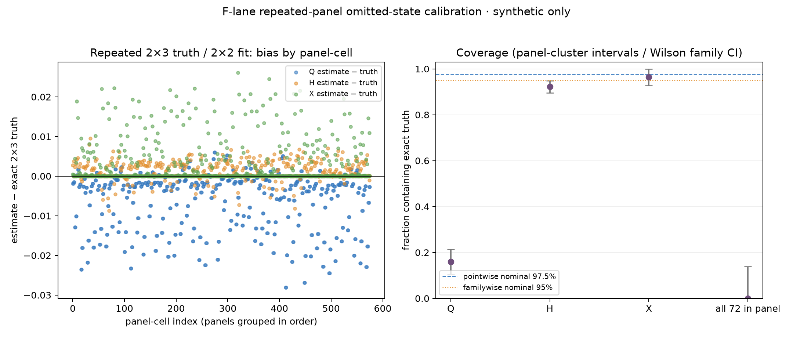

文字流程：`冻结 2×3 finite-Nt truth + 2×2 拟合/区间 -> 24 个独立 seed panel × 96 blocks -> same-snapshot GLS -> 72 个 q/h/x upper 与 exact truth 对照 -> panel-cluster pointwise / familywise coverage + MC 区间 -> F 认证门 abstain`。

这个结果限定于单一 omitted-third-static-state truth、iid Gaussian block 噪声和当前 fit/delta 规则；它足以否定“此 2×2 delta upper 已对该失配情景稳健”的主张，但不代表所有 Wilson spectrum 或更完整 state model 都会欠覆盖。`n_panel=24` 令 familywise Monte Carlo 区间仍宽；需用独立、预冻结的更多 panel 与 DGP strata 确认覆盖/停止规则，再比较 2×3 recovery、profile likelihood 与全流程 moving-block bootstrap，并记录失败、条件数、区间宽度及 abstention。不得用同一 24 panels 调 shrinkage 或重新宣称校准通过。

测试/验证边界：本轮运行诊断脚本并核对报告哈希，脚本 `py_compile` 与 `git diff --check` 通过；没有重跑 pytest 全集。所有输入均是新生成的 synthetic CPU 数据，无真实 `C_ij`、GPU/QUDA 或 sealed split。物理 measurement denominator 仍 `0/0/0/0`；有限-$T$ Creutz C lane 与基态静态力 F lane 仍分开，保持 `NOT_READY/UNCERTIFIED`、F=`GROUND_STATE_FORCE_UNCERTIFIED`、`physical_score=null`。后续真实生产仍需获准 raw `3x3` correlator、endpoint/source-sink 约定 review、matched-`N_t=32` thermal/mixed receipts、reference force/error budget 与独立统计/物理 review。

### 2026-11-27 双态拟合的遗漏第三静态态反例

为实际执行上段的第一种不同 DGP，新增[遗漏态图文报告](f_lane_two_sector_omitted_state_20261127_v1/README.md)和[逐 cell CSV](f_lane_two_sector_omitted_state_20261127_v1/qhx_comparison.csv)。输入仍是 96 个独立 Gaussian synthetic block，但生成器保留 toy 中全部 **2 vacuum × 3 static** states；被比较的 diagonal 与 regularized-GLS 拟合都仍固定为 **2 × 2**、45 参数/180 个实 Hermitian 分量、相同三组 starts。此处检验的是截断模型偏差，不是实际 Wilson spectrum。

两条路径都返回 `45/45` rank；GLS Jacobian condition number `1.346e4`，其未校准 GLS `chi2=18,921` 很高，但这里只把它当作模型失配提示而非正式 GOF 拒绝。用生成器完整 2×3 truth 核对拟合 q/h/x 后，单侧 pointwise upper 只有 `48/72` 项包含真值，Bonferroni-72 upper 只有 `52/72`；GLS 标准化绝对误差中位数/最大值约 `14.3/38.4`。图中许多 q 估值偏低约 20–40 个所报 delta SE，h/x 也显著偏高；因此 full rank、优化器收敛和形式上的 upper-bound 宽度均不能替代模型失配检查。

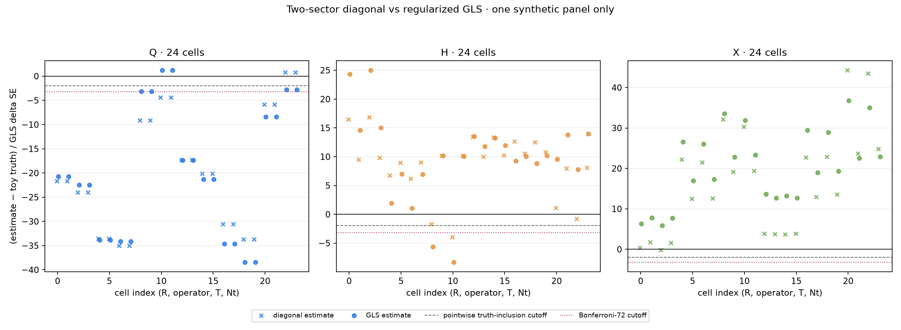

文字流程：`2×3 known-truth finite-Nt trace + iid noise -> immutable snapshot -> diagonal/GLS 两条 2×2 fit -> q/h/x delta upper -> 与完整三静态态 truth 对照 -> 保留失配诊断并对物理 gate abstain`。一张 panel 的 `48/72` 与 `52/72` 只是本次真值包含计数，**不是覆盖率估计**，也没有以它调过拟合窗、shrinkage 或阈值。报告同步留存源码/输入快照和 artifact hashes。

这项 stress 使下一轮 calibration 设计更具体：独立重复 panel 要按事先冻结的第三态 gap/overlap 区间、near-degenerate 双激发、弱 ground overlap、vacuum-sector omitted state 与 AR(1)/unequal covariance 分层；每个 panel 同时记 chi-square/GOF、参数 rank/condition、fit failure、q/h/x 逐项及 familywise upper 覆盖、宽度与 abstention。需另外比较允许第三态或 profile/bootstrap 区间的恢复能力，不能只靠增加 GLS shrinkage 修补模型偏差。Wilson 全物理 boundary 仍未闭合，保持双 lane 分离、`NOT_READY/UNCERTIFIED`、F=`GROUND_STATE_FORCE_UNCERTIFIED`、`physical_score=null`，不访问 sealed split/GPU/QUDA。

### 2026-11-28 F 覆盖报告的传递源码依赖补齐

对重复覆盖报告的 source manifest 做 AST import-closure 审计，发现报告已经 hash `f_lane_two_sector_gls_diagnostic.py` 与 raw-matrix reader，但没有包含它们实际导入的 `f_lane_two_sector_fit_diagnostic.py`、`gevp_overlap_object_diagnostic.py` 和 `gevp_t0_truncation_diagnostic.py`。现把这三项加入未来报告的 `SOURCE_PATHS`；静态复核当前 manifest 为 14 个源码/合同文件，14/14 存在并可 hash，递归本地 import closure 为 15 个模块（多出的一个是空 `tasks/wilson_loop/__init__.py`），没有遗漏的非空本地模块。新增 `tests/test_wilson_f_lane_omitted_coverage_source_manifest.py` 钉住三条容易漏掉的传递依赖，**1 passed**；`git diff --check` 通过。

文字流程：`覆盖入口 -> two-sector candidate/GLS + raw-matrix reader -> fit initializer 与 GEVP helper -> 14 个 source/contract bytes -> AST closure 无未列依赖 -> diagnostic-only`。既有 `f_lane_two_sector_omitted_coverage_20261128_v1` 是冻结历史结果，仍保留原 `11/11` source hashes 与 `68/68` artifact hashes；没有重跑 panel 或修改旧图表。真实 `C_ij` 输入仍 `0/0/0/0`，认证门仍 `1/0/0/1`；有限-$T$ Creutz C lane 与基态力 F lane 继续分开，`NOT_READY/UNCERTIFIED`、F=`GROUND_STATE_FORCE_UNCERTIFIED`、`physical_score=null` 不变。后续不扩展同一覆盖 generator；只有独立校准输入、生产 exporter convention review、matched-`N_t=32` 污染/误差 receipts 与授权到位，才进入新的 calibration 或 production evaluator。

### 2026-11-28 F familywise coverage 的精确二项式样本量方案

基于上一节报告的 **0/24** 个 panel 同时覆盖全部 72 个 q/h/x truth，本轮不生成新数据，而是把后续独立 coverage panel 的停止门量化。把一个 outer panel 记为一次 Bernoulli 成功：只有当拟合成功、72 个 Bonferroni-72 上界全部生成且都覆盖已知 DGP truth 才算成功；fit failure 或 interval abstention 对验收计数按 non-success 处理，并另列完整 `planned/valid/failed/abstained`，避免只在成功拟合条件下报告覆盖率。72 个 cell 不能当作 72 个独立试验，二项式单位是独立生成的 panel。

对单一预注册 stratum，以单侧 Clopper–Pearson 下限 `Beta^{-1}(alpha; k, n-k+1)` 检验家族覆盖率至少 `0.95`。当前 `0/24` 的单侧 95% exact 上限为 `0.11735`；即使未来出现 `59/59` 全部成功，也仅刚足以使单一 stratum 的单侧 95% 下限超过 `0.95`，其对真实覆盖率 `0.98` 的检验功效只有约 `30%`。因此“全成功所需的最小 n”不能作为有足够功效的计划。

为避免五个预注册压力 stratum 的事后挑选，建议对 familywise coverage 的 5 个 strata 用 Bonferroni `alpha_s=0.05/5=0.01`。选取 `0.98` 作为有意义的规划备择值，并要求总体（五个 stratum 全部通过）功效至少 `80%`；可用并集界保证每个 stratum 的功效至少 `1-0.20/5=0.96`。精确二项式枚举得到每个 stratum `n=606`，须至少 `588/606` 个成功（最多 18 个 non-success）；单侧 CP 下限约 `0.95006`，在真实覆盖率 `0.98` 时单格功效约 `0.96102`，五格联合功效下界约 `0.805`。单格功效 80% 的较小方案 `398/格、388 成功`，联合功效只有约 `0.375`，故不作为主计划。这里 80% 是已声明备择 `p=0.98` 下的 power；若真实覆盖率只略高于 0.95，所需样本会大得多。

| 设计 | 每格 alpha | 每格 n | 最少全家族成功 panel | 真实 p=0.98 的每格 power | 五格总体 power 规则 |
| --- | ---: | ---: | ---: | ---: | ---: |
| 单一 stratum、仅控制单格 5% type-I | 0.05 | 234 | 228 | 0.809 | 不适用 |
| 五格 Bonferroni、每格各有 80% power | 0.01 | 398 | 388 | 0.822 | 约 0.375（不够） |
| **五格 Bonferroni、并集界保证总体至少 80% power** | **0.01** | **606** | **588** | **0.961** | **至少 0.805** |

预注册的五格候选为：遗漏第三静态态、近简并双激发、弱基态 overlap、遗漏 vacuum 激发态、以及 AR(1)/不等协方差 stress。每格的真值参数与噪声机制仍须在独立生成前冻结；这里的 `606×5` 是样本量规划，不是新 calibration 结果，也不授权重跑既有 2×3 Gaussian generator。calibration/方法选择 panel 与 untouched validation panel 必须分开；若在验证集上同时比较多个区间方法，需在看结果前另作方法数校正，或只验证事先冻结的单一 procedure。

文字流程：`冻结五个 DGP strata 与独立 seed manifests -> 每 panel 形成一个“72/72 均覆盖且拟合有效”的二项结果 -> 每格以 alpha=0.01 的 exact CP 下限验 0.95 -> 每格至少 588/606 成功 -> 五格均过且完整失败分母可审 -> 才能说 synthetic familywise coverage 达到预设精度`。规划枚举分母 `3/3/0/0`（三种方案均计算，无数据 panel）；真实 Wilson 输入仍 `0/0/0/0`，不形成 gate evidence。下一次只有在新的预注册 DGP/外部校准输入能改变区间方法决策时才执行；现有 no-go 数值、旧图和 `NOT_READY/UNCERTIFIED`、F=`GROUND_STATE_FORCE_UNCERTIFIED`、`physical_score=null` 均保持不变。

### 2026-11-27 force-budget helper 的 q/h/x 键 fail-closed 补齐

对 [`force_budget.py`](force_budget.py) 的直接调用边界做静态检查时发现：上层 `force_summary_reader` 已要求 `qhx_corner_bounds` 精确包含 `q/h/x`，但底层可复用的 `propagate_force_budget` 只读取这三个键，会静默忽略调用方附加的未注册污染项。现将精确键检查下沉到底层 helper；带 `thermal_extra` 等未知项的直接调用现在报错，避免跳过未进入预算的系统项。计算公式、fraction、reference-force LCB 与物理 gate 均未改变。

文字流程：`qhx bound mapping -> 要求键集合恰为 {q,h,x} -> 每项两 kernel×四 loop-corner -> sum(log1p(bound)) -> 与候选 reference force LCB 比较`；附加键或缺项直接拒绝。`tests/test_wilson_force_budget.py tests/test_wilson_evidence_adapter.py` **29 passed**，覆盖新增未知键负例和现有 reader/gate 分母路径，`git diff --check` 通过。此项只关闭输入 schema 的旁路，不提供新的 `q/h/x`、有限-$N_t$ 热污染、模型截断或 force receipts；真实物理输入仍缺，F=`GROUND_STATE_FORCE_UNCERTIFIED`、`NOT_READY/UNCERTIFIED`、`physical_score=null` 保持不变。

### 2026-11-28 F-lane q reader 的极端数值 fail-closed 补齐

对 `spectral_q_bound_reader.py` 的纯 CPU 输入边界做数值审计，发现 JSON 可含可解析的超大整数：将 overlap ratio 转为 float 时会抛出未捕获 `OverflowError`；两个各自有限的 overlap ratio 相加也可能让 `math.fsum` 溢出。Confidence allocation 中的超大整数同样可能越过内容校验直接抛异常。现将有限数转换统一变为可审计的拒绝路径，以 log-sum-exp 计算 `q(T)=Σ_i r_i exp(-ΔE_i T)`，并在最终上界超出有限浮点范围时返回 `ABSTAIN_F_SPECTRUM_Q_NUMERIC`。该返回保留完整 36 个拟合支持行分母，单列失败 q cell，并保持 `physical_score=null`；不将溢出值截断成有限值或当作成功。

文字流程：`immutable JSON bytes -> finite numeric/schema checks -> per-variant log-sum-exp -> finite q upper -> derive selected corners`；超大 JSON 整数在拟合行或 alpha metadata 阶段进入原有 failed/abstained 计数，超范围 q 上界则进入 `q_cell planned=8, failed=1, abstained=7` 并整体 abstain。新增负控分别覆盖超大 ratio 整数、有限输入相加溢出与超大 alpha；Wilson 定向 reader/evidence/force 测试 **41 passed**。随后当前 PR #6 worktree 的完整 `python -m pytest -q tests` **464 passed in 76.45 s**，`git diff --check` 通过。此项仅关闭数值异常逃逸边界，不证明 q 上游区间 coverage、正谱假设、h/x、有限-$N_t$ 污染、model truncation 或 reference force；生产输入仍 `0/0/0/0`，F=`GROUND_STATE_FORCE_UNCERTIFIED`、双 lane `NOT_READY/UNCERTIFIED`、`physical_score=null` 不变。

### 2026-11-28 F-lane 下一轮独立五 strata 筛查输入（执行前冻结）

上一节 `0/24` familywise 覆盖已足以否定“当前 2×2 delta 上界在这一遗漏静态态 DGP 下稳健”，但不能说明失败只由遗漏态造成，还是同时受 near-degeneracy、弱 overlap、遗漏 vacuum 或 block covariance 影响。为让下一轮有明确的新判别目标，我自行冻结下列**合成压力设置**；它们是算法压力参数，不是项目实测能谱或物理先验：

| stratum | 完整 truth / 噪声的预冻结变化 | 可区分的问题 |
|---|---|---|
| S1 high-overlap omitted static | 每个 `R` 的 2-vacuum × 3-static truth 保持原 `V_n`；将 `n=2` 的全部 transition amplitudes `A[m,n=2,i]` 乘 `1.5`；2×2 fit 不变 | 较强遗漏静态贡献会怎样影响 `q/h/x` bias 与 family coverage |
| S2 near-degenerate static | `R=2: V=[0.44,0.94,0.965]`；`R=3: V=[0.59,1.07,1.095]`，其它 truth 同原型；2×2 fit 不变 | 近简并激发态能否由当前窗口/协方差拟合稳定区分 |
| S3 weak operator ground overlap | 两个 `R` 上，仅对 `operator_index=2` 将 `A[m,n=0,i=2]`（`m=0,1`）乘 `0.04`；其余 amplitude 不变 | 目标 overlap 接近小量时比值和 delta 误差是否失控 |
| S4 omitted vacuum state | truth 增加 `epsilon=[0,0.42,0.70]`；第三 vacuum sector 的 `A[2,n,i]=0.25 A[0,n,i]`；fit 仍限制 2 vacuum × 2 static | finite-`N_t` partition/thermal `h` 与 mixed `x` 中未建模 vacuum state 的影响 |
| S5 dependent unequal-variance blocks | 保持原 2×3 truth；96 个 block noise 采用 stationary `AR(1) rho=0.50`；按 `T={3,4,5}/{6}/{7}` 将 innovation SD 乘 `{0.5,1,2}`，生成后保持每块 `3×3` Hermitian | 当前 iid covariance-of-mean 和固定 shrinkage 在依赖、跨 feature 不等尺度下的覆盖表现 |

共同拟合与评分规则不变：96 blocks/panel、基准相对 noise fraction `0.003`（S5 的分层比例乘在其上）、`Nt={16,32}`、`R={2,3}`、`T=3..7`、两态 2×2 regularized full-covariance GLS、25% diagonal shrinkage、相对 eigenvalue floor `1e-10`、原有三 starts、72 项 q/h/x、pointwise one-sided 97.5% 和 Bonferroni-72 family 95% upper。**小筛查**每 strata 12 个独立 outer panels，seed=`2026112900 + 100*stratum_index + panel_index`（index 从 0 起），与旧 `2026112800..2823` 完全不重叠；报告 classification 固定为 `SYNTHETIC_SCREENING_ONLY_NOT_CALIBRATION`。不因筛查结果改模型、overlap、rho、noise 或 interval rule。

每个 panel 预期保存 raw NPZ/hash、fit-start/status/iteration/rank/condition、72 项全分母、q/h/x signed bias、逐项包含与 panel-level familywise event；图至少并列五 strata 的 familywise Wilson 区间和按 panel 聚类的 pointwise 区间，并标 95%/97.5% nominal line。文字流：`固定五类 truth/noise -> disjoint seeds -> 5×12 raw panels -> same-snapshot 2×2 fit -> 72 q/h/x intervals + P/V/F/A -> panel-cluster coverage / familywise Wilson + condition-number plot -> diagnostic-only`。任何屏幕图只用于定位额外失效机制；不能替代前一节 `n=606、至少588 successes/stratum` 的确认精度设计。

运行成本先用已存 open synthetic `panel_000` 单次完整三起点 fit 作了一次纯计时复核：`4.1325 s`，rank `45/45`。按此速率，`5×606=3,030` 个 panel 的完整设计约 `3.48 h`，还未计 source snapshot、绘图与高失败成本；`5×12=60` 个初筛约 `4.1 min`，也只是近似预算，不是当前报告中的已运行结果。因此本节只冻结新设置与停止规则，没有生成 panels；下一步实现可审 runner 后，先跑这 60 个 screening panels，若其方法结论不改变且完整面板成本/失败率过高，就停止并等待独立 review，而不声称 coverage calibration。所有工作仍仅 synthetic CPU；生产 raw `C_ij`、exporter convention、matched-`N_t=32` thermal/mixed receipt、force/reference error budget 与授权缺口不变，C finite-`T` Creutz lane 与 F ground-state force lane 保持分离，`NOT_READY/UNCERTIFIED`、F=`GROUND_STATE_FORCE_UNCERTIFIED`、`physical_score=null`、sealed split closed，不启动 GPU/QUDA。

### 2026-11-28 五 strata F-lane synthetic screen 已运行：q delta family 全格 no-go

完成上节 runner [`f_lane_two_sector_multistratum_screen.py`](f_lane_two_sector_multistratum_screen.py)，冻结参数见 [`protocol.json`](f_lane_two_sector_multistratum_screen_20261128_v1/protocol.json)，逐项结果与图文见[报告](f_lane_two_sector_multistratum_screen_20261128_v1/README.md)。基础 omitted-coverage generator 加入可选 stationary AR(1) 与 `T` 分层噪声尺度；原 iid 默认分支保留原随机数 draw 顺序。新 runner 临时变换 truth 后在 `finally` 中恢复模块全局，不改原始 spectrum 常量；每格使用 `2026112900 + 100*stratum_index + panel_index`，共 60 个独立 panel，明确标注 `SYNTHETIC_SCREENING_ONLY_NOT_CALIBRATION`。

**分母与共同方法：**拟合 `60/60/0/0` 有效/失败/弃权/计划，均为 Jacobian rank `45/45`；q/h/x interval cell `4320/4320/0/0`；raw matrix SHA-256 `60/60` 唯一；五格每格拟合 `12/12`、interval `864/864`。共同规则仍是 `2×2` full-covariance GLS、25% diagonal shrinkage、relative eigenvalue floor `1e-10`、3 starts、72 项 Bonferroni-72 family 95% upper。五格的 familywise 成功均 `0/12`，每格 Wilson 95% MC 区间 `[0.000,0.242]`；小 `n=12` 下该区间很宽，不能把观测到的零次成功解读为真实覆盖率为零。

| stratum | panel-cluster pointwise coverage `q/h/x` | median / max Jacobian condition |
|---|---|---|
| S1 强化遗漏静态态 overlap | `0.083 / 0.962 / 0.931` | `1.06e4 / 1.06e9` |
| S2 近简并静态激发 | `0.014 / 1.000 / 0.993` | `3.42e3 / 1.10e4` |
| S3 operator-2 弱 ground overlap | `0.271 / 1.000 / 0.986` | `8.70e3 / 7.51e4` |
| S4 遗漏第三 vacuum | `0.215 / 0.896 / 0.958` | `1.79e4 / 1.63e5` |
| S5 AR(1) + unequal variance | `0.174 / 0.927 / 0.934` | `1.95e4 / 8.64e8` |

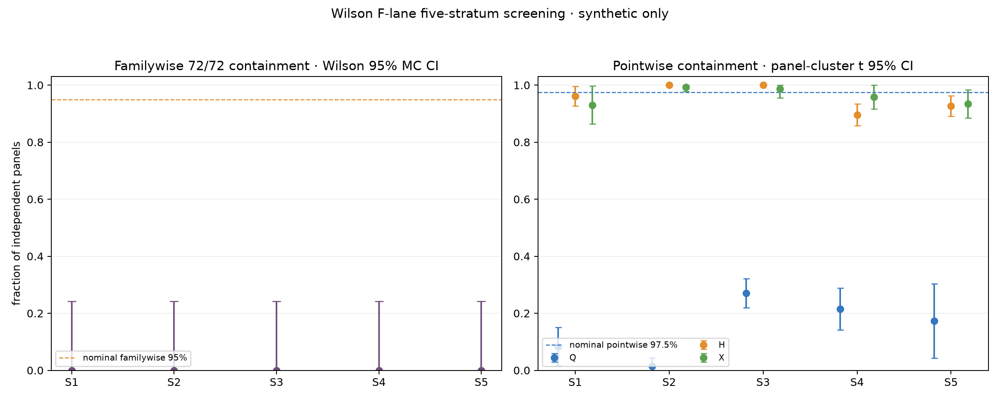

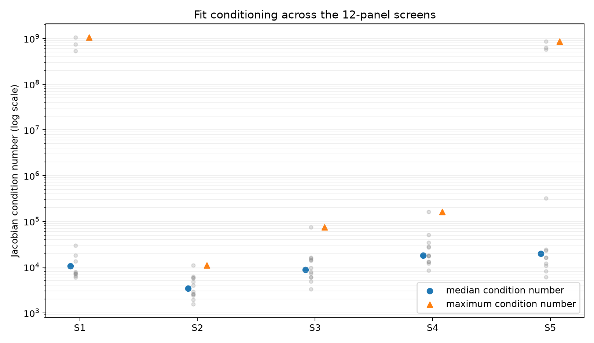

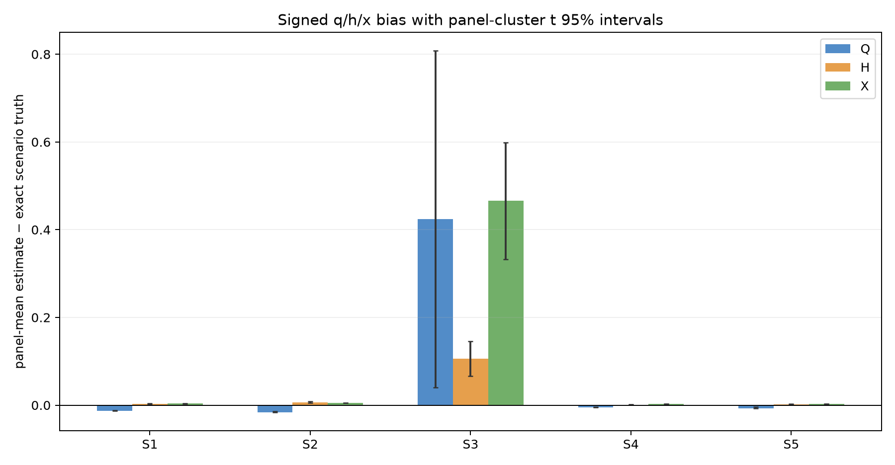

**诊断读法：**q 是五格共同弱点，pointwise cluster mean 为 `0.014–0.271`；h/x 较高，但若干格仍低于 pointwise nominal 97.5%，因此没有一格达到 Bonferroni family event。S1/S2 的 q 覆盖尤其低；S2 条件数并没有上升到最高，提示单看 optimizer condition 不能解释漏态 q 失效。S4 的 h 覆盖降到 `0.896`，与遗漏 vacuum sector 对有限-$N_t$ thermal/mixed 项的压力方向一致。S5 的 q 覆盖仍只有 `0.174`。S3 valid-cell mean signed bias 为 `q/h/x=(0.425,0.106,0.466)`，而 median 分别约 `(-0.0035,0.0025,0.0020)`；最大绝对误差达 `q=7.66, h=2.77, x=8.68`，说明少量弱 overlap panel 出现重尾/比值失控。S1 与 S5 虽全部 full-rank/fit-valid，最大条件数仍分别达 `1.06e9/8.64e8`；“优化器成功”不足以作为数值稳定证据。以上只定位合成机制，不确定哪个新 interval 有效，也不允许据此调 shrinkage 或改 family rule。

文字流程：`协议固定五类 truth/noise -> disjoint seeds -> 60 份 raw Hermitian NPZ + source/input hashes -> 同一 2×2 GLS -> 每 panel 保留 rank/condition/starts/72 cells -> 按 panel 聚类的 q/h/x 区间 + familywise Wilson + signed bias 图 -> F gate abstain`。测试 `tests/test_wilson_f_lane_multistratum_screen.py` 与 source-map 回归 **9 passed**；随后当前 PR #6 worktree 完整 `python -m pytest -q tests` **482 passed in 76.57 s**；`py_compile`、`git diff --check` 通过。报告共 264 个 artifact entries，所有 root hashes 匹配；每个 child report 各 16/16 source hashes 匹配。报告文件约 14.2 MB，内含 60 份 raw NPZ。没有使用真实 `C_ij`、GPU/QUDA 或 sealed split。

**后续边界：**该 screening objective 已完成，保留 606/588 的 confirmatory 样本量门槛；不因这 60 个 panel 重复扫描或调参。按既有单 panel 计时，`5×606` 约 3.48 小时，必须等统计 reviewer 确认是否值得投入后再跑，且它也只能给 synthetic coverage，不闭合物理 F gate。production source/exporter convention、matched-`N_t=32` thermal/mixed receipts、reference force/error budget、授权与独立 review 仍缺；C lane finite-$T$ Creutz 与 F lane ground-state force 继续分开，production denominator `0/0/0/0`、certification gate `1/0/0/1`、`NOT_READY/UNCERTIFIED`、F=`GROUND_STATE_FORCE_UNCERTIFIED`、`physical_score=null` 不变。

### 2026-11-28 有限-$N_t$ Creutz 代数 toy 的数值输入边界补齐

检查确认性 C lane 之外使用的纯代数 `finite_nt_toy.py` 时发现，其正谱 q/h/x、振幅与势输入通过裸 `float()` 转换：布尔和数字字符串会被默认为物理数，超范围整数会漏出 `OverflowError`；有限的超大 q/h/x 分别可接受，但直接先相加可能溢出，使原本有限的 `log(1+q+h+x)` envelope 变成无穷。现在只接受有限实数并拒绝 bool/string/complex/不可表示输入；对正的 q/h/x 项用缩放对数和计算 `log(1+Σ)`，并对最终 `log W` 的非有限结果 fail closed。

文字诊断：`q,h,x finite nonnegative -> scaled log-sum -> delta=log(1+q+h+x)`；其中 `q=h=x=10^308` 的数学 log-envelope 仍有限（约 709.3），现在不会先形成溢出的 `3×10^308`；布尔、字符串、`10**400`、complex 进入输入拒绝路径；过大有限势若导致 `log W` 非有限则拒绝。`tests/test_wilson_finite_nt_toy.py` **19 passed**，本轮 PR #6 全套 CPU tests **496 passed**，覆盖既有有限-$N_t$/Creutz 符号恒等式与新边界。此修正仅作用于 synthetic algebra helper，不产生生产 `C_ij`、有限-$N_t$ 污染界、reference force 或统计区间；Creutz C lane 与基态静态力 F lane 保持分离，生产仍 `NOT_READY/UNCERTIFIED`、F=`GROUND_STATE_FORCE_UNCERTIFIED`、`physical_score=null`，sealed split closed。

### 2026-11-28 Wilson 数值入口接入共享 core

Wilson 的有限-$N_t$ Creutz toy 输入与 q/h/x→force-budget scalar 现复用 [`core/numerics.py`](../../core/numerics.py) 的 `as_finite_real`，因此 bool、字符串、complex、浮点溢出和 float64 无法精确表示的大整数在 task 计算前拒绝。task 层仍分别执行非负/正值、q/h/x 项、force 单位预算和 stable `log(1+q+h+x)` 检查。共享 helper 不把 dimensionless loop envelope 当 force receipt。

文字流程：`raw Wilson scalar -> shared finite-real/exactness check -> domain positivity/nonnegative check -> stable log envelope or force-budget propagation -> finite result or reject`。共享 core tests 与 Wilson finite-$N_t$/force-budget 定向测试合计 **86 passed**；PR #6 全套 CPU suite **513 passed**。C lane finite-$T$ Creutz 和 F lane ground-state force 仍分开，生产 `C_ij`、`N_t=32` thermal/mixed receipts、正 reference-force/error budget 和独立物理审阅仍未完成；不读 sealed split、不运行 GPU/QUDA，保持 `NOT_READY/UNCERTIFIED`、F=`GROUND_STATE_FORCE_UNCERTIFIED`、`physical_score=null`。

### 2026-11-28 Wilson source snapshots 覆盖共享数值转换

依赖闭包复核发现有限-$N_t$ 代数 toy 与 F-lane force-budget code 都已调用 `core/numerics.py`，但先前的合成诊断收据只标记调用方。现有新输出对有限-$N_t$ toy 的 `analysis_source_sha256` 加入共享 helper 和 toy 本身，并分别保留 `snapshot_core_numerics.py` 与 `snapshot_finite_nt_toy.py`；随机正谱 stress 的 `protocol.source_sha256` 同样记录 generator、toy 和 helper 三项并保留快照。F-lane force-budget diagnostic 的 `input_hashes` 加入 helper hash且输出源码快照；真实 force-summary snapshot reader 的诊断另记录 reader、force-budget helper 与 `core/numerics.py` 的分析源码哈希。

文字流程：`toy/stress/force-summary reader -> strict scalar conversion dependency -> source hash + retained helper bytes -> artifact manifest -> finite/force formula and explicit abstention state`。新增或更新的 finite-$N_t$、force-budget 与 reader regression 均由 PR #6 全仓 CPU suite 覆盖；当前 suite **515 passed**，`git diff --check` 通过。旧的历史报告与 hashes 未改写。这只使未来代码路径更可复核，不构成数据来源、finite-$N_t$ 污染界或生产 F-lane bounds 的证据。

**下一步交接：**新 C 报告需把实际 loop exporter、source/sink、时序、边界条件、kernel/stencil 和有限-$T$ correction 与冻结的 Creutz point 一起纳入 raw-source receipt；F 报告需从 matched-$N_t=32$ GEVP/thermal/mixed 输入导出独立 q/h/x 与 positive-reference force bounds，连同模型截断、统计误差、source identity 和 reviewer receipt 传播八个签名 loop corners。代码哈希不能替代这些物理 receipts；继续保持 C/F estimand 分开、`NOT_READY/UNCERTIFIED`、F=`GROUND_STATE_FORCE_UNCERTIFIED`、`physical_score=null` 与 sealed inputs closed。

### 2026-11-28 archived Wilson producer 与当前 C reader 的兼容性审计

只读检查历史 `remotes/fork/dianjun@54f0e97` 的 `tasks/wilson_loop/measure.py`：measurement transaction 保存 `{split}.npz`、`{split}_provenance.json`、`{split}.commit.json`；NPZ keys 是 `ids/loops/protocol_hash/generation`，loop array 轴为 `(configuration,kernel,R,T)`；provenance 另记完整 protocol、dependency/kernel hashes、每配置 raw-gauge SHA、trajectory 和 loop-content SHA；commit marker 绑定 NPZ、provenance 与 aggregate loops hashes。`measurement_input_manifest` 在运行前做 split range、source hash、geometry/beta/seed 与 raw gauge hash 检查，但默认允许列表只有 `development/gap/validation`，要产 calibration 必须 protocol 明确加入 calibration split。

当前 `c_lane_snapshot_reader.py` 则要求三个 captured entries `manifest/loop_measurements/interval_summary`；NPZ key/schema、split/config/kernel/R/T axes 和 manifest SHA 都是新的严格合同。因此旧 producer transaction **不能直接送入**当前 C reader；代码树中虽有可重算的 C calibration reader，但没有把旧 `{split}.npz` 同字节映射成 canonical calibration manifest 与新 C loop-matrix schema 的 converter。F 的 old `measure.py` 也只输出 Wilson-loop measurements，不产生 raw 3×3 GEVP/overlap、matched-`N_t=32` thermal 或 mixed-sector `h/x` receipts，所以不能借转换补全 F bounds。

文字诊断流：`archived measure.py: npz + provenance + commit -> verify transaction hashes/generation and producer protocol -> require explicitly authorized calibration split + captured input manifest -> map producer axes/kernel ID to C (R=2,T=5 stout) point and four paired loops -> recompute interval under selected C contract -> canonical manifest/summary -> C gate`。这条链现在缺 converter、生产 calibration-format manifest/source-map、独立 coverage/dependence/review receipts；历史 producer 默认 split policy 不会被本轮静态审计改写。当前环境 `nvidia-smi` 不可用；本轮没有启动 GPU/QUDA、没有读取 gauge/loop/GEVP/thermal data，也没有改动 `production_data_authorized=false` 或 `sealed_confirmation_open=false`。

**下一步软件任务仍开放：**若要接此 legacy producer，应新增一个仅接收 `SourceByteSnapshot` 的 compatibility adapter，逐项验 NPZ/provenance/commit 与 captured input-manifest bytes、split opt-in、generation/dependency/kernel hashes、configuration IDs、R/T/kernel axes，再从同一 snapshot 派生 C summary；用 synthetic transaction 覆盖正控、snapshot 后改写路径、错 hash、缺文件、closed split、错 kernel/stencil、失败分母和 no-clobber。只有 adapter 输出与真实 exporter schema 经 reviewer 对齐后，才接 C gate；无生产 calibration input /授权 receipt 时仍保持本轮 status。C finite-$T$ Creutz 与 F ground-state force 继续分轨，物理 `NOT_READY/UNCERTIFIED`、F=`GROUND_STATE_FORCE_UNCERTIFIED`、`physical_score=null`。

### 2026-11-28 archived C producer adapter：CPU 软件路径闭合，真实旧协议安全拒绝

新增 [c_lane_legacy_transaction.py](c_lane_legacy_transaction.py)：只接受同一个 SourceByteSnapshot 中的四份输入——旧 {split}.npz、provenance、commit marker 与 HMC input manifest；不提供路径回退，也不读取 gauge 文件。它核对四个 captured SHA、NPZ/provenance/commit 互绑、旧 generation=fingerprint(measurement_spec) 与 protocol hash、五项 producer dependency 和 kernel hash，以及已留存的 archived source hash allowlist（[commit 54f0e97](https://github.com/Greyyy-HJC/LatticeArena/commit/54f0e97ba85b7f8f724c31d9f9d3512f040583a9)）。随后逐配置连接 configuration ID、HMC trajectory、raw-gauge SHA 与 loop-content SHA，再检查 beta/action/边界、所选 stout rho=0.10,n=5 和完整 R=1..4,T=4..8 stencil。只有 producer protocol 明确列出 measurement_splits: [calibration] 且调用者另显式传 calibration_opt_in=True 才继续。

适配器只在内存中生成当前 C schema 的 manifest/loop NPZ/interval summary，并交给相同的 C reader 重算一致性；reader 现允许只读三项 C 数据 bytes 做 diagnostic，完整 evidence gate 仍需原来的八项 source map、dependence/coverage/review/authorization receipts。输出永远是 LEGACY_TRANSACTION_ADAPTED_DIAGNOSTIC_ONLY、certified=false、physical_score=null。此 adapter 不写输出目录或文件，因此 no-clobber 测试不适用。依赖 hash 与固定 archived allowlist 相符仍只是内部身份声明；legacy transaction 本身没有 producer code bytes 或签名，因此 adapter 报告明确保留这一限制。

**静态旧协议结论：**审阅 54f0e97 保存的 protocol.json 与 measure.py 后，实际旧默认 protocol 不满足 adapter：measurement_splits 缺省时 producer 只允许 development/gap/validation；没有 calibration range/input-manifest 摘要和 action/boundary 元数据；R=[1,2,3] 缺当前 stencil 的 R=4，且 kernel list 只有 identity/APE、没有选定的 stout。故现有旧 transaction 不能被升级或重命名成 C calibration；它必须 ABSTAIN。合成正控只证明将来满足新 protocol 的 transaction 可无损映射，不表示任何真实 measurement 已兼容。

文字流程：

~~~text
4 captured files
  -> explicit calibration opt-in + source SHA checks
  -> commit / generation / protocol / pinned producer-code hash checks
  -> HMC manifest join: ID + trajectory + raw-gauge SHA
  -> per-ID loop hash + R/T/kernel/action/boundary checks
  -> derive canonical C bytes in memory
  -> current reader recomputes point and block-bootstrap hull
  -> diagnostic-only; full evidence gate and physical receipts remain separate
~~~

定向回归覆盖 snapshot 后改写原路径仍读取 captured bytes、缺失/坏文件的完整 4 项分母、错误 commit hash、未 opt-in、旧默认 split、缺少 R stencil、错误 kernel、HMC trajectory 不匹配；共 **7 个 adapter tests passed**，与 C snapshot reader/evidence tests 合计 **26 passed**。本轮整仓 CPU suite **532 passed**，py_compile 与 git diff --check 通过。上述正控完全由临时 synthetic transaction 构造，没有读取真实 C calibration、sealed split、GPU 或 QUDA。

**剩余 Wilson 工作：**adapter 的 software bridge 已完成，但真实 C-lane run 仍不能启用。下一步须先由 producer owner/reviewer 对 exporter 的 action、time/orientation、loop normalization、kernel bytes 和 calibration split 授权逐项签认；再由获准、非封存的 compatible transaction 提供四个 snapshot 输入及独立 dependence/coverage/review/authorization receipts，运行当前 reader 和八项 evidence gate。F lane 仍另需 matched-Nt=32 GEVP/thermal/mixed q/h/x、正 reference-force 下界和模型截断/误差预算。当前两个 lane 保持 NOT_READY/UNCERTIFIED、F=GROUND_STATE_FORCE_UNCERTIFIED、physical_score=null，sealed inputs closed。

### 2026-11-28 自批停止当前 F-lane delta-family 的 606-panel 确认跑

我按用户“自行批准、继续推进”的授权，基于已冻结的五-strata screen 做继续/停止决策。五格当前 2×2 GLS + finite-difference delta upper family 都是 `0/12` panel-level familywise successes；单格 95% one-sided Clopper–Pearson coverage 上限为 `1-0.05^(1/12)=0.2209`。若该 screen 的真实 familywise coverage 达到原确认设计的规划备择 `p=0.98`，观测到 `0/12` 的概率仅为 `0.02^12=4.096e-21`。因此**不批准**将 3,030 个 panels（5×606，旧计时估算约 3.48 h）用于确认这个已被 screen 强烈否定的同一 interval；`606` 与 `588/606` 门槛仍留作一个未来新候选方法的确认规则，不能再误读为本轮必须跑满的待办。这里是对当前 synthetic interval candidate 的 no-go，不是对物理 F estimator 或任何新方法的 coverage 结论。

图文诊断已经由 [`f_lane_two_sector_multistratum_screen_20261128_v1/README.md`](f_lane_two_sector_multistratum_screen_20261128_v1/README.md) 和 `screening_coverage.png` 给出：左侧 familywise 全部为 0/12，右侧按 panel 聚类的 q 点态覆盖在五格仅 `0.014–0.271`；S1/S2 的 q 失败、S3 的弱 overlap 重尾和 S4 的 h 退化均不能靠“fit valid / Jacobian full-rank”消除。停止当前确认跑可避免消耗 CPU 去精确估计一个已不具接受可能性的候选；不能据此调参或重用这 60 个 panels 为新 estimator 做最终校准。

后续只接受**新冻结的 estimator/区间规则**和新的 disjoint calibration seeds；优先考虑把生产可审计的正谱 q 上界、`N_t=32` thermal/mixed h/x 上界、模型截断界与 statistical interval 作为分开的非负项合成 force envelope。若这些项不能由独立输入给上界，则保留 `GROUND_STATE_FORCE_UNCERTIFIED` 并 abstain；不以增加拟合态数、修改 shrinkage 或重复扫描旧 seeds 来伪造覆盖改善。C lane 的 finite-`T` Creutz primary 继续使用现有 `R=2,T=5, spatial_stout_rho0.10_n5` 合同，不与 F 的 ground-state force 合并；缺生产 loop/reference/污染 receipts 时 C 也不升级。F/C 仍 `NOT_READY/UNCERTIFIED`、`physical_score=null`，sealed inputs closed。

### 2026-11-28 自批 Gaussian-parameter max-T 区间新 seed 筛查：候选 no-go

按用户“继续、自行批准”的授权，我没有把先前已筛否的 delta-family 直接送入 5×606 确认跑，而是先冻结一个不同区间候选及独立 seed 段：对原 regularized full-covariance 2-vacuum×2-static GLS 的 45 维拟合参数，从 inverse-whitened-Jacobian Gaussian 近似抽取每 panel 2,048 次，将每次变换成 72 个 `q/h/x`，用 72 项单侧 studentized 最大偏差的经验 95% 分位构造 simultaneous upper；相同 panel 上以 finite-difference delta + Bonferroni-72 作基线。DGP、拟合态数、shrinkage、fit window 和决策阈值均固定，seed 使用 `2026113400+100*stratum_index+panel_index`，与此前两组筛查不重叠。任何一次参数抽样产生非法 `q/h/x` 都使整 panel 区间弃权，保留完整抽样分母，不截断或修补 Gaussian tails。

运行产物为 [`f_lane_qhx_maxt_screen_20261128_v1/README.md`](f_lane_qhx_maxt_screen_20261128_v1/README.md)、[覆盖/区间宽度图](f_lane_qhx_maxt_screen_20261128_v1/coverage_and_width.png)、冻结的 [`protocol.json`](f_lane_qhx_maxt_screen_20261128_v1/protocol.json)、60 份 panel 原始 NPZ/manifest 和逐 panel `panel_result.json`。图文流程：`5 个冻结 DGP strata × 12 个新 seed -> 60 份 Hermitian 3×3 raw matrix -> 同一 full-covariance 2×2 GLS -> 72 格 delta 与 Gaussian-parameter max-T simultaneous uppers -> familywise 覆盖/宽度/弃权分母 -> 预设 no-go`。

| Stratum | Fit valid | Delta familywise | Gaussian max-T familywise | max-T 区间有效 | max-T 全 panel 弃权 |
|---|---:|---:|---:|---:|---:|
| S1 omitted static/high overlap | 12/12 | 0/12 | 0/12 | 10/12 | 2 |
| S2 near-degenerate static | 12/12 | 0/12 | 0/12 | 12/12 | 0 |
| S3 weak operator ground overlap | 12/12 | 0/12 | 0/12 | 12/12 | 0 |
| S4 omitted vacuum state | 12/12 | 0/12 | 0/12 | 11/12 | 1 |
| S5 dependent/unequal-variance blocks | 12/12 | 0/12 | 0/12 | 9/12 | 3 |
| **Total** | **60/60** | **0/60** | **0/60** | **54/60** | **6/60** |

所有 4,320 个 synthetic `q/h/x` cell fit-valid；parameter-draw 分母为 `planned=122,880, valid=117,346, failed=5,534, abstained=0`。6 个弃权 panel 的共同原因类型是非法变换 (`ValueError`)；它们集中在 S1/S4/S5，符合 Gaussian 参数近似在 overlap/模型压力下给出不受约束尾部的风险。由于协议规定任一 draw 无效即整 panel 弃权，不能把剩余有效 draw 当作有效 interval。每一格两个方法都 0/12 familywise 成功；单格 0/12 的 Wilson 95% Monte Carlo 区间上限约 0.2425，仍不足以给出校准判断，但远低于 screen 的 10/12 继续门槛。故冻结规则给出 **`NO_GO_FOR_THIS_GAUSSIAN_PARAMETER_MAXT_CANDIDATE`**，不批准把该候选投入 5×606 确认样本。

附图右侧的 median-of-stratum-median absolute upper widths（无量纲、只在 interval 有效格计算）是：`q` delta `9.26e-4` / max-T `9.37e-4`，`h` `1.85e-4` / `1.68e-4`，`x` `1.30e-5` / `2.80e-5`。这些是宽度比较，不是覆盖证据；尤其 max-T 的 `x` upper 更宽也没有改善 72/72 familywise containment。抽样协方差仍是局部渐近近似，不能抵消 omitted-state bias、弱 overlap、近简并、依赖 block covariance 估计误差或生产 exporter 约定错误。

定向回归 **13 passed**（45 参数协方差/抽样、非法抽样全分母、protocol seed/strata 锁定、72 项索引顺序、Wilson 边界和零成功图的渲染）；本轮 PR #6 worktree 全仓 CPU suite **539 passed in 80.91 s**，脚本 `py_compile`、`git diff --check` 通过。报告含 201 项 artifact hashes、11/11 source snapshot hashes；报告图在修复 Wilson 零成功端点的浮点舍入后由 60 个已保存的原 `panel_result.json` 重建，`reassembly_note.json` 逐项绑定并复核 60/60 panel-result SHA-256，没有重跑或改写数据。此轮仍纯 synthetic CPU，真实 Wilson measurement `0/0/0/0`，F force 不产生任何 gate evidence。

**后续方法工作：**不要通过截断 Gaussian tails 让当前候选“少弃权”，那会改变抽样分布且未经校准。若继续纯 CPU 方法研究，应新冻结一个 procedure 和另一组独立 seeds，优先比较 (a) 每个 block-resample 中完整重拟合的 dependence-aware bootstrap 区间；(b) 由 2-state/3-state 可接受谱族给出单独的 model-truncation envelope，再与 statistical upper 作保守合成；(c) 有边界约束的 profile/parametric bootstrap。记录每个 strata 的 72/72 containment、模型 GOF/秩/条件数、拟合与 transform 失败、弃权率和宽度。Omitted-state 覆盖必须由模型包络或显式高态输入处理，单纯改变参数协方差法不够。新方法只有在筛查阶段过预设门，才考虑另行审阅的 606×5 calibration；screen panel 不能再挪作确认数据。生产 C lane finite-`T` Creutz point 与 F lane ground-state force 保持分开，匹配 `N_t=32` raw `C_ij`、热/混合谱、positive reference force、污染/error budget、授权和独立 review 未齐之前，双 lane 仍 `NOT_READY/UNCERTIFIED`，F=`GROUND_STATE_FORCE_UNCERTIFIED`、`physical_score=null`，sealed data closed。

### 2026-11-28 有限时间正谱矩的基态力非唯一性构造

Gaussian-parameter max-T 失败后，先不再抽一组 MC panels，而是检查其缺口中更根本的 model-truncation identifiability。新增 [`f_lane_finite_time_ground_force_nonidentifiability.py`](f_lane_finite_time_ground_force_nonidentifiability.py) 和确定性图文报告 [`f_lane_finite_time_ground_force_nonidentifiability_20261128_v1/README.md`](f_lane_finite_time_ground_force_nonidentifiability_20261128_v1/README.md)。时间 slices 取当前 F candidate 的 `T=3…7`，半径取其 `R=2,3`。base 是 5 个正 transfer nodes × 3 个正交 operator directions，共 15 个正谱状态；alternative 在每个 R 增加一个正振幅低能 triplet，共 18 个状态。对每个 R，用五点 Vandermonde 方程调整原 5 个正权重，使 `C_ij(R,T)` 的全部 3×3 矩阵在五个测量时间完全相同。

数值诊断：十个 `(R,T)` 矩阵点全部有效、失败/弃权 `0/0`，最大相对矩阵差仅 `7.75×10^-17`；alternative 所有旧态权重仍正，最小为 `0.199998`。base 在 R=2、3 的基态能量均为 `a_t E_0=0.105361`，所以 lattice-coordinate ground force 为 `0.000`；alternative 的隐藏态能量为 `0.03, 0.08`，同一 force 定义给出 `0.050`。两 spectrum 从可见的 `T=3…7` 计算的 effective energies 与 force 仍完全重合，finite-time force 为 `0.000`。这是一个正谱 toy witness，不是生产力值，也不说明 hidden spectrum 在项目中真实存在。

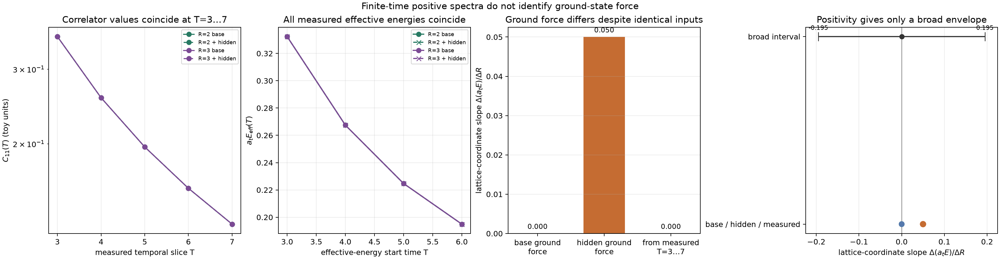

文字流程：

~~~text
5 positive transfer nodes -> 3x3 C_ij(R,T), R={2,3}, T=3..7
                                  | add tiny positive lower-energy triplet
V w_alt + epsilon v_hidden = V w_base; all adjusted old weights remain positive
                                  | exact finite-moment match (relative residual 7.75e-17)
same matrices / same measured effective energies -> ground force 0.000 vs 0.050
~~~

这构造说明有限时间的 3×3 正谱数据本身不唯一决定 `E_0(R)` 或 ground force；更一般地，只要有限矩向量位于正矩锥内部，就可加入足够小的正原子并微调旧正权重来保持所有已观测矩不变。令隐藏 transfer node 趋近 1、同时把振幅缩小，可在完全相同的有限采样值下继续降低未见态能量；因此有限时间 fit residual、Jacobian rank 或 q/h/x 参数协方差本身不给出生产所需的 overlap floor / gap receipt。

还计算了一个明确有条件、但很宽的 positivity-only 包络：若 production energy convention 另行保证每个谱能量 `a_t E_n>=0`，正谱给 `0<=a_t E_0(R)<=min_{T=3..6} a_t E_eff(R,T)`。本 toy 的每个半径上界均为 `0.194949`，故 `R=2→3` ground force 只能收窄到 `[-0.194949,+0.194949]`，宽度 `0.389898`；它包含 `0` 与 `0.05` 两个不可区分的 ground force。该非负能量约定需检查是否与 production 的静态能量减法/归一化一致；若不成立，此区间不能引用。这个 broad envelope 不证明达到 Wilson contract 的 1% model-truncation budget，正 reference force 仍缺，故不据此通过或失败物理门。

输出保存五个时间的两组 3×3 矩阵、逐 `(R,T)` CSV、冻结参数、源码快照、协议、图和 artifact hashes。定向测试 `tests/test_wilson_f_lane_finite_time_nonidentifiability.py` **4 passed**，覆盖矩阵完全匹配到浮点精度、所有矩阵 Hermitian positive definite、旧谱权重为正、effective-energy 观测重合但基态力不同，以及带 `E_0>=0` 前提的宽力区间。未做 Monte Carlo、未读 `C_ij`/GEVP/thermal/sealed bytes，未启动 GPU/QUDA；Wilson C/F 两 lane、`NOT_READY/UNCERTIFIED`、F=`GROUND_STATE_FORCE_UNCERTIFIED`、`physical_score=null` 不变。

**下一步方法工作：**不要再用不加限制的有限时谱拟合宣称 model-truncation bound。若继续纯 CPU 推进，先把独立 gap/overlap 限制作为显式条件变量，审计 [`ground_state_bound.py`](ground_state_bound.py) 与 `spectral_q_bound_reader.py` 的 q envelope 如何连接有限时间数据，再给出“给定 Q_max、Delta_min 后”的力区间并和 force budget 的 1% 门逐项对照；无这些外部限制时，模型截断项应保持缺失/ABSTAIN。C-lane finite-T Creutz 的 `R=2,T=5,spatial_stout_rho0.10_n5` 与 F-lane ground-state force 仍分开，真实 exporter、thermal/mixed h/x、正 reference-force、授权和独立 review 仍是物理门。

### 2026-11-28 条件 Q/gap 力区间与 F estimand 对齐

按上一节执行条件 Q/gap 屏查，新增 [`f_lane_gap_overlap_force_screen.py`](f_lane_gap_overlap_force_screen.py)、8 项聚焦测试与[图文报告](f_lane_gap_overlap_force_screen_20261128_v1/README.md)。正谱假设给出

```text
b_kR(T) = log1p(Qmax_kR * exp(-Delta_min_kR * T))
E0(R) in intersection_{k,T}[Eeff_kR(T)-b_kR(T), Eeff_kR(T)]
F_abs in [L_E0(3)-U_E0(2), U_E0(3)-L_E0(2)] / DeltaR
|delta F_eff(T=5)| <= sum_{kernel,R} b_kR(5)
```

本合成单激发态 fixture 取共享 `E0(R=2,3)=(-0.25,-0.05)`、四角 overlap ratio `0.08–0.20`、gap `0.25–0.45`；它没有用 `E0>=0` 假设。显示条件 `Qmax=0.25, Delta_min=0.20` 给出的绝对力区间是 `[0.128243,0.267936]`，包含真值 `0.20`。选定的 reference-force toy 下界为 `0.20`，所以 1% proxy-error 预算是 `0.002`。`T=5` finite-time effective-energy 的 stout-minus-identity 差为 `-0.008225`（真基态差为零），实际 toy 偏差已是预算的 `4.11×`；四角条件上界 `0.351933` 是预算的 `175.97×`。在 3,721 个 Q/gap 网格点中，495 点满足本 fixture 的 Q/gap 前提；这 495 点全部产生有效区间且覆盖解析 toy 力，但 **0/495** 达到 1% proxy-error 门。该网格是确定性敏感度图，不是 Monte Carlo coverage。

同时发现并明确区分 F 量：当前 `lane_contract.py` 将 lane F 定义为 `stout - identity` ground-state force，而不是单个 kernel 的绝对静态力。共同 transfer matrix 下，各 smearing operator 的 `E0(R)` 相同，真基态差恒为零；上一节有限时反例改变的是**绝对**力，两套谱中的 kernel 差都仍为零。因此该反例不证明已选 kernel-difference 的不可识别性，也不能直接充当 joint-fit model-truncation 误差。新增回归直接核对这一点。新屏查的四角式只界定 `T=5` effective-energy proxy 的激发态 bias，**不是**当前 joint multi-state fit estimator 的误差/覆盖界。

报告保存每个 kernel/R/T effective energy、3,721 行条件网格、固定 toy truth、图、原公式源码快照和哈希；4/4 kernel-radius 角点有效，失败/弃权 0/0；8/8 artifact 与 3/3 source SHA-256 匹配。聚焦测试 **8 passed**；PR #6 全仓 CPU suite **551 passed in 78.10 s**。后续可继续做 CPU 的 estimator-specific bridge：用 joint-fit 生产候选在新冻结的正谱/遗漏态 fixtures 上，逐样本对照拟合所得 stout-minus-identity force 与上面的 effective-energy proxy；只有在 source estimator、噪声/协方差与 failure denominator 对齐后才能评价其覆盖。不得将该 proxy 条件界直接移植到 joint fit，也不能把 toy 的 `Qmax/Delta_min` 当生产 receipt。Wilson 仍为 `NOT_READY/UNCERTIFIED`、F=`GROUND_STATE_FORCE_UNCERTIFIED`、`physical_score=null`，sealed 输入未读取。


### 2026-11-28 F lane 主量更正：绝对 stout 基态力，不再用 operator 差作主量

源码审阅发现当前 `f_lane_two_sector_fit_candidate.py` 对 identity、APE、stout 三个算符共用同一组 `static_energies_by_R`。因此在这个 joint-spectrum 模型里，

```text
F_stout = U0_stout(R=3) - U0_stout(R=2)
F_identity = U0_identity(R=3) - U0_identity(R=2) = F_stout
F_stout - F_identity = 0  # 由共享谱结构固定，不是数据检验结果
```

旧合同把 F primary 写成 `F_stout - F_identity`，会令拟合目标按模型设计恒为零；这不符合用户选择的“基态静态力”。此前 finite-time witness 改变绝对力、而 kernel 差仍为零，也不能支持旧差值的 model-truncation 结论。本节据此**替代上文当作当前规则的 kernel-difference 文字**；已生成的旧报告与 source snapshot 留作历史记录。

当前方法合同改为 midpoint `R=2.5` 的**绝对 stout 离散基态力** `U0_stout(3)-U0_stout(2)`。Identity 保留独立两项 stencil，角色是同一 action/static-source transfer spectrum 下的算符一致性诊断；不从主力中相减。拟合结果现在显式带 `force_estimand_diagnostic`，标出绝对 stout 力、由共享谱结构产生的 identity 对照、差恒零是结构性约束，以及不具备校准不确定度。它是方法输出字段，不是生产力值或独立交叉验证。

这项 operator-independence 判断以 identity/stout 只改变空间 trial operator、而不改变静态源传播 Hamiltonian 为前提。若生产 smearing 实际进入 temporal/static-source action，须由 exporter/action receipt 和独立 review 先证明 transfer matrix 相同；否则 identity 结果不能充当同谱一致性检查，需重新定义 comparison estimator。

主量的 q/h/x 力误差只传播 stout 的四个 `(R,T)` 角：`(2,5),(2,6),(3,5),(3,6)`；identity 的四角继续留在 q-envelope / 比较诊断，但不双倍计入主预算。若每角原始 component bound 都是 `c`，合同预算为 `4 log(1+c) <= epsilon*f_L`，故 `c <= expm1(epsilon*f_L/4)`。identity–stout 的旧 8 角 helper 仍保存为明确标注的比较上界，不再接入 absolute-force primary reader。force summary schema v3 现在要求 stout 点估计、正的 stout 区间端点、正 force-scale 下界和统计半宽；下界必须不超过 stout 区间下端，半宽必须等于估计值到两个端点的最大偏差。q/h/x 输入仍明确携带 stout、identity 两行各四角；reader 仅取 stout 行做主预算，并把 identity 行传播另存 comparison diagnostic。

新增[绝对力预算图文包](absolute_force_budget_20261128_v1/README.md)与[合同结构图文报告](lane_contract_diagnostic_20261128_v10/README.md)。前者有 50/50 个确定性公式敏感度点、0 failed/abstained；它不是 Monte Carlo coverage。`f_L=1` 时，若误把 q/h/x 的 1.5%/1.5%/1% 当作每角原始上限，四角主力相对 envelope 分别约为 5.96%、5.96%、3.98%；联合 `sum log(1+q+h+x)` 的 exact-log 上限为 15.69%，分量因子化上限为 15.89%；后者连同 model 1% 和统计 5% 后总上限约 21.89%，超过 10% 线性总预算。反解得到 q/h/x 的单角上限约 `0.003756 / 0.003756 / 0.002503`。这些只是公式说明，未代入生产测量。合同报告的所有结构 fixture/hash 检查通过，通用物理 RunState 仍为 `5/0/0/5` abstained，`physical_score=null`。

定向 tests **73 passed**；本轮全仓 CPU tests **557 passed in 83.44 s**。没有读取 Wilson `C_ij`、GEVP、sealed split，没有申请或运行 GPU/QUDA；因此这次只修正软件合同和 synthetic 代数诊断。C lane 的有限-$T$ Creutz 保持不变，F=`GROUND_STATE_FORCE_UNCERTIFIED`、两 lane `NOT_READY/UNCERTIFIED`、`physical_score=null`、sealed inputs closed。

**下一个可执行工作包：**(1) 在获准的 open calibration split 上，由生产 exporter 输出带 source/sink、time-origin、边界、smearing 与 `C_ij` 轴约定的 stout/identity `R=2,3; T=3…7; N_t=16,32` 矩阵，并提供可复核来源与 block 关联；(2) 独立校准 stout 绝对力 interval 与正 force-scale lower bound，保留每个 bootstrap draw 的失败和依赖来源，不能把 toy 的 30,000 draws 当覆盖证明；(3) 对 q 24 变体、匹配 `N_t=32` 的 h、mixed x、4 个 stout model-truncation cells 分别给经审阅的 upper bound 与哈希；(4) 在校准/盲化的独立样本上检验 identity 与 stout 力一致性、覆盖率和四角 force-unit 误差预算；(5) 另行取得独立 review、生产/GPU 资源和 confirmation 授权。缺任一项仍必须 abstain，不因 schema、fixture 或全套测试通过而升级物理状态。

### 2026-11-28 绝对 stout 力区间的 joint-fit estimator bridge：遗漏态屏查未通过

修正旧“stout-minus-identity 力”estimand 后，补上与当前主量一致的估计器级 CPU 检查。`f_lane_two_sector_fit_candidate.py` 现从 45 维 two-sector fit 参数中解析求得

```text
F_abs = E0(R=3) - E0(R=2),   Delta R = 1 spatial lattice step
dF/dp = -sigmoid(p_E0,R2) e_R2 + sigmoid(p_E0,R3) e_R3
Var(F_abs) ~= grad(F_abs)^T Cov(p) grad(F_abs)
```

并在 regularized full-covariance GLS 模式输出 inverse-whitened-Jacobian covariance 下的双侧 95% normal delta interval。解析梯度已用有限差分核验；定向回归 **17 passed**，当前全仓 CPU suite **559 passed in 81.39 s**。字段明确标为 asymptotic diagnostic、`finite_sample_coverage_calibrated=false`，不为 diagonal fit 凭空补 interval，也不产生 physical score。

新 seed screen 见[图文报告](f_lane_absolute_force_coverage_20261128_v1/README.md)及[逐 panel 区间图](f_lane_absolute_force_coverage_20261128_v1/absolute_force_intervals.png)。冻结设置为 24 个独立 RNG panel、每 panel 96 blocks、相对噪声 0.003、2-vacuum×3-static 正谱 truth 拟合 2×2 模型、seed `2026113600 + panel_index`；toy 绝对力真值为 lattice-unit `a_t ΔE0=0.15`，`ΔR=1`。24/24 fit 与 interval 均有效，失败/弃权 `0/0`；只有 **4/24** 个 delta interval 覆盖真值，observed containment `0.1667`，valid-panel Wilson 95% MC interval `[0.0668,0.3585]`，median interval width `5.61e-4`。所以该 delta interval 在这个固定 omitted-static-state 设计下明显低估真实误差；不能把它接入 force summary reader，也不能把这 24 panel 当一般覆盖率证明。相同面板的 q/h/x 72-term Bonferroni 全族覆盖为 `0/24`；cell 相关，不能按 1,728 cells 当独立样本。

图示含义：蓝点 interval 包含 exact toy truth，红点未包含；点的散布与极窄误差棒显示估计协方差不能吸收 omitted-state bias。报告保留拟合输入、panel hash、协议、逐 panel CSV、源码快照；artifact hashes **74/74**、source hashes **16/16** 验证通过。该 screen 是一套 DGP 的反例性诊断，既非生产数据也非完整校准，未访问 `C_ij`/GEVP/sealed split，未运行 GPU/QUDA。

本结果取代上文“将 joint-fit stout-minus-identity 力与 effective-energy proxy 比覆盖”的下一步建议：当前 primary 是绝对 stout 力，proxy 的差值界不适用。若继续纯 CPU 方法研究，应冻结新 procedure 和独立 seeds，把统计误差与 model-truncation 分开；优先用对 primary force 的 full refit block bootstrap，并对可接受 2/3-state 谱族做单独 profile/envelope，再在至少 near-degenerate、weak ground-overlap、omitted vacuum 和 dependent/unequal-variance strata 同时报告 family coverage、宽度、拟合秩/条件数、failure/abstain 分母。不要靠截断 Gaussian 参数尾部、复用已看 panel、或只增拟合态数来宣称校准。若该 CPU screen 也失败，则停止方法扫描，等待带来源与独立审阅的 open-calibration exporter receipt。

F lane 仍需生产 `C_ij`/source-sink/time-origin/边界/时序约定、匹配 `N_t=32` thermal/mixed q/h/x、绝对力与正 force-scale 独立区间、模型截断 envelope、误差预算、独立 review 与运行授权。C lane finite-`T` Creutz primary 不变。当前 Wilson 两 lane `NOT_READY/UNCERTIFIED`，F=`GROUND_STATE_FORCE_UNCERTIFIED`，`physical_score=null`，sealed data closed。

### 2026-11-28 绝对 stout 力 full-refit moving-block bootstrap：小样本屏查

继续检验上一节 delta undercoverage 后，新增[`full-refit MBB 屏查`](f_lane_absolute_force_bootstrap_20261128_v1/README.md)、[区间图](f_lane_absolute_force_bootstrap_20261128_v1/absolute_force_bootstrap.png)和[`f_lane_absolute_force_bootstrap_diagnostic.py`](f_lane_absolute_force_bootstrap_diagnostic.py)。每个 panel 使用 96 个有序 AR(1) block、`rho=0.5`、相对噪声 `0.003`、新 seed `2026113800 + panel_index`；主估计仍按 regularized full-covariance 2×2 GLS。每 panel 做 39 次长度 8 的 circular moving-block resample，每次完整重拟合 45 参数 GLS；任一 refit 失败就让整条 percentile interval 弃权，不删失败 draw。`B=39` 的 equal-tail 95% rank 是 `(1,39)`，所以该区间实际上是 bootstrap 极差，尾部极粗，明确只作方法筛查。

结果：外层 panel/完整拟合 **6/6** 有效；bootstrap refit **234/234** 有效，失败/弃权 `0/0`；6 个 MBB 区间均有效。相同 outer panels 的 delta 正态区间覆盖 **3/6**，MBB 极差区间覆盖 **6/6**。MBB median width 为 `0.002600`，delta 为 `0.000498`（约 **5.2 倍**）；当前证据只能说明这个小样本 DGP 下更宽的重拟合区间包含 toy 真值，不能称为校准成功。该生成 truth 仍为 2-vacuum×3-static，而被拟合模型固定为 2×2；full refit 不能消掉遗漏态模型偏差，也没有覆盖更近简并/弱 overlap/遗漏 vacuum/异方差多 strata。

测试与复现：bootstrap helper / hash-bound resample reader 测试 **4 passed**；报告保存六个 panel 的 raw matrices、234 条 bootstrap fit receipt、图、协议和源码快照；artifact hashes **28/28**、summary source hashes **9/9** 已核验。图中的 delta 区间大多很窄；MBB 极差区间明显较宽，六个都跨过 toy 真值。无真实 Wilson 输入、GEVP、sealed split、GPU 或 QUDA。

本项把 full-refit bootstrap 从方法建议推进为有分母、图和原始 resample 结果的执行屏查，但没有闭合 statistical coverage。下一个纯 CPU 方法项应对当前**绝对力**做 2-state/3-state profile 或受约束谱包络，分离 bootstrap sampling width 与 omitted-state truncation envelope；至少在 near-degenerate、weak-ground-overlap、omitted-vacuum 和 dependent/unequal-variance strata 上用新 seeds 检查。不得把“6/6”或 `B=39` 极差当 95% 覆盖证明，也不把 q/h/x 参数抽样近似重新接到 primary force reader。

生产 exporter/action convention、open calibration 授权、匹配 `N_t=32` thermal/mixed q/h/x、独立 force/reference 误差预算、模型截断 receipt 与 independent review 仍未提供；因此 F=`GROUND_STATE_FORCE_UNCERTIFIED`，Wilson 两 lane `NOT_READY/UNCERTIFIED`、`physical_score=null`、sealed data closed。

### 2026-11-28 matched-`N_t=32` 二/三静态态点包络屏查

为检查 MBB 的统计宽度能否与遗漏静态态偏差分开，新增 [`f_lane_absolute_force_state_count_envelope_screen.py`](f_lane_absolute_force_state_count_envelope_screen.py) 和[图文报告](f_lane_absolute_force_state_count_20261128_v1/README.md)。固定 12 个新 seed `2026114000+i`；每 panel 96 ordered blocks、stationary AR(1) `rho=0.5`、相对噪声 `0.003`。每个 panel 并排运行当前 full finite-`N_t` 2-vacuum×2-static primary fit，以及只用 matched `N_t=32,T=3…7`、逐半径独立的 2-state/3-state positive-spectrum GLS。state-count 点包络只取两个估计值的 min/max，拟合缺失时整 panel 弃权。

数据流：`fresh 2-vacuum×3-static toy matrices -> full finite-Nt 2×2 primary -> Nt=32 per-R 2/3-state fits -> absolute-force point span + residual plot -> preserve panel matrices, fit diagnostics and hashes`。图左同时画精确 toy truth、两个 state-count 点估计及其跨度、full finite-`N_t` primary；图右比较两个 `N_t=32` 模型的 reduced-chi-square 分布。

12/12 个 envelope panel 有效，四组逐半径模型拟合各 24/24 full-rank；点跨度含真值 5/12，median span width `0.0013620` lattice units。该 `5/12` 是对点估计跨度的描述，不是区间覆盖。3-state matched-`N_t=32` 拟合 median mean reduced chi-square 为 `4.13`，2-state 为 `152.99`，显示该 toy 中删掉第三态会严重恶化谱拟合；但两种拟合的力点仍围绕 `0.15`，这不构成 truncation bound。图文/数据包保存逐 panel 原始矩阵、主拟合与各 R/state-count residual/秩/条件数、协议、源码快照；artifact hashes **40/40**、source hashes **10/10** 匹配（lane contract 以单份共享文件保存）。新增 helper 的定向测试 **4 passed**；完整 PR #6 suite 在后续跨任务回归记录。

**方法裁决：**`Nt32 per-R` 2/3-state 点估计跨度不作为主力的 model envelope，也不接入 force summary reader。它没有 model 内统计不确定度，并且观测时间/真空态假设与主 `Nt=16,32`、2-vacuum joint estimator 不同；此外同一 omitted-state toy 仅 5/12 点跨度含真值。因此当前这个简化候选为 **NO-GO as a force uncertainty bound**。下一个纯 CPU 的实质工作是把第三静态态加入同一 finite-`Nt` two-vacuum primary forward model，先做单 panel noiseless identity、秩/可识别性与初始化负控，再决定是否开展新 seed screen；不再重复当前 `Nt32` 点跨度网格。生产 `C_ij`、thermal/mixed q/h/x、正 force-reference、独立 model-truncation/误差预算、授权与 review 仍缺，F=`GROUND_STATE_FORCE_UNCERTIFIED`、双 lane `NOT_READY/UNCERTIFIED`、`physical_score=null`、sealed data closed。

### 2026-11-28 estimator-matched有限-$N_t$ 2-vacuum×3-static pilot

为回应上一节“`N_t=32` 简化模型不能界定 full finite-`N_t` primary”的方法裁决，新加 [`f_lane_three_static_two_vacuum_candidate.py`](f_lane_three_static_two_vacuum_candidate.py)：在原 trace

```text
C_ij(R,T;Nt) = Z(Nt)^(-1) Σ_(m=0..1,n=0..2)
               exp[-eps_m (Nt-T)] exp[-V_n(R)T] A_(mn,i) A*_(mn,j)
F_abs = V0(R=3)-V0(R=2),  ΔR=1
```

中增加第三静态态，保持两真空态、`Nt={16,32}`、`T=3…7` 和同一绝对 stout 力 estimand。参数化用正 softplus 能量增量保持能级顺序，拟合全协方差 3×3 Hermitian 组件，3 组多起点全留存。另有单 panel [图文 pilot](f_lane_three_static_fit_pilot_20261128_v1/README.md)：96 blocks、seed `2026114101`、stationary AR(1) `rho=0.5`、相对噪声 `0.003`。

图左的六个 2×3 static energies 与注入 truth 近重合；图右 current 2×2 primary point 为 `0.146195`，新 2-vacuum×3-static full finite-`Nt` point 为 `0.150716`，exact toy force `0.150000`。candidate local Jacobian **67/67 full-rank**、condition number `6.48e4`、reduced GLS objective `6.125`，3/3 起点均 full-rank，但最终 objective 横跨 `692.081…729.520`，说明至少有一支收敛到较差 basin。新模型的 force error 是 `7.16e-4` lattice units。无噪声 forward identity 的最大 component 差 `1.11e-16`；4 个聚焦测试覆盖公式 identity、参数维度/finite、能级顺序负控和主力梯度坐标。报告保留原始 NPZ、manifest、三组起点 receipt、fit 参数、图、源码与 hash；artifact **21/21**、source **11/11** 匹配。

该 pilot 只表明同一 finite-`Nt` 公式下 3 静态态 fit 可运行并在一个 toy panel 局部满秩，不证明全局可识别、multi-start basin 搜索充分、有限样本覆盖或物理 model-truncation bound。inverse-Jacobian SE 未校准，candidate 没有接入 force summary reader。下一步在扩充种子前先做受控的初始化/近简并/弱 ground-overlap profile 负控，量化 rank、condition、truth bias 和每个 basin 的目标差；只有这些通过预设 screen 才跑多 strata sampling/calibration。Wilson 生产 exporter/action convention、thermal/mixed q/h/x、正 force reference、独立 truncation bound 与授权/review 仍未有；C/F=`NOT_READY/UNCERTIFIED`，F=`GROUND_STATE_FORCE_UNCERTIFIED`、`physical_score=null`、sealed data closed。

### 2026-11-28 三静态态有限-$N_t$ 候选：近简并/弱 overlap/模型错设初始化屏查

在单 panel estimator-matched pilot 后，按其下一步只做五个 deterministic synthetic negative-control profiles，不估 coverage：baseline、`E1-E0=0.035` near-degenerate、全部 ground-transition overlap 缩至 `0.05`、单真空态 truth/双真空态 fit、以及 `rho=0.75` + 时间异方差。每格 96 blocks、relative noise `0.003`、seed `2026114200+i`，均按 67 参数 full finite-`N_t` 2-vacuum×3-static candidate，保留三个初始化、raw matrix、fit receipt 与失败分母。

五格均得到 67/67 local Jacobian rank，planned/valid/failed/abstained=`5/5/0/0`，但局部满秩不保证 estimand 稳健。near-degenerate condition number 为 `1.185e6`，是五格最大；遗漏真空格为 `9.672e5`。关键负控是 weak-ground-overlap：它仍 67/67 满秩，force point 却为 `0.157576`，对 toy truth `0.150000` 的绝对偏移 `0.007576`（约真力 5.1%）。baseline error `0.000766`、near-degenerate `0.000480`、omitted-vacuum `0.000553`、dependent/unequal-variance `0.000151`；这些只是每格**单个** panel 的点误差，绝非 coverage、偏差上界或族群率。三起点在每格都收敛，但 objective/landscape receipt 仍随 stratum 变；weak-overlap 例子已经否定“full-rank 就可按小 delta SE 认证”。图左显示各格点与 exact force，灰竖线连接点误差；右图用 log 轴显示 Jacobian conditioning。数据包有五份 raw NPZ、manifest、逐格 fit/start JSON、图、协议与恢复记录；artifact **34/34**、source **12/12** 匹配。聚焦测试 **3 passed**；全仓 CPU suite **574 passed in 78.07 s**。

报告 README 首次渲染曾因字典 literal 大括号未 escape 而中止；五格 fit、CSV、raw matrices、fit receipts 和图当时均已写完。本次按 `--finalize-existing` 从原有 receipts 修复 README 与 hash，更新 report-only source snapshot，**没有重跑、删除或替换任何 panel**；报告明确记录了这一恢复。方法上该 screen 让 3-state candidate 进入 **NO-GO as a force bound**：弱 overlap 反例已超过 1% model-truncation budget 一个数量级左右，即使 local rank 满。之后若继续只做一个明确的研究目的——对弱 overlap 下 ground-state energy/force 的识别性做 constrained profile / overlap floor 扫描，并把“缺独立 overlap 下界”时的输出设计为 abstain；不要用新 seed 频率把单个反例变成 coverage 结论。真实 overlap/gap receipt、production `C_ij`/source-action convention、thermal/mixed q/h/x、positive force reference、预算、授权及 independent review 仍缺；Wilson 两 lane=`NOT_READY/UNCERTIFIED`，F=`GROUND_STATE_FORCE_UNCERTIFIED`，`physical_score=null`，sealed data closed。

### 2026-11-28 弱 ground-overlap 下界条件 profile：局部近似弃权屏查

按上一节提出的 `A_ground` floor 方向，在不引入新样本的前提下复用弱-overlap stratum 的同一 raw panel（原始矩阵 SHA-256 `ba7ec51a…582921`）与已保存 67 参数 fit。这里的 toy overlap 定义为 `min_R |A[m=0,n=0,operator=0]|`，处于 endpoint toy normalization；`0.045` 与 `0.075` 只是敏感度情景，不是物理先验或独立测量下界。先计算 whitened residual 的中心差分 Jacobian，再在 `F_abs=E0(R=3)-E0(R=2)` 网格上解有 overlap 不等式约束的 local Gauss-Newton KKT profile；检查条件包括非线性 objective mismatch ≤10%、精确 force 偏差 ≤`0.0025` lattice units、最大参数位移 ≤`0.25`。

18 个规划 profile 点中仅 **2/18** 通过局部性检查：无 floor 与 `A_ground>=0.045` 各自都只有原 fit center `F=0.1575756` 通过（各 1/6）；`0.075` 情景为 **0/6**。其余 **16** 点因为线性化误差或参数位移过大被显式记为 `ABSTAIN_LOCAL_LINEARIZATION_BREAKDOWN`；故三个 floor 情景全部因 profile grid 不完整而不给局部区间。最近的非中心点 `F=0.16` 已有约 `0.548` objective mismatch fraction；`0.075` 情景最大参数位移约 `9.87`，明显超出局部展开的信任范围。即使单个中心点有效，也不能构成区间。缺独立 open-calibration overlap-floor receipt 时 gate 输出 `ABSTAIN_NO_INDEPENDENT_OVERLAP_FLOOR`。

[图文报告与 profile 曲线](f_lane_three_static_overlap_profile_20261128_v1/README.md)：左图分别显示无 floor / `0.045` 的局部 objective 曲线，右图用独立纵轴显示 `0.075`；叉号表示未通过局部 fidelity 检查。报告保存原输入 panel、来源 manifest/fit receipt、18 行逐点 profile、协方差诊断、协议、代码快照；artifact hashes **18/18**、source snapshots **7/7** 匹配。新增 fail-closed/local-KKT focused tests **2 passed**；全仓 CPU suite **576 passed in 78.85 s**。

**裁决与后续：**该低成本线性化方法是 **NO-GO as a force interval**；不能把 nominal `Δobjective=3.84` 当 95% 区间，也不能使用 hypothetical floor 认证物理力。下一条 CPU 路线若继续，应先为有限-$N_t$ 2-vacuum×3-static 模型实现并有限差分核验解析 residual Jacobian，再以非线性 full nuisance refit 做小型 conditional force-profile；每个网格仍须保留收敛失败和局部/全局解诊断。如果全 refit 对弱 overlap 仍无法稳定或 profile 只在假设 floor 下闭合，停止方法扫描并等待独立 production overlap receipt。任何情形下缺 production `C_ij`/action convention、独立 overlap/gap/thermal/mixed bounds、正力 reference、review 与 open-calibration 授权均继续 abstain；双 lane `NOT_READY/UNCERTIFIED`、F=`GROUND_STATE_FORCE_UNCERTIFIED`、`physical_score=null`、sealed data closed。

### 2026-11-28 exact finite-$N_t$ 非线性 overlap-floor profile pilot

为落实上节后续，在新文件 `f_lane_three_static_nonlinear_overlap_profile.py` 中实现 2-vacuum×3-static 67 参数 forward model 的解析 whitened residual Jacobian，并在每个目标 `F_abs=E0(R=3)-E0(R=2)` 下消去 `R=3` ground-energy logit，精确固定力；nuisance spectrum / overlap 用有界非线性 GLS full refit。每个 force/floor cell 保留 captured-fit start 与降低 excited-vacuum overlap 的第二 start。analytic Jacobian 对全部 67 个 raw model 参数的 central finite-difference 最大绝对与缩放差均为 `8.82e-12`；精确 force elimination 的链式导数也有单测核验。

仍只复用前述同一弱-overlap synthetic panel，故是条件方法 pilot 而不是独立覆盖率实验。18/18 cell 均有效、36/36 starts 均有效，所有 profile Jacobian 66/66 满秩；condition number 中位数 `9.70e4`、最大 `5.83e5`，每 cell 两个起点的最佳目标差最大 `0.00359`。在无 floor 与 toy floor `0.045` 下，名义 `Δobjective<=3.84` 的粗网格集均为 `[0.157576,0.160]`，没有包含本 toy 的 exact truth `0.150000`；在 `0.075` 假设下最佳点落在 `0.18` 网格端点，必须标记 clipped。该单面板结果不能声称 undercoverage rate，也不能把 floor 当外部证据；absence-of-independent-floor gate 仍为 `ABSTAIN_NO_INDEPENDENT_OVERLAP_FLOOR`。

[非线性 profile 图文包](f_lane_three_static_nonlinear_overlap_profile_20261128_v1/README.md)保存逐 cell 两起点拟合坐标、objective/rank/condition/nfev、输入 panel、来源 receipts、Jacobian check、图及代码快照；artifact hashes **19/19**、source snapshots **7/7** 匹配。新增解析 Jacobian 与 force-elimination 测试 **2 passed**；全仓 CPU suite **578 passed in 76.96 s**。

**当前结论：**精确非线性 profile 在同模型同 panel 上比 Gauss-Newton 局部 approximation 稳定，但单 panel 粗网格的 nominal set 仍排除 truth，`0.075` floor 下还受边界裁切影响；因此仍 **NO-GO as a calibrated force interval**。下一个 CPU 工作可固定生成过程与 profile 阈值，用新 seed 做小规模 weak-overlap panel calibration（逐 panel 保存 truth containment、有效/失败/弃权分母、每个 profile 的两起点与边界裁切），并另做 analytic Jacobian 的随机参数负控；先看是否能复现单 panel 的 truth-exclusion。即便 toy coverage 较好，也不能关闭 production overlap-floor、finite-sample calibration、reference、independent review 或资源授权门。

### 2026-11-28 weak-overlap exact nonlinear profile：六 panel 条件覆盖屏查

按上一节计划固定模型和规则，以 6 个新 RNG seed `2026114300…4305` 生成同一 weak-ground-overlap DGP（96 ordered blocks、AR(1) `rho=0.5`、relative noise `0.003`、exact force `0.15`），逐 panel 执行 2-vacuum×3-static fit，再对无 overlap floor 与 toy oracle floor `0.045` 各做 exact-force nonlinear nuisance profile。每 panel 的 grid 为固定 `{0.14,0.15,0.16,0.17,0.18}` 加该 panel 的 fitted center；nominal profile set 取 `Δobjective<=3.84` 的 accepted grid hull，边界裁切单独标记。`0.045` 恰是这组生成 truth 的 `min_R |A[m=0,n=0,operator=0]|`，仅作已知 toy truth 的 oracle 条件，不是生产可用独立界。

结果：candidate fit **6/6** 有效；profile cells **72/72**、两起点 **144/144** 有效/满秩，失败/弃权 `0/0`；局部 condition number 中位数 `3.24e4`、最大 `1.09e5`，两起点 objective 差的中位数 `3.49e-7`、最大 `3.92e-5`。candidate point force 跨 `0.141366…0.151985`，体现同一弱 overlap DGP 的有限样本波动。

以**未裁切完整 profile set**为覆盖分母：无 floor 观察到 **2/5** containment，另 1/6 panel 的 set 在 grid 边界裁切；Wilson 95% binomial interval `[0.118,0.769]`。oracle floor `0.045` 为 **3/6**，Wilson 95% interval `[0.188,0.812]`，无边界裁切。故 6 个 toy replicates 中任一做法都没有接近名义 95% containment；但 MC interval 很宽，不能由此估计通用 coverage，也不能据此诊断真实生产 coverage。图里蓝色横线包含 `0.15`，红色不含，向右三角表示 grid clip；逐 panel objective/profile/fit receipts 可重算这些分母。

[六 panel profile 图文报告](f_lane_three_static_overlap_profile_calibration_20261128_v1/README.md)留有逐 panel raw matrices、manifest、point fits、每个网格的两份起点参数、interval 规则、图及源码快照；artifact hashes **45/45**、source snapshots **7/7** 匹配。校准分母与 binomial 区间 helper tests **4 passed**；全仓 CPU suite 结果见同日跨任务回归记录。

**裁决：**exact-force nonlinear profile 方法可执行，但 `Δobjective<=3.84` 在这个小型弱-overlap synthetic DGP 屏查中表现为远低于名义值的 containment，不能作 95% 力区间；oracle floor 也没有救回该结果。下一步先做随机参数点 analytic Jacobian 负控、增加 panel 数并至少加入 near-degenerate / omitted-vacuum / dependent-heteroscedastic strata，以得到可用的 simulation coverage / abstain map；正式使用前仍需独立 production overlap-floor receipt、open-calibration 数据、force reference 与审阅。缺这些 receipt 仍输出 `ABSTAIN_NO_INDEPENDENT_OVERLAP_FLOOR`，Wilson 双 lane=`NOT_READY/UNCERTIFIED`、F=`GROUND_STATE_FORCE_UNCERTIFIED`、`physical_score=null`、sealed inputs closed。

### 2026-11-28 exact nonlinear force profile：多 strata 小样本 abstention map

按上一节计划，用 6 个 hash-verified weak-overlap panel 作为既有参照，并新增 baseline、near-degenerate、omitted-vacuum truth、dependent/unequal-variance 四组，各 3 个确定性 seed（`2026114400 + 100*stratum_index + replicate`）。每 panel 使用 generator 给出的 oracle ground-overlap floor 和无 floor 两种条件；各 profile cell 保留精确 force elimination、两个 starts、固定力网格加 point estimate、nominal `Δobjective<=3.84` 集与完整失败收据。三个 panel/stratum 只够定位数值脆弱区，不能估计通用 coverage。

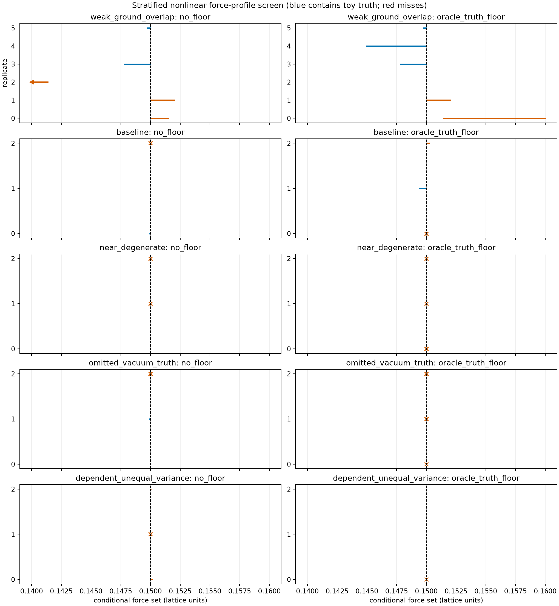

总面板 **18/18** point fit 有效，其中 weak-overlap 6 个来自前一份 hash-verified 报告、其余 12 个是新面板。profile cells **195/216** 有效、失败/弃权 **21**；start fits **380/432** 有效、失败/弃权 **52**。无 floor / oracle floor 的未裁切区间与 toy truth 命中数分别为：weak-overlap **2/5**、**3/6**；baseline **1/2**、**1/2**；near-degenerate **0/1**、**无完整区间（0/3 panels）**；omitted-vacuum **1/2**、**无完整区间（0/3）**；dependent/unequal-variance **0/2**、**0/2**。其中 `n` 是未裁切且完整的 panel 区间数，不是计划面板数；例如 near-degenerate no-floor 的两个 panel profile 不完整，只剩 1 个可计数区间。相应 Wilson 95% binomial intervals 在 summary 中逐格提供；可计数分母最大仅 6，且这些是受控 toy panel，不能解释成 production coverage。

关键诊断不是把“no interval”记为 miss：near-degenerate 的 oracle-floor profiles **0/3** 完整，omitted-vacuum 的 oracle-floor profiles亦 **0/3** 完整；两者在该设定下触发 optimizer/identifiability abstention。全体无效起点中，`max_nfev=1600` 被耗尽占 **49/52**，另 **3/52** 虽以 `ftol` 终止但未过 rank/约束有效性检查。baseline no-floor 有 **1/3** 面板 profile 不完整；dependent/unequal-variance 两种 floor 各有 **1/3** 不完整。profile grid 未作连续插值，`3.84` threshold 和 grid 均未经 coverage 校准。

[完整图文报告与逐格数据](f_lane_three_static_stratified_profile_20261128_v1/README.md)保留了每 panel 的 raw matrix、manifest、point-fit / profile receipts、protocol、summary、图和源码快照；artifact hashes **75/75**、source hashes **8/8** 已逐项复核。新 Jacobian randomized perturbation regression 与 stratified helper tests 共 **8 passed**；全仓 CPU suite 结果将在下方跨任务回归记录中更新。整个屏幕只用公开的 synthetic toy generator 与先前 open 式合成报告；生产 Wilson、sealed inputs、GPU/QUDA 均未读取或执行。

**方法结论与下一步：**固定 `Δobjective=3.84` 的 profile 在 weak-overlap 小屏中已显示低命中；本次进一步表明 oracle floor 并不能自动使困难 strata 可评估，且 near-degenerate / omitted-vacuum 的高 floor 条件会使 profile 大量弃权。不得把被弃权 panel 从计划面板中静默删去后再称覆盖率；至少同时报告 nominal interval containment、完整率、裁切率和优化失败率。下一条纯 CPU 工作应先做 profile solver 改进实验：检查失败起点的 basin/objective、参数缩放与 Jacobian 条件数；试验在每个 force target 之间 warm-start/continuation，并对 floor-active 约束加可行初值，完整保存旧算法为对照。预先比较完整率、有效率、truth containment、区间宽度和每个 cell 的 `nfev`；不能只优化 coverage、不能把 warm-start path 当独立 starts。若同预算下困难 strata 仍不能给完整 profile，应把报告范围定为**条件估计器的弃权图**并停止 seed 扩增，转向可识别性/estimand 重定义。无论 solver 改善如何，独立 production overlap-floor receipt、校准的 profile threshold、正力 reference、物理 source/operator convention、independent review 与 open-calibration 授权仍未齐；物理门继续 `ABSTAIN_NO_INDEPENDENT_OVERLAP_FLOOR`，C/F=`NOT_READY/UNCERTIFIED`、F=`GROUND_STATE_FORCE_UNCERTIFIED`、`physical_score=null`、sealed data closed。

### 2026-11-28 失败 profile cell 的邻点 continuation 起点重试

为检验上节所列 solver 改进，仅重跑 stratified report 中 near-degenerate 与 omitted-vacuum 两组、toy oracle floor `0.9` 下 **13 个 cold-invalid cells**；不新增 seeds 或重跑原来有效格点。每次保留 point-fit start，并把同 panel / 同 floor 中最近力点的 cold-valid 参数作为第二个 `neighbor_force_continuation` start；相邻参数在新 target force 下重新施加精确力约束。并列距离按较低 target force、再按 objective 确定。每 start 仍限 `max_nfev=1600`。

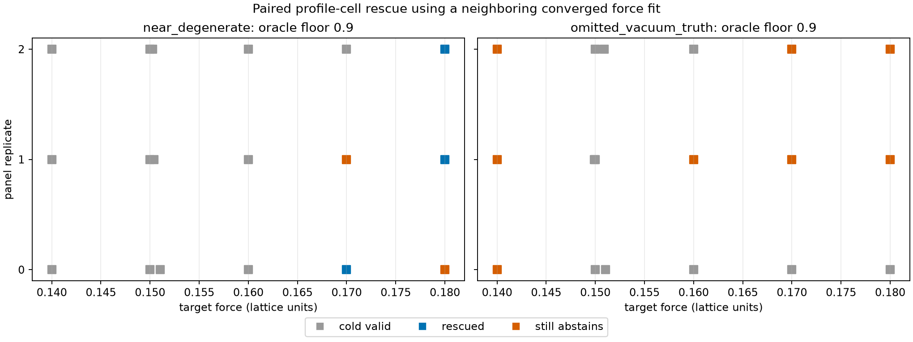

继续起点救回 **3/13** 个 cell，全部来自 near-degenerate；总 continuation starts **3/26** 有效，失败/弃权 **23/26**。near-degenerate oracle-floor profile 完整率由 cold **0/3** 增至 **1/3**，唯一完整 interval 仍 **不包含** toy truth（0/1，Wilson 95% `[0,0.793]`）；omitted-vacuum 保持 **0/3** 完整、没有可计 containment 分母。三个救回 cell 的总 `nfev` 为 **2054、1930、1817**；各自已有 point-fit 起点与 continuation 起点，不能把它们解释成独立样本或独立 multistarts。该小型重试说明邻点 warm start 可减少少数近简并格点的弃权，但没有修复遗漏真空组，也没有给出包含真值的完整 interval；不支持增加预算或继续 seed 扩样。

只读归因保存的 attempt receipts：原 cold-invalid cells 中 **26/26** 个失败 starts 都耗尽 `max_nfev=1600`，且都保留 Jacobian rank **66/66**；其 condition number median / max 为 `6.43e6 / 1.10e10`。邻点重试失败的 **23/23** starts 同样达到评估上限且 rank **66/66**，condition median / max 为 `1.76e6 / 1.10e10`。两组的 ground-overlap floor slack 最小值均为 0，说明至少有拟合贴在 toy floor 上。**观测**指向优化收敛/病态困难，而不是这些终点的局部 rank loss；它不证明全局可识别性，也不证明这些 profile cells 不可行。失败分解和数值表已写入报告 README / protocol，没增加重拟合。

[重试报告、配对表和逐 cell receipts](f_lane_three_static_profile_continuation_20261128_v1/README.md)：输入 panel 文件均由上一 stratified report 的 artifact hashes 核验并捕获 immutable bytes；本次报告 artifact hashes **15/15**、source snapshots **9/9** 已复核（执行后导入闭包审计补入了三个未改变的运行依赖源码，并在 protocol 中记录）。定向 continuation/profile tests **12 passed in 1.14 s**；PR #6 全仓 CPU suite **588 passed in 78.37 s**。未使用 production Wilson、sealed inputs、GPU 或 QUDA。

**下一步：**不再对相同 cell 增加起点或提高 `nfev`。先按失败格点输出残差、active overlap bound、Jacobian singular vectors/condition、两起点 objective 与收敛状态，区分不可行/近简并/仅优化慢；只在 source 参数尺度和 floor 参数化有可检验改进后做一次固定 panel 的 paired solver comparison。若同预算的 profile completion 仍不足，就把该 estimator 限定为 abstain-map 诊断并转向重新定义可识别 estimand。生产 overlap-floor、物理 source/operator 约定、force reference、独立 coverage/contamination review 和 open-calibration 授权仍未齐；物理 gate 继续 abstain，Wilson 两 lane=`NOT_READY/UNCERTIFIED`、F=`GROUND_STATE_FORCE_UNCERTIFIED`、`physical_score=null`、sealed data closed。

### 2026-11-28 保存终点 stationarity 与 TRF/dogbox 配对屏查

先对 continuation report 中失败的保存终点做只读复算，再在相同六份 synthetic panel 和固定力网格上比较另一种有界求解器。复算前，stratified profile 与 continuation 两份输入报告分别完整通过 artifact hash **75/75**、**15/15**；每个终点重建的 whitened objective 与 Jacobian condition 均与原 receipt 数值吻合。分析没有重新调用 optimizer。

只读 gradient 使用 `J.T @ residual`，对距有限 bounds 相对容差 `1e-7` 内且梯度指向可行域外的分量作投影，再除以 whitened Jacobian 的列范数。该量近似 `x_scale='jac'` 下的 box-constrained scaled first-order optimality，不是原 SciPy receipt 中保存的 `optimality` 字段。cold failures **26/26** 与 neighbor retry failures **23/23** 都在 `nfev=1600` 停止且局部 rank 为 **66/66**；投影梯度中位数 / P90 / max 分别为 **0.339 / 4.91 / 10.3** 和 **0.115 / 1.64 / 10.3**，全部显著高于配置 `gtol=1e-9` 的量级。故这些端点仍有可见下降方向，支持“预算耗尽/病态收敛”的解释；不能推成 profile 不可行或全局不可识别。列单位归一化 Jacobian 的最弱局部方向，平均平方载荷在 R2 amplitudes 上为 cold **0.482**、neighbor **0.573**；这是端点局部、参数化相关的提示，不是全局 identifiability 结论。

随后固定数据、协方差、目标、解析 Jacobian、bounds、起点与 `max_nfev=1600`，仅将 `trf` 换成 `dogbox`。总计重跑 **39 个去重 start/force jobs**，与冷启动和邻点分支形成 **52 行配对比较**。两分支各有 dogbox **13/26** starts 通过原 valid 条件；其余 **13/26** 均达到评估上限。cold starts 的 TRF→dogbox valid starts 为 **0/26→13/26**，neighbor starts 为 **3/26→13/26**。按 force cell 看，dogbox 在 cold 分支 **7/13**、neighbor 分支 **7/13** 恢复，分别高于 TRF 的 **0/13** 和 **3/13**；dogbox 的 nfev median/max 两分支均为 **1423/1600**。

但决策相关结果没有改善：两种 dogbox 起点分支都只有 near-degenerate **1/3** profile 完整，omitted-vacuum 仍 **0/3**；唯一完整、未裁切区间仍未包含该 panel toy truth（**0/1**）。相较 neighbor-TRF，dogbox 额外救回的局部 cells 没有闭合任何新 panel。因此**本屏只支持“dogbox 可减少单 cell 数值弃权”，不支持把 profile 变成可用力区间**。停止在这六个复用 panel 上继续堆 solver、起点或 `nfev` 变体，不再用这些 seed 选择/调参后宣称覆盖。

图文与审计文件：[保存终点 stationarity 报告](f_lane_three_static_profile_stationarity_20261128_v1/README.md)和[TRF/dogbox 配对报告](f_lane_three_static_profile_dogbox_20261128_v1/README.md)。前者 source snapshots **8/8**、artifact hashes **13/13**；后者 source snapshots **8/8**、artifact hashes **13/13**；完整输入 manifest 均复核通过。改动后全仓 CPU suite **588 passed in 80.02 s**；两个新增诊断模块 `py_compile` 成功，`git diff --check` 通过。全部结果仍限 synthetic CPU，没读生产 `C_ij`、GEVP、sealed split，也没运行 GPU/QUDA。

**本支线的下一步停止规则：**不再对当前 `Δobjective<=3.84` profile 作同样 seed 的局部数值调参。若重开 profile 研究，先提出改变模型/参数化或 estimand 的可证伪方案，并在看新 panel 前冻结目标指标、solvers、起点和接受门槛；报告所有 fit/cell/panel 的有效、失败、弃权与裁切分母，不把拟合可完成等同覆盖校准。若没有生产独立 overlap-floor receipt 与 open calibration 样本，仍 abstain。真实 Wilson C/F 的 source/operator/time conventions、matched `N_t=32` thermal/mixed 污染界、正 force reference、模型截断/误差预算、独立审阅和授权都未由本次 synthetic 对照补上；C finite-T Creutz 与 F ground-state force 继续分轨，双 lane `NOT_READY/UNCERTIFIED`、F=`GROUND_STATE_FORCE_UNCERTIFIED`、`physical_score=null`、sealed data closed。

### 2026-11-28 最大分量相位图的正谱参数化检查

当前 [`f_lane_three_static_two_vacuum_candidate.py`](f_lane_three_static_two_vacuum_candidate.py) 对每个 `(R,m,n)` overlap vector 都把 operator 0 固定为正实相位锚。这个 chart 对一般非零向量完全够用，但 `two_state._pack_amplitude` 会拒绝 `Z_0=0` 的向量，即使 `Z_1` 或 `Z_2` 非零、完整 `3×3` 正谱外积矩阵仍能包含该态。新增独立原型 [`f_lane_three_static_pivot_chart.py`](f_lane_three_static_pivot_chart.py)：逐 transition 选 `argmax_i |Z_i|` 为 pivot，消去共同相位后将正的最大分量存为 log-amplitude，其余两个复分量直接存储；参数数目仍为 67，有限-$N_t$ trace 与当前 candidate 的物理模型不变。全零向量没有可识别相位锚，明确拒绝。

文字流程：`positive finite-Nt spectrum -> per-(R,m,n) largest-|Z_i| pivot -> phase rotation -> 67-coordinate encoding -> unchanged 2-vacuum × 3-static forward trace/Jacobian -> exact reconstruction and finite-difference checks -> diagnostic only`。

确定性 67 参数夹具实际用到三个 pivot，计数 `10/1/1`；重编码前后的模型向量最大差为 `1.11e-16`。解析 Jacobian 与中心差分的最大绝对 / 单位缩放差为 `5.03e-11`。单独的 `Z=(0,0.70+0.10i,-0.20+0.10i)` fixture 由新 chart 精确表达，而现有 operator-0 packer 按预期拒绝；全零向量也按预期拒绝。新增 [`test_wilson_f_lane_three_static_pivot_chart.py`](../../tests/test_wilson_f_lane_three_static_pivot_chart.py) **5 passed**；与 Optimize cost-ledger 数值边界的两组定向测试合计 **11 passed**。README 用文字流程记录结果；`artifact_hashes.json` 的 **2/2** 与 `source_hashes.json` 的 **4/4** 均按 SHA-256 复核匹配。

这关闭的是参数表示对“第 0 算符分量恰为零”的软件盲点，不代表 profile optimizer 的完成率、覆盖率或物理污染界有所改善。后续的 hash-verified point-fit screen 已于本文件末节完成；其冻结推进门限判定不进入 paired profile。没有独立 overlap-floor、正力 reference、source/operator/time convention、thermal/mixed/truncation receipts 和 reviewer 前，两条 Wilson lane 仍 `NOT_READY/UNCERTIFIED`、F=`GROUND_STATE_FORCE_UNCERTIFIED`、`physical_score=null`、sealed data closed。

### 2026-11-28 全仓 CPU 回归：pivot chart 与成本边界修正后

该历史快照的 PR #6 checkout 全仓 `python -m pytest -q tests` 为 **599 passed in 83.58 s**。当时纳入 Wilson pivot-chart 5 项与 Optimize cost-ledger overflow 2 项测试；同一测试文件集中的 4 项 cost-ledger 基础测试也首次进入那次全仓复跑。Wilson pivot chart 的 model/Jacobian 摘要、4/4 source hashes、2/2 artifact hashes 另见 [`f_lane_three_static_pivot_chart_20261128_v1/README.md`](f_lane_three_static_pivot_chart_20261128_v1/README.md)。该次 `py_compile` 与 `git diff --check` 通过；更新后的当前 suite 为 600，见下一节。

文字流程：`Wilson exact chart round-trip + zero-anchor support + Jacobian regression / Optimize finite-cost overflow negatives -> full CPU suite -> 599 passed -> source and artifact digests checked`。这只验证 CPU 软件路径与上述确定性夹具；没有读取 production/sealed measurements、没有运行 GPU/QUDA，也没有形成 Wilson force coverage、Optimize paired risk/cost、Pion anchor bridge 或 physical score。C finite-T Creutz、F ground-state force、Optimize 与 Pion 均维持既定 `NOT_READY/UNCERTIFIED` / `physical_score=null` 边界。

### 2026-11-28 最大分量 chart 的配对点拟合 screen：profile 门限未通过

先按 v1 固定协议尝试 12 panels × 3 starts × 2 charts，共 72 个有限差分拟合。进程运行约 23 分钟仍在第一个 fit，尚无任何完整结果；停止原因是计算代价，与拟合优劣无关，见 [`v1 execution status`](f_lane_pivot_chart_fit_comparison_20261128_v1/execution_status.json)。0 项拟合完成、无失败/弃权结果，部分进度未当作证据。为保持比较的物理统计条件，v2 只把两 chart 的数值差分 Jacobian 改为已有解析 Jacobian；panel、starts、objective、TRF、`x_scale='jac'`、`max_nfev=8000`、容差、rank-67 validity 和推进门限都保持一致。fixed operator-0 chart 等价于 largest-pivot map 所有 pivot index 为 0；解析 Jacobian 与中心差分以及同一 model 的数值等价关系已有回归验证。

v2 的[图文报告](f_lane_pivot_chart_fit_comparison_20261128_v2/README.md)记录完整 planned denominator、每个起点的 solver calls、时间、rank、condition number、objective、force 与失败原因。结果为：panel initializer `12/12/0/0`，source capture `36/36/0/0`，fixed operator-0 `36/36/0/0`，largest-component pivot `36/32/4/0`（均为 planned/valid/failed/abstained）。分层 fixed / pivot 有效率分别是 baseline `9/9` 对 `9/9`、near-degenerate `9/9` 对 `9/9`、omitted-vacuum truth `9/9` 对 `6/9`、dependent/unequal-variance `9/9` 对 `8/9`。pivot 没有救回 fixed chart 的失效起点。32 个双方有效起点上的中位 `nfev+njev` 节省比例为 baseline `-456.0%`、near-degenerate `+32.5%`、omitted-vacuum `-136.7%`、dependent/unequal-variance `+21.5%`；负值代表 pivot 更慢。虽两个 strata 达到了 20% 节省条件，但 pivot 在另两个 strata 丢失有效起点，故预设的 profile gate 为 **不推进**。pivot 四个失败都达到 `nfev=8000` 上限、局部 Jacobian rank 仍为 `67/67`，condition number 约 `1.95e8–6.37e8`。这支持“当前坐标下迭代/条件数困难”的解释，不证明相位表示能力缺失。各 panel 两 chart 的 best-force 差异最大绝对值 `1.76e-5` lattice units，但仅是复用 synthetic data 上的点估计。

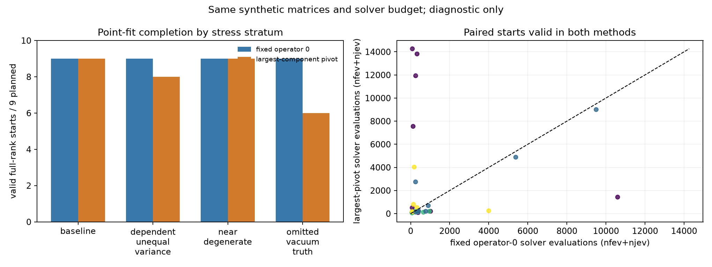

文字流程：`12 个 open synthetic panels -> same covariance / initializer / 3 starts -> 两个 phase charts 与共同解析 Jacobian -> 每起点保留 status/calls/rank/condition/force -> 检查分层有效数与中位 evaluation savings -> 预设门限失败，停止 profile 比较`。v2 的 artifacts **9/9** 与 source snapshots **7/7** 匹配。新增解析 Jacobian 等价回归后，PR #6 全仓 CPU suite **600 passed in 89.08 s**，定向 chart tests **6 passed in 1.08 s**，`py_compile` 与 `git diff --check` 通过。此前 599 的结果作为历史快照保留；最新为 600。

该 screen 是 point-fit feasibility 诊断，不估计 profile coverage、q/h/x 污染或物理力。不要在这组重复 panels 上继续 profile / seed / solver 扫描。若继续 CPU 方法研究，先冻结新的独立 exact-`Z_0=0` synthetic DGP、noise/covariance、initialization、bounds 与残差目标，再比较固定 chart 的贴边/表示残差和 pivot chart 的完整拟合分母；这用于检验该 chart 的目标用例，不得把现有 12 panels 改称确认样本。C finite-$T$ Creutz 与 F ground-state force 仍分轨，Wilson 为 `NOT_READY/UNCERTIFIED`、F=`GROUND_STATE_FORCE_UNCERTIFIED`、`physical_score=null`，sealed inputs closed。
